# Lab 4: Create a Custom AI Agent Using the Exadata Database Service MCP Server

## Introduction

In this lab, you will use Oracle AI Database Private Agent Factory to create a custom AI agent connected to the MCP Server for Exadata Database Service. You’ll configure the agent to use the MCP server’s tools to interact with Exadata Database Service and respond to your questions.

In this lab, you will explore **Oracle AI Database Private Agent Factory**, a no-code environment for building, deploying, and managing AI agents grounded in enterprise data.

You will begin by accessing Private Agent Factory and creating an **Agent Builder** to create a custom AI agent that connects to the managed MCP Server configured in Lab.

This lab demonstrates how Oracle AI Database Private Agent Factory can combine enterprise knowledge, AI models, agent workflows, and Model Context Protocol (MCP) tools while keeping enterprise data and database access governed.

**Estimated Time:** 10 minutes

### Objectives

In this lab, you will:

- Create a custom AI agent using Agent Builder.
- Connect a custom agent to the managed MCP Server for Exadata Database Service.
- Test grounded responses using natural language.

### Prerequisites

Before starting this lab, verify that the following resources are available:

- Access to the Oracle AI Database Private Agent Factory workshop environment.
- The workshop user credentials provided to you.
- The enterprise documents provided for this workshop.
- Access to the AI and embedding models configured for the workshop.
- The OCI Managed MCP Server configured
- The MCP Server authentication information required by the workshop.

> **Note:** The database, AI models, network access, IAM configuration, and supporting resources required for this workshop are provided as part of the workshop environment unless otherwise specified.


## Task 1: Create a Custom AI Agent with MCP Tool

In this task, you will use **Agent Builder** to create a custom AI agent that interacts with Oracle AI Database through the managed MCP Server configured in Lab 1.

Model Context Protocol provides a standardized interface through which an AI agent can discover and invoke approved tools. In this workshop, the MCP Server provides the governed connection between Private Agent Factory and Oracle AI Database.

The resulting flow is:

```text
User
  |
  v
Oracle AI Database Private Agent Factory
  |
  v
Custom AI Agent
  |
  v
MCP Tool
  |
  v
OCI Database Tools MCP Server
  |
  v
Oracle AI Database
```

### **Review the Preconfigured MCP Server**

In this task, you will locate and review the MCP Server that has already been configured in Oracle AI Database Private Agent Factory.

1. In the left navigation menu, scroll to **Utilities**.

2. Select **MCP Servers**.

3. Locate the preconfigured MCP Server named: ***MCP Server for Exadata Database Service on Exascale Infrastructure***
   

4. Confirm that the MCP Server status is **Connected**.
   
    

    > **Important:** The MCP Server has already been configured for you. Do not click **Add MCP server**, modify the configuration, enter credentials, or delete the existing MCP Server.


5. In the **Actions** column, click the **View** icon.

6. Review the MCP Server details displayed in the dialog, including:

    - MCP Server name
    - Resource access
    - Sharing information
    - Ownership

   <!--  -->

    You have now located and reviewed the preconfigured MCP Server in Private Agent Factory.

### **Create a Custom Agent Flow**

7. Navigate to **Agent Builder**.
   
    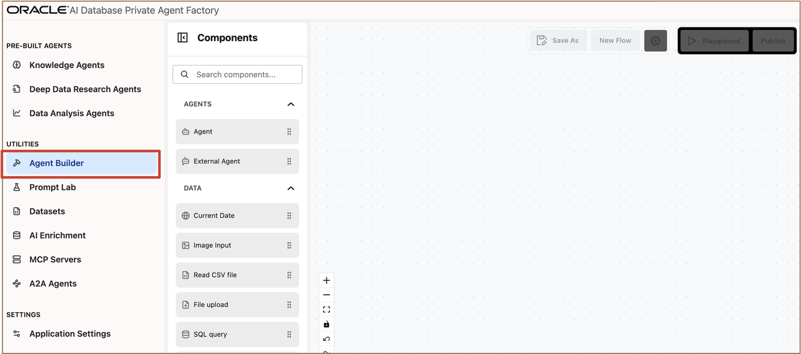

8. On the Agent Builder canvas, add the components required for the custom agent workflow.
   
    Add the **Agent** component 

    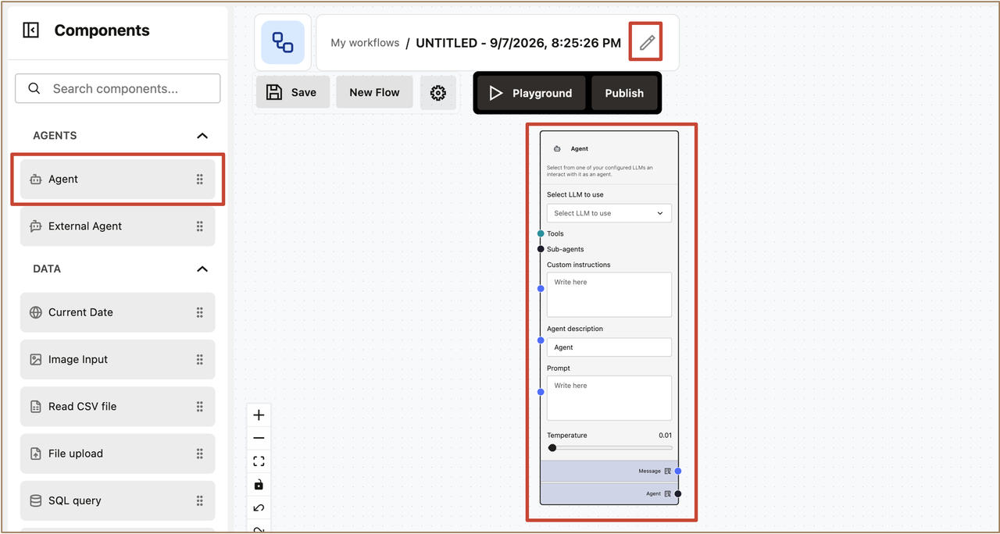

9. Enter a name for the flow.
    
    For example:

    ```text
    <copy>Database MCP Agent</copy>
    ```

    Enter a description.

    For example:

    ```text
    <copy>Custom AI agent that interacts with Oracle AI Database using MCP</copy>
    ```

    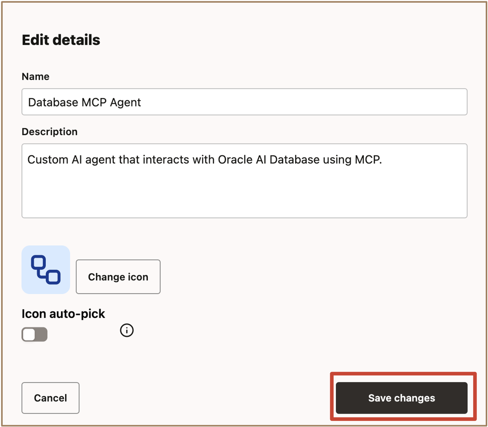

10. Click **Save changes** to create the flow.


### **Configure the Agent**

11. Select the **Agent** component on the canvas.

12. Under **Select LLM to use**, select the LLM provided for the workshop environment:

    select ***llm-model-entry (oci)***

13. In **Custom instructions**, enter the following:

    ```nohighlight
    <copy>You are an enterprise database assistant.

    Use the connected MCP tools whenever information must be retrieved from Oracle AI Database.

    Base database-related answers on information returned by the MCP tools. Do not invent database records, values, or query results.

    Provide clear and concise responses using short bullet points. When appropriate, include the tool or database information used to support the answer.</copy>
    ```

14. In **Agent description**, enter the name of the agent:

    ```nohighlight
    <copy>Exascale Data Assistant</copy>
    ```

15. Leave the **Prompt** field blank.

16. Leave **Temperature** at the workshop default of `0.01`.

17. Review the Agent configuration 

    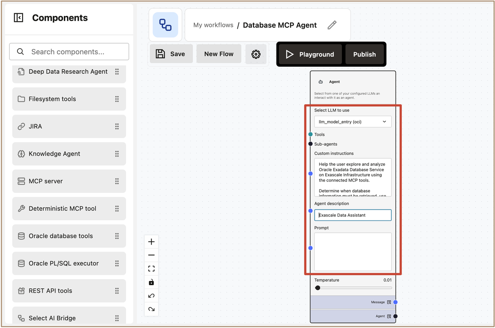


### **Add the MCP Tools**

18. Add an **MCP Server** component to the workflow. Select the MCP Server connection configured earlier.

    Review the tools available from the MCP Server.

    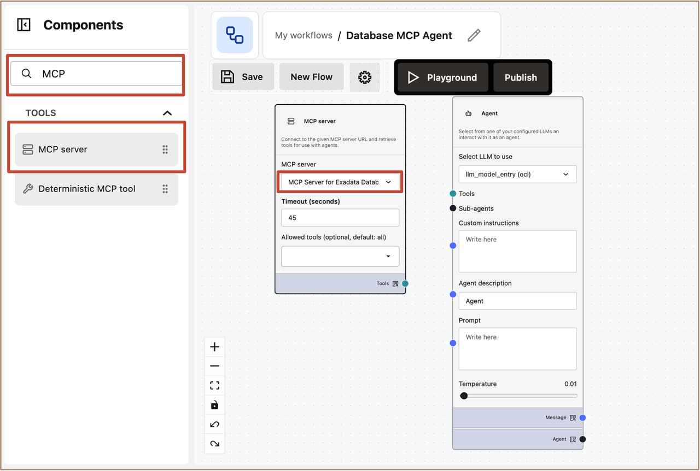

    Select only the tools required by this custom agent.

    > **Note:** Limiting an agent to the tools required for its intended task reduces unnecessary capabilities and helps maintain a governed agent workflow.

19. Connect the MCP Server component to the **Tools** input of the Agent component.
    
    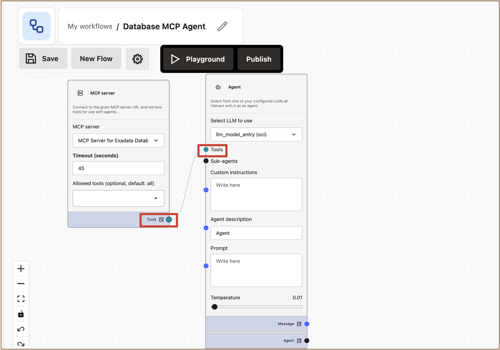

20. Verify that the remaining workflow components are connected correctly.
    
    Add the Chat Input and Chat Output components.

    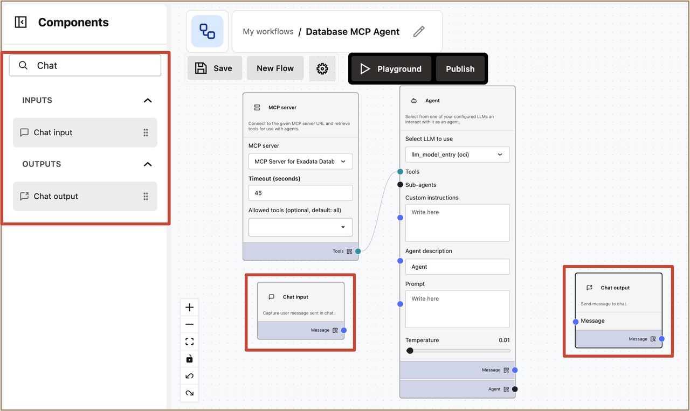

    Connect both components to the Agent 

    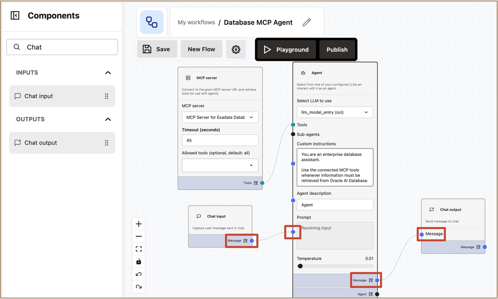


21. Click **Save** to save the custom agent flow.
    
    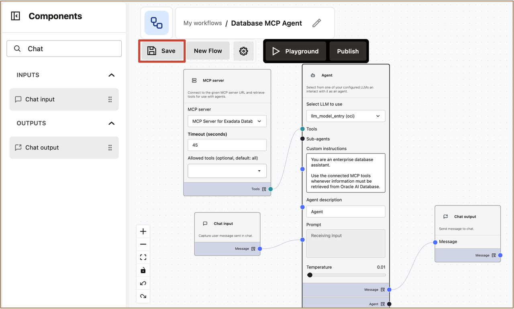

### **Test the MCP Connection in Playground**

22. Open the completed workflow in **Playground**.
    
    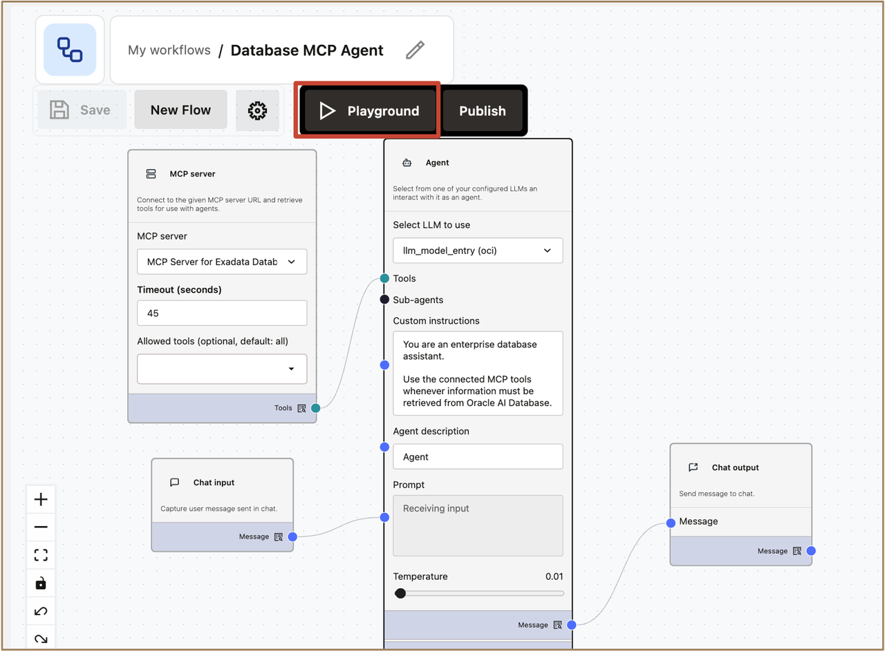

23. Enter a prompt that asks the agent about its available database capabilities.
   
    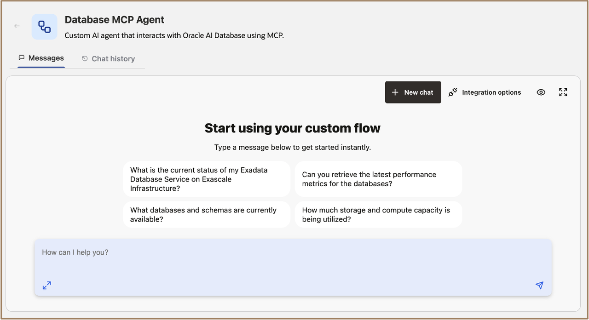

    For example:

    ```text
    <copy>What database tools do you have available?</copy>
    ```

    Submit the prompt.

    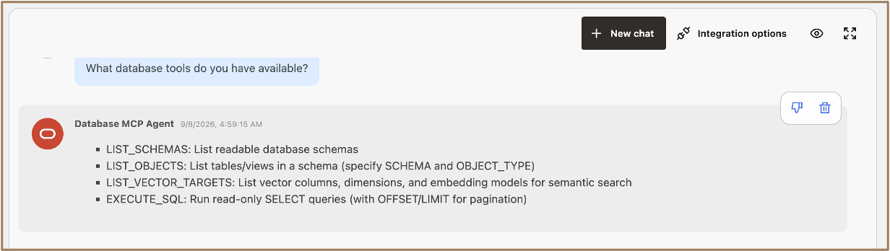

24. Verify that the agent recognizes the tools exposed through the MCP Server.

25. Enter a natural-language question that requires information from the Oracle AI Database.

    > **Note:** Use a question that corresponds to the sample database objects and data provided with the workshop. For this demonstration, we are using a sample retail sales dataset containing transaction, product, channel, regional, sales, margin, and return information.

    For example:

    **Establish the data scope**

    ```text
    <copy>Give me an executive summary of the retail sales data for the full available period. Include the date range, total net sales, total orders, total refunds, and sales by channel.</copy>
    ```

26. Submit the question.

27. Observe the agent execution.

28. Verify that the agent invokes an appropriate MCP tool rather than attempting to answer the database-specific question using only the language model.

29. Review the response returned by the agent.

    Ask more sample questions:

    **Analyze regional performance**

    ```text
    <copy>For the full available period, show total net sales by region. Include order count and each region’s percentage of total net sales. Sort from highest to lowest.</copy>
    ```

    **Analyze sales trends**

    ```text
    <copy>Show monthly net sales trends for the full available period. Include net sales, order count, and month-over-month change. Identify the highest and lowest sales months.</copy>
    ```

    **Compare sales channels**

    ```text
    <copy>Compare WEB, STORE, and MOBILE for the full available period using total net sales, order count, average order value, gross margin amount, and margin percentage. Sort by net sales.</copy>
    ```

    **Analyze product profitability**

    ```text
    <copy>Using gross margin amount, defined as net sales minus cost, which five products generated the highest total gross margin? Include product name, category, net sales, cost, gross margin, and margin percentage.</copy>
    ```

     **Ask a cross-analysis question**

    ```text
    <copy>Among the five highest-margin products, which channel and region generated the most net sales?</copy>
    ```

    **Identify improvement opportunities**

    ```text
    <copy>Which region has the highest return rate? Calculate return rate as returned transactions divided by total transactions, and include net sales and refund amount.</copy>
    ```


30. Verify that the answer is based on information returned from Oracle AI Database.


Congratulations! You have now created a custom AI agent that can interact with Oracle AI Database through the managed MCP Server.

This architecture enables AI applications to use enterprise database capabilities through a standardized MCP interface while database access remains governed independently from the agent.

## Acknowledgements

**Authors** 

* Leo Alvarado, Vishal Patil, Product Management, Oracle Database Cloud Services, Multicloud 

**Last Updated Date** - September, 2026

