# How Agents Plan the Work

## Introduction

In this lab, you will observe how an AI agent plans its work before taking action.

Planning is what separates agents from chatbots. Before executing anything, an agent breaks a task into steps, identifies which tools to use, and determines the order of operations. This makes agent behavior predictable and debuggable.

You will give an agent a multi-step task and watch how it decomposes the work.

### The Business Problem

At Seer Equity, preparing for a client call is tedious. A loan officer needs to pull together information from multiple places:

- **Contact info**: What email address is on file for this applicant?
- **Loan history**: What applications do they have pending?
- **Rate eligibility**: What tier are they in?
- **Credit information**: What credit tier applies?

> *"Before every client call, I spend 10-15 minutes just gathering the information I need. By the time I'm ready, I've forgotten why they called."*
>
> Jennifer, Loan Officer

The loan officers need an agent that can plan and execute a multi-step information retrieval: analyze what's needed, identify the right tools, determine the order, and synthesize the results.

### What You Will Learn

This lab shows you how agents plan multi-tool operations. You will see the agent decide which tools to call, in what order, and how to combine the results. This is the foundation for solving Seer Equity's "gathering" problem.

**What you will build:** A multi-tool agent that plans information retrieval for loan applicants.

Estimated Time: 10 minutes

### Objectives

* Understand how agents break tasks into steps
* Observe the planning process through history views
* See the relationship between instructions and execution
* Learn why planning makes agents predictable

### Prerequisites

For this workshop, we provide the environment. You will need:

* Basic knowledge of SQL and PL/SQL, or the ability to follow along with the prompts

## Task 1: Import the Lab Notebook

Before you begin, you are going to import a notebook that has all of the commands for this lab into Oracle Machine Learning. This way you don't have to copy and paste them over to run them.

1. If you have not already downloaded the lab notebooks in a previous lab, [click this download link](https://c4u04.objectstorage.us-ashburn-1.oci.customer-oci.com/p/EcTjWk2IuZPZeNnD_fYMcgUhdNDIDA6rt9gaFj_WZMiL7VvxPBNMY60837hu5hga/n/c4u04/b/livelabsfiles/o/labfiles/notebooks.zip) to get the notebooks zip file.

2. Unzip the downloaded `notebooks.zip` file on your computer.

3. From the Oracle Machine Learning home page, click **Notebooks**.

    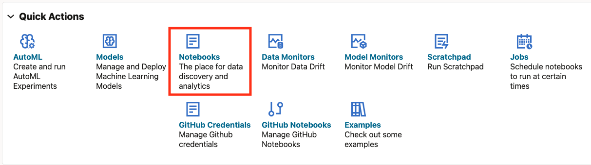

4. Click **Import** to expand the Import drop down.

    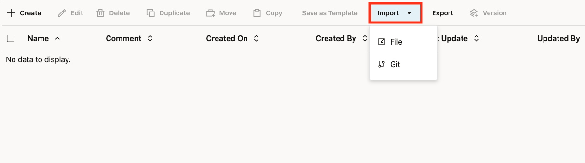

5. Select **From File**.

    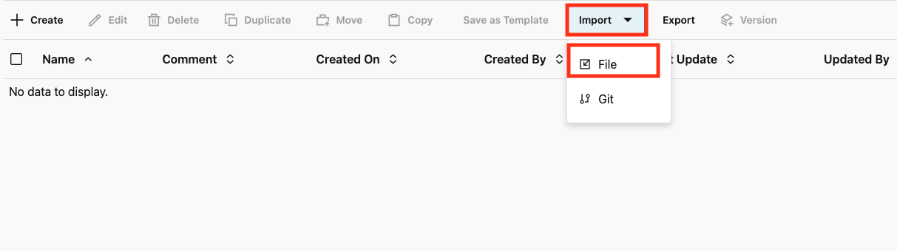

6. Select the `lab3-how-agents-plan.json` file from the unzipped notebook files.

    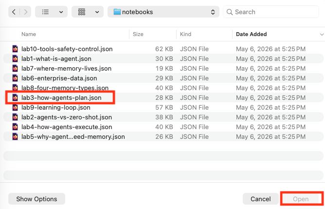

7. Click **Open**.

    

You should now be on the screen with the notebook imported. This workshop will have all of the screenshots and detailed information however the notebook will have the commands and basic instructions for completing the lab.

## Task 2: Create a Multi-Tool Agent

Run the SQL paragraphs in notebook order. Select a paragraph and use its **Run Paragraph** button, then wait for the result before continuing. The notebook-wide **Run Paragraphs** button also runs cleanup, so use the individual paragraph controls while following the lab. Agent responses can take several minutes. Run cleanup after you have reviewed the results.

To see planning in action, we need an agent with multiple tools. When an agent has several tools available, it has to figure out which ones to use and in what order. This decision-making process is what we call "planning."

1. Create sample data tables.

    First, we need some data for the agent to work with. We'll create `demo_applicants` for applicant names, credit tiers, and email addresses, and `demo_applications` for their loan application history. Use `APPL-001` for Acme Industries in the following examples.

    > This command is already in your notebook—just click the play button (▶) to run it.

    ```sql
    <copy>
    -- Applicant table
    CREATE TABLE demo_applicants (
        applicant_id    VARCHAR2(20) PRIMARY KEY,
        name            VARCHAR2(100),
        credit_tier     VARCHAR2(20),
        contact_email   VARCHAR2(100)
    );

    INSERT INTO demo_applicants VALUES ('APPL-001', 'Acme Industries', 'PREFERRED', 'loans@acme.com');
    INSERT INTO demo_applicants VALUES ('APPL-002', 'TechStart LLC', 'STANDARD', 'finance@techstart.com');

    -- Application table
    CREATE TABLE demo_applications (
        application_id  VARCHAR2(20) PRIMARY KEY,
        applicant_id    VARCHAR2(20),
        loan_status     VARCHAR2(20),
        loan_amount     NUMBER(12,2),
        application_date DATE
    );

    INSERT INTO demo_applications VALUES ('LOAN-100', 'APPL-001', 'APPROVED', 150000, SYSDATE - 2);
    INSERT INTO demo_applications VALUES ('LOAN-101', 'APPL-001', 'PENDING', 75000, SYSDATE);
    INSERT INTO demo_applications VALUES ('LOAN-102', 'APPL-002', 'APPROVED', 50000, SYSDATE - 5);

    COMMIT;
    </copy>
    ```

    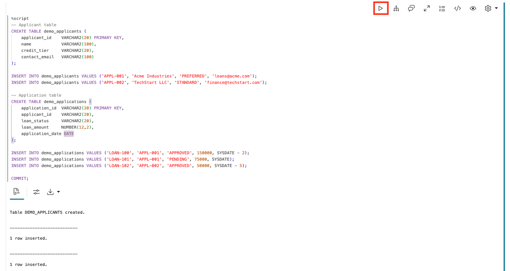

2. Create tool functions.

    Now we create three different functions, each doing one specific job. This separation is important—instead of one big function that does everything, we give the agent three focused tools. The agent will then decide which ones it needs based on what you ask.

    > This command is already in your notebook—just click the play button (▶) to run it.

    ```sql
    <copy>
    -- Tool 1: Look up applicant
    CREATE OR REPLACE FUNCTION get_applicant(p_applicant_id VARCHAR2) RETURN VARCHAR2 AS
        v_result VARCHAR2(500);
    BEGIN
        SELECT 'Applicant: ' || name || ', Credit Tier: ' || credit_tier || ', Email: ' || contact_email
        INTO v_result FROM demo_applicants WHERE applicant_id = p_applicant_id;
        RETURN v_result;
    EXCEPTION WHEN NO_DATA_FOUND THEN RETURN 'Applicant not found: ' || p_applicant_id;
    END;
    /

    -- Tool 2: Get applicant loans
    CREATE OR REPLACE FUNCTION get_applicant_loans(p_applicant_id VARCHAR2) RETURN VARCHAR2 AS
        v_result CLOB := '';
        v_count NUMBER := 0;
    BEGIN
        FOR rec IN (SELECT application_id, loan_status, loan_amount, application_date
                    FROM demo_applications WHERE applicant_id = p_applicant_id ORDER BY application_date DESC) LOOP
            v_result := v_result || rec.application_id || ': ' || rec.loan_status || ', $' || TO_CHAR(rec.loan_amount, '999,999') || CHR(10);
            v_count := v_count + 1;
        END LOOP;
        IF v_count = 0 THEN RETURN 'No loan applications found for applicant.'; END IF;
        RETURN 'Found ' || v_count || ' loan applications:' || CHR(10) || v_result;
    END;
    /

    -- Tool 3: Check if applicant is eligible for premium rates
    CREATE OR REPLACE FUNCTION check_premium_eligibility(p_applicant_id VARCHAR2) RETURN VARCHAR2 AS
        v_tier VARCHAR2(20);
    BEGIN
        SELECT credit_tier INTO v_tier FROM demo_applicants WHERE applicant_id = p_applicant_id;
        IF v_tier = 'PREFERRED' THEN
            RETURN 'ELIGIBLE: Applicant has Preferred credit tier - qualifies for premium rates (7.9% APR).';
        ELSE
            RETURN 'NOT ELIGIBLE: Applicant has ' || v_tier || ' credit tier - standard rates apply (12.9% APR).';
        END IF;
    EXCEPTION WHEN NO_DATA_FOUND THEN RETURN 'Applicant not found.';
    END;
    /
    </copy>
    ```

    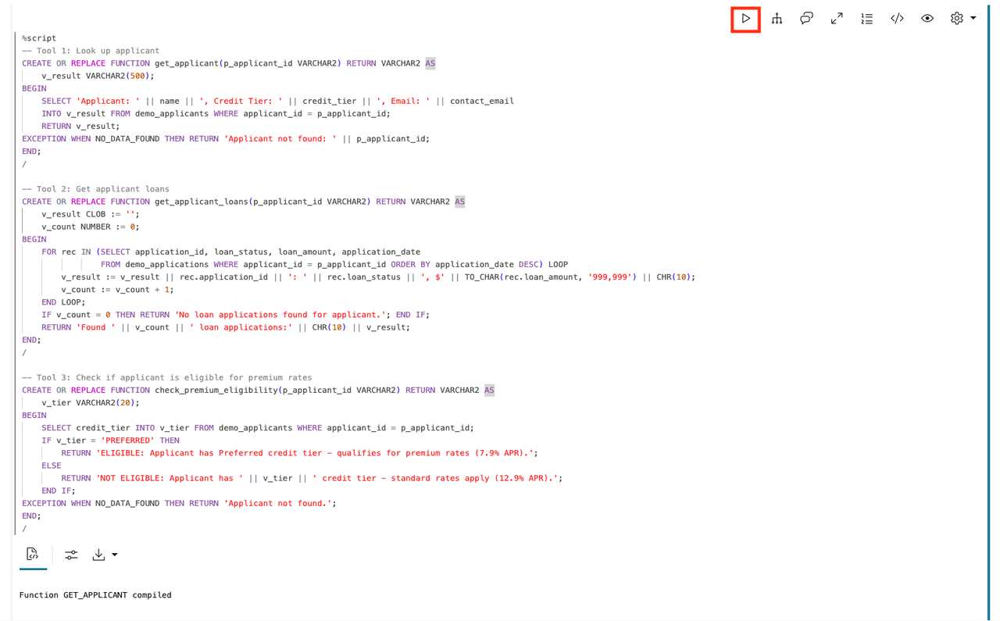

3. Register the tools.

    Each function becomes a tool that the agent can use. The `instruction` for each tool explains what it does and when to use it. Think of these instructions as training the agent on its toolkit—the better the instructions, the smarter the agent's choices.

    > This command is already in your notebook—just click the play button (▶) to run it.

    ```sql
    <copy>
    BEGIN
        DBMS_CLOUD_AI_AGENT.CREATE_TOOL(
            tool_name   => 'GET_APPLICANT_TOOL',
            attributes  => '{"instruction": "Get loan applicant details by ID. Parameter: P_APPLICANT_ID (e.g. APPL-001). Returns name, credit tier, and email.",
                            "function": "get_applicant"}',
            description => 'Retrieves applicant name, credit tier, and contact email'
        );
    END;
    /

    BEGIN
        DBMS_CLOUD_AI_AGENT.CREATE_TOOL(
            tool_name   => 'GET_LOANS_TOOL',
            attributes  => '{"instruction": "Get all loan applications for an applicant. Parameter: P_APPLICANT_ID (e.g. APPL-001). Returns application IDs, statuses, and amounts.",
                            "function": "get_applicant_loans"}',
            description => 'Retrieves applicant loan application history with status and amounts'
        );
    END;
    /

    BEGIN
        DBMS_CLOUD_AI_AGENT.CREATE_TOOL(
            tool_name   => 'CHECK_PREMIUM_TOOL',
            attributes  => '{"instruction": "Check if applicant qualifies for premium loan rates. Parameter: P_APPLICANT_ID (e.g. APPL-001). Returns ELIGIBLE or NOT ELIGIBLE with rate information.",
                            "function": "check_premium_eligibility"}',
            description => 'Checks if applicant credit tier qualifies for premium rates'
        );
    END;
    /
    </copy>
    ```

    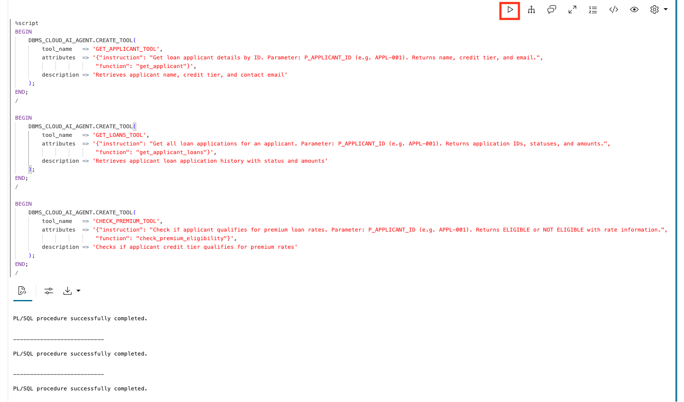

4. Create the agent and team.

    Now we create the agent with access to all three tools. When you ask a question, the agent will look at its available tools and plan which ones to use. A simple question might need just one tool; a complex question might need all three.

    > This command is already in your notebook—just click the play button (▶) to run it.

    ```sql
    <copy>
    BEGIN
        DBMS_CLOUD_AI_AGENT.CREATE_AGENT(
            agent_name  => 'PLANNING_AGENT',
            attributes  => '{"profile_name": "genai",
                            "role": "You are a loan officer assistant for Seer Equity. Use your tools to look up applicant information, loan history, and rate eligibility. Always use the tools - never guess or make up information."}',
            description => 'Agent that plans multi-step responses'
        );
    END;
    /

    BEGIN
        DBMS_CLOUD_AI_AGENT.CREATE_TASK(
            task_name   => 'PLANNING_TASK',
            attributes  => '{"instruction": "Answer loan applicant inquiries by using the available tools. Do not ask clarifying questions - use the tools to look up the information and report what you find. User request: {query}",
                            "tools": ["GET_APPLICANT_TOOL", "GET_LOANS_TOOL", "CHECK_PREMIUM_TOOL"]}',
            description => 'Task with multiple tools for planning demonstration'
        );
    END;
    /

    BEGIN
        DBMS_CLOUD_AI_AGENT.CREATE_TEAM(
            team_name   => 'PLANNING_TEAM',
            attributes  => '{"agents": [{"name": "PLANNING_AGENT", "task": "PLANNING_TASK"}],
                            "process": "sequential"}',
            description => 'Team demonstrating agent planning'
        );
    END;
    /
    </copy>
    ```

    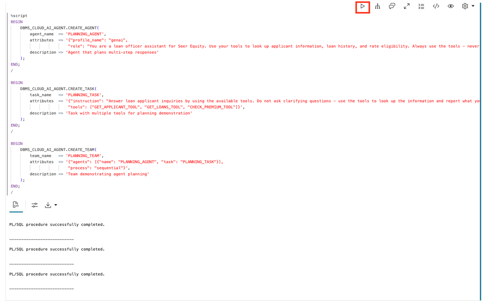

## Task 3: Observe Single-Tool Planning

Let's start with a simple request that needs only one tool.

1. Set the team and ask a simple question.

    > This command is already in your notebook—just click the play button (▶) to run it.

    ```sql
    <copy>
    EXEC DBMS_CLOUD_AI_AGENT.SET_TEAM('PLANNING_TEAM');
    SELECT AI AGENT Who is applicant APPL-001;
    </copy>
    ```

    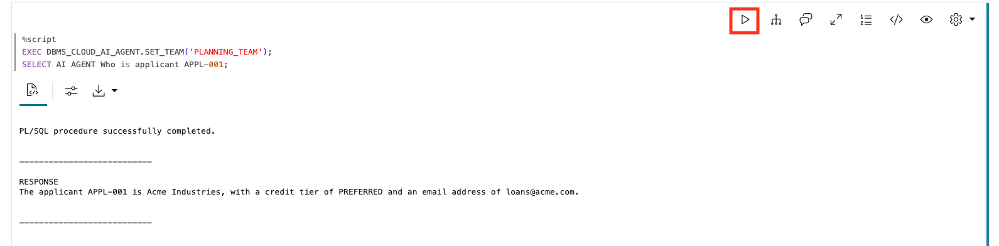

2. Check the tool history to see the executed calls.

    The rows are displayed newest first. Use the timestamps to identify the calls for this request; read them from the earliest timestamp to the latest when checking their execution order.

    > This command is already in your notebook—just click the play button (▶) to run it.

    ```sql
    <copy>
    SELECT
        tool_name,
        TO_CHAR(start_date, 'HH24:MI:SS.FF3') as called_at,
        SUBSTR(output, 1, 60) as result
    FROM USER_AI_AGENT_TOOL_HISTORY
    ORDER BY start_date DESC
    FETCH FIRST 5 ROWS ONLY;
    </copy>
    ```

    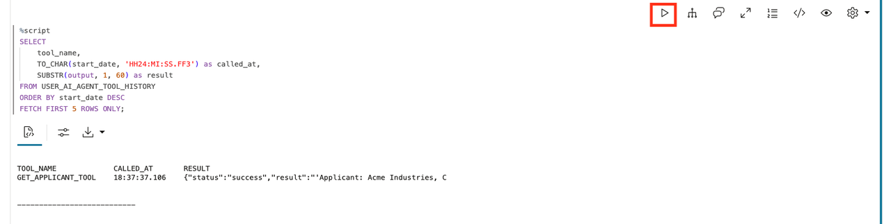

**Observe:** The agent planned to use just `GET_APPLICANT_TOOL` because that's all the question required.

## Task 4: Observe Multi-Tool Planning

Now let's ask a question that requires multiple tools, just like a loan officer preparing for a client call.

1. Ask a complex question.

    > This command is already in your notebook—just click the play button (▶) to run it.

    ```sql
    <copy>
    SELECT AI AGENT Give me a complete picture of applicant APPL-001 including their loan history and rate eligibility;
    </copy>
    ```

    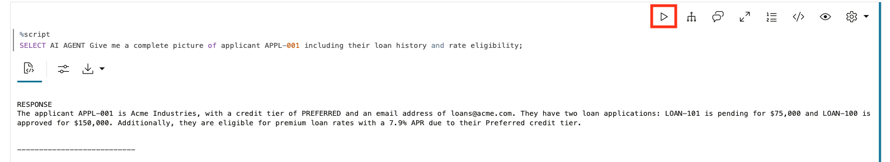

2. Check the tool history.

    > This command is already in your notebook—just click the play button (▶) to run it.

    ```sql
    <copy>
    SELECT
        tool_name,
        TO_CHAR(start_date, 'HH24:MI:SS.FF3') as called_at,
        SUBSTR(output, 1, 60) as result
    FROM USER_AI_AGENT_TOOL_HISTORY
    ORDER BY start_date DESC
    FETCH FIRST 10 ROWS ONLY;
    </copy>
    ```

    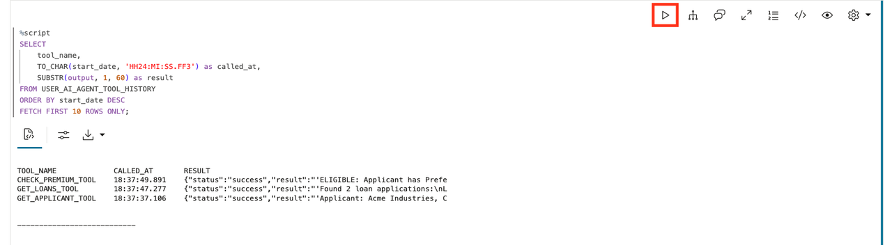

    **Observe:** The agent planned to use multiple tools:
    - `GET_APPLICANT_TOOL` to get basic info
    - `GET_LOANS_TOOL` to get loan history
    - `CHECK_PREMIUM_TOOL` to verify rate eligibility

3. Use the timestamps to reconstruct the execution sequence. The history shows the tool calls that completed; it does not display a separate plan before execution.

## Task 5: See How Instructions Shape Planning

The task instruction guides how the agent plans. Let's modify it.

1. Create a more specific task.

    > This command is already in your notebook—just click the play button (▶) to run it.

    ```sql
    <copy>
    BEGIN
        DBMS_CLOUD_AI_AGENT.CREATE_TASK(
            task_name   => 'STRUCTURED_TASK',
            attributes  => '{"instruction": "For applicant inquiries, ALWAYS follow this exact sequence: 1. First, look up the applicant using GET_APPLICANT_TOOL 2. Then, get their loan history using GET_LOANS_TOOL 3. Finally, check premium rate eligibility using CHECK_PREMIUM_TOOL. Report all findings. User request: {query}",
                            "tools": ["GET_APPLICANT_TOOL", "GET_LOANS_TOOL", "CHECK_PREMIUM_TOOL"]}',
            description => 'Task with explicit planning instructions'
        );
    END;
    /

    -- Update the team to use the new task
    BEGIN
        DBMS_CLOUD_AI_AGENT.DROP_TEAM('PLANNING_TEAM', TRUE);
        DBMS_CLOUD_AI_AGENT.CREATE_TEAM(
            team_name   => 'PLANNING_TEAM',
            attributes  => '{"agents": [{"name": "PLANNING_AGENT", "task": "STRUCTURED_TASK"}],
                            "process": "sequential"}',
            description => 'Team with structured planning'
        );
    END;
    /
    </copy>
    ```

    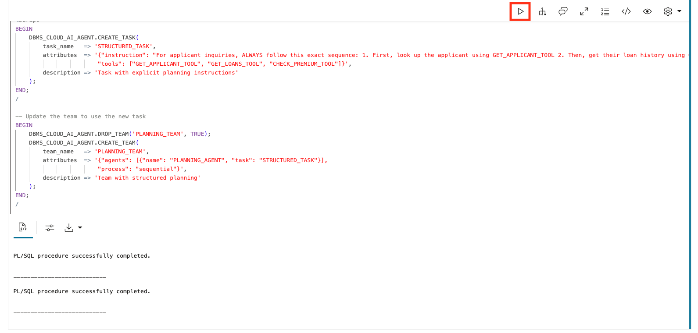

2. Test with the structured instructions.

    > This command is already in your notebook—just click the play button (▶) to run it.

    ```sql
    <copy>
    EXEC DBMS_CLOUD_AI_AGENT.SET_TEAM('PLANNING_TEAM');
    SELECT AI AGENT Tell me about applicant APPL-001;
    </copy>
    ```

    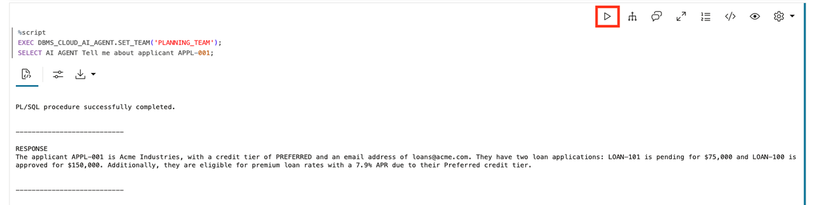

3. Check the tool history again.

    > This command is already in your notebook—just click the play button (▶) to run it.

    ```sql
    <copy>
    SELECT
        tool_name,
        TO_CHAR(start_date, 'HH24:MI:SS.FF3') as called_at
    FROM USER_AI_AGENT_TOOL_HISTORY
    ORDER BY start_date DESC
    FETCH FIRST 5 ROWS ONLY;
    </copy>
    ```

    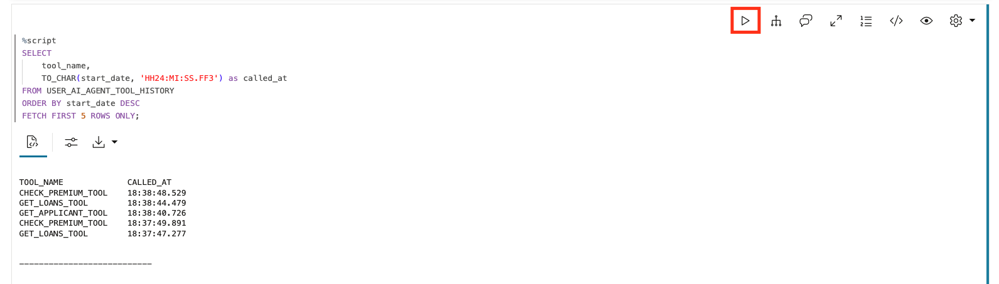

**Observe:** Check that the calls for this request followed the instructed sequence: applicant first, then loan applications, then premium rate eligibility. The history is displayed newest first, so use timestamps to read the execution order. Response time can vary.

## Task 6: Understand Why Planning Matters

Planning provides:

1. **Predictability**: You can anticipate what the agent will do
2. **Debuggability**: When something goes wrong, you can see where
3. **Efficiency**: The agent gathers what it needs without redundant calls
4. **Control**: You shape the plan through instructions

Query the complete execution sequence:

> This command is already in your notebook—just click the play button (▶) to run it.

```sql
<copy>
SELECT
    tool_name,
    TO_CHAR(start_date, 'HH24:MI:SS') as started,
    TO_CHAR(end_date, 'HH24:MI:SS') as ended
FROM USER_AI_AGENT_TOOL_HISTORY
ORDER BY start_date DESC
FETCH FIRST 10 ROWS ONLY;
</copy>
```

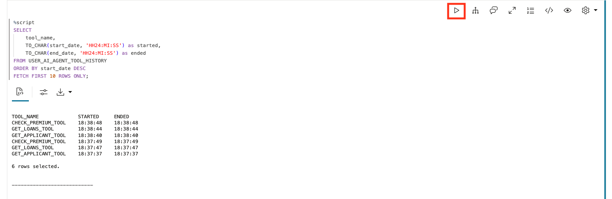

## Summary

In this lab, you observed how agents plan their work:

* Created an agent with multiple tools
* Watched the agent choose tools based on the question
* Saw how multi-step questions trigger multi-tool plans
* Learned how instructions shape the planning process

**Key takeaway:** Planning is what makes agents predictable. Before any action happens, the agent knows the path. You can see that path in the history views. For Seer Equity, this means loan officers get complete client summaries in seconds, not minutes.

## Learn More

* [`DBMS_CLOUD_AI_AGENT` Package](https://docs.oracle.com/en/cloud/paas/autonomous-database/serverless/adbsb/dbms-cloud-ai-agent-package.html)

## Acknowledgements

* **Author** - David Start, Director, Database Product Management
* **Last Updated By/Date** - David Start, February 2026

## Cleanup

> This command is already in your notebook—just click the play button (▶) to run it.

```sql
<copy>
EXEC DBMS_CLOUD_AI_AGENT.DROP_TEAM('PLANNING_TEAM', TRUE);
EXEC DBMS_CLOUD_AI_AGENT.DROP_TASK('PLANNING_TASK', TRUE);
EXEC DBMS_CLOUD_AI_AGENT.DROP_TASK('STRUCTURED_TASK', TRUE);
EXEC DBMS_CLOUD_AI_AGENT.DROP_AGENT('PLANNING_AGENT', TRUE);
EXEC DBMS_CLOUD_AI_AGENT.DROP_TOOL('GET_APPLICANT_TOOL', TRUE);
EXEC DBMS_CLOUD_AI_AGENT.DROP_TOOL('GET_LOANS_TOOL', TRUE);
EXEC DBMS_CLOUD_AI_AGENT.DROP_TOOL('CHECK_PREMIUM_TOOL', TRUE);
DROP TABLE demo_applications PURGE;
DROP TABLE demo_applicants PURGE;
DROP FUNCTION get_applicant;
DROP FUNCTION get_applicant_loans;
DROP FUNCTION check_premium_eligibility;
</copy>
```

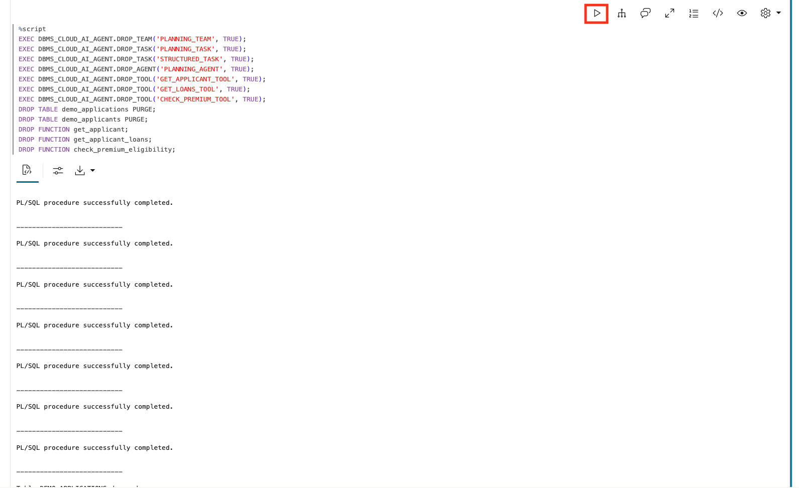
