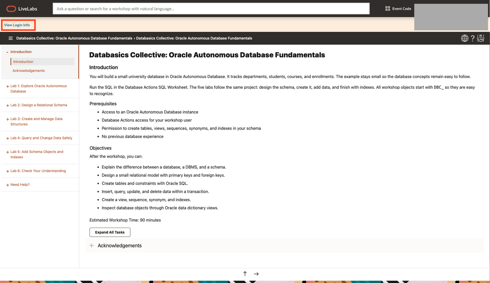
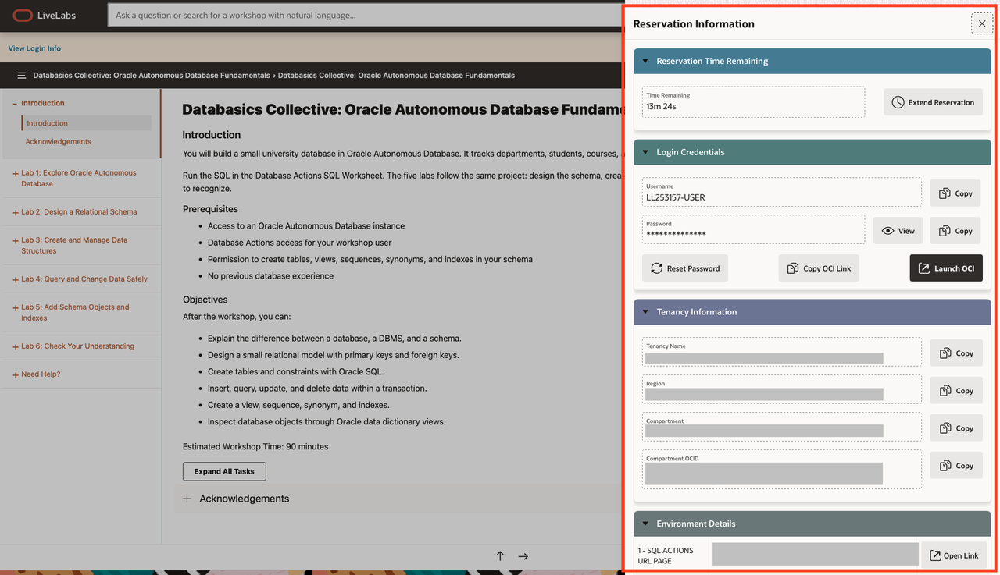
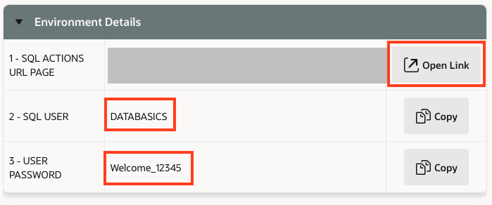
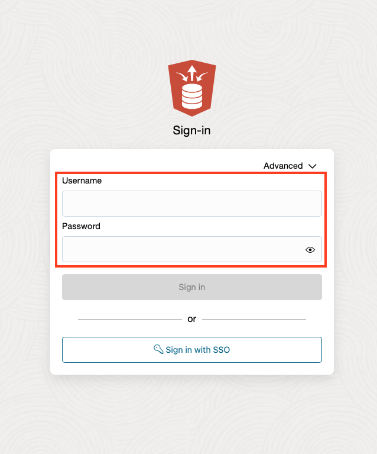
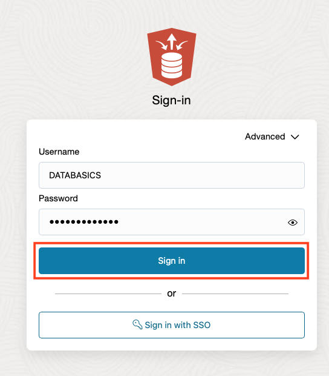
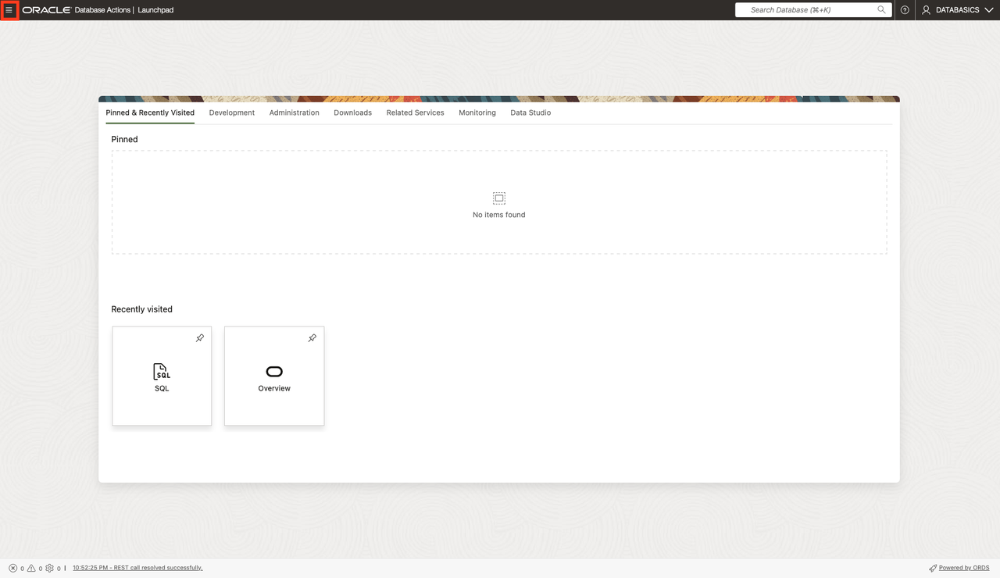
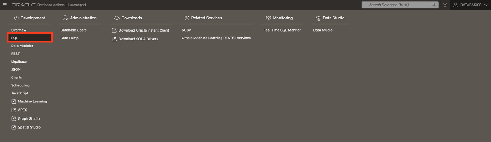
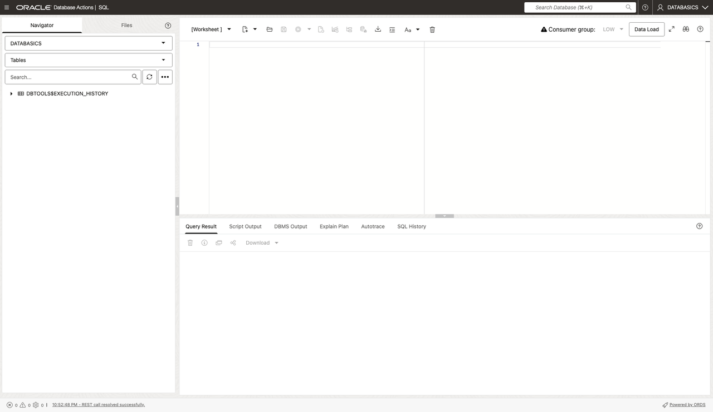

# Getting Started

## Introduction

Your reservation includes an Autonomous Database and a preloaded workshop dataset. In this lab, open the reservation details, sign in to Database Actions, and open the SQL Worksheet.

### Objectives

You will:

- Find the reservation login information.
- Sign in to Database Actions with the workshop account.
- Open the SQL Worksheet for the next labs.

Estimated Time: 5 minutes

## Task 1: Find your reservation login details

1. On the LiveLabs workshop page, select **View Login Info**.

    

2. In the Reservation Information panel, find the SQL Actions URL, SQL User, and User Password under Environment Details. Use the **Copy** buttons to copy the login values.

    

3. Select **Open Link** next to the SQL Actions URL. Keep the reservation details available so you can paste the credentials on the sign-in page.

    

## Task 2: Sign in to Database Actions

1. On the sign-in page, paste the SQL User and User Password from the reservation details. The SQL User for this workshop is `DATABASICS`.

    

2. Select **Sign in**. After the page loads, confirm that `DATABASICS` appears as the signed-in user.

    

## Task 3: Open the SQL Worksheet

1. After sign-in, Database Actions opens the Launchpad. Open the navigation menu.

    

2. Under **Development**, select **SQL**.

    

3. The SQL Worksheet is ready. Later labs use it to explore the preloaded data and database objects.

    

## Acknowledgements

* **Author** - Ilan Gómez Guerrero
* **Last Updated By/Date** - Ilan Gómez Guerrero, November 2026
