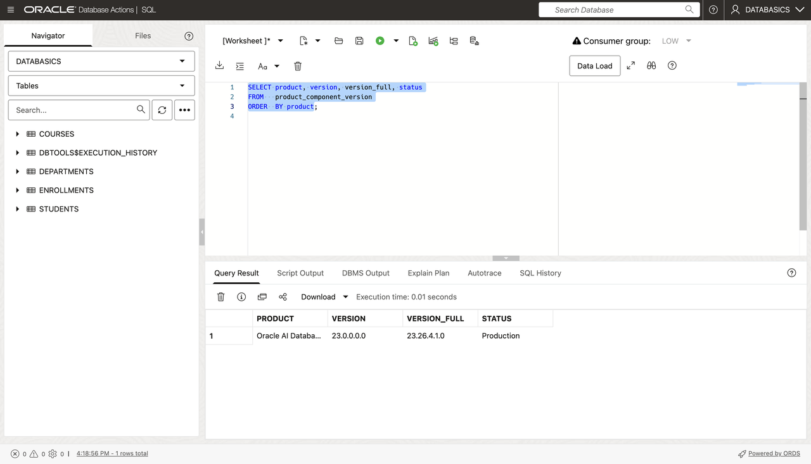
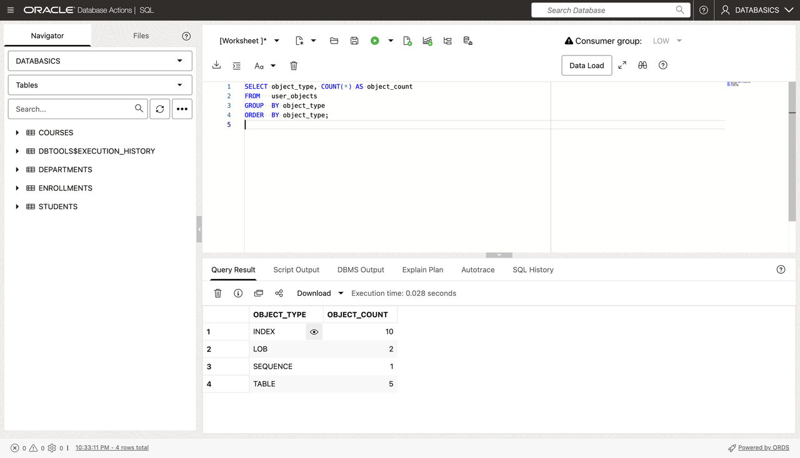
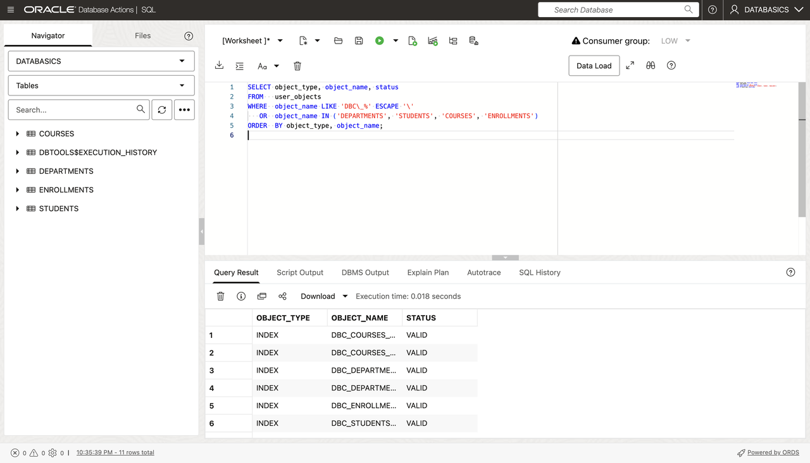

# Lab 1: Explore Oracle Autonomous Database

## Introduction

Your reservation already has the university tables and sample rows. Start by checking your connection and finding them in your schema. Autonomous Database is the managed cloud service that runs the database; Oracle handles routine work such as patching, backups, and tuning. You still manage the tables and SQL in your schema.

### Objectives

You will:

- Identify your current user, schema, service, and container.
- Distinguish the database from the objects in your schema.
- Use data dictionary views to inspect your environment.
- Confirm that the four core tables are ready.

Estimated Time: 10 minutes

## Task 1: Identify your database session

1. Sign in to Database Actions with your workshop user and open the SQL Worksheet. A **session** is your active connection to the database while you work. The worksheet runs your statements through this session.

2. Run this query to read details about the session you are currently using. `SYS_CONTEXT` returns information about that session; `DUAL` is Oracle's built-in one-row table, so the query can return these values without reading a workshop table.

    ```sql
    <copy>
    SELECT SYS_CONTEXT('USERENV', 'CURRENT_USER') AS current_user,
           SYS_CONTEXT('USERENV', 'CURRENT_SCHEMA') AS current_schema,
           SYS_CONTEXT('USERENV', 'SERVICE_NAME') AS service_name,
           SYS_CONTEXT('USERENV', 'CON_NAME') AS container_name
    FROM   dual;
    </copy>
    ```

3. Read the result. It should show `DATABASICS` for both the current user and schema. A **user** is the account that signs in; its **schema** is the set of database objects that account owns. `CURRENT_SCHEMA` is the default schema Oracle checks when a query uses a table name without an owner; here it matches the user. `SERVICE_NAME` identifies the database service (connection route) your worksheet used. The `CONTAINER_NAME` result comes from `CON_NAME` and identifies the database container holding your schema. Oracle can host several pluggable databases (PDBs) inside a container database (CDB); for this workshop, you only need to know your schema is inside the PDB shown here.

    

## Task 2: Inspect the database version

1. Run the following query.

    ```sql
    <copy>
    SELECT product, version, version_full, status
    FROM   product_component_version
    ORDER  BY product;
    </copy>
    ```

2. Find the Oracle AI Database row and read `VERSION_FULL`. A **database version** identifies the release of the database software. This view lists version information for the database and its components. It avoids filtering on a product name that can vary by release.

    

## Task 3: Inspect your schema

1. List the tables that your user owns. A **table** stores data in rows and columns. `USER_TABLES` is a data dictionary view: a built-in catalog that describes objects owned by your user. The `USER_` prefix means the results are limited to your schema.

    ```sql
    <copy>
    SELECT table_name
    FROM   user_tables
    WHERE  table_name IN ('DEPARTMENTS', 'STUDENTS', 'COURSES', 'ENROLLMENTS')
    ORDER  BY table_name;
    </copy>
    ```

    The result should list the four ready workshop tables. You can also find them in the Database Actions table navigator.

    

    The navigator shows the tables available in the DATABASICS schema and lets you expand a table to inspect its columns.

    

2. Count your objects by type. A **schema object** is something created in a schema, such as a table, index, view, or sequence. This checks the schema's structure, not the number of rows stored in the tables. `USER_OBJECTS` is another data dictionary view.

    ```sql
    <copy>
    SELECT object_type, COUNT(*) AS object_count
    FROM   user_objects
    GROUP  BY object_type
    ORDER  BY object_type;
    </copy>
    ```

    The result groups the objects owned by your user, such as tables, indexes, and any Database Actions support objects.

    

3. Look at the indexes that support the ready tables. An **index** is a separate structure Oracle can use to find table rows more quickly. `USER_INDEXES` lists indexes in your schema.

    ```sql
    <copy>
    SELECT table_name, index_name, uniqueness
    FROM   user_indexes
    WHERE  table_name IN ('DEPARTMENTS', 'STUDENTS', 'COURSES', 'ENROLLMENTS')
    ORDER  BY table_name, index_name;
    </copy>
    ```

    The result should show indexes used by the primary key and unique constraints. Oracle creates or reuses these indexes to enforce those rules. This query only reads the data dictionary; it does not change your schema. Lab 5 adds separate indexes on foreign key columns so you can compare the list before and after. Database Actions may also create a `DBTOOLS$EXECUTION_HISTORY` table for its own use. If a core table is missing, the reservation setup has not finished.

    

## Task 4: Connect the concepts

1. Review how the main layers fit together. The database stores and serves the data; an **instance** is the running memory and processes that access it. A CDB can contain one or more PDBs, and your schema lives inside a PDB.

    | Layer | Meaning |
    | --- | --- |
    | Database | Organized data and supporting files |
    | Instance | The running memory and processes that access the database |
    | CDB and PDB | A container database (CDB) can host pluggable databases (PDBs); your schema is inside a PDB |
    | Schema | Database objects owned by a user |
    | Autonomous Database | Oracle manages much of the cloud service; you manage your schema and SQL |

2. Oracle Database can run on a company's own computers (**on-premises**) or as a cloud service. This workshop uses Oracle's managed Autonomous Database cloud service so you can stay focused on SQL.

3. Oracle also supports other ways to work with information, including JSON documents, location data (spatial), connected data (graph), and vector data used in similarity searches. This workshop starts with relational tables: rows and columns connected by shared IDs.

4. Move on when you can identify your schema, explain `USER_TABLES`, and describe what Autonomous Database manages.

## Acknowledgements

* **Author** - Ilan Gómez Guerrero
* **Last Updated By/Date** - Ilan Gómez Guerrero, November 2026
