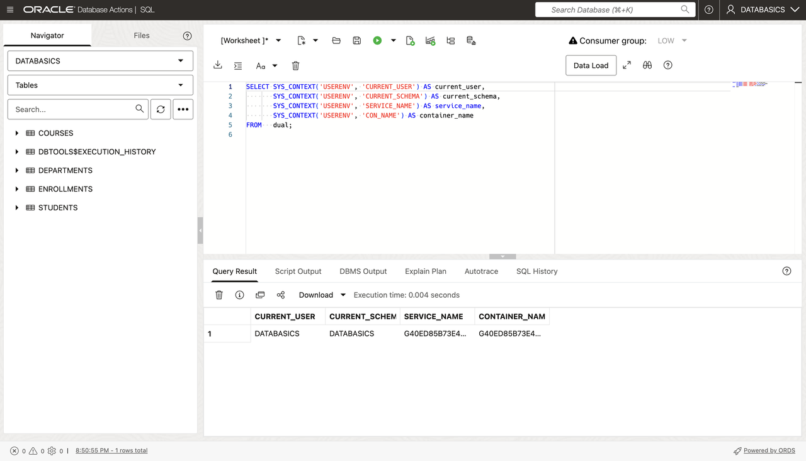
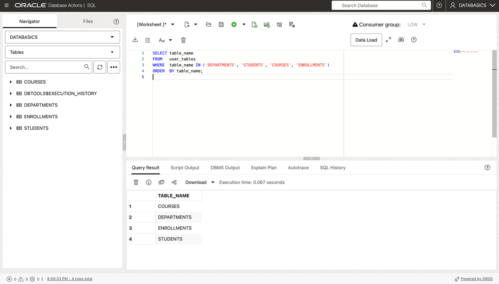
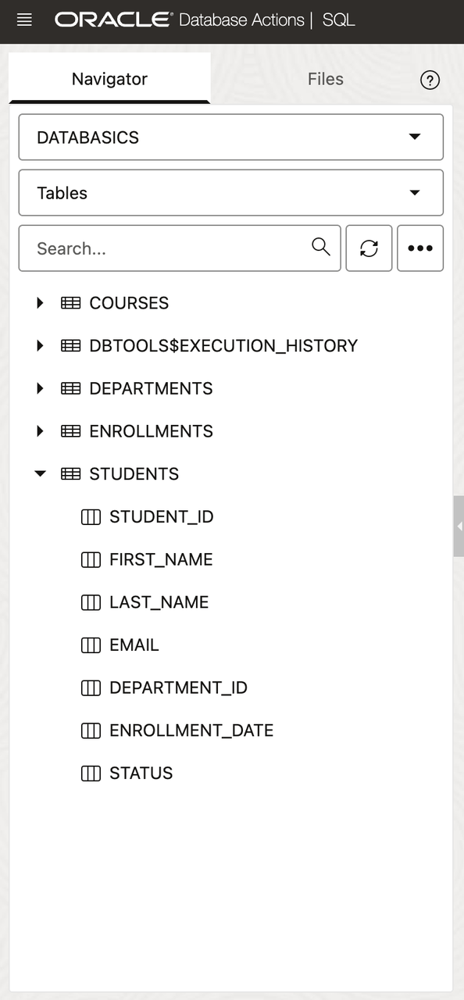

# Lab 1: Explore Oracle Autonomous Database

## Introduction

Your reservation already has the university tables and sample rows. Start by checking your connection and finding them in your schema. Autonomous Database handles patching, backups, and routine tuning.

### Objectives

You will:

- Identify your current user, schema, service, and container.
- Distinguish the database from the objects in your schema.
- Use data dictionary views to inspect your environment.
- Confirm that the four core tables are ready.

Estimated Time: 10 minutes

## Task 1: Identify your database session

1. Sign in to Database Actions with your workshop user and open the SQL Worksheet.

2. Run this query.

    ```sql
    <copy>
    SELECT SYS_CONTEXT('USERENV', 'CURRENT_USER') AS current_user,
           SYS_CONTEXT('USERENV', 'CURRENT_SCHEMA') AS current_schema,
           SYS_CONTEXT('USERENV', 'SERVICE_NAME') AS service_name,
           SYS_CONTEXT('USERENV', 'CON_NAME') AS container_name
    FROM   dual;
    </copy>
    ```

3. Read the result. It should show `DATABASICS` for both the current user and schema. `SERVICE_NAME` shows the service used by the worksheet, and `CONTAINER_NAME` shows the pluggable database that contains your schema.

    The result should show your current session details, with `DATABASICS` as both the user and schema.

    

## Task 2: Inspect the database version

1. Run the following query.

    ```sql
    <copy>
    SELECT product, version, version_full, status
    FROM   product_component_version
    ORDER  BY product;
    </copy>
    ```

2. Find the Oracle AI Database row and read `VERSION_FULL`. This view lists version information for the database and its components. It avoids filtering on a product name that can vary by release.

## Task 3: Inspect your schema

1. List the tables that your user owns.

    ```sql
    <copy>
    SELECT table_name
    FROM   user_tables
    WHERE  table_name IN ('DEPARTMENTS', 'STUDENTS', 'COURSES', 'ENROLLMENTS')
    ORDER  BY table_name;
    </copy>
    ```

    The result should list the four ready workshop tables. You can also find them in the Database Actions table navigator.

    

    The navigator shows the tables available in the DATABASICS schema and lets you expand a table to inspect its columns.

    

2. Count your objects by type.

    ```sql
    <copy>
    SELECT object_type, COUNT(*) AS object_count
    FROM   user_objects
    GROUP  BY object_type
    ORDER  BY object_type;
    </copy>
    ```

    The result groups the objects owned by your user, such as tables, indexes, and any Database Actions support objects.

    

3. Look at the indexes that support the ready tables.

    ```sql
    <copy>
    SELECT table_name, index_name, uniqueness
    FROM   user_indexes
    WHERE  table_name IN ('DEPARTMENTS', 'STUDENTS', 'COURSES', 'ENROLLMENTS')
    ORDER  BY table_name, index_name;
    </copy>
    ```

    The result should show indexes used by the primary key and unique constraints. Oracle creates or reuses these indexes to enforce those rules. This query only reads the data dictionary; it does not change your schema. Lab 5 adds separate indexes on foreign key columns so you can compare the list before and after. Database Actions may also create a `DBTOOLS$EXECUTION_HISTORY` table for its own use. If a core table is missing, the reservation setup has not finished.

    

## Task 4: Connect the concepts

1. Review how the main layers fit together.

    | Layer | Meaning |
    | --- | --- |
    | Database | Managed data and recovery information |
    | Instance | Memory and processes that access the database |
    | CDB and PDB | A CDB hosts PDBs; your schema is inside a PDB |
    | Schema | Objects owned by one user |
    | Autonomous Database | Oracle manages the service; you manage schemas and SQL |

2. Oracle Database can run on-premises, on Exadata, through Cloud@Customer, or in the cloud. We use Autonomous Database here so you can stay focused on SQL.

3. Oracle also supports JSON, spatial, graph, and vector data. We will start with relational tables.

4. Move on when you can identify your schema, explain `USER_TABLES`, and describe what Autonomous Database manages.

## Acknowledgements

* **Author** - Ilan Gómez Guerrero
* **Last Updated By/Date** - Ilan Gómez Guerrero, November 2026
