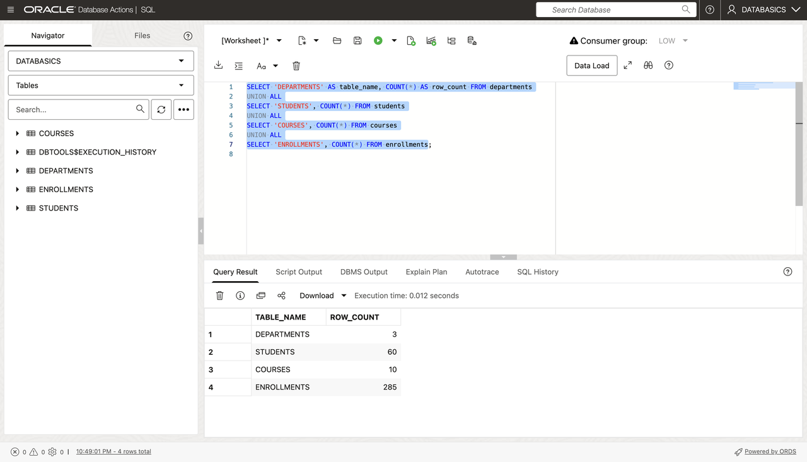
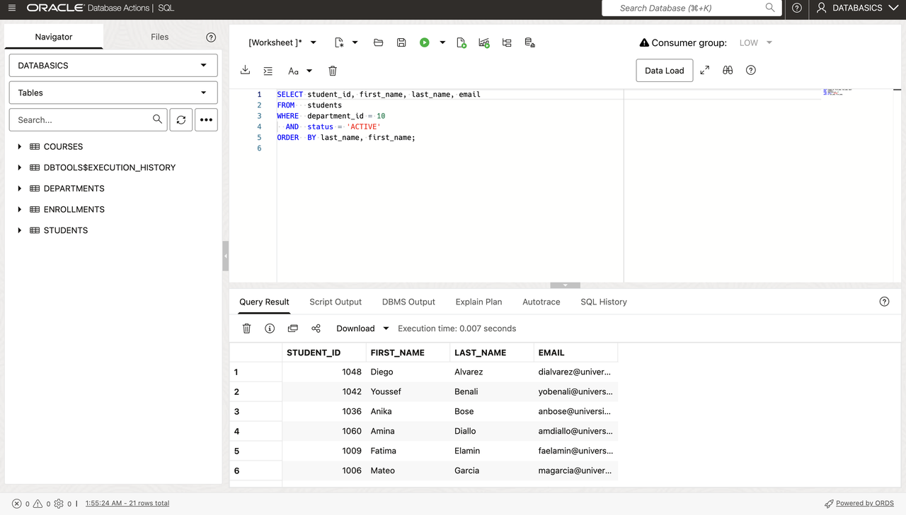
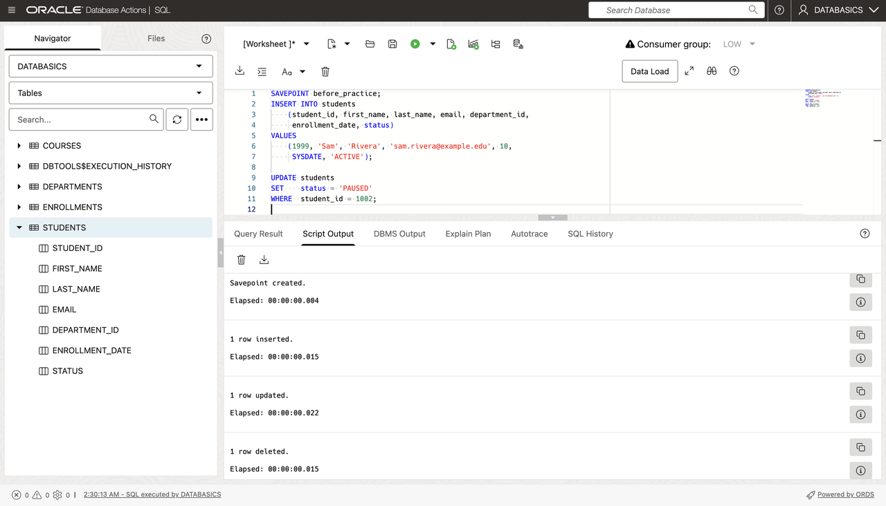
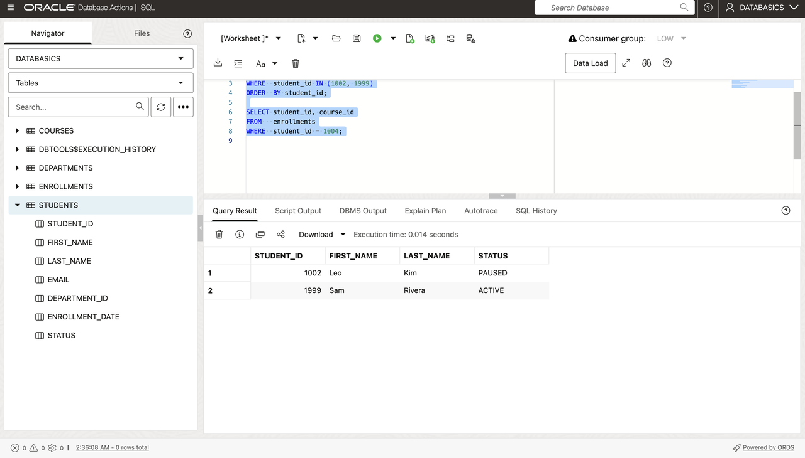

# Lab 3: Query and Change Data Safely

## Introduction

The reservation has already loaded three departments, 60 students, 10 courses, and 285 enrollments. Use those rows to practice queries. Then try an insert, update, and delete inside a transaction that you roll back.

### Objectives

You will:

- Check the loaded rows.
- Filter, sort, join, and aggregate data with `SELECT`.
- Practice targeted `INSERT`, `UPDATE`, and `DELETE` statements.
- Control a transaction with `SAVEPOINT`, `ROLLBACK`, and `COMMIT`.

Estimated Time: 25 minutes

## Task 1: Check the loaded data

1. Count the rows in each core table.

    ```sql
    <copy>
    SELECT 'DEPARTMENTS' AS table_name, COUNT(*) AS row_count FROM departments
    UNION ALL
    SELECT 'STUDENTS', COUNT(*) FROM students
    UNION ALL
    SELECT 'COURSES', COUNT(*) FROM courses
    UNION ALL
    SELECT 'ENROLLMENTS', COUNT(*) FROM enrollments;
    </copy>
    ```

    The result should show 3 departments, 60 students, 10 courses, and 285 enrollments. The setup loaded these rows before you opened Database Actions. If a count is missing, the reservation did not finish loading the dataset.

    

2. Open `STUDENTS` in the Tables list and view a few rows. The student IDs and department IDs connect these rows to the other tables.

## Task 2: Filter and sort rows

1. Find active students in the Computer Science department.

    ```sql
    <copy>
    SELECT student_id, first_name, last_name, email
    FROM   students
    WHERE  department_id = 10
      AND  status = 'ACTIVE'
    ORDER  BY last_name, first_name;
    </copy>
    ```

    `WHERE` keeps only rows matching both conditions: department 10 and active status. `ORDER BY` sorts them by last name, then first name. The result should contain active Computer Science students.

    

2. Try the same search for department 30. Change the department number in the filter and run this query.

    ```sql
    <copy>
    SELECT student_id, first_name, last_name, email
    FROM   students
    WHERE  department_id = 30
      AND  status = 'ACTIVE'
    ORDER  BY last_name, first_name;
    </copy>
    ```

    The result should contain active students in department 30, sorted by last name and first name. The `WHERE` conditions determine which rows appear.

    

## Task 3: Join related tables

1. Run a four-table join to show the courses for each student.

    ```sql
    <copy>
    SELECT s.first_name || ' ' || s.last_name AS student_name,
           d.department_name,
           c.course_code,
           c.course_title,
           e.enrolled_on
    FROM   students s
    JOIN   departments d ON d.department_id = s.department_id
    JOIN   enrollments e ON e.student_id = s.student_id
    JOIN   courses c ON c.course_id = e.course_id
    ORDER  BY student_name, c.course_code;
    </copy>
    ```

    The result should show one row per enrollment with the student name, department, and course. The joins follow the primary and foreign keys from one table to the next. The `||` operator combines first and last names for display.

    

2. Count students in each course.

    ```sql
    <copy>
    SELECT c.course_code,
           c.course_title,
           COUNT(e.student_id) AS student_count
    FROM   courses c
    LEFT JOIN enrollments e ON e.course_id = c.course_id
    GROUP  BY c.course_code, c.course_title
    ORDER  BY c.course_code;
    </copy>
    ```

    The result should show each course and its enrollment count. `GROUP BY` collects rows by course, and `COUNT` totals students. `LEFT JOIN` keeps courses with no enrollments too; those courses show a count of zero.

    

3. The foreign keys give you the join conditions. Each department, student, and course still lives in only one table.

## Task 4: Test data changes inside a transaction

Database Actions runs each statement or script in its own session. A savepoint only works in the session that created it. Run this whole block as one script with **Run Script** (F5 or Fn+F5 on some Mac keyboards). Do not run statements one by one.

1. Run the full script and compare the results before and after the rollback.

    ```sql
    <copy>
    SAVEPOINT before_practice;

    INSERT INTO students
        (student_id, first_name, last_name, email, department_id,
         enrollment_date, status)
    VALUES
        (1999, 'Sam', 'Rivera', 'sarivera@university.com', 10,
         SYSDATE, 'ACTIVE');

    UPDATE students
    SET    status = 'PAUSED'
    WHERE  student_id = 1002;

    DELETE FROM enrollments
    WHERE  student_id = 1004
      AND  course_id = 2002;

    SELECT student_id, first_name, last_name, status
    FROM   students
    WHERE  student_id IN (1002, 1999)
    ORDER  BY student_id;

    SELECT COUNT(*) AS enrollment_rows_before_rollback
    FROM   enrollments
    WHERE  student_id = 1004
      AND  course_id = 2002;

    ROLLBACK TO before_practice;

    SELECT COUNT(*) AS practice_student_rows_after_rollback
    FROM   students
    WHERE  student_id = 1999;

    SELECT student_id, status
    FROM   students
    WHERE  student_id = 1002;

    SELECT COUNT(*) AS enrollment_rows_after_rollback
    FROM   enrollments
    WHERE  student_id = 1004
      AND  course_id = 2002;

    COMMIT;
    </copy>
    ```

    Before rollback, the first student query should show Sam and student 1002 as `PAUSED`. The enrollment count should be zero because the practice delete removed that row. The script output should report one inserted row, one updated row, and one deleted row.

    

    After `ROLLBACK TO`, the checks should show no Sam row, student 1002 back to `ACTIVE`, and the enrollment restored with a count of one. The final `COMMIT` ends the clean transaction; none of the practice changes remain.

    

## Acknowledgements

* **Author** - Ilan Gómez Guerrero
* **Last Updated By/Date** - Ilan Gómez Guerrero, November 2026
