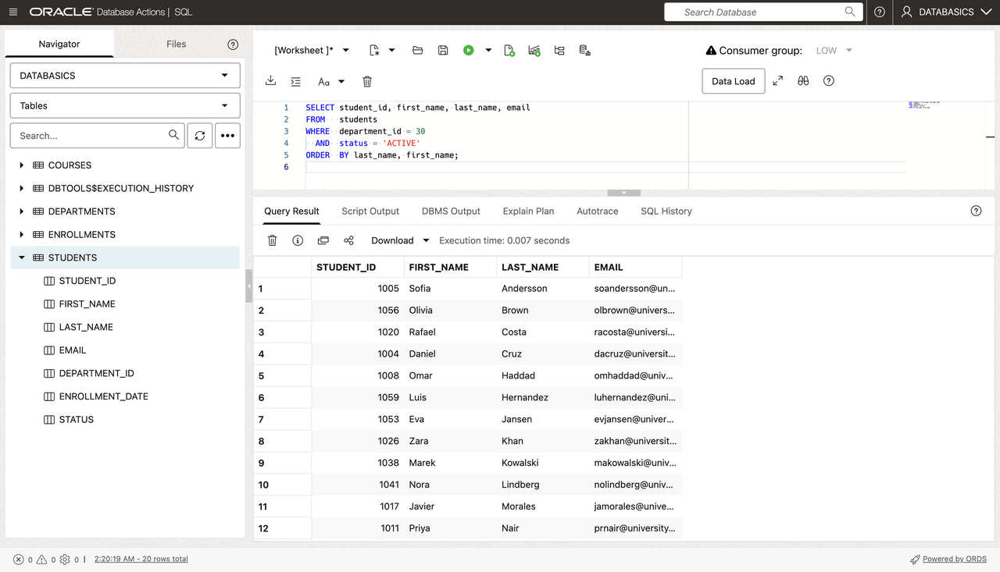
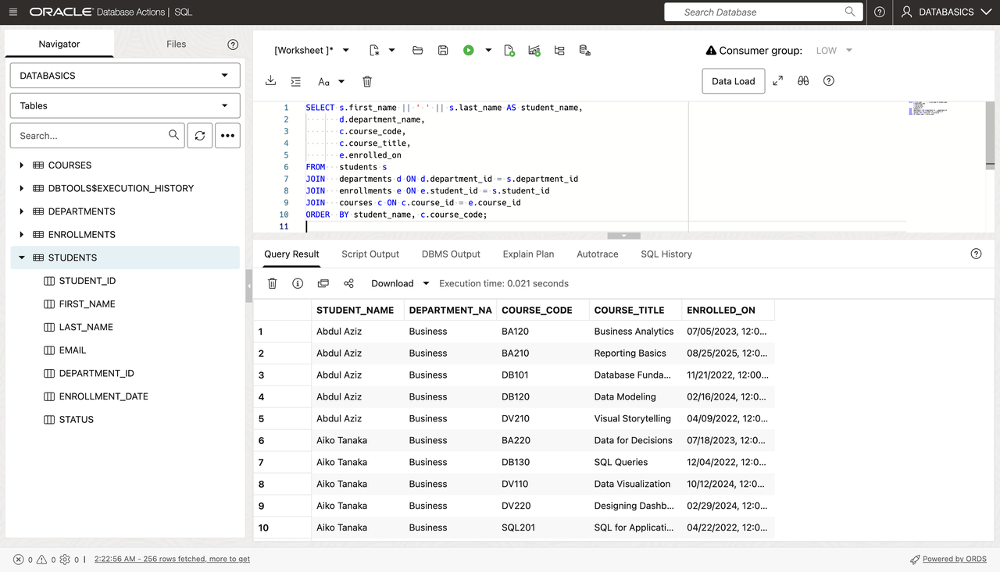
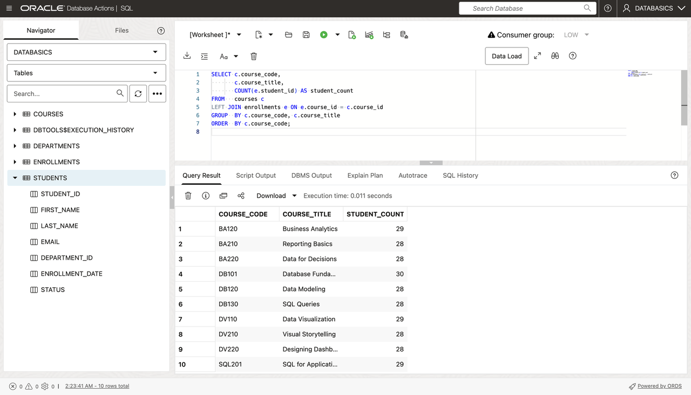
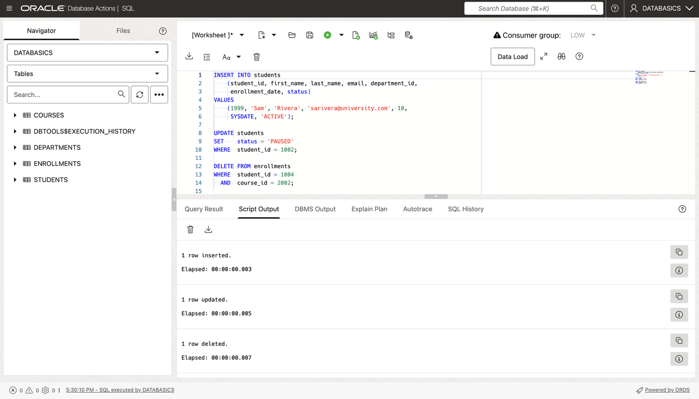
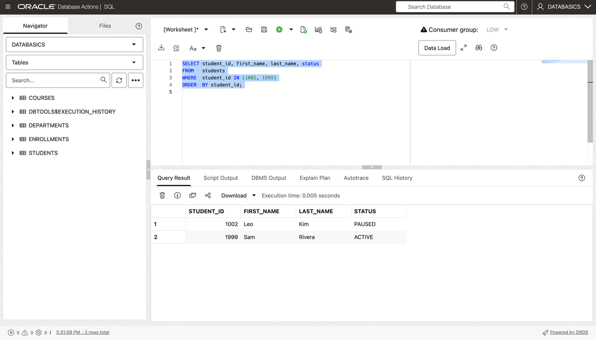
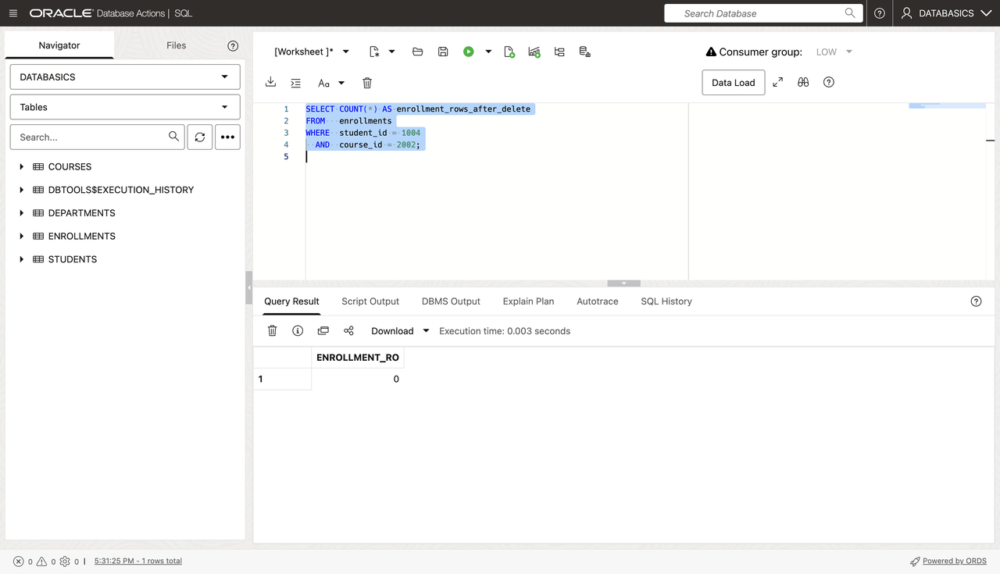
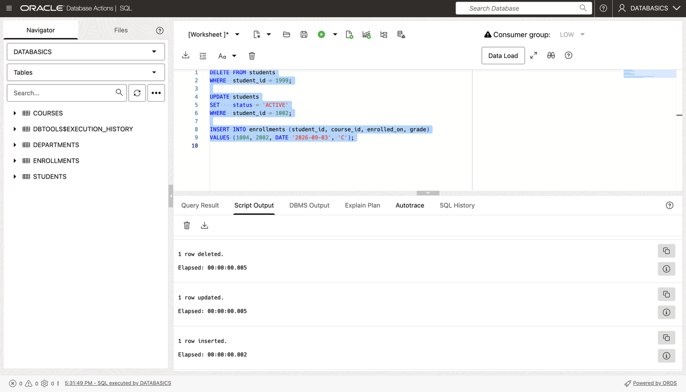
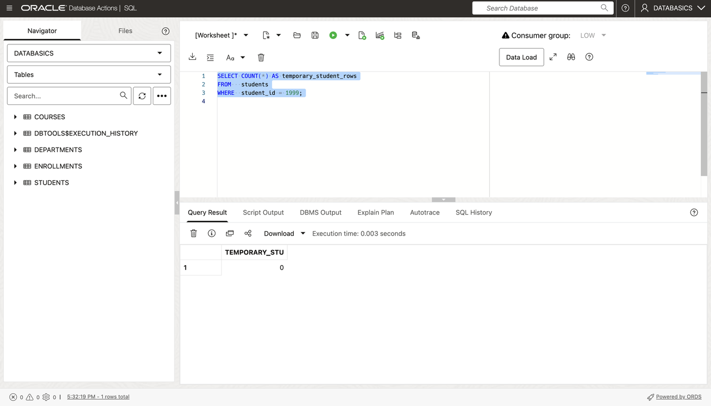
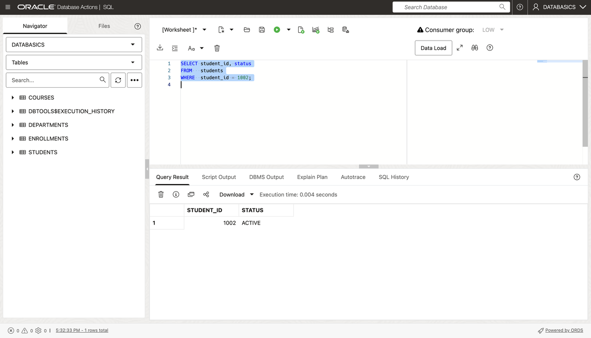
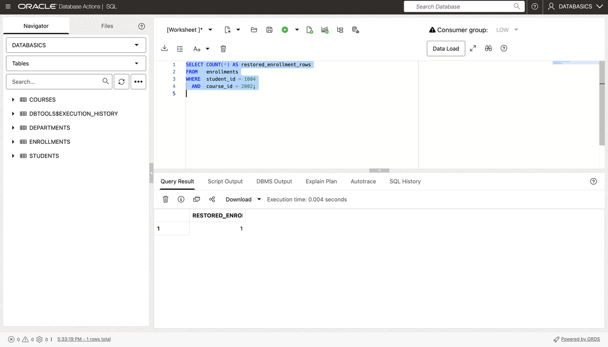

# Lab 3: Query and Change Data Safely

## Introduction

The reservation has already loaded three departments, 60 students, 10 courses, and 285 enrollments. Use those rows to practice queries. Then make a few temporary data changes, inspect them, and restore the sample values.

### Objectives

You will:

- Check the loaded rows.
- Filter, sort, join, and aggregate data with `SELECT`.
- Practice targeted `INSERT`, `UPDATE`, and `DELETE` statements.
- Make data changes and restore the workshop rows safely.

Estimated Time: 25 minutes

## Task 1: Check the loaded data

1. Count the rows in each core table.

    ```sql
    <copy>
    SELECT 'DEPARTMENTS' AS table_name, COUNT(*) AS row_count FROM departments
    UNION ALL
    SELECT 'STUDENTS', COUNT(*) FROM students
    UNION ALL
    SELECT 'COURSES', COUNT(*) FROM courses
    UNION ALL
    SELECT 'ENROLLMENTS', COUNT(*) FROM enrollments;
    </copy>
    ```

    The result should show 3 departments, 60 students, 10 courses, and 285 enrollments. The setup loaded these rows before you opened Database Actions. If a count is missing, the reservation did not finish loading the dataset.

    

2. Open `STUDENTS` in the Tables list and view a few rows. The student IDs and department IDs connect these rows to the other tables.

## Task 2: Filter and sort rows

1. Find active students in the Computer Science department.

    ```sql
    <copy>
    SELECT student_id, first_name, last_name, email
    FROM   students
    WHERE  department_id = 10
      AND  status = 'ACTIVE'
    ORDER  BY last_name, first_name;
    </copy>
    ```

    `WHERE` keeps only rows matching both conditions: department 10 and active status. `ORDER BY` sorts them by last name, then first name. The result should contain active Computer Science students.

    

2. Try the same search for department 30. Change the department number in the filter and run this query.

    ```sql
    <copy>
    SELECT student_id, first_name, last_name, email
    FROM   students
    WHERE  department_id = 30
      AND  status = 'ACTIVE'
    ORDER  BY last_name, first_name;
    </copy>
    ```

    The result should contain active students in department 30, sorted by last name and first name. The `WHERE` conditions determine which rows appear.

    

## Task 3: Join related tables

1. Run a four-table join to show the courses for each student.

    ```sql
    <copy>
    SELECT s.first_name || ' ' || s.last_name AS student_name,
           d.department_name,
           c.course_code,
           c.course_title,
           e.enrolled_on
    FROM   students s
    JOIN   departments d ON d.department_id = s.department_id
    JOIN   enrollments e ON e.student_id = s.student_id
    JOIN   courses c ON c.course_id = e.course_id
    ORDER  BY student_name, c.course_code;
    </copy>
    ```

    The result should show one row per enrollment with the student name, department, and course. The joins follow the primary and foreign keys from one table to the next. The `||` operator combines first and last names for display.

    

2. Count students in each course.

    ```sql
    <copy>
    SELECT c.course_code,
           c.course_title,
           COUNT(e.student_id) AS student_count
    FROM   courses c
    LEFT JOIN enrollments e ON e.course_id = c.course_id
    GROUP  BY c.course_code, c.course_title
    ORDER  BY c.course_code;
    </copy>
    ```

    The result should show each course and its enrollment count. `GROUP BY` collects rows by course, and `COUNT` totals students. `LEFT JOIN` keeps courses with no enrollments too; those courses show a count of zero.

    

3. The foreign keys give you the join conditions. Each department, student, and course still lives in only one table.

## Task 4: Make, inspect, and restore data changes

Database Actions can run each worksheet operation in a different session. A `SAVEPOINT` created in one operation is not available to a later one, which causes `ORA-01086`. To let you run the checks separately, this exercise uses committed practice changes and then restores the original sample values with SQL. It does not use `ROLLBACK` across operations.

### Step 1: Make three practice changes

Run these statements together with **Run Script** (F5 or Fn+F5 on some Mac keyboards). `INSERT` adds a temporary student, `UPDATE` changes the status of student 1002, and `DELETE` removes the enrollment identified by student 1004 and course 2002. The `WHERE` conditions target only the intended rows. Run this block once; the following steps inspect the changes before cleanup.

```sql
<copy>
INSERT INTO students
    (student_id, first_name, last_name, email, department_id,
     enrollment_date, status)
VALUES
    (1999, 'Sam', 'Rivera', 'sarivera@university.com', 10,
     SYSDATE, 'ACTIVE');

UPDATE students
SET    status = 'PAUSED'
WHERE  student_id = 1002;

DELETE FROM enrollments
WHERE  student_id = 1004
  AND  course_id = 2002;
</copy>
```

The script output should report one inserted row, one updated row, and one deleted row.



### Step 2: Check the student changes

Run this query as a separate operation.

```sql
<copy>
SELECT student_id, first_name, last_name, status
FROM   students
WHERE  student_id IN (1002, 1999)
ORDER  BY student_id;
</copy>
```

The result should show student 1002 as `PAUSED` and Sam Rivera as `ACTIVE`.



### Step 3: Check the enrollment change

Run this query separately. It checks whether the enrollment for student 1004 in course 2002 is still present.

```sql
<copy>
SELECT COUNT(*) AS enrollment_rows_after_delete
FROM   enrollments
WHERE  student_id = 1004
  AND  course_id = 2002;
</copy>
```

The result should be zero because Step 1 deleted that enrollment.



### Step 4: Restore the starting data

Run this cleanup block with **Run Script**. These statements reverse the practice changes: `DELETE` removes the temporary student, `UPDATE` returns student 1002 to the seeded `ACTIVE` status, and `INSERT` restores the enrollment with its original date and grade. This cleanup restores the sample rows; it is not a transaction rollback.

```sql
<copy>
DELETE FROM students
WHERE  student_id = 1999;

UPDATE students
SET    status = 'ACTIVE'
WHERE  student_id = 1002;

INSERT INTO enrollments (student_id, course_id, enrolled_on, grade)
VALUES (1004, 2002, DATE '2026-09-03', 'C');
</copy>
```

The output should report one deleted student, one updated student, and one inserted enrollment. These values match the sample data loaded for the workshop.



### Step 5: Verify the data is restored

Run each check separately.

```sql
<copy>
SELECT COUNT(*) AS temporary_student_rows
FROM   students
WHERE  student_id = 1999;
</copy>
```

The result should be zero because the temporary student was removed.



```sql
<copy>
SELECT student_id, status
FROM   students
WHERE  student_id = 1002;
</copy>
```

The result should show student 1002 with status `ACTIVE` again.



```sql
<copy>
SELECT COUNT(*) AS restored_enrollment_rows
FROM   enrollments
WHERE  student_id = 1004
  AND  course_id = 2002;
</copy>
```

The result should be one because the enrollment was restored.



All three checks should match the original data. The cleanup statements restore the rows explicitly because a rollback cannot reach across separate worksheet operations.

## Acknowledgements

* **Author** - Ilan Gómez Guerrero
* **Last Updated By/Date** - Ilan Gómez Guerrero, November 2026
