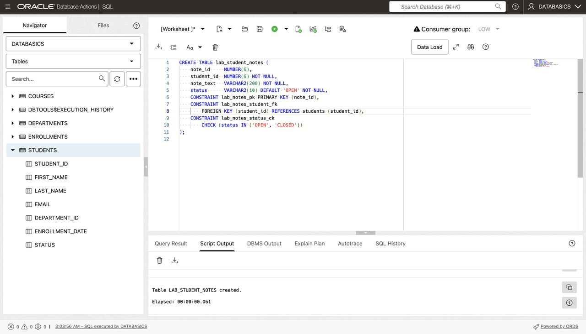
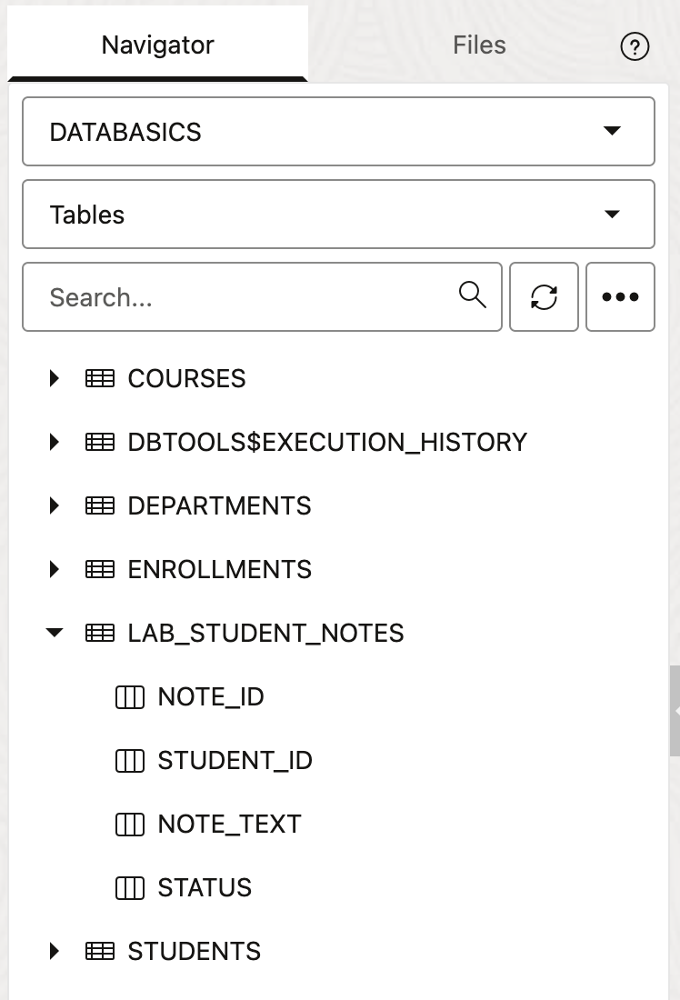
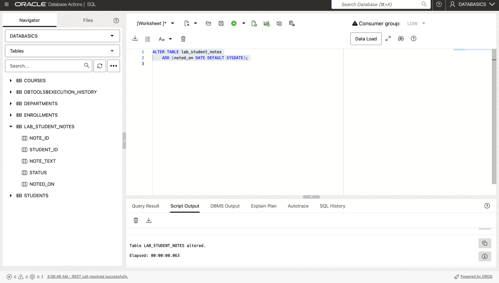
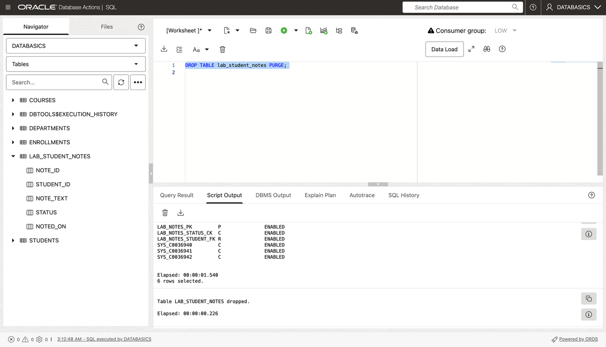

# Lab 4: Create and Manage Data Structures

## Introduction

The reservation already contains the four university tables and their data. Look at how they were built, then create a small practice table of your own. The practice table will not change the workshop data.

### Objectives

You will:

- Inspect table columns and constraints.
- Create a table with Oracle data types and rules.
- Modify a table with `ALTER TABLE`.
- Recognize how DDL affects transactions.

Estimated Time: 20 minutes

## Task 1: Inspect the ready tables

1. List the columns in the four workshop tables.

    ```sql
    <copy>
    SELECT table_name, column_id, column_name, data_type, nullable
    FROM   user_tab_columns
    WHERE  table_name IN ('DEPARTMENTS', 'STUDENTS', 'COURSES', 'ENROLLMENTS')
    ORDER  BY table_name, column_id;
    </copy>
    ```

    The result should list each column name, data type, and whether it accepts nulls. Find a `NUMBER`, a `VARCHAR2`, and a `DATE` column. A column marked `N` under `NULLABLE` requires a value.

    

2. List the rules on those tables.

    ```sql
    <copy>
    SELECT table_name, constraint_name, constraint_type
    FROM   user_constraints
    WHERE  table_name IN ('DEPARTMENTS', 'STUDENTS', 'COURSES', 'ENROLLMENTS')
    ORDER  BY table_name, constraint_type, constraint_name;
    </copy>
    ```

    The result should show the rules on each core table: `P` means primary key, `R` foreign key, `U` unique, and `C` check or required value. The reservation created these rules before you signed in.

    

## Task 2: Create a practice table

1. Create a table for optional notes about existing students.

    ```sql
    <copy>
    CREATE TABLE lab_student_notes (
        note_id     NUMBER(6),
        student_id  NUMBER(6) NOT NULL,
        note_text   VARCHAR2(200) NOT NULL,
        status      VARCHAR2(10) DEFAULT 'OPEN' NOT NULL,
        CONSTRAINT lab_notes_pk PRIMARY KEY (note_id),
        CONSTRAINT lab_notes_student_fk
            FOREIGN KEY (student_id) REFERENCES students (student_id),
        CONSTRAINT lab_notes_status_ck
            CHECK (status IN ('OPEN', 'CLOSED'))
    );
    </copy>
    ```

    The result should report that the table was created. `NOTE_ID` identifies each note. The foreign key only accepts a student already in `STUDENTS`, and the check rule limits status to two values. The definition screenshot shows the statement used.

    

2. Refresh the Tables list. You should see `LAB_STUDENT_NOTES` next to the four core tables. The result should show the new table and its columns.

    

## Task 3: Change and check the practice table

1. Add a date column.

    ```sql
    <copy>
    ALTER TABLE lab_student_notes
        ADD (noted_on DATE DEFAULT SYSDATE);
    </copy>
    ```

    The result should report that the table was altered. The default supplies the current date when a new row omits `NOTED_ON`. The screenshot shows the `ALTER TABLE` statement used.

    

2. Check its columns and constraints.

    ```sql
    <copy>
    SELECT column_name, data_type, nullable
    FROM   user_tab_columns
    WHERE  table_name = 'LAB_STUDENT_NOTES'
    ORDER  BY column_id;

    SELECT constraint_name, constraint_type, status
    FROM   user_constraints
    WHERE  table_name = 'LAB_STUDENT_NOTES'
    ORDER  BY constraint_name;
    </copy>
    ```

    The result should include the new `NOTED_ON` date column and show the primary key, foreign key, and check rule. Oracle also records required columns as constraints.

    

## Task 4: Remove the practice table

1. Drop the table you created in this lab.

    ```sql
    <copy>
    DROP TABLE lab_student_notes PURGE;
    </copy>
    ```

    The result should report that `LAB_STUDENT_NOTES` was dropped. The four university tables and their rows remain, and you can repeat this lab without a name conflict.

    

2. `CREATE`, `ALTER`, and `DROP` are DDL statements. Oracle commits pending work around DDL, so finish any practice transactions before changing a table structure.

## Acknowledgements

* **Author** - Ilan Gómez Guerrero
* **Last Updated By/Date** - Ilan Gómez Guerrero, November 2026
