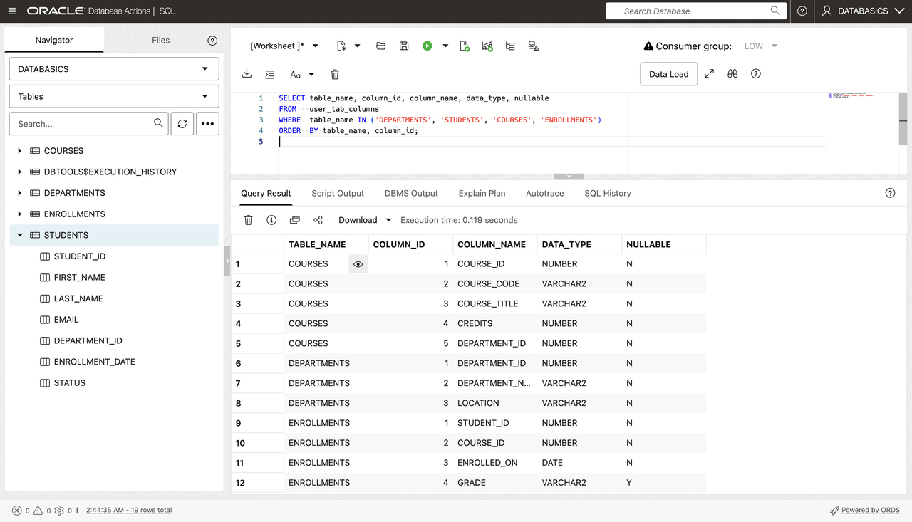
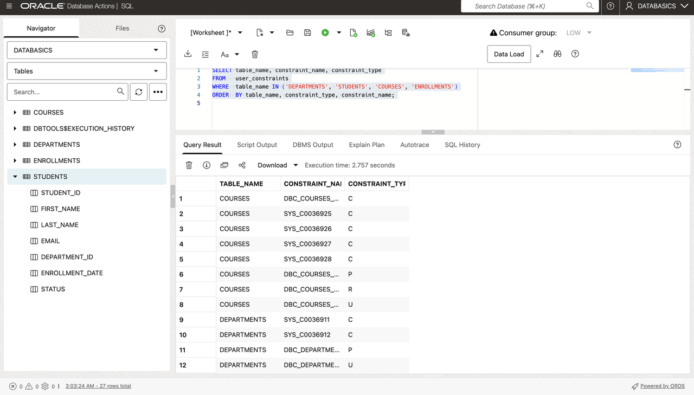
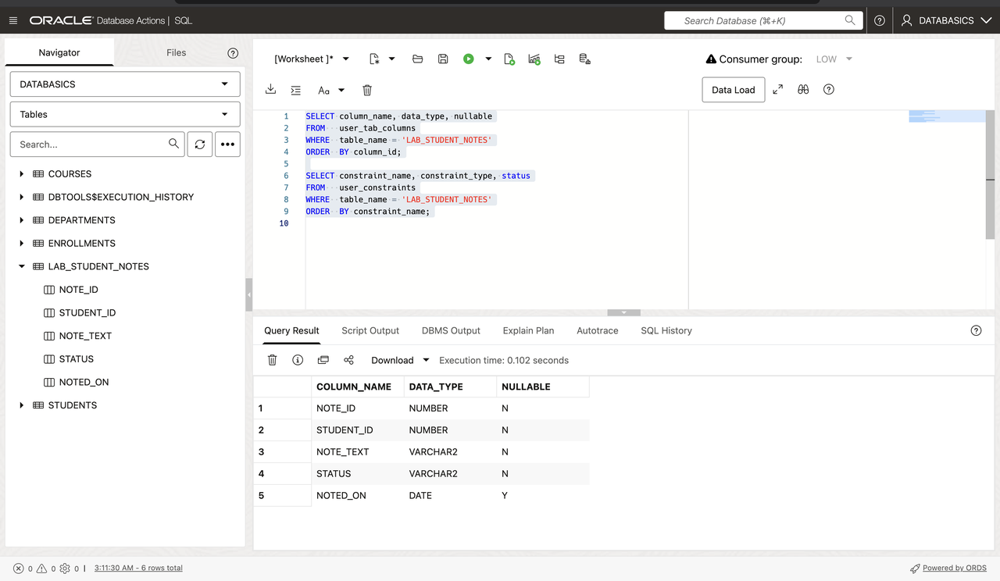

# Lab 4: Create and Manage Data Structures

## Introduction

The reservation already contains the four university tables and their data. Look at how they were built, then create a small practice table of your own. A **column** describes one kind of value, and a **row** holds one record. The practice table will not change the workshop data.

### Objectives

You will:

- Inspect table columns and constraints.
- Create a table with Oracle data types and rules.
- Modify a table with `ALTER TABLE`.
- Recognize how DDL affects transactions.

Estimated Time: 20 minutes

## Task 1: Inspect the ready tables

1. List the columns in the four workshop tables.

    ```sql
    <copy>
    SELECT table_name, column_id, column_name, data_type, nullable
    FROM   user_tab_columns
    WHERE  table_name IN ('DEPARTMENTS', 'STUDENTS', 'COURSES', 'ENROLLMENTS')
    ORDER  BY table_name, column_id;
    </copy>
    ```

    The result should list each column name, data type, and whether it accepts nulls. A **data type** tells Oracle what kind of value a column can store: `NUMBER` stores numeric values, `VARCHAR2` stores text, and `DATE` stores dates and times. A column marked `N` under `NULLABLE` requires a value; `NULL` means no value is present.

    

2. List the rules on those tables.

    ```sql
    <copy>
    SELECT table_name, constraint_name, constraint_type
    FROM   user_constraints
    WHERE  table_name IN ('DEPARTMENTS', 'STUDENTS', 'COURSES', 'ENROLLMENTS')
    ORDER  BY table_name, constraint_type, constraint_name;
    </copy>
    ```

    The result should show the rules on each core table. In `CONSTRAINT_TYPE`, `P` means primary key, `R` foreign key, `U` unique, and `C` check constraint. Oracle also represents `NOT NULL` as a check constraint in this view. A **foreign key** links a column to an existing key in another table, preserving the relationship between the rows. The reservation created these rules before you signed in.

    

## Task 2: Create a practice table

1. Create a table for optional notes about existing students.

    ```sql
    <copy>
    CREATE TABLE lab_student_notes (
        note_id     NUMBER(6),
        student_id  NUMBER(6) NOT NULL,
        note_text   VARCHAR2(200) NOT NULL,
        status      VARCHAR2(10) DEFAULT 'OPEN' NOT NULL,
        CONSTRAINT lab_notes_pk PRIMARY KEY (note_id),
        CONSTRAINT lab_notes_student_fk
            FOREIGN KEY (student_id) REFERENCES students (student_id),
        CONSTRAINT lab_notes_status_ck
            CHECK (status IN ('OPEN', 'CLOSED'))
    );
    </copy>
    ```

    The result should report that the table was created. `NOTE_ID` identifies each note, and `NUMBER(6)` stores a number with up to six significant digits. `VARCHAR2(200)` stores text up to 200 characters. `NOT NULL` requires a value; `DEFAULT 'OPEN'` fills in `OPEN` when an insert omits the status. The foreign key only accepts an existing student, and the check constraint limits status to `OPEN` or `CLOSED`. This creates an empty practice table and leaves the four core tables unchanged. The definition screenshot shows the statement used.

    

2. Refresh the Tables list because Database Actions may not update the navigator immediately after DDL. You should see `LAB_STUDENT_NOTES` next to the four core tables. The table has columns and rules but no note rows yet; this confirms that the new structure exists.

    

## Task 3: Change and check the practice table

1. Add a date column.

    ```sql
    <copy>
    ALTER TABLE lab_student_notes
        ADD (noted_on DATE DEFAULT SYSDATE);
    </copy>
    ```

    The result should report that the table was altered. `ALTER TABLE` changes a table's structure. The `DATE` type stores a date and time, and `SYSDATE` supplies the database's current date and time when a new row omits `NOTED_ON`. The screenshot shows the statement used.

    

2. Check its columns and constraints.

    ```sql
    <copy>
    SELECT column_name, data_type, nullable
    FROM   user_tab_columns
    WHERE  table_name = 'LAB_STUDENT_NOTES'
    ORDER  BY column_id;

    SELECT constraint_name, constraint_type, status
    FROM   user_constraints
    WHERE  table_name = 'LAB_STUDENT_NOTES'
    ORDER  BY constraint_name;
    </copy>
    ```

    These **data dictionary** queries read Oracle's built-in catalog of information about database objects; they inspect the table design rather than its rows. The first result should include the new `NOTED_ON` date column; the second should show the primary key, foreign key, and check rule. Oracle also records required columns as constraints.

    

## Task 4: Remove the practice table

1. Drop the table you created in this lab.

    ```sql
    <copy>
    DROP TABLE lab_student_notes PURGE;
    </copy>
    ```

    The result should report that `LAB_STUDENT_NOTES` was dropped. `DROP TABLE` removes a table definition and its rows. `PURGE` also removes it from Oracle's recycle bin, where dropped tables can otherwise be recovered. The four university tables and their rows remain, and you can repeat this lab without a name conflict.

    

2. `CREATE`, `ALTER`, and `DROP` are **DDL** (data definition language) statements: they create, change, or remove database structures. Oracle automatically commits pending changes before and after DDL, so finish any practice transactions (groups of data changes) before changing a table structure; `ROLLBACK` cannot undo that DDL change.

## Acknowledgements

* **Author** - Ilan Gómez Guerrero
* **Last Updated By/Date** - Ilan Gómez Guerrero, November 2026
