# Lab 5: Add Schema Objects and Indexes

## Introduction

The reservation supplied the four core tables and their rows. Add a sequence, a view, a synonym, and three B-tree indexes to finish the schema.

Here is what each object is for:

| Object | Purpose |
| --- | --- |
| Sequence | Generates numeric values independently of a table |
| View | Gives a saved query a reusable table-like interface |
| Synonym | Provides another name for an existing object |
| Index | Gives Oracle an alternate path for locating rows |

### Objectives

You will:

- Generate numeric values with a sequence.
- Present joined data through a view.
- Create a private synonym for a schema object.
- Add B-tree indexes that support foreign key joins.
- Inspect schema objects and indexes.

Estimated Time: 20 minutes

## Task 1: Create and use a sequence

A sequence gives you new numbers without checking the highest value in a table. It is a separate object, so requesting a number does not insert a row.

1. Check whether the sequence already exists.

    ```sql
    <copy>
    SELECT sequence_name, last_number
    FROM   user_sequences
    WHERE  sequence_name = 'DBC_STUDENT_SEQ';
    </copy>
    ```

    On a new reservation, the result should be empty because the sequence has not been created yet. If a row appears, it already exists and you can skip its creation. `USER_SEQUENCES` lists sequences owned by your user. `LAST_NUMBER` is a cache value and may not be the next value you receive.

    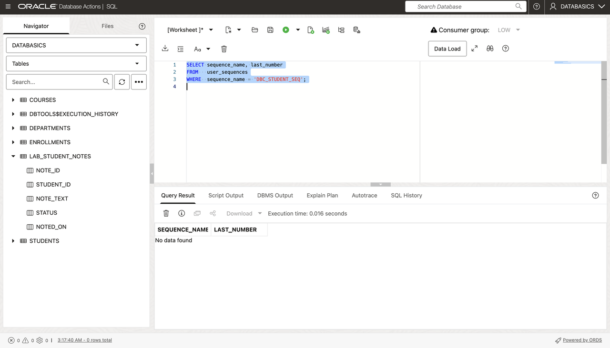

2. Run this block with **Run Script** (F5). It creates the sequence if missing and can be run again safely.

    ```sql
    <copy>
    DECLARE
        sequence_count PLS_INTEGER;
    BEGIN
        SELECT COUNT(*)
        INTO   sequence_count
        FROM   user_sequences
        WHERE  sequence_name = 'DBC_STUDENT_SEQ';

        IF sequence_count = 0 THEN
            EXECUTE IMMEDIATE
                'CREATE SEQUENCE dbc_student_seq START WITH 1100 INCREMENT BY 1 NOCYCLE CACHE 20';
        END IF;
    END;
    /
    </copy>
    ```

    The block first counts matching rows in `USER_SEQUENCES`. If the count is zero, `EXECUTE IMMEDIATE` runs the `CREATE SEQUENCE` statement; if the sequence exists, the block does nothing so it can be rerun safely. The sequence starts at 1100 and adds one for each request. `NOCYCLE` stops it from returning to the beginning, and `CACHE 20` keeps values ready in memory.

    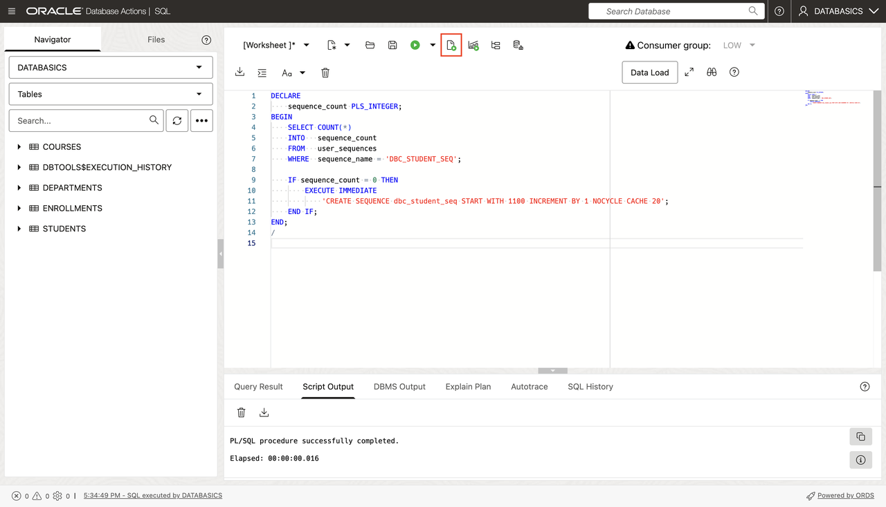

3. Read the next value without inserting a row. Run this statement with **Run Script** (F5 or Fn+F5 on some Mac keyboards), not **Run Statement**.

    ```sql
    <copy>
    SELECT dbc_student_seq.NEXTVAL AS next_student_id
    FROM   dual;
    </copy>
    ```

    The result should be one new number in `NEXT_STUDENT_ID`. `NEXTVAL` returns a number and moves the sequence forward. `DUAL` gives the query one row to work with. Each request consumes a value even when you do not insert it.

    This is a top-level `SELECT`, where Oracle allows `NEXTVAL`. If you run it with **Run Statement** and see `ORA-02287`, switch to **Run Script**. The statement may be handled as a nested query by the worksheet's query execution path, where `NEXTVAL` is not allowed.

    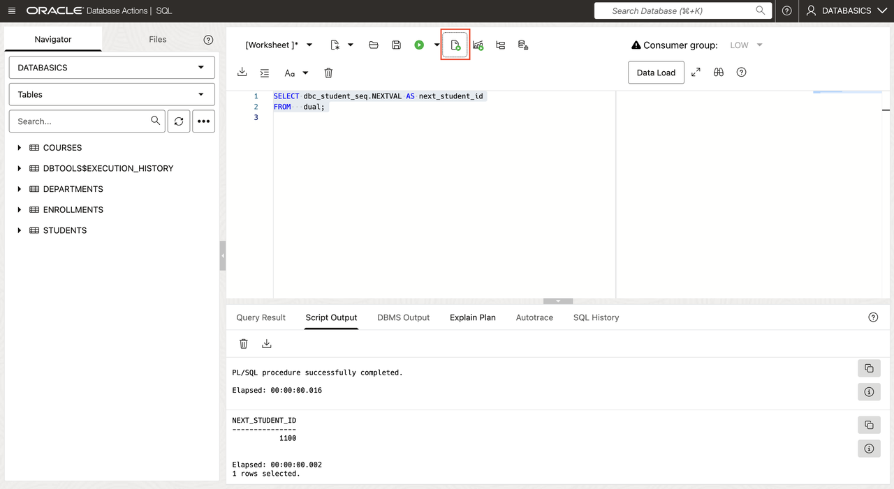

4. Oracle does not roll sequence values back. An unused cached value can also disappear when an instance stops. Gaps are normal, and they do not mean that table rows are missing.

## Task 2: Create a view and synonym

A regular view gives a useful query a name. It reads the current rows from the base tables whenever you use it. A synonym is only another name for an object; it does not give extra privileges.

1. Create a view that stores the four-table query definition.

    ```sql
    <copy>
    CREATE OR REPLACE VIEW dbc_student_schedule_v AS
    SELECT s.student_id,
           s.first_name || ' ' || s.last_name AS student_name,
           d.department_name,
           c.course_code,
           c.course_title,
           e.enrolled_on,
           e.grade
    FROM   students s
    JOIN   departments d ON d.department_id = s.department_id
    JOIN   enrollments e ON e.student_id = s.student_id
    JOIN   courses c ON c.course_id = e.course_id;
    </copy>
    ```

    The result should report that the view was created. Each join matches related rows by their keys, and each result row represents a student-course enrollment with the student's department and course details. The view saves this query definition, not another copy of the data. `CREATE OR REPLACE` lets you update the definition later without dropping the view first.

    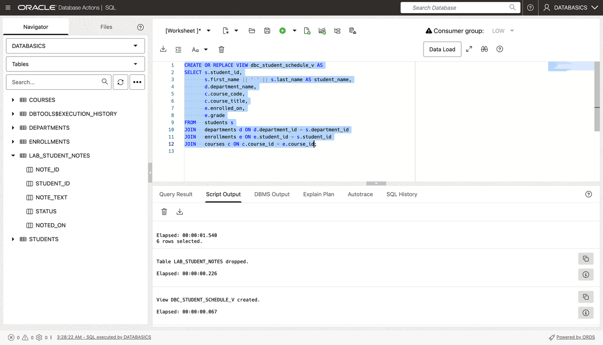

2. Create a shorter private synonym for the view.

    ```sql
    <copy>
    CREATE OR REPLACE SYNONYM dbc_schedule
    FOR dbc_student_schedule_v;
    </copy>
    ```

    The result should report that the synonym was created. `DBC_SCHEDULE` is a shorter name that resolves to `DBC_STUDENT_SCHEDULE_V`; it does not store or copy data and does not add permissions.

    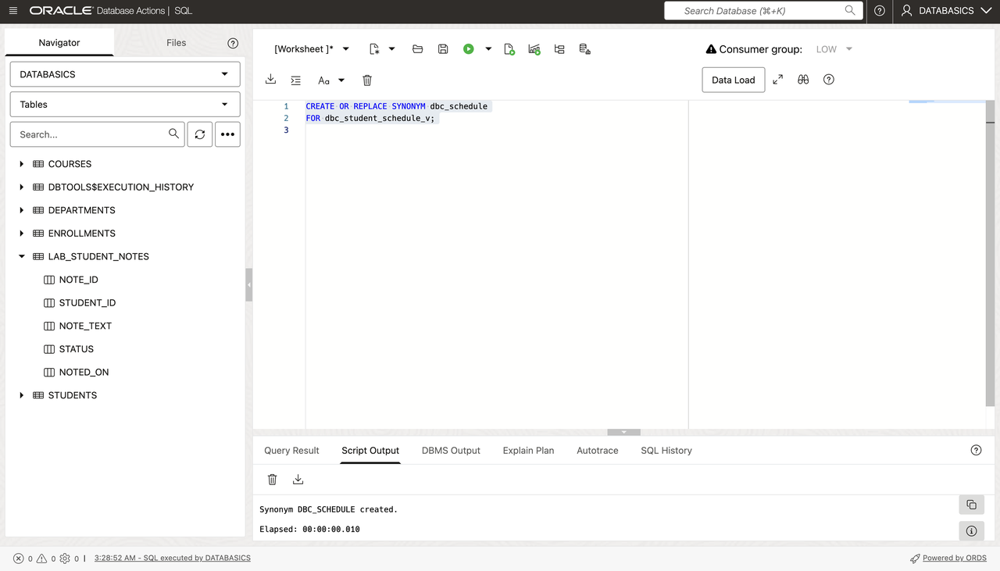

3. Query through the synonym.

    ```sql
    <copy>
    SELECT student_name, department_name, course_code, course_title
    FROM   dbc_schedule
    ORDER  BY student_name, course_code;
    </copy>
    ```

    The result should show the schedule rows from the view. Oracle resolves `DBC_SCHEDULE` to the original view and runs its joins, so the rows match `DBC_STUDENT_SCHEDULE_V`.

    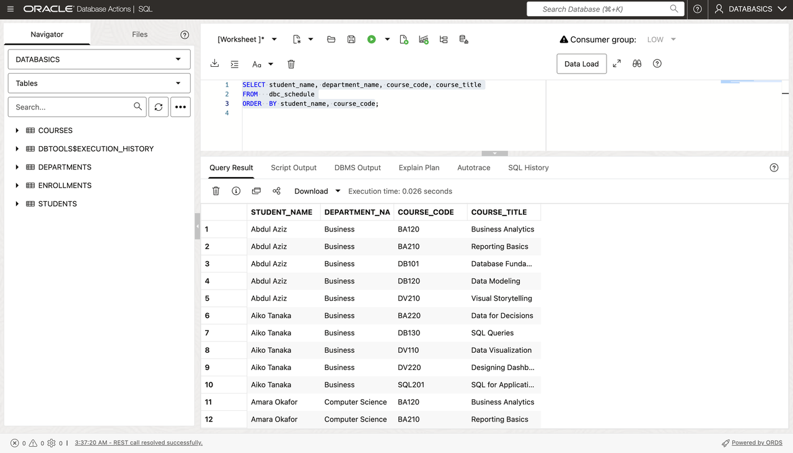

4. A regular view stores the query definition. A materialized view stores the query results on disk and must refresh when the base data changes. We will not create one in this workshop.

5. `DBC_SCHEDULE` is private to your schema. A public synonym is database-wide and needs administrative privileges.

## Task 3: Add indexes for common joins

Lab 1 showed indexes for primary key and unique constraints. Here, add three more on foreign keys. A B-tree stores ordered keys and row locations. It can speed up searches, but uses storage and adds write cost.

1. Check which indexes already exist.

    ```sql
    <copy>
    SELECT table_name, index_name, uniqueness
    FROM   user_indexes
    WHERE  table_name IN ('DEPARTMENTS', 'STUDENTS', 'COURSES', 'ENROLLMENTS')
    ORDER  BY table_name, index_name;
    </copy>
    ```

    The result lists the indexes that already exist on the core tables. Primary key and unique constraints use indexes to enforce their rules. The three new foreign key index names should not appear yet. If any one is already present, remove its matching `CREATE INDEX` statement from Step 2 before running the remaining statements.

    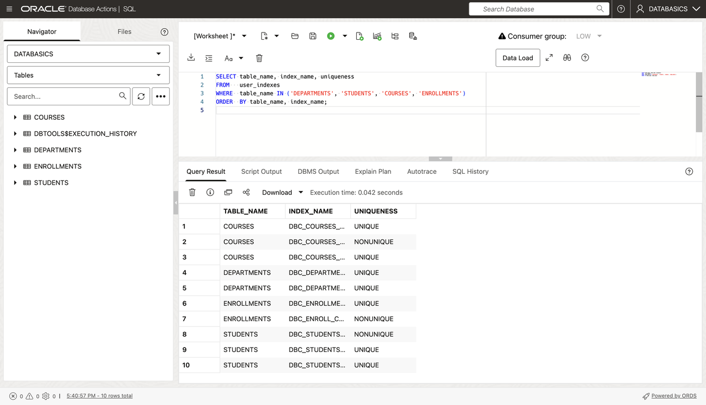

2. Create the missing indexes. Run the remaining statements with **Run Script** so each missing index is created.

    ```sql
    <copy>
    CREATE INDEX dbc_students_dept_ix
        ON students (department_id);

    CREATE INDEX dbc_courses_dept_ix
        ON courses (department_id);

    CREATE INDEX dbc_enroll_course_ix
        ON enrollments (course_id);
    </copy>
    ```

    The result should show a successful creation for each statement you ran. The first index supports searches and joins by a student's department, the second by a course's department, and the third by course ID in `ENROLLMENTS`. They give Oracle another path for finding rows; the optimizer uses an index only when it estimates that path costs less than a full table scan.

    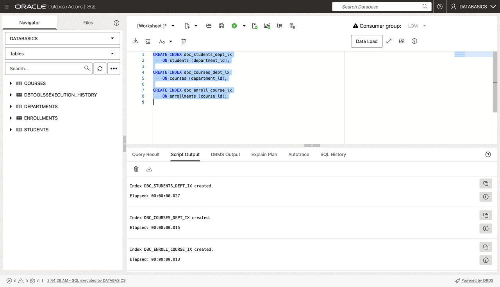

3. Repeat the Step 1 query. The three new index names should now appear. Comparing the before and after lists shows the schema change made by `CREATE INDEX`.

4. The primary key on `ENROLLMENTS` already starts with `STUDENT_ID`. The new index starts with `COURSE_ID`, which supports searches from the other side of the relationship. Oracle normally creates or reuses an index for a primary key or unique rule. It does not automatically index foreign key columns.

5. Use the workload to choose an index type.

    This comparison explains other index options; you do not create these index types in this lab. The three practice indexes are B-tree indexes, which fit the joins and searches used here.

    | Index type | Typical use |
    | --- | --- |
    | B-tree | Lookups, ranges, joins, and frequently changed data |
    | Bitmap | Read-heavy analytics on columns with few distinct values, such as a small status list; avoid frequent DML |
    | Function-based | Expressions such as `UPPER(last_name)` |
    | Specialized | Text, spatial, JSON, graph, or vector searches |

    For example, a bitmap index may fit a column with only a few possible values, but frequent row changes make it a poor choice. The workshop data changes and joins across IDs, so the exercises use B-tree indexes instead.

6. Do not worry if Oracle scans the full table in this small example. The optimizer uses an index only when it estimates that the index will cost less.

7. Autonomous Database can manage indexes automatically. Create these three yourself to see how the index list changes.

## Task 4: Inspect the finished schema

Oracle records schema details in data dictionary views. Names that begin with `USER_` describe objects owned by your user. Use these final queries to check what you built.

1. Count the workshop objects by type.

    ```sql
    <copy>
    SELECT object_type, COUNT(*) AS object_count
    FROM   user_objects
    WHERE  object_name LIKE 'DBC\_%' ESCAPE '\'
       OR  object_name IN ('DEPARTMENTS', 'STUDENTS', 'COURSES', 'ENROLLMENTS')
    GROUP  BY object_type
    ORDER  BY object_type;
    </copy>
    ```

    The result should group matching objects by type. The filter selects the four core tables plus workshop objects whose names begin with the literal prefix `DBC_`; `ESCAPE` makes the underscore literal rather than a `LIKE` wildcard. `GROUP BY` collects object types and `COUNT` totals them. Expect tables, indexes, a view, a sequence, and a synonym.

    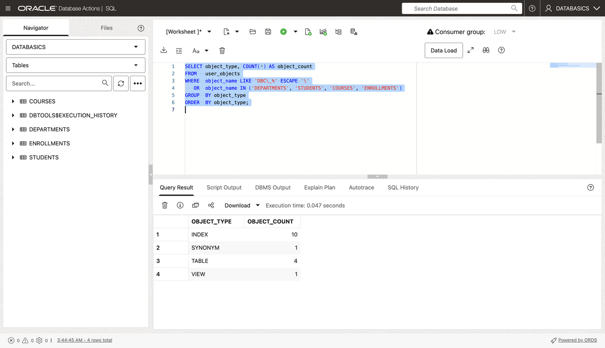

2. List the indexed columns in order.

    ```sql
    <copy>
    SELECT i.table_name,
           i.index_name,
           c.column_position,
           c.column_name
    FROM   user_indexes i
    JOIN   user_ind_columns c ON c.index_name = i.index_name
    WHERE  i.table_name IN ('DEPARTMENTS', 'STUDENTS', 'COURSES', 'ENROLLMENTS')
    ORDER  BY i.table_name, i.index_name, c.column_position;
    </copy>
    ```

    The result should list each index column and its position. The join connects each index to its columns. `COLUMN_POSITION` shows the order, and the first column usually controls which searches can use the index well.

    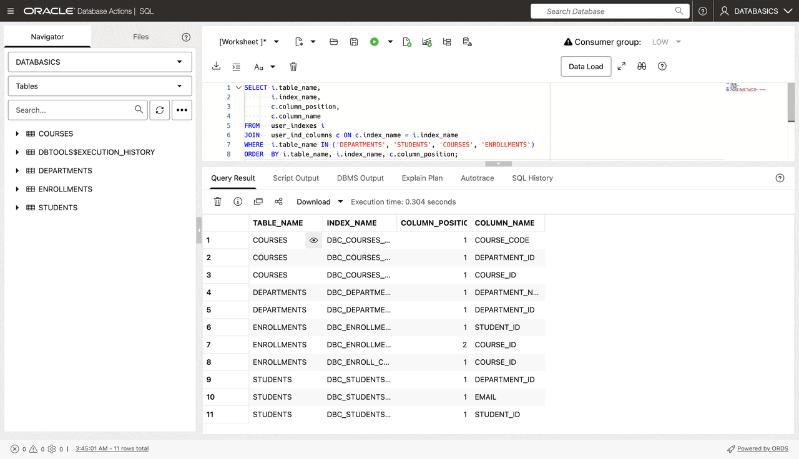

3. Run the schedule query one last time.

    ```sql
    <copy>
    SELECT student_name, department_name, course_code, course_title
    FROM   dbc_student_schedule_v
    ORDER  BY student_name, course_code;
    </copy>
    ```

    The result should show the same schedule rows as before. Indexes do not change the data or answer; they give the optimizer another way to find rows.

    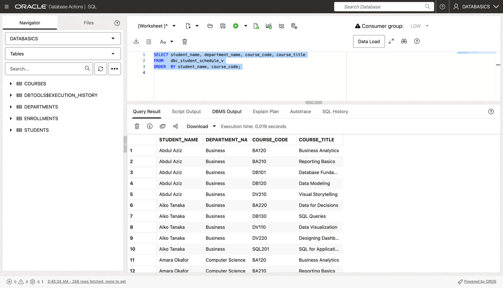

4. Your schema now has data, constraints, a sequence, a view, a synonym, and indexes. Keep the objects for review unless your instructor asks you to reset the workshop schema.

## Acknowledgements

* **Author** - Ilan Gómez Guerrero
* **Last Updated By/Date** - Ilan Gómez Guerrero, November 2026
