# Check the Existing ADB and Prepare Access

## Introduction

In this lab, you will locate the Oracle Autonomous AI Lakehouse created in Lab 1 as the ADMIN user and create an Essbase user with the necessary permissions. You will then sign in as the Essbase user to confirm access to Database Actions and Data Studio.

Estimated Time: 35 minutes

### About Database Actions

Database Actions is a browser-based interface for working with your Autonomous AI Database. Access from the OCI Console and access to database tools are controlled separately. In this lab, you will use the OCI Console to find the Lakehouse, then use database credentials to sign in to Database Actions.

### Objectives

In this lab, you will:

- Locate the Autonomous AI Lakehouse created in Lab 1 in your tenancy.
- Open Database Actions using the database ADMIN credentials.
- Create a user with Web Access and the Essbase Power User role.
- Verify that the Essbase user can sign in.

### Prerequisites

This lab assumes you have:

- The Autonomous AI Lakehouse created in Lab 1, with lifecycle state **Available**.
- An OCI ADMIN account that can view the AI Lakehouse in the Console.
- Access to Database Actions in AI Lakehouse.

## Task 1: Locate the Existing Autonomous AI Lakehouse

1. Within OCI, open the hamburger menu in the top left corner and select **Oracle AI Database**, then **Autonomous AI Database**.
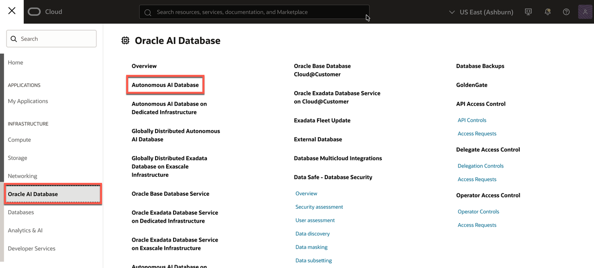

2. Select the region and compartment where your Autonomous AI Lakehouse instance is located.
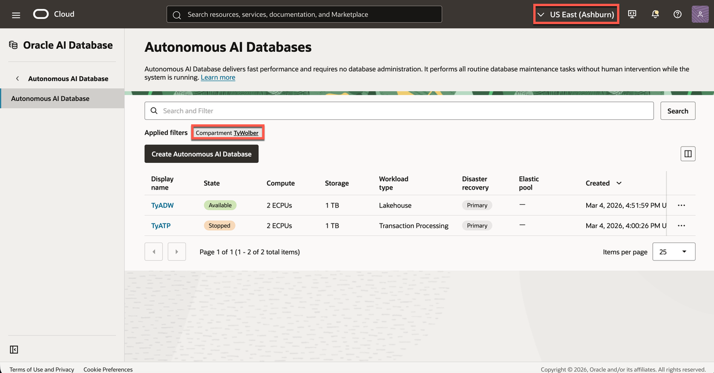

3. Find the AI Lakehouse you created in Lab 1, such as **ESSBASELAB**, in the database list. Confirm the database name and the lifecycle state is **Available**.
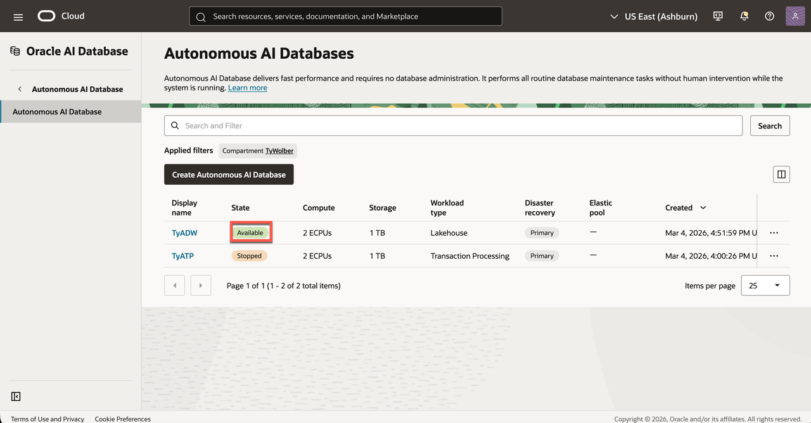

4. Click on the AI Lakehouse to access the database details page.

## Task 2: Open Database Actions

1. On the details page, open the **Database actions** menu and select **View all database actions**.
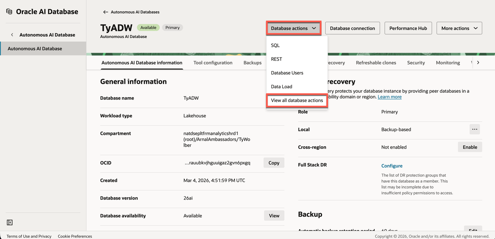

2. If prompted, sign in as the database **ADMIN** user.
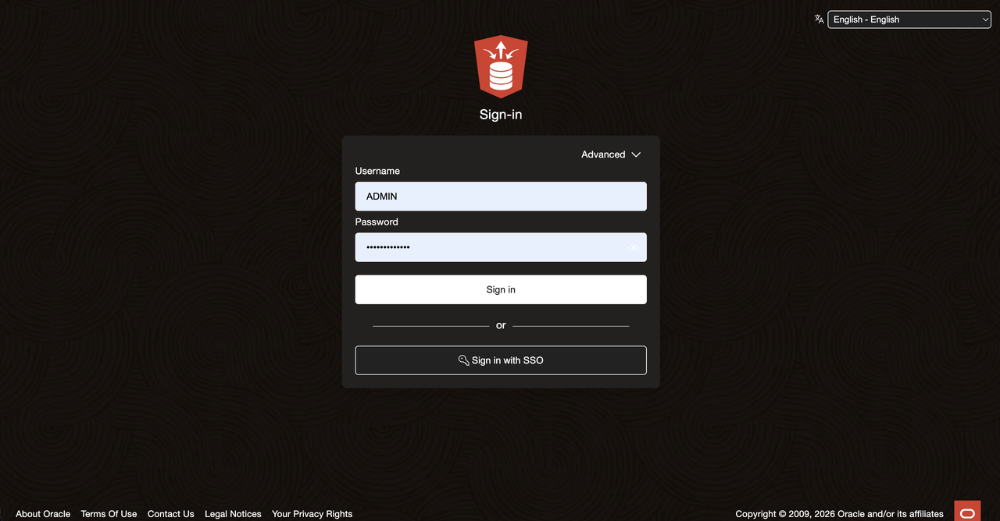

3. Confirm that the Database Actions launchpad opens and **Admin** is in the top right. Locate the **Data Studio** area and its available tools. This will be used later in the workshop.

    > **Note:** The Database Actions screenshots in this lab use Dark Mode, but the steps are the same in either theme. To enable Dark Mode, click your name in the upper-right corner, then select Preferences → Code Editor → Theme.

## Task 3: Create and Enable the Workshop Database User

1. In Database Actions, open the hamburger menu in the top left corner. Under **Administration**, select **Database Users**.
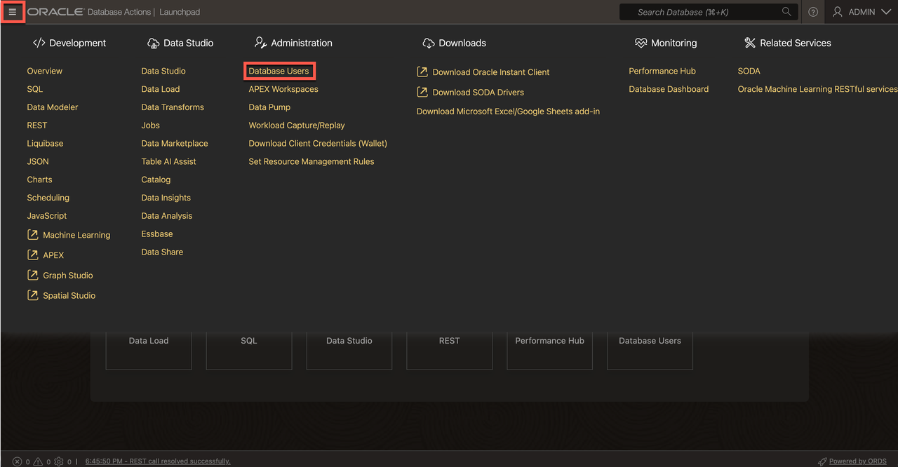

2. Select **Create User**.
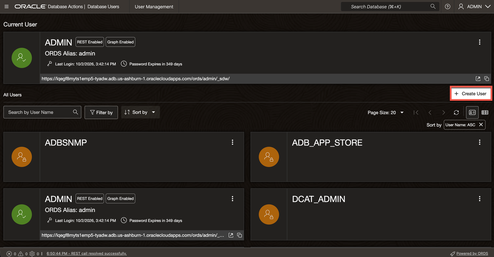

3. Enter a username for the workshop user and create a password that meets the displayed requirements. Keep the credentials saved for future use.
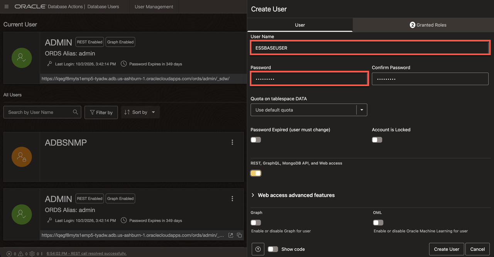

4. Set the **Quota on tablespace DATA** to the amount approved for your workshop environment. The minimum of 25M is enough for the scope of this workshop.
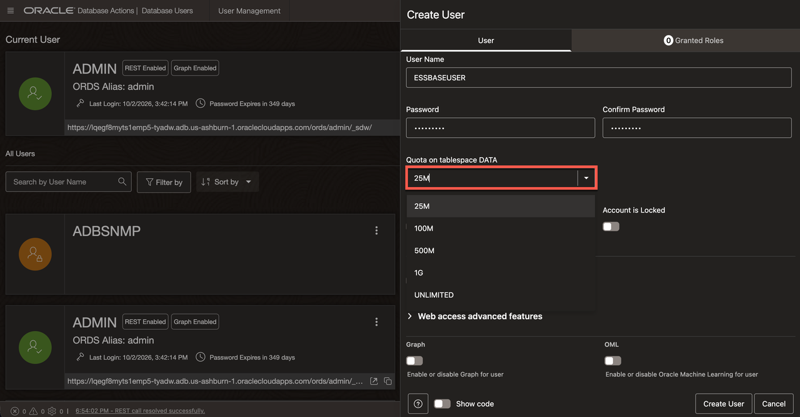

5. Enable **REST, GraphQL, MongoDB API, and Web Access** for the new user.
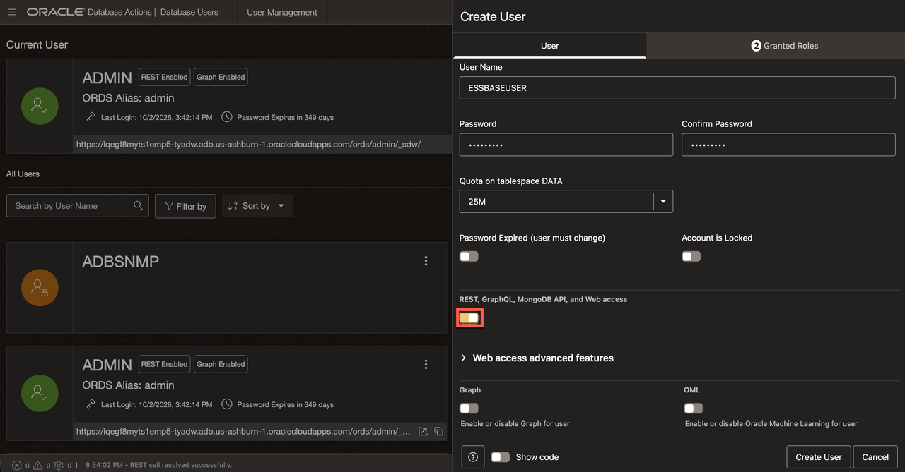

6. Open **Granted Roles**. For both **DWROLE** and **ESSBASEPOWERUSER** Grant and set to Default so the user can access the Data Studio tools used in this workshop. Confirm that both **CONNECT** and **RESOURCE** are Granted and Default as well.
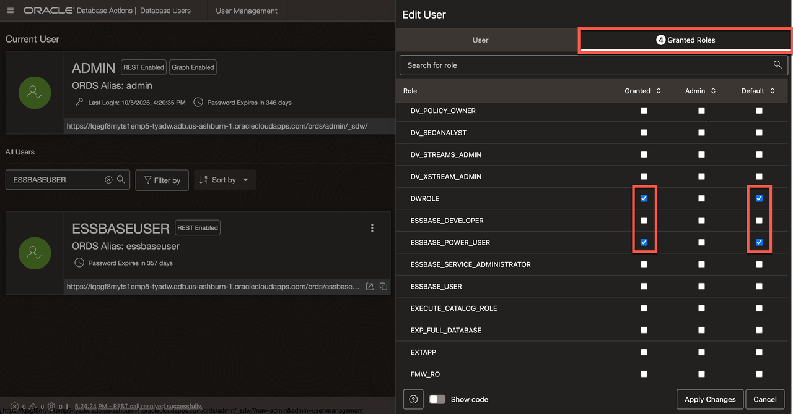

7. Select **Create User** and confirm that Database Actions reports that the user was created.

8. Find the new user's card on the **Database Users** page. Confirm that the account is open and shows **REST Enabled**.
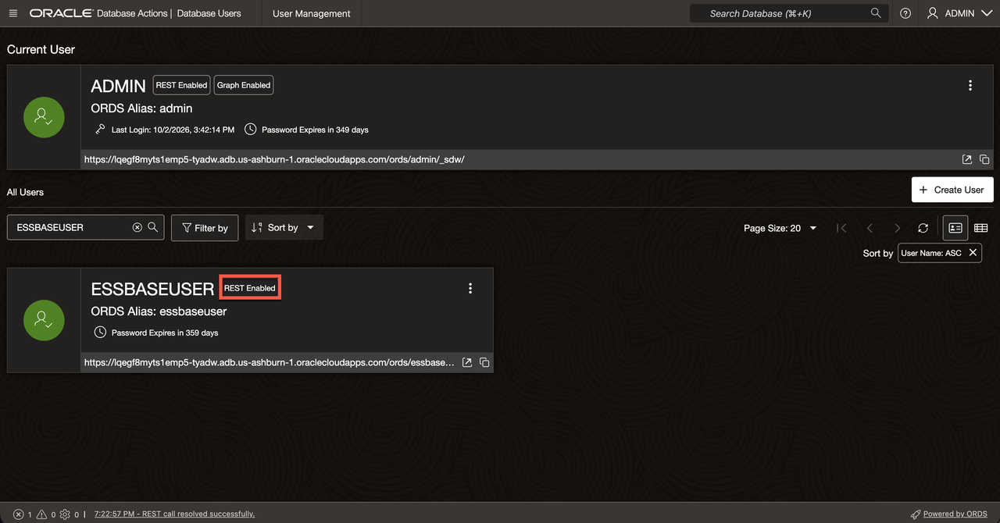

## Task 4: Sign In as the Workshop User and Verify Access

1. Sign out of the **ADMIN** session, or open a separate private browser window.
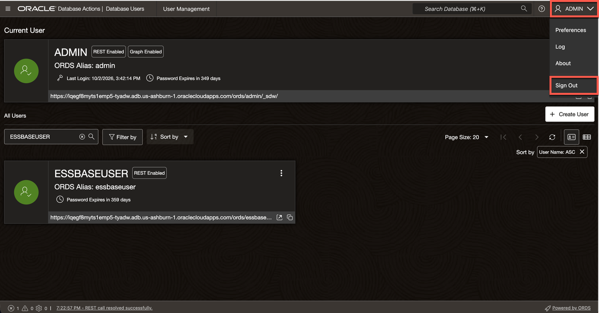

2. Sign in with the Essbase user's credentials from Task 3 to test the credentials.
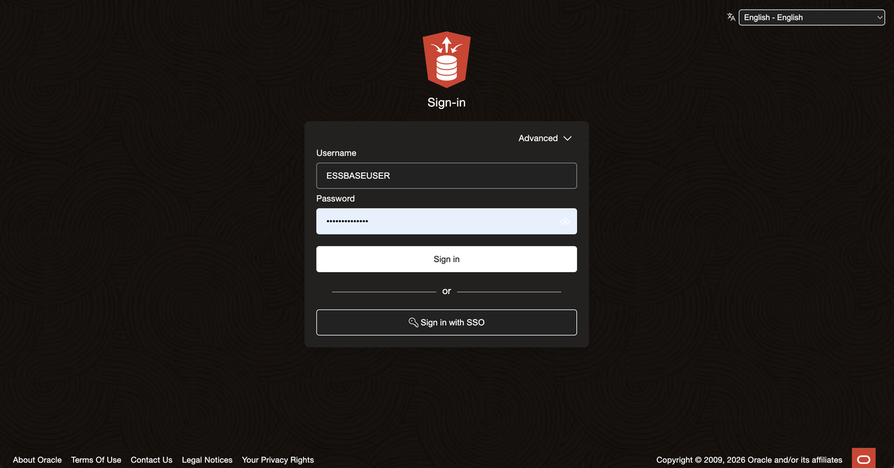

3. Keep the credentials saved for the next lab.

You have prepared and verified the database user. In the next lab, you will use this account to launch Essbase embedded on AI Lakehouse.

You may now **proceed to the next lab**.

## Learn More

- [Connect with Built-In Oracle Database Actions](https://docs.oracle.com/en/cloud/paas/autonomous-database/serverless/adbsb/connect-database-actions.html)
- [Create and Manage Users on Autonomous AI Database](https://docs.oracle.com/en/cloud/paas/autonomous-database/serverless/adbsb/manage-users-create.html)
- [Manage User Roles and Privileges on Autonomous AI Database](https://docs.oracle.com/en/cloud/paas/autonomous-database/serverless/adbsb/manage-users-privileges.html)

## Acknowledgements

* **Author** - Ty Wolber, Cloud Engineer
* **Last Updated By/Date** - Ty Wolber, October 2026
