# Launch Embedded Essbase

## Introduction

In this lab, you will enable embedded Essbase from the OCI Console, sign in as the database ADMIN user for the initial setup, and then verify access with the Essbase user created in Lab 2. You will confirm that the Essbase home page is available before importing the PeakGear Sporting Goods application in the next lab.

Estimated Time: 10 minutes

### About Essbase

Essbase provides multidimensional cubes for analyzing business data. In this workshop, Essbase is available from the Data Studio area of Database Actions in your existing Autonomous AI Lakehouse.

### Objectives

In this lab, you will:

- Launch Essbase from the OCI Console.
- Sign in to Essbase and verify that it provisioned properly.
- Confirm the Import action is available for the Essbase user.

### Prerequisites

This lab assumes you have:

- Access to the existing Autonomous AI Lakehouse and permission to enable embedded Essbase.
- OCI Console access, the database ADMIN credentials, and the workshop user's credentials from Labs 1 and 2.

## Task 1: Launch Essbase from AI Lakehouse

1. Return to your AI Lakehouse details page.
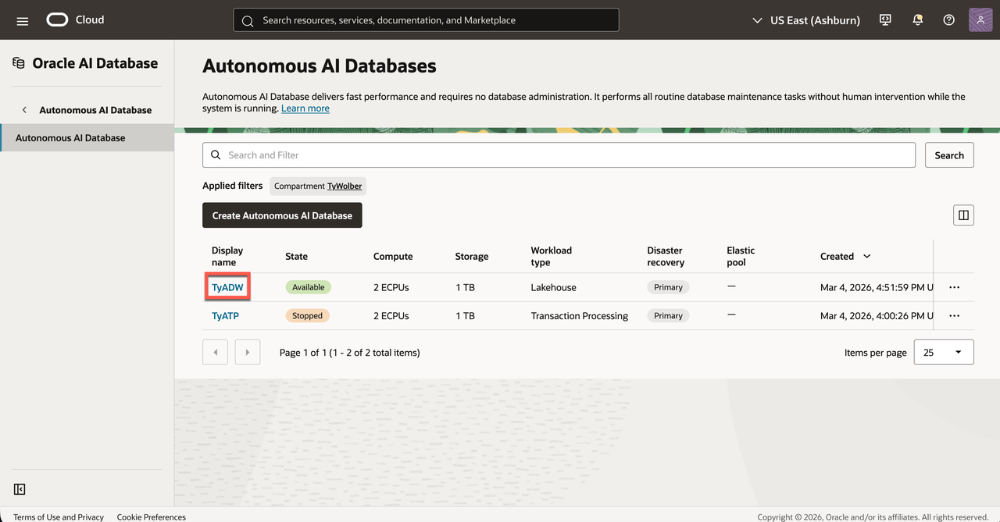

2. Click on **Tool Configuration** from the ribbon options.
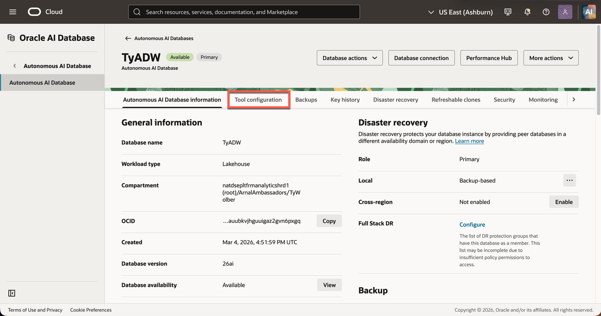

3. Scroll down to **Essbase** then click **Edit**.
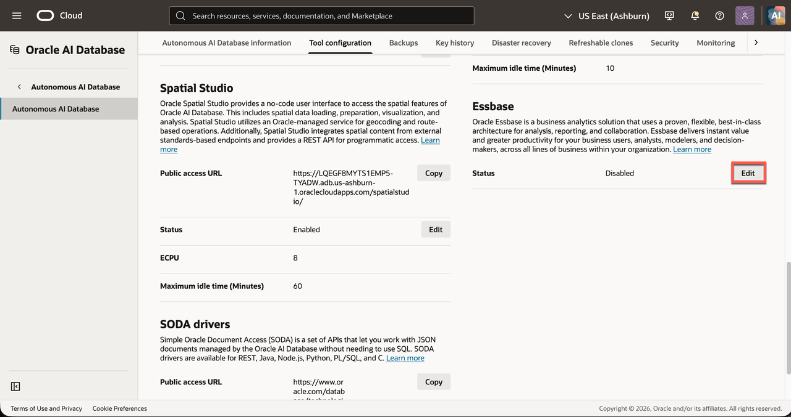

4. Toggle on **Enable Essbase** and click apply. You can configure the OCPU count and idle time here as well.
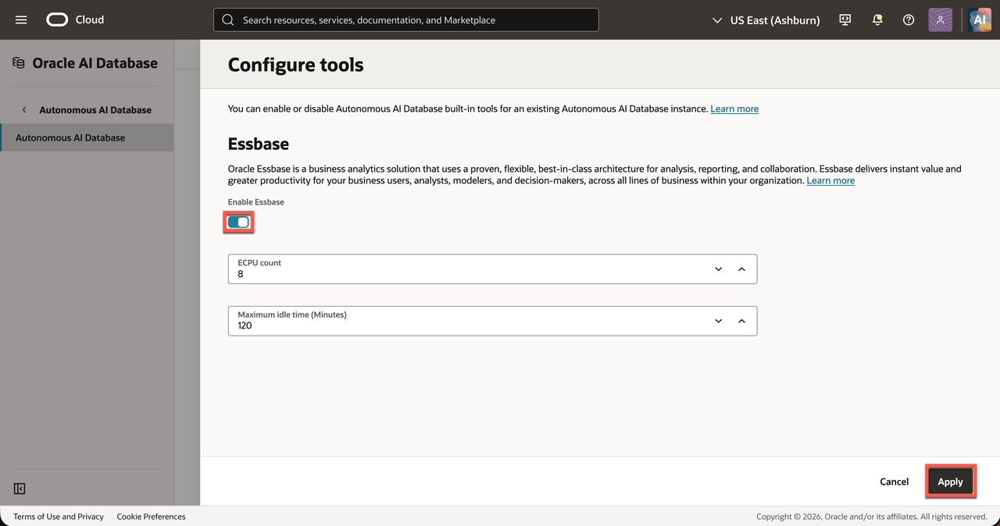

5. After AI Lakehouse finishes updating, copy the URL under Essbase and paste it in a new browser window.
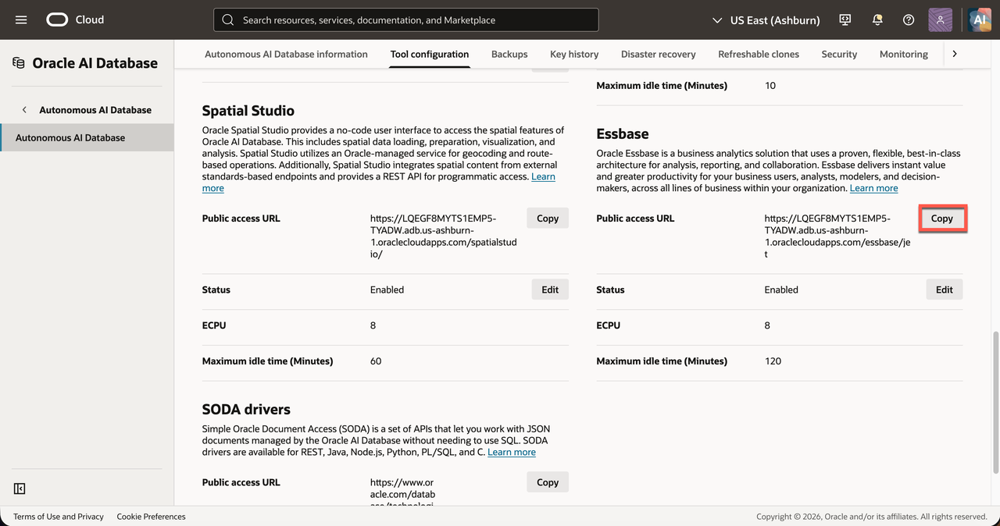

6. On the Essbase sign-in page, enter the database **ADMIN** credentials.
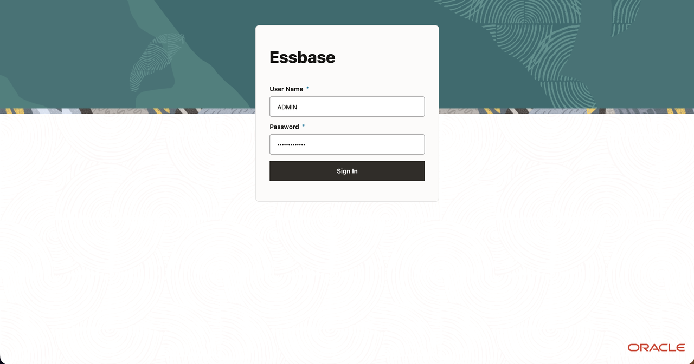

7. Select **Sign In**. Essbase will take a few minutes to provision when the first user logs in. After provisioning starts proceed to Task 2.

## Task 2: Catalog Object Storage Configuration

1. While Essbase provisions, go back to your OCI console tab. Click the **Navigation Menu** in the top left then **Storage → Buckets**.
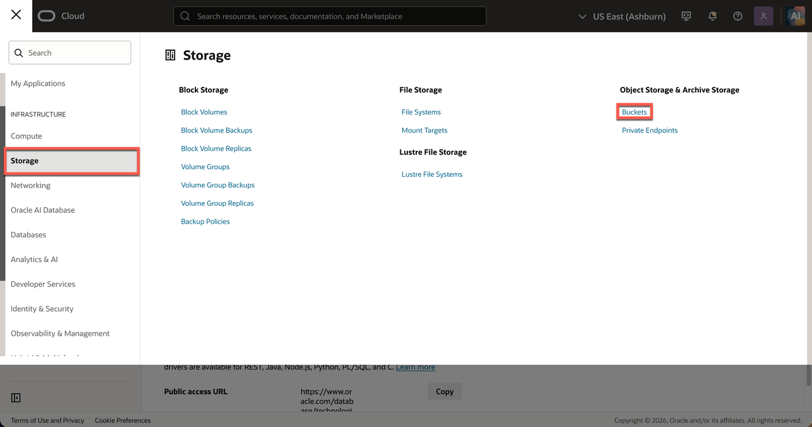

2. Select the compartment designated for the lab, then click **Create bucket**.
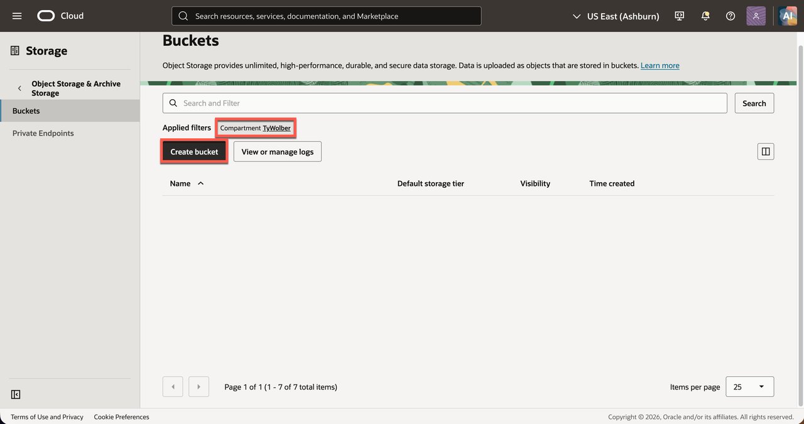

3. Enter a unique name, such as `essbase-embedded-ailakehouse-catalog`. Select the **Standard** storage tier and leave the rest as default, then click **Create Bucket**.
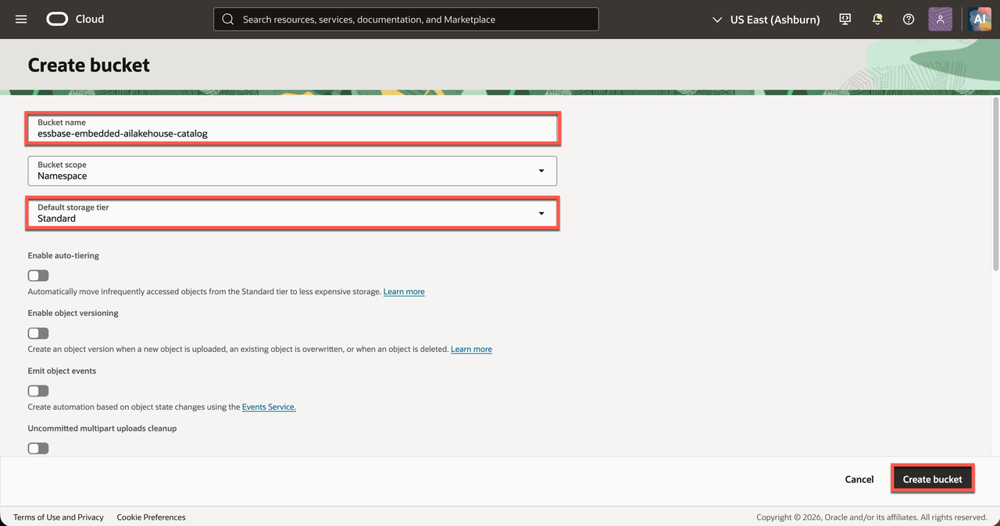

4. Open the new bucket. Record its **Bucket name** and **Namespace** from the bucket details. Essbase needs the bucket name, not the bucket OCID.
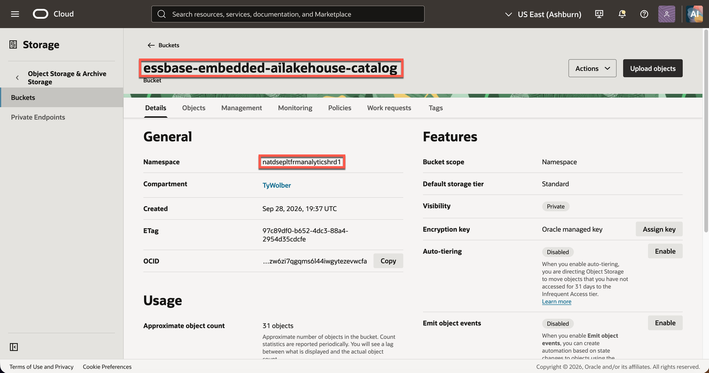

5. Open the OCI profile menu for the user whose API signing key will access the bucket, then select **User settings** and copy the **User OCID**. This user may differ from the bucket creator, but must have access to the bucket.
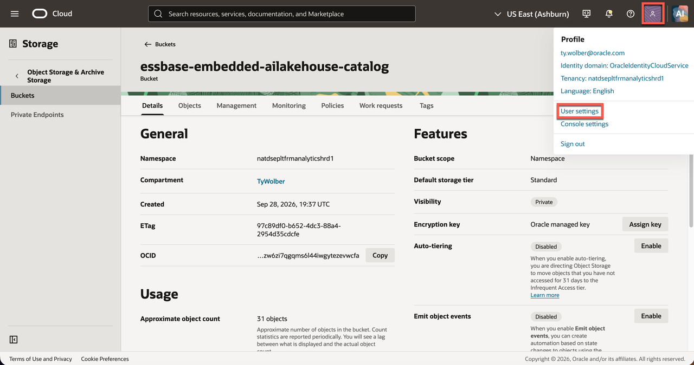
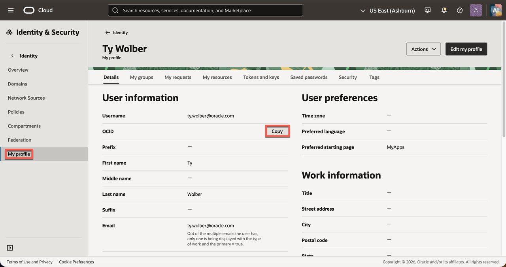

6. On the same user page, open **Tokens and keys**. If you already have the matching private key file, copy its **Fingerprint** and skip Step 7 and 8. Otherwise, click **Add API Key**.
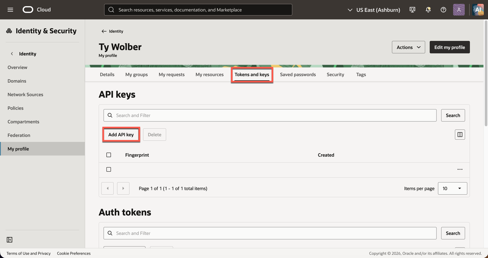

7. Download the new **private key** `.pem` file, then click **Add**.
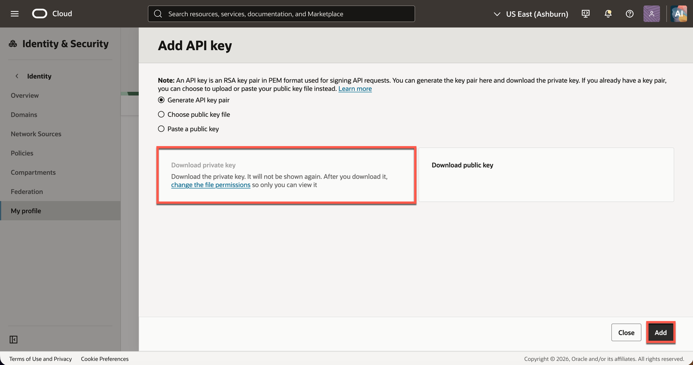

8. Copy the displayed fingerprint under **Fingerprint**. Keep the private key in a secure location.
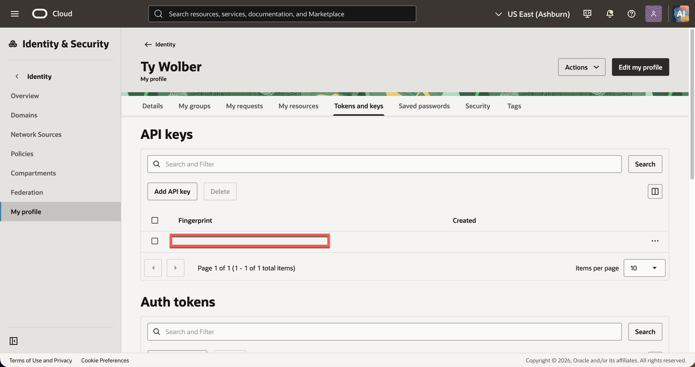

9. Open the profile menu and select your tenancy name. Copy the **Tenancy OCID**.
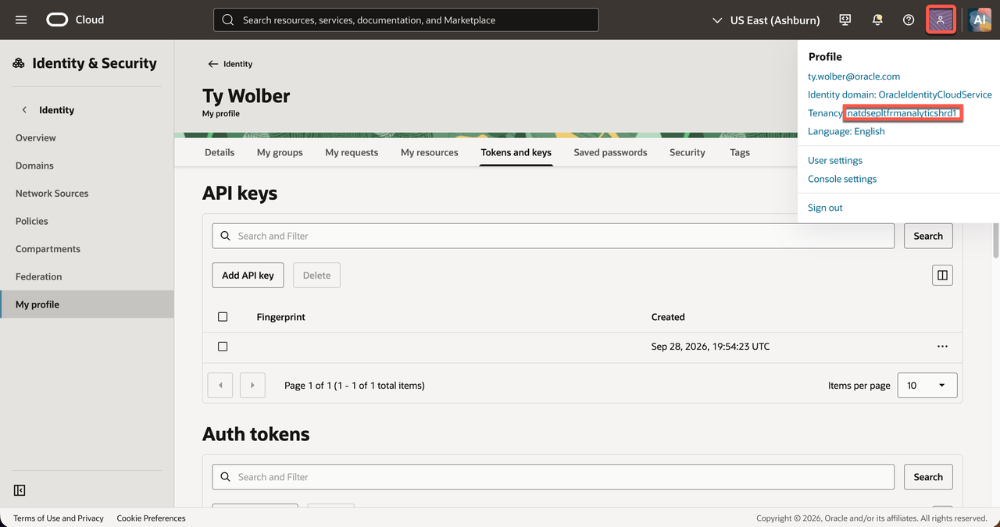
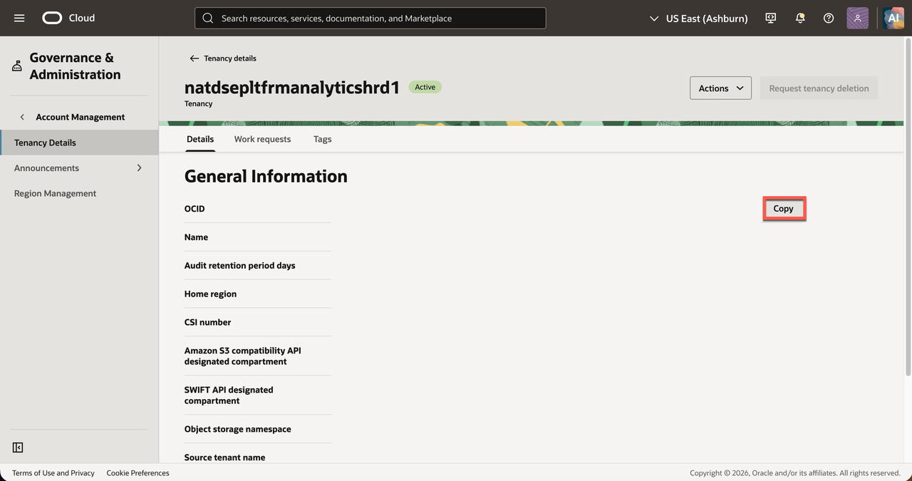

10. Return to Essbase as **Admin** user and click **Configure** to add **Catalog Object Storage**.

   | Essbase field | Value to enter |
   | --- | --- |
   | **User ID** | The OCI **User OCID** from User settings |
   | **Fingerprint** | The fingerprint of the API key paired with your private `.pem` file |
   | **Tenancy** | The **Tenancy OCID** |
   | **Region** | The bucket's OCI region identifier, for example `us-ashburn-1` |
   | **Key file** | Select the downloaded **private API signing key** `.pem` file |
   | **Key file content** | Confirm the private key content appears after selecting the file; if needed, paste the private PEM content directly into this Essbase field |
   | **Namespace** | The Object Storage namespace shown in the bucket details |
   | **Bucketname** | The exact bucket name created above |
   | **Private key passphrase** | Enter it only if the private key was created with a passphrase |

11. Click **Test**. If the test succeeds, click **Save** and confirm the catalog loaded. Then sign out of the Essbase ADMIN user.

12. Sign in with the workshop user created in Lab 2. Confirm that the Essbase Applications page opens and **Import** is available.

You may now **proceed to the next lab**.

## Learn More

- [Connect with Built-In Oracle Database Actions](https://docs.oracle.com/en/cloud/paas/autonomous-database/serverless/adbsb/connect-database-actions.html)
- [Using the Oracle Essbase Web Interface](https://docs.oracle.com/en/database/other-databases/essbase/26/ugess/index.html)

## Acknowledgements

* **Author** - Ty Wolber, Cloud Engineer
* **Last Updated By/Date** - Ty Wolber, October 2026
