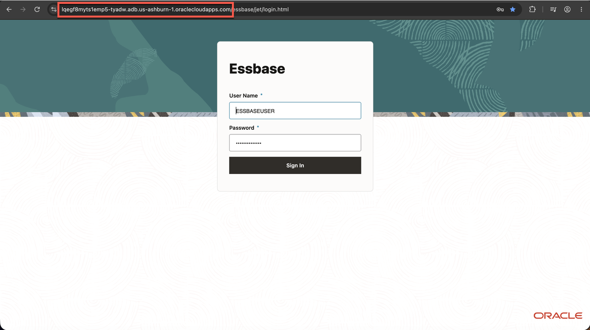
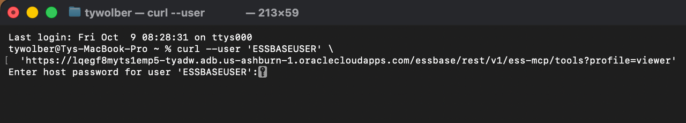
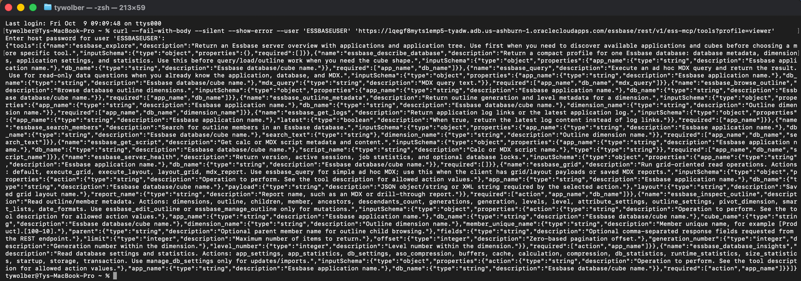
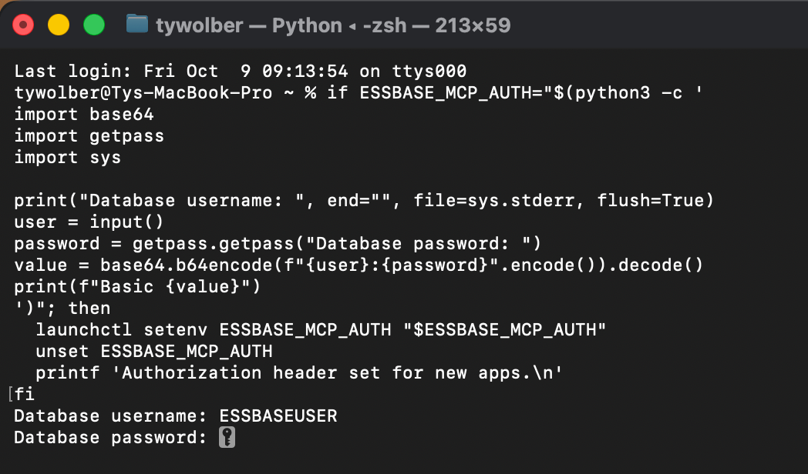
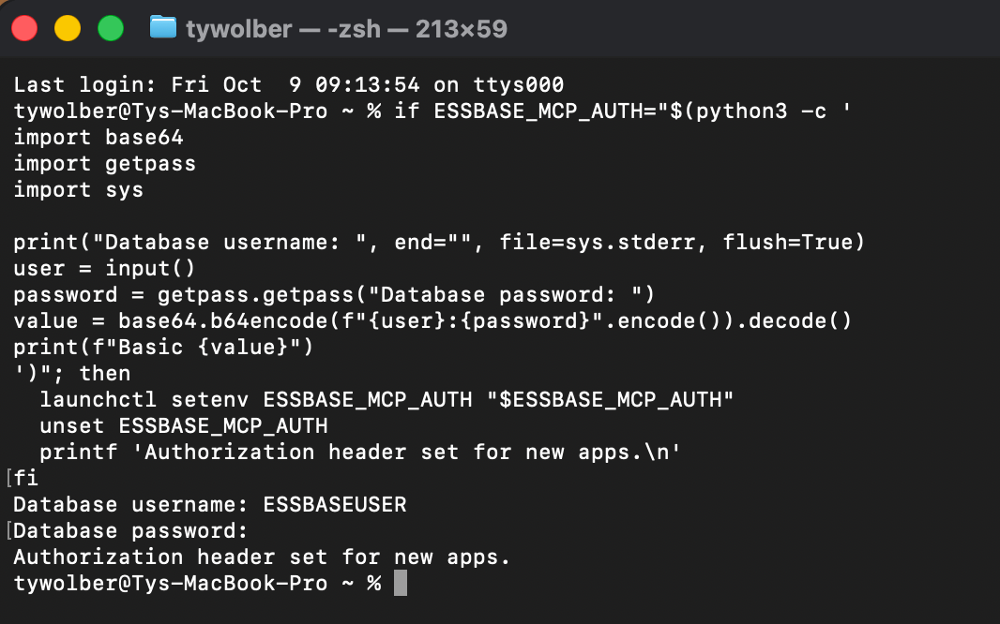
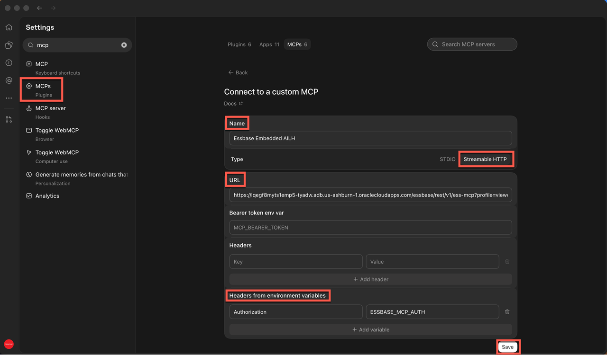
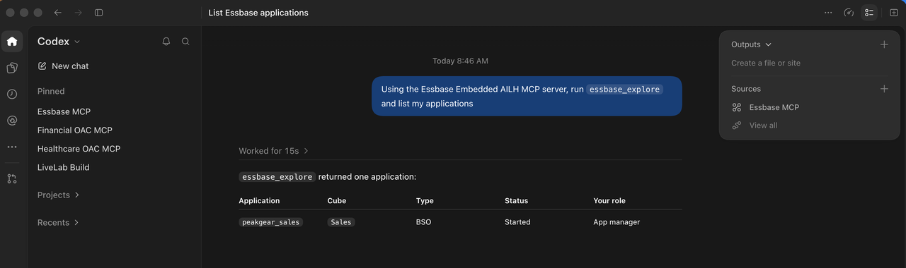
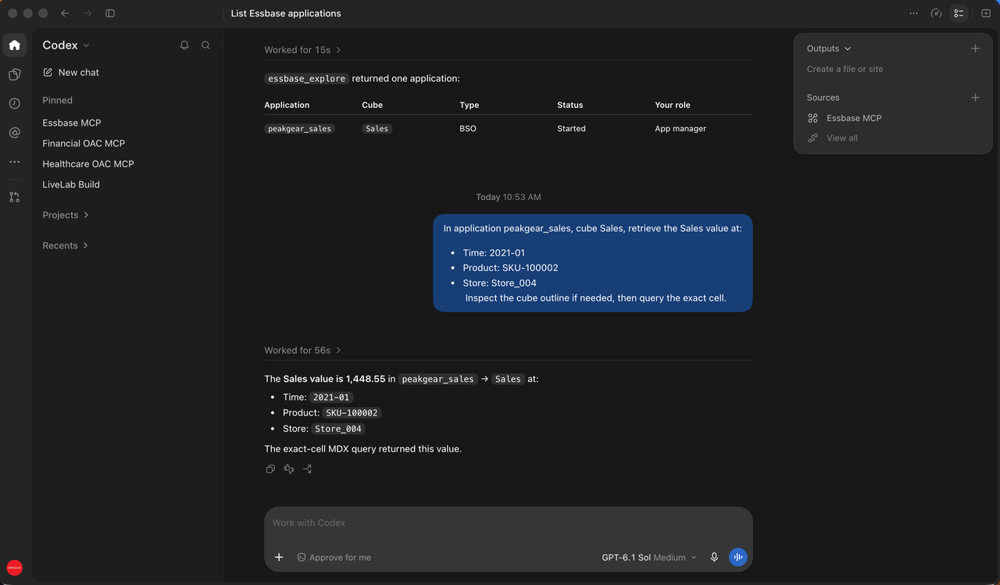

# Connect Codex to the Embedded Essbase MCP Server

## Introduction

In this optional lab, you will connect Codex to the Essbase MCP server embedded in your AI Lakehouse. You will use the read-only `viewer` profile based on your ESSBASEUSER created in Lab 2 to list the Essbase applications available to the user. Screenshots in this lab are based on MacOS, but Windows commands will be provided as well.

Estimated Time: 20 minutes

### About the Essbase MCP Server

Embedded Essbase provides its own MCP endpoint under `/essbase/rest/v1/ess-mcp`. This is separate from the Autonomous AI Database MCP endpoint under `/adb/mcp/v1/databases/`. For this embedded Essbase environment, use HTTP Basic authentication with the Database credentials you use to access Essbase.

### Objectives

In this lab, you will:

- Find the Essbase host and MCP URL.
- Verify the endpoint with your Database credentials.
- Configure Codex to send the authorization header.
- Use a read-only Essbase MCP tool to list applications.

### Prerequisites

This lab assumes you have:

- An AI Lakehouse with embedded Essbase available.
- The Essbase login URL and a Database username and password that can sign in to Essbase.
- Access to the PeakGear application imported earlier in the workshop.
- Codex desktop and terminal access with `python3` and `curl`.

## Task 1: Find the Essbase MCP URL

1. Open the Essbase login page used earlier in this workshop. Its URL has this form:

   ```text
   https://.../essbase/jet/login.html
   ```

2. Copy only the host name between `https://` and `/essbase`. Build the read-only MCP URL and save it for Task 4:

   ```text
   https://host-name/essbase/rest/v1/ess-mcp?profile=viewer
   ```


3. Build the tool-catalog URL for the verification step in Task 2:

   ```text
   https://host-name/essbase/rest/v1/ess-mcp/tools?profile=viewer
   ```

> **Note:** Use the host URL from the **Essbase login page**, not the `dataaccess.adb.../adb/mcp/v1/databases/...` URL for the Autonomous AI Database MCP server.

## Task 2: Verify the Essbase MCP Endpoint

1. In a Terminal / Powershell, run the following command. Replace `host-name` and `ESSBASEUSER` with your values. Leave the username inside the quotes.

**Terminal (Mac):**
   ```bash
   <copy>curl --fail-with-body --silent --show-error \
     --user 'ESSBASEUSER' \
     'https://host-name/essbase/rest/v1/ess-mcp/tools?profile=viewer'</copy>
   ```

**Powershell (Windows):**
```powershell
<copy>curl.exe --fail-with-body --silent --show-error `
  --user 'ESSBASEUSER' `
  'https://host-name/essbase/rest/v1/ess-mcp/tools?profile=viewer'</copy>
```

> **Note:** Use `curl.exe` in PowerShell. The macOS command uses a backslash (`\`) to continue onto another line; PowerShell uses a backtick (`` ` ``). Do not put spaces after either continuation character. The URL must include `/tools` before `?profile=viewer`. Without `/tools`, the response describes the MCP server but does not list its tools.

2. When `curl` prompts for a password, enter your Database password. The password will not appear as you type.


3. Confirm the response contains Essbase tool names, including `essbase_explore`. The `viewer` profile exposes read-only tools.


> **Troubleshooting:** HTTP 401 means the endpoint was reached but authentication failed. Check the Database username and password. HTTP 404 usually means the host or `/essbase/rest/v1/ess-mcp/tools` path is incorrect.

## Task 3: Make the Authorization Header Available to Codex

Codex will read the complete HTTP `Authorization` header from an environment variable named `ESSBASE_MCP_AUTH`. Use the steps for your operating system to create the required `Basic` value without displaying your password.

1. Paste and run the **entire** block for your operating system. Type your Database username and password only when prompted. The password stays hidden.

   **Terminal (Mac):**

   ```bash
   <copy>if ESSBASE_MCP_AUTH="$(python3 -c '
   import base64
   import getpass
   import sys

   print("Database username: ", end="", file=sys.stderr, flush=True)
   user = input()
   password = getpass.getpass("Database password: ")
   value = base64.b64encode(f"{user}:{password}".encode()).decode()
   print(f"Basic {value}")
   ')"; then
     launchctl setenv ESSBASE_MCP_AUTH "$ESSBASE_MCP_AUTH"
     unset ESSBASE_MCP_AUTH
     printf 'Authorization header set for new apps.\n'
   fi</copy>
   ```

   **PowerShell (Windows):**

   ```powershell
   <copy>$dbUser = Read-Host 'Database username'
   $securePassword = Read-Host 'Database password' -AsSecureString
   $plainPassword = [System.Net.NetworkCredential]::new('', $securePassword).Password
   $credentialBytes = [Text.Encoding]::UTF8.GetBytes($dbUser + ':' + $plainPassword)
   $authHeader = 'Basic ' + [Convert]::ToBase64String($credentialBytes)
   [Environment]::SetEnvironmentVariable('ESSBASE_MCP_AUTH', $authHeader, 'User')
   [Array]::Clear($credentialBytes, 0, $credentialBytes.Length)
   Remove-Variable dbUser, securePassword, plainPassword, credentialBytes, authHeader
   Write-Host 'Authorization header set for newly launched apps.'</copy>
   ```

2. On both Windows and Mac, fully quit and reopen Codex so the app receives the new user environment variable.


3. Confirm the terminal prints `Authorization header set for new apps.` or `Authorization header set for newly launched apps.` Do not print the environment variable: its value contains your encoded credentials.


> **Note:** Base64 encoding is not encryption. The macOS launch environment or Windows user environment retains this value until you remove it. Perform Task 5 when finished.

## Task 4: Add the Essbase MCP Server to Codex

1. Open **Codex → Settings → MCP servers → Add server**.

2. Enter these values:

   | Field | Value |
   |---|---|
   | Name | `Essbase Embedded AILH` |
   | Type | `Streamable HTTP` |
   | URL | `https://host-name/essbase/rest/v1/ess-mcp?profile=viewer` |
   | Bearer token env var | Leave blank |
   | Headers | Leave blank |
   | Headers from environment variables — Key | `Authorization` |
   | Headers from environment variables — Value | `ESSBASE_MCP_AUTH` |

3. Replace `host-name` in the URL with the host you found in Task 1, then **Save**.


4. Fully quit and reopen Codex so its new process receives `ESSBASE_MCP_AUTH`.

5. In a new Codex chat, enter:

   ```text
   <copy>Using the Essbase Embedded AILH MCP server, run essbase_explore and list the Essbase applications available to me.</copy>
   ```

6. Confirm the result lists the applications your Database user can access. PeakGear should appear if that user has permission to it in Essbase.


7. In the same Codex chat, enter:

```text
   <copy>In application peakgear_sales, cube Sales, retrieve the Sales value at:
- Time: 2021-01
- Product: SKU-100002
- Store: Store_004
   Inspect the cube outline if needed, then query the exact cell.</copy>
   ```

8. Confirm the result shows the Sales value for the exact cell your Database user queried. The value should be 1,448.55 for Time 2021-01, Product SKU-100002, and Store Store_004 in the peakgear_sales application’s Sales cube. This value matches the results obtained in Smart View for the same Time, Product, and Store intersection.


## Task 5: Remove the Credential After the Lab

1. When you finish using the connection, remove the credential using the command for your operating system.

   **Terminal (macOS):**

   ```bash
   <copy>launchctl unsetenv ESSBASE_MCP_AUTH</copy>
   ```

   **PowerShell (Windows):**

   ```powershell
   <copy>[Environment]::SetEnvironmentVariable('ESSBASE_MCP_AUTH', $null, 'User')</copy>
   ```

2. Fully quit and reopen Codex. On Windows, sign out and sign back in to ensure newly launched apps no longer receive the credential. To use the connection again in a later session, repeat Task 3 with your current Database credentials.

## Learn More

- [Essbase MCP Access Profiles](https://docs.oracle.com/en/database/other-databases/essbase/26/esmcp/mcp-access-profiles.html)
- [Configure MCP Servers in Codex](https://developers.openai.com/codex/mcp)

## Acknowledgements

* **Author** - Ty Wolber, Cloud Engineer
* **Last Updated By/Date** - Ty Wolber, October 2026
