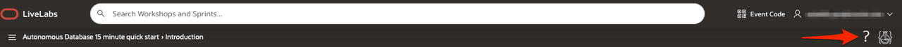
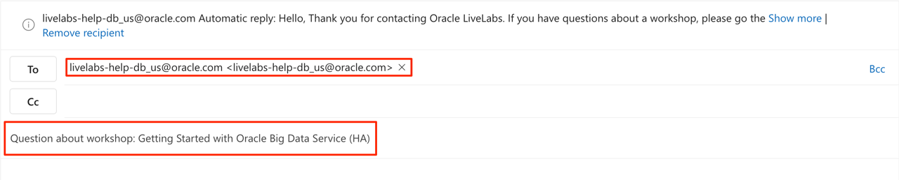
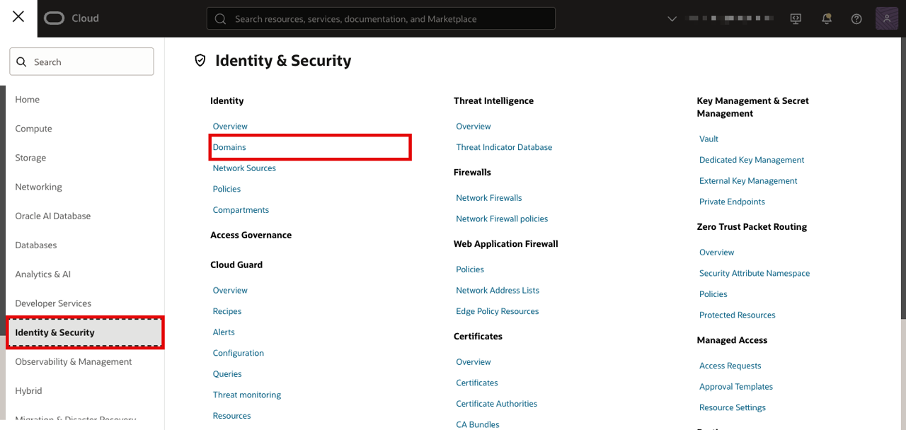
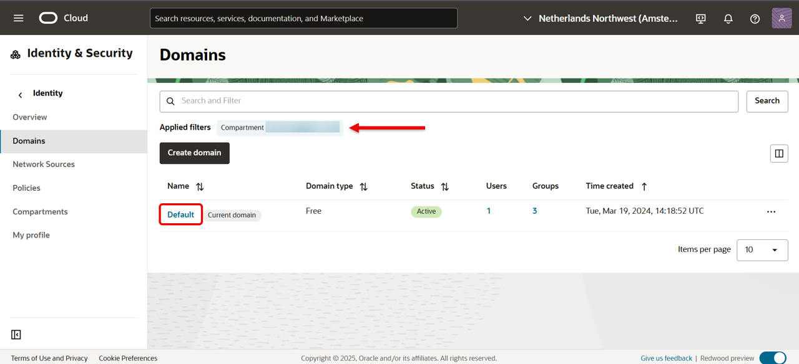
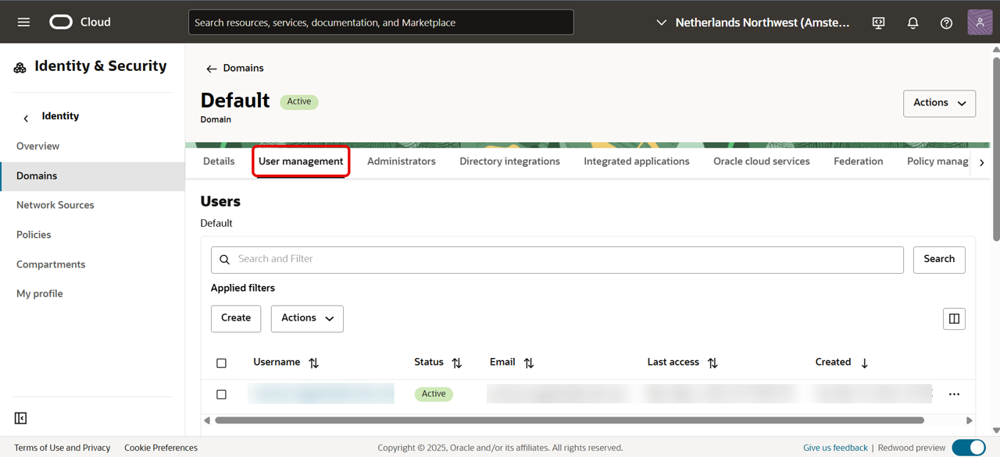
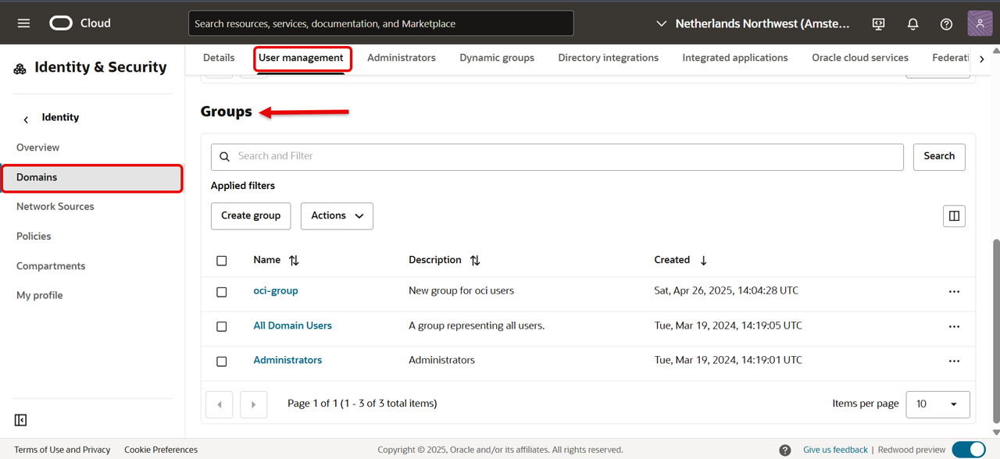

# Need help?

## Introduction
This page is designed to help you solve some common problems users face in this LiveLab.

After reading those troubleshooting tips, if you still find yourself stuck or would like to report an issue with the workshop, click the question mark icon in the upper right corner to contact the LiveLabs team directly via email.

For more about getting support using our email, see Task 1 below.

### Common Issues Table of Contents
  - [Connectivity Issues?](#ConnectivityIssues?)
  - [Cannot Create Passwords for Database Users?](#CannotCreatePasswordsforDatabaseUsers?)
  - [Cannot find Groups under Identity and Security in my tenancy?](#CannotfindGroupsunderIdentityandSecurityinmytenancy?)

## Task 1: How to Format Your Support Email Request
This will construct an email in your default mail application that is auto-populated to address our LiveLabs support inbox and will also include your current workshop in the subject line. Follow the steps below to contact us and get a quick resolution to your issue.

1. In the subject line please provide the **Workshop Name** (see example).
    

2. Include the **Lab Number**, **Task Number**, and **Step Number** where you've encounter the issue. Also, include the **environment** where you are running this workshop (your tenancy or the LiveLabs sandbox tenancy).

3. Include the description of your **issue** and any pertinent information in the contents of your email.

4. Attach a **Screenshot** and **Any Troubleshooting Steps** you've tried, so that we can recreate the issue and provide a timely and accurate solution.

## Connectivity Issues?

Are you connected to a **VPN**, **Corporate Network**, or behind a strict **Firewall**?

If any of these three conditions are true, some ports in your network may be closed to traffic.

For uploading data through Database Actions in your web browser and applications like the Oracle Analytics Tool could be restricted and may appear to "Hang" or freeze.

While connecting to a noVNC workshop, you might get "Hmmm... can't reach this page" error and could not access the workshop.

Try these options to access the environment again:

1. Please disconnect from your VPN and try again if applicable.

2. If you are connected to a corporate network, try switching to a public or a "clear" network if allowed.

3. Check and disable the ad blocker if there is one setup for your browser.

4. Try running the workshop in a different browser other than your current browser.

5. For the noVNC workshop, check if you can open port 6080.

6. For other standard scenarios, check if you can open ports such as 80, 443, and 22 (for ssh).

7. Alternatively, contact your IT Administrator to see if adding exceptions to your network or firewall would be viable.

## Cannot Create Passwords for Database Users?

1. Make sure the password you enter satisfies the following [restrictions](https://docs.oracle.com/en/cloud/saas/marketing/responsys-user/Account_PasswordRestrictions.htm).

## Cannot find Groups under Identity and Security in my tenancy?

1. From the navigation menu, click **Identity & Security** and select **Domains** under **Identity**.

  

2. Make sure you are in the correct compartment and click **Default(Current domain)**

  

3. From the menu under the domain you chose, click **User management**.

  

4. Scroll until you see **Groups** section.

  

## Acknowledgements
* **Author** - LiveLabs Team
* **Contributors** - LiveLabs Team
* **Last Updated By/Date** - Eileen Beck, November 2025
