# Authenticate users

## Introduction

In this lab, you will add authentication to your app using the Oracle Backend with Supabase APIs JavaScript SDK. When you are done, users will be able to create an account with a display name, sign in, and sign out. Your app will also keep them signed in when the page reloads.

### Objectives

In this lab, you will:

- review the SDK client and its `auth` methods
- create accounts with `client.auth.signUp()`
- sign in with `client.auth.signInWithPassword()`
- end sessions with `client.auth.signOut()`
- follow session changes with `client.auth.onAuthStateChange()`

Estimated Time: 15 minutes

### Prerequisites

This lab assumes you have:

- Successfully completed all previous labs.

## Task 1: Verify email/password authentication

1. In the Fusabase console, open **LiveLab > Authentication > Authentication setup**. You should see **Authentication type** set to **BASIC**. Lab 2's quickstart set this up for you.

    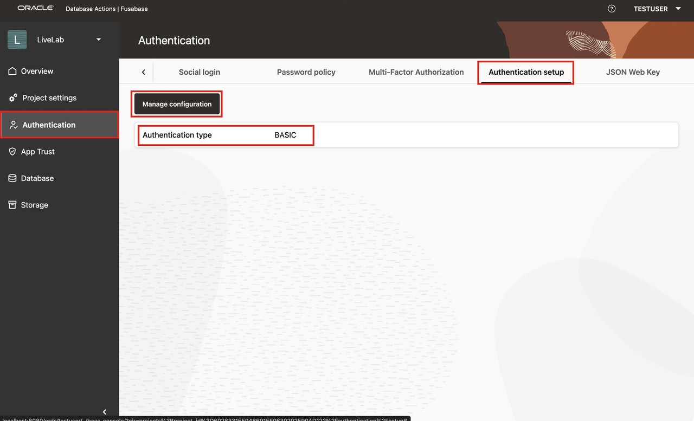

2. Click **Manage configuration** to review the authentication options. **Basic** uses the database to manage user accounts. Click **Cancel** to keep the Basic service.

    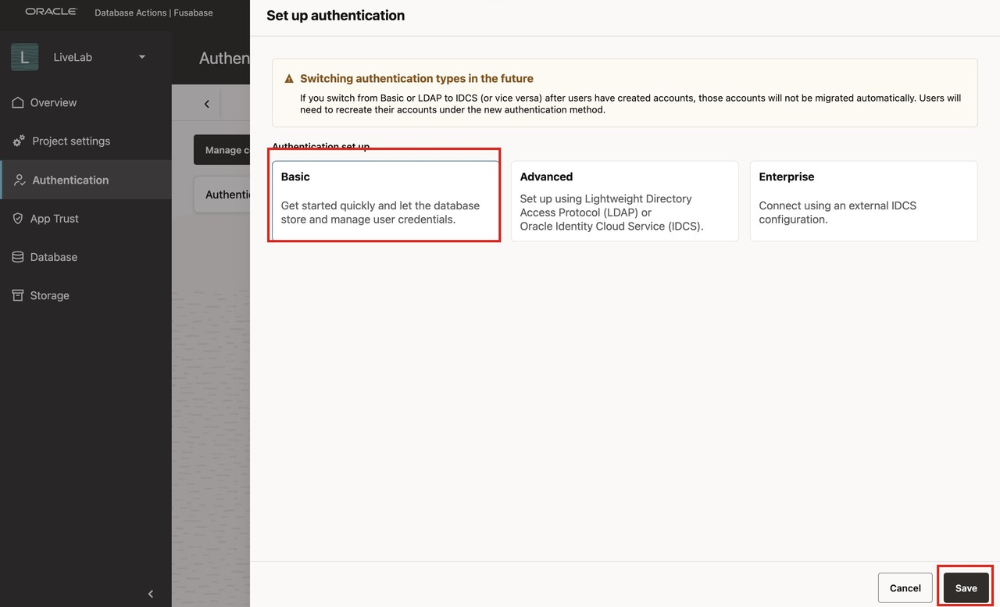

3. Open **Password policy**. You should see a minimum of 6 and a maximum of 30 characters. You can set a different policy here for your own applications.

    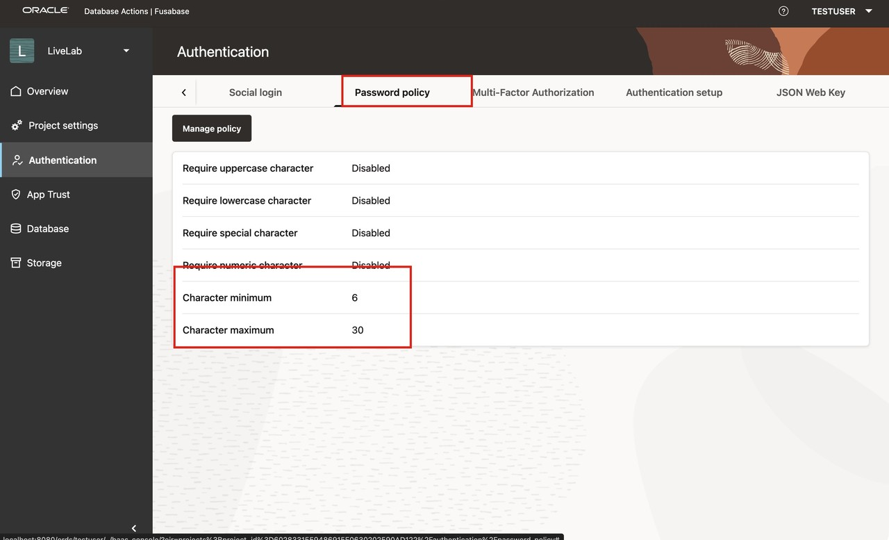

## Task 2: Create an account

You will complete four functions in `starter/actions.js`. The app's forms and buttons are already built, so change only the function named in each step.

1. Return to VS Code and open `starter/actions.js`. The app imports the `fusabase` client you exported from `starter/config.js` in Lab 2 and passes it to each function as `client`. The authentication methods are on `client.auth`, so you don't need an import.

2. Find the `signUp` function. The app passes the client, email, password, and display name to this function. Select the whole function, including its declaration and closing brace.

    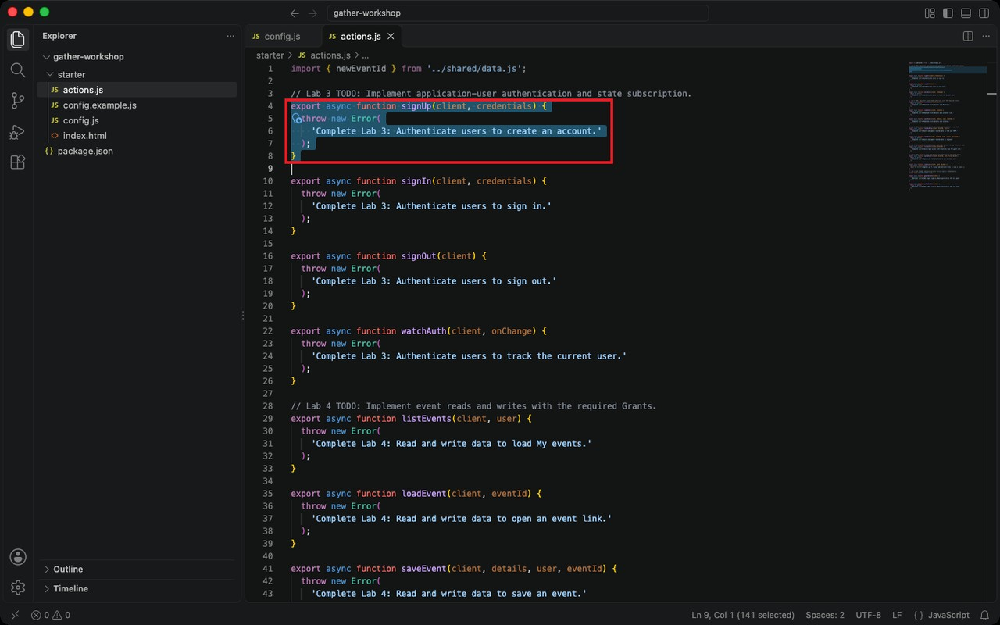

3. Read the sign-up code in three parts:

    - `displayName.trim()` removes spaces from the start and end of the name. The next line checks that a name was entered.
    - `client.auth.signUp()` creates the account with the email and password. `options.data.full_name` saves the display name with the account.
    - The SDK returns `data` and `error`. If the request fails, `throw error` lets the app show a helpful message. On success, `data` contains the user and session.

    Replace the selected function with the complete code and save the file:

    ```javascript
    export async function signUp(client, { email, password, displayName }) {
      const fullName = displayName.trim();
      if (!fullName) throw new Error('Enter a display name.');
      const { data, error } = await client.auth.signUp({
        email,
        password,
        options: { data: { full_name: fullName } }
      });
      if (error) throw error;
      return data;
    }
    ```

    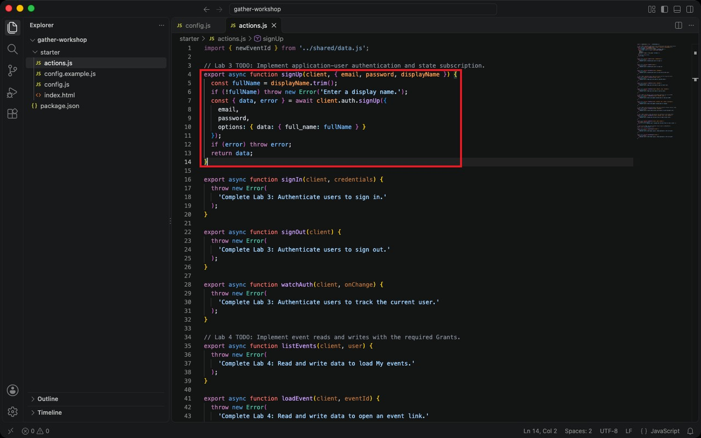

    > Note: Complete Tasks 3 through 5 before you test the app. The listener in Task 5 tells your app when a user has signed in.

## Task 3: Sign in with an existing account

1. Find and select the whole `signIn` placeholder function.

    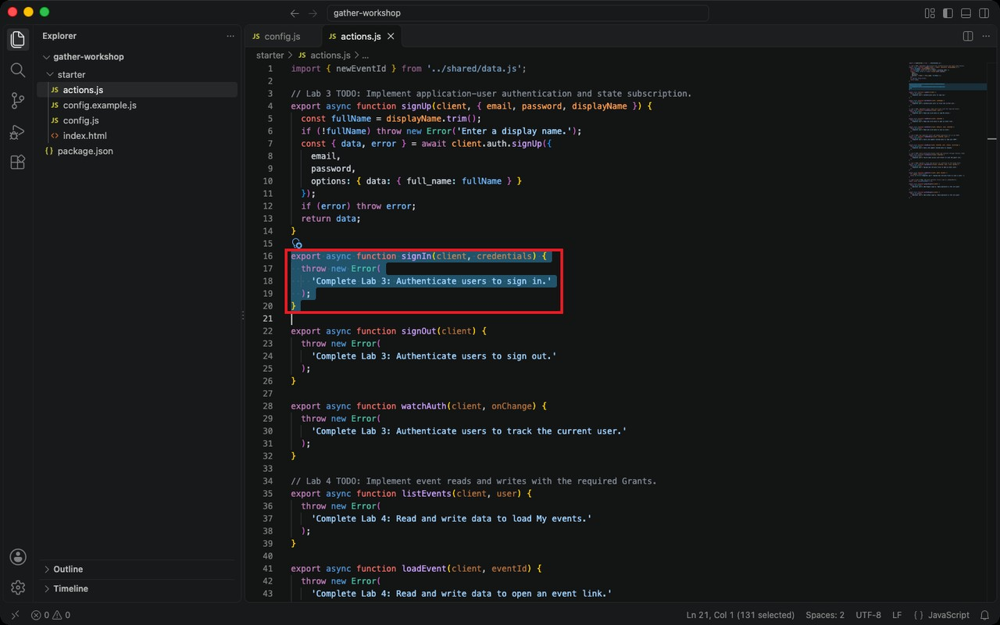

2. `client.auth.signInWithPassword()` signs in an existing user with the email and password from the app. Check `error` so the app can show a helpful message if sign-in fails.

    Replace the selected function with this code and save the file:

    ```javascript
    export async function signIn(client, { email, password }) {
      const { data, error } = await client.auth.signInWithPassword({
        email,
        password
      });
      if (error) throw error;
      return data;
    }
    ```

    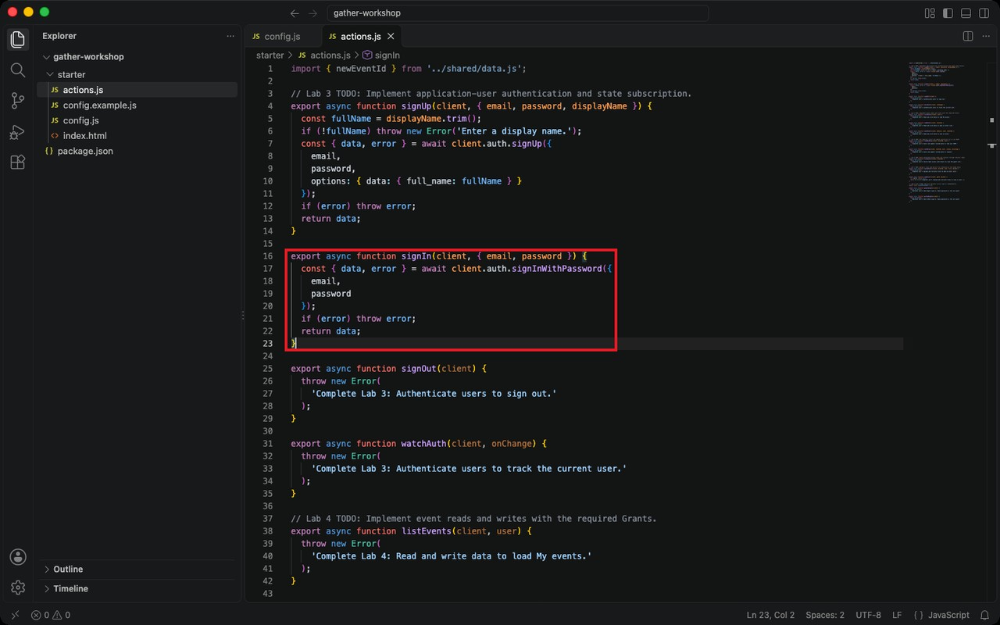

## Task 4: Sign out

1. Find and select the whole `signOut` placeholder function.

    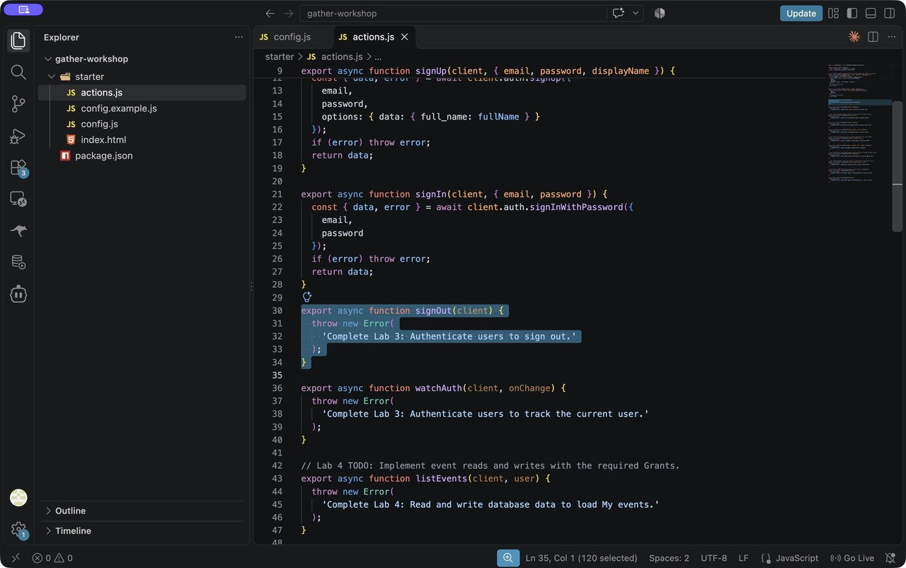

2. `client.auth.signOut()` ends the current session. The app waits for it to finish before closing the account dialog.

    Replace the selected function with this code and save the file:

    ```javascript
    export async function signOut(client) {
      const { error } = await client.auth.signOut();
      if (error) throw error;
    }
    ```

    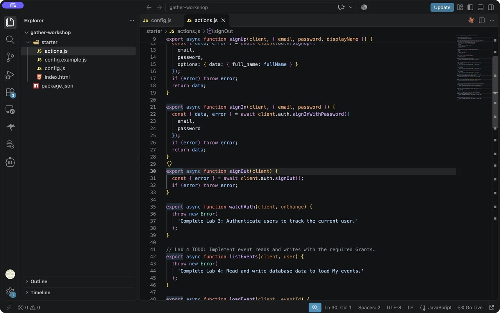

## Task 5: Follow session changes

Your app needs to know when a user signs in, signs out, or returns with an existing session. You will add a listener that keeps the account controls up to date.

1. Find and select the whole `watchAuth` placeholder function. Leave the Lab 4 TODO in place.

    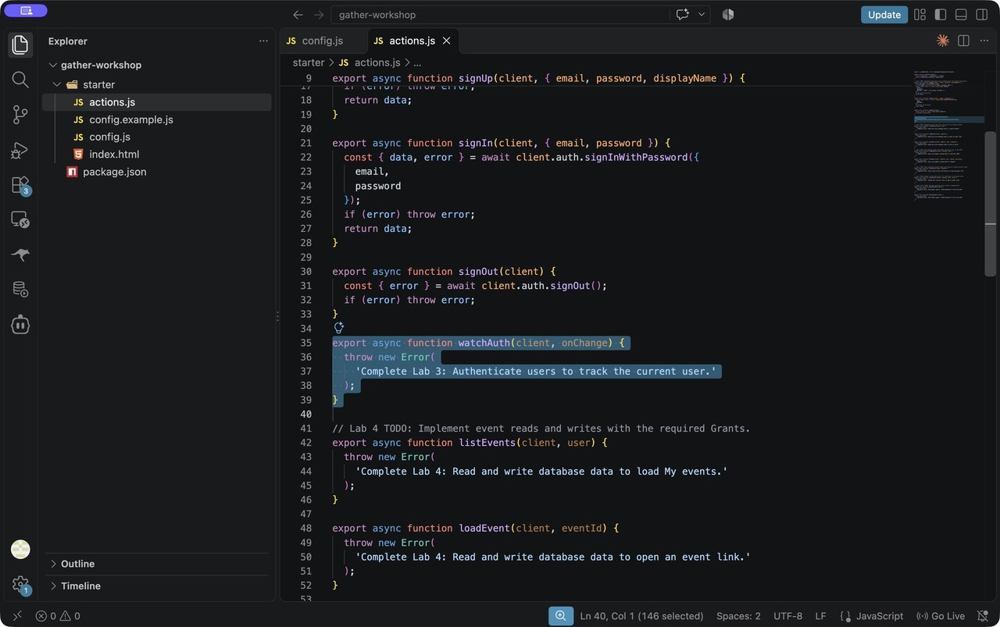

2. Read how the listener works before copying the complete function:

    - `client.auth.onAuthStateChange()` runs your callback when the SDK restores a session or the user signs in or out. The callback receives the event name and the current `session`.
    - `session?.user` gets the signed-in user. `onChange()` passes their ID and saved display name to the app, or `null` when signed out. The app then updates the account controls.
    - `data.subscription.unsubscribe()` stops the listener. Returning a function that calls it gives the app a way to stop listening when needed.

    Replace the selected function with this code and save the file:

    ```javascript
    export async function watchAuth(client, onChange) {
      const { data } = client.auth.onAuthStateChange((_event, session) => {
        const user = session?.user;
        onChange(user ? {
          id: user.id,
          displayName: user.user_metadata?.full_name || 'Signed in'
        } : null);
      });
      return () => data.subscription.unsubscribe();
    }
    ```

    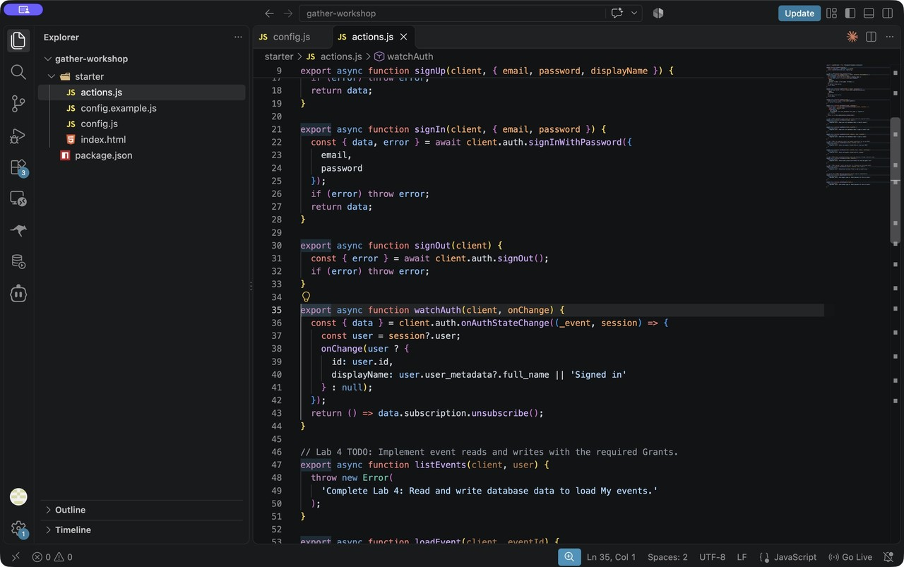

3. Check that all four authentication functions are complete and the later TODOs remain.

## Task 6: Verify authentication in your app

1. Reload [your app](http://localhost:8000/starter/). Select **Sign in > Create account**.

    Create a test account:

    - Enter a display name (for example, Alex Gather).
    - Enter an email address (for example, `test@example.com`).
    - Enter a password that meets Task 1's policy.
    - Click **Create account**.

    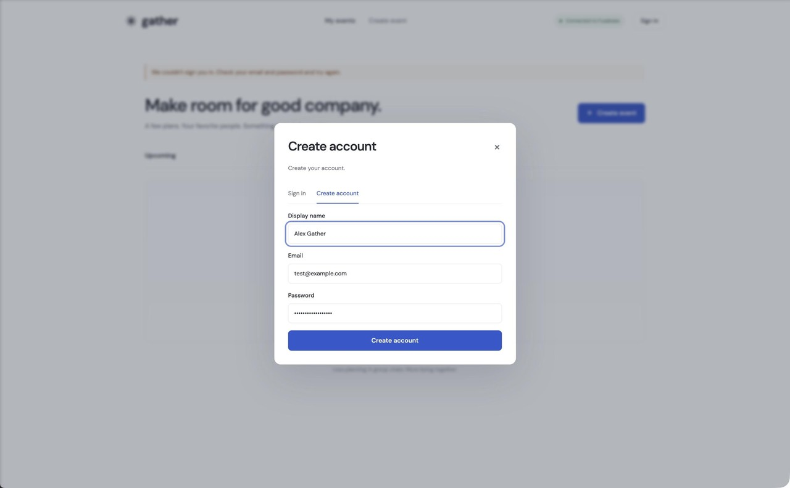

2. The form closes after the account is created. Open **Account**. You should see your display name and the **Sign out** button.

    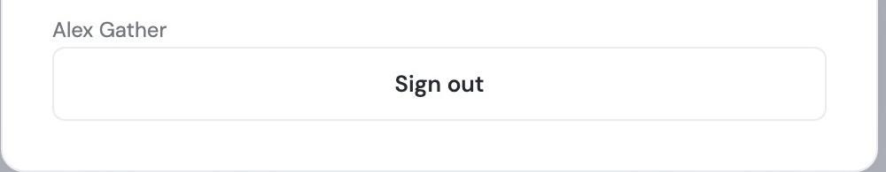

3. Click **Sign out**. You should see **Sign in** in the header and the status **Signed out.** Open the dialog to check that the account form is available again.

    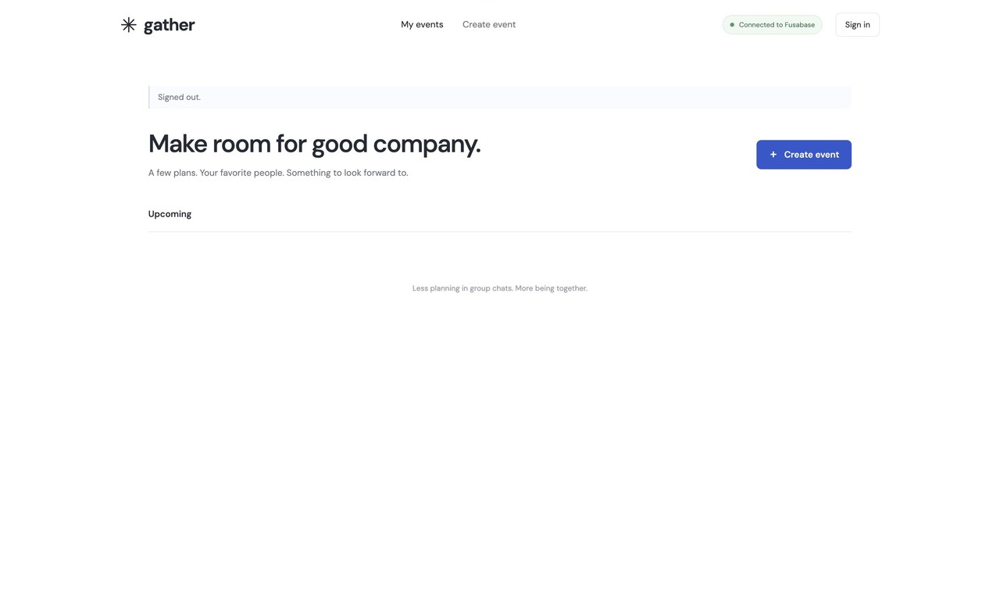

4. Select **Sign in**, enter the same email/password, and click **Sign in**.

    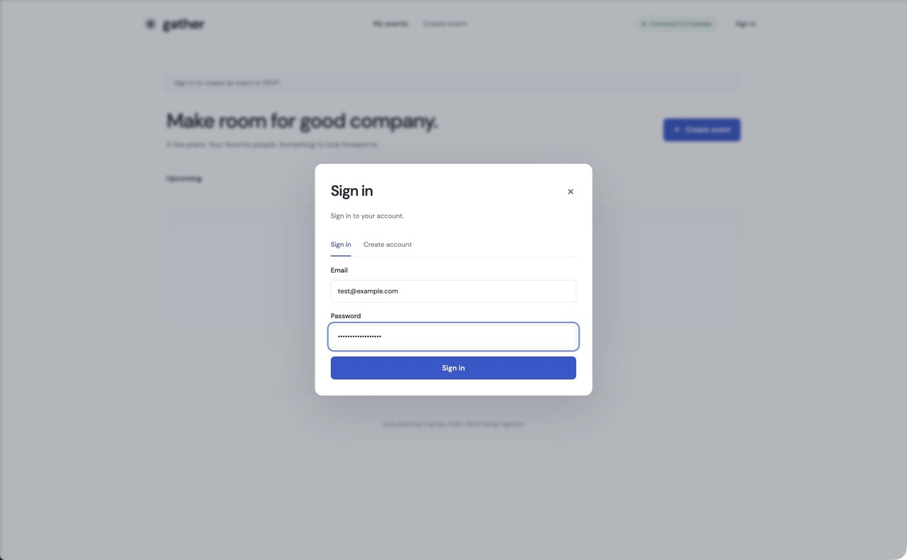

5. Open **Account** and check that it shows the same display name. Reload the page and reopen **Account**. You should still be signed in with the same display name.

6. Sign out, then try to sign in with an incorrect email address or password. The dialog should stay open and show **We couldn't sign you in. Check your email and password and try again.** You should stay signed out.

    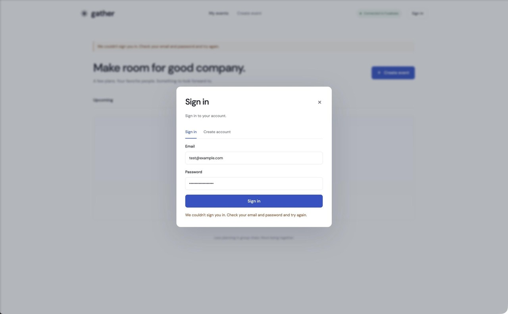

7. Sign in again with the account details you used to sign up. Select **My events**. The app should still ask you to complete Lab 4.

8. If `starter/actions.js` does not work after this lab, navigate to the `checkpoints` folder in your repo, open `lab-3/actions.js`, and use that file's contents to replace `starter/actions.js`. Keep your own `starter/config.js`.

## Troubleshooting

- **A Lab 3 guard remains:** save all four functions and reload. Check that you edited `starter/actions.js`, not `finished/actions.js`.
- **Authentication type isn't BASIC:** click **Manage configuration**, select **Basic**, and click **Save**. Switching types later doesn't migrate existing accounts.
- **Tag is green but authentication fails:** check that the backend is running. Check that `auth_type` and `auth_id` in `config.js` match your app's Fusabase console configuration.
- **Signed in with no name:** check `options.data.full_name` in `signUp` and `user.user_metadata.full_name` in `watchAuth`. An account without a saved name shows **Signed in**.
- **Account exists after a failed sign-up:** sign in with that account instead. The account can exist even if saving the name failed.
- **Too many requests:** wait for the limit to reset, then sign in again. Leave the rate-limit settings unchanged.

You may now **proceed to the next lab**.

## Acknowledgements

* **Author** - Killian Lynch, Senior Product Manager, Oracle AI Database
* **Last Updated By/Date** - Killian Lynch, November 2026
