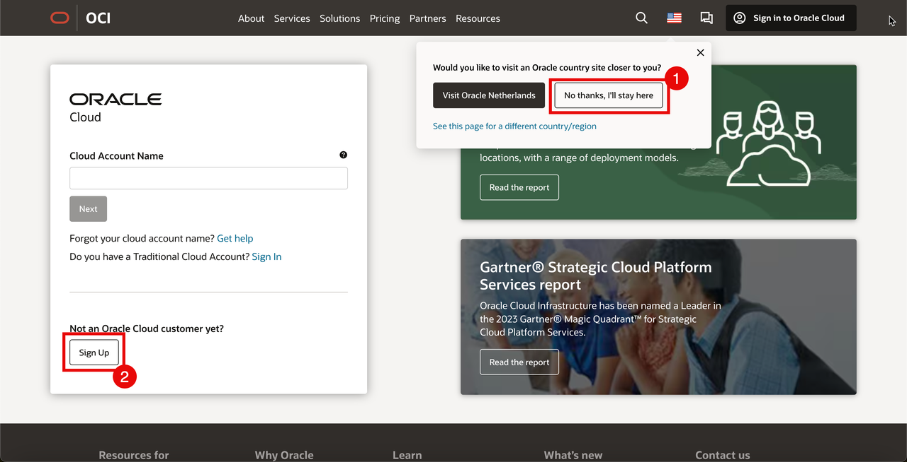
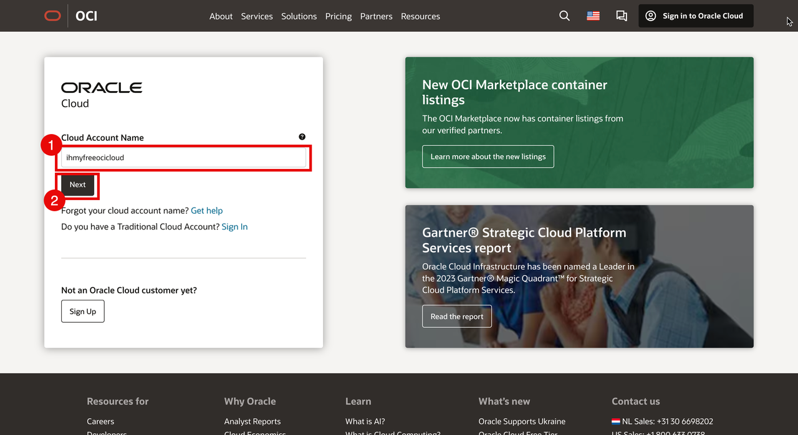

# Get Started: Create or access your OCI account

## Introduction

In this lab, you will create an Oracle Cloud Infrastructure (OCI) Free Tier account and sign in to it. Lab 1 uses it to set up OCI Identity and Access Management (IAM).

> Note: If you already have an OCI account, or might, check your email for its details and skip to **Task 4**.

### Objectives

In this lab, you will:

- prepare to register
- create and activate your account
- sign in to the OCI Console

Estimated Time: 25 minutes, plus account activation time

### Prerequisites

This lab assumes you have:

- A web browser and an email inbox you can open.
- Your contact details, plus a phone and a payment method if the form asks.

## Task 1: Prepare to register

1. Choose an email address you can open for verification and welcome emails.

2. Choose a home region that suits your location and organization. You can't change it later.

3. Open the [Oracle Cloud Free Tier registration page](https://signup.oraclecloud.com/). The form can vary by country.

    

## Task 2: Create your Free Tier account

1. Enter your country or territory, name, and email address, then complete the verification challenge.

2. Click **Verify my email**, then follow the link in the verification email.

3. Create a password, then enter your account details and a cloud account name you'll recognize.

4. Select your home region from Task 1, then enter your address and phone number.

5. Complete payment verification if asked. The [Free Tier sign-up instructions](https://docs.oracle.com/en-us/iaas/Content/GSG/Tasks/signingup_topic-Sign_Up_for_Free_Oracle_Cloud_Promotion.htm) explain the temporary hold and upgrade terms.

6. Review the terms, select the agreement checkbox, and click **Start my free trial**.

## Task 3: Wait for account activation

1. Wait for Oracle to activate your account. Check your inbox and spam folder for the welcome email.

2. Keep that email, and save your cloud account name, home region, and sign-in address somewhere private.

3. If the email doesn't arrive, use the [first sign-in guidance](https://docs.oracle.com/en-us/iaas/Content/GSG/Tasks/signingin_topic-Signing_In_for_the_First_Time.htm) to contact Oracle support.

## Task 4: Sign in to the OCI Console

1. For a new account, open the link in the welcome email and complete any activation or password setup.

    For an existing account, open [the OCI Console](https://cloud.oracle.com/) and enter your cloud account name, or use your organization's sign-in link.

2. Follow the prompts to enter your username or email and password.

    

3. If asked, set up secure verification. The [first sign-in instructions](https://docs.oracle.com/en-us/iaas/Content/GSG/Tasks/signingin_topic-Signing_In_for_the_First_Time.htm) list the available methods.

4. You should see the OCI Console with your account's navigation and selected region.

    > Note: On an organization's account, ask its administrator if you can create and activate IAM applications and edit identity domain settings.

## Learn More

- [Prepare to Sign Up](https://github.com/oracle-livelabs/database/blob/main/create-oci-account/prepare-to-sign-up/prepare-to-sign-up.md)
- [Create and Activate Your Account](https://github.com/oracle-livelabs/database/blob/main/create-oci-account/create-account/create-account.md)
- [Sign In to OCI for the First Time](https://github.com/oracle-livelabs/database/blob/main/create-oci-account/first-sign-in/first-sign-in.md)

You may now **proceed to the next lab**.

## Acknowledgements

* **Source material** - Create Your OCI Free Tier Account, Cyrce Salinas, Oracle LiveLabs, July 2026.
* **Screenshot source** - [Oracle's OCI getting started guide](https://docs.oracle.com/en/learn/get-started-with-oci-and-oci-console/)
* **Adapted By/Date** - Killian Lynch, November 2026.
