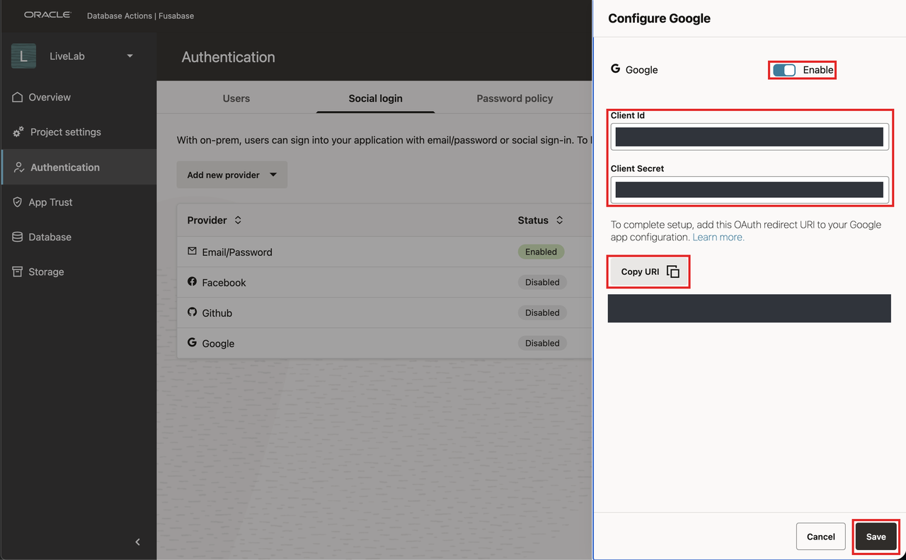
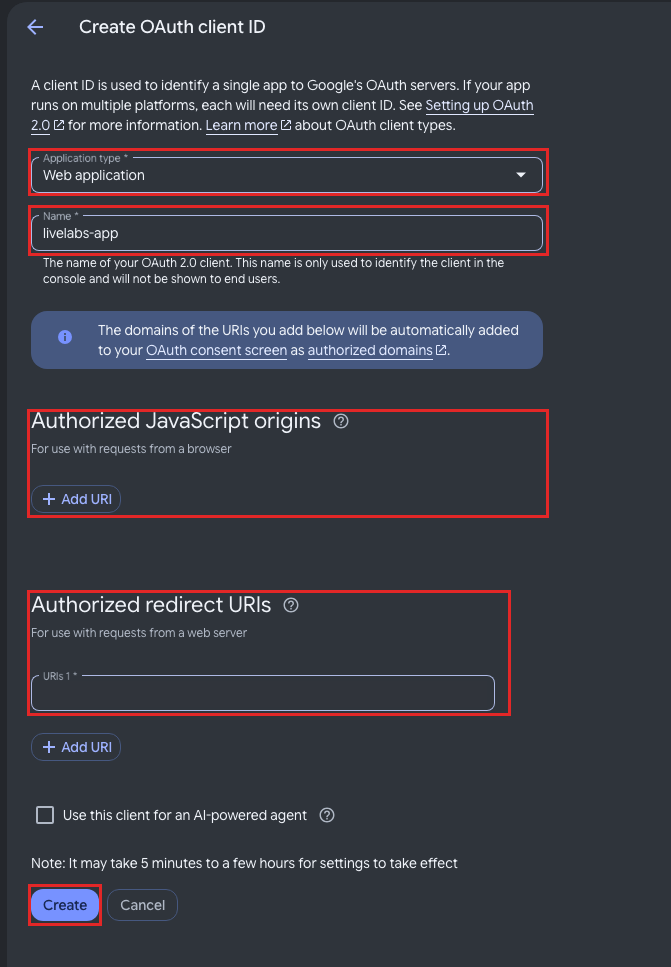
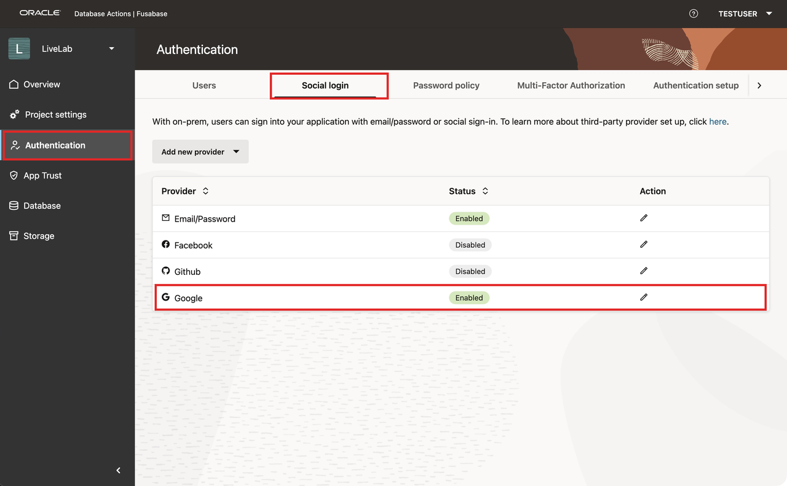
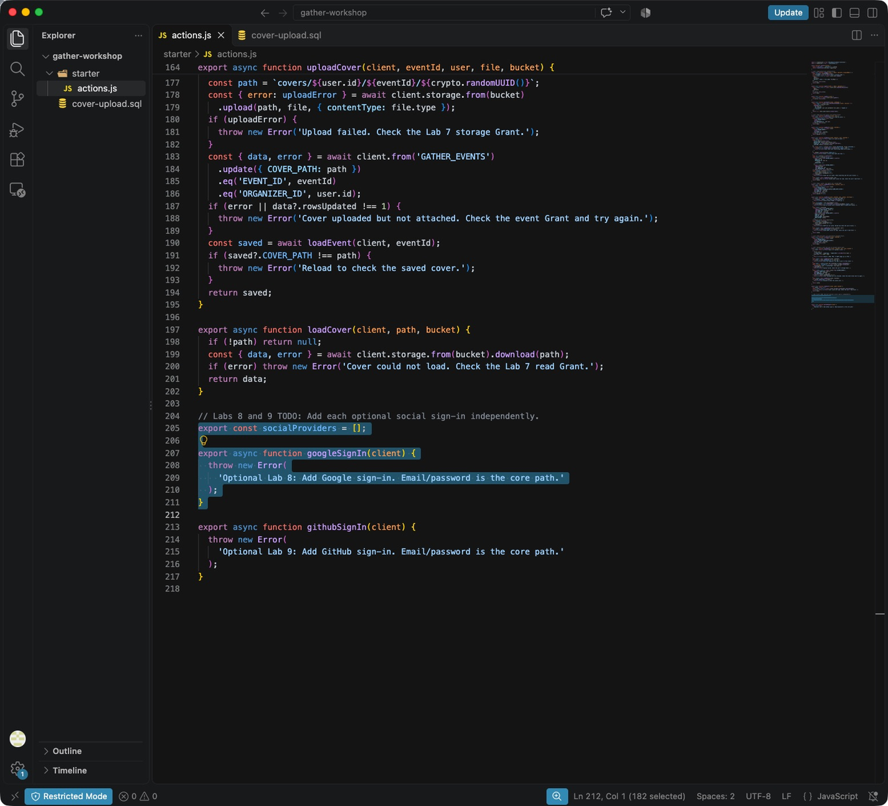
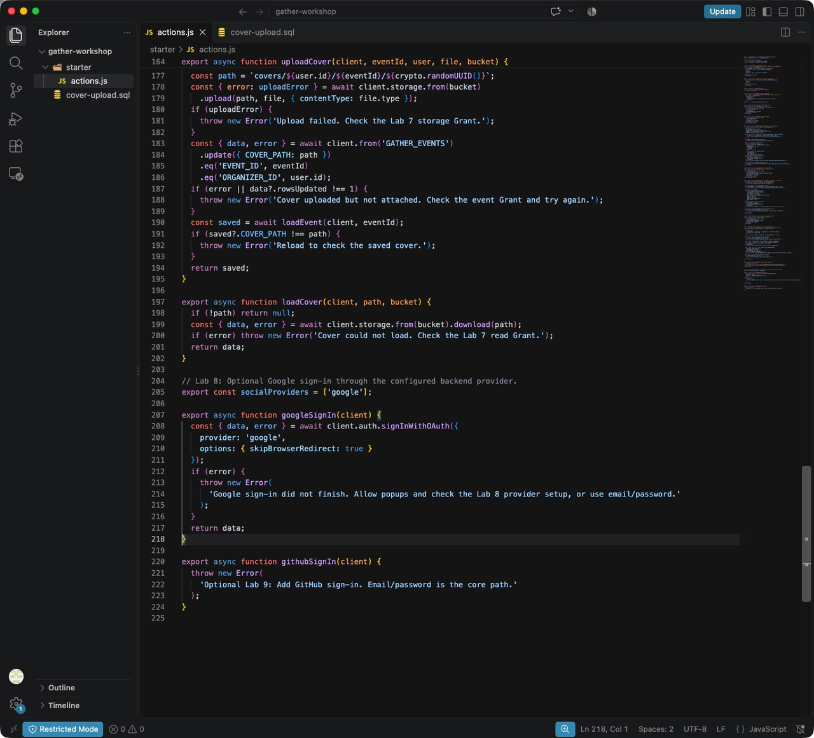
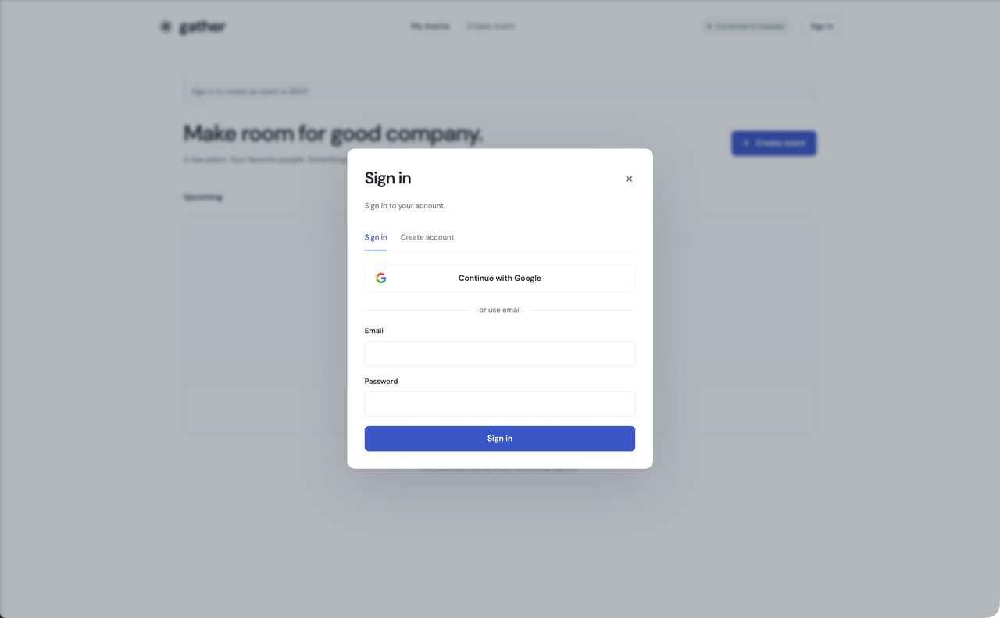
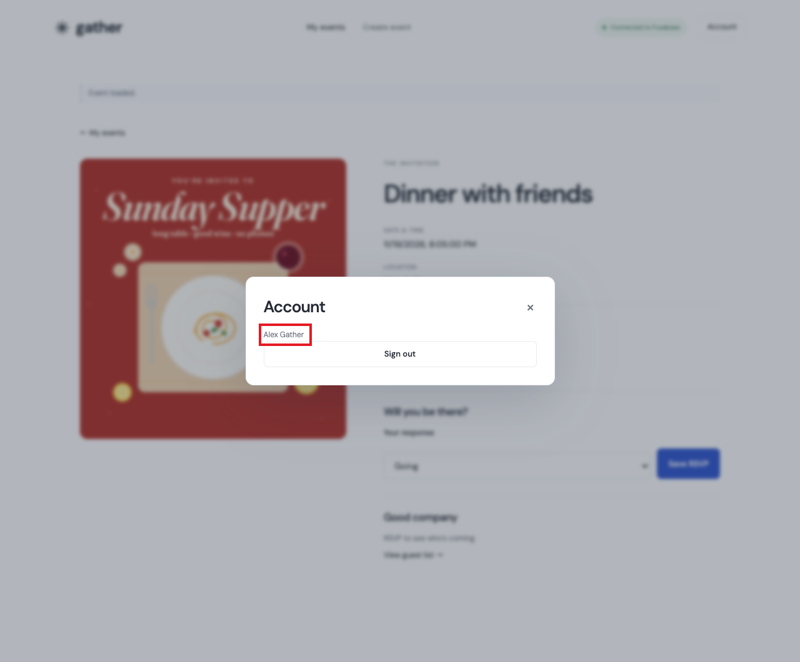
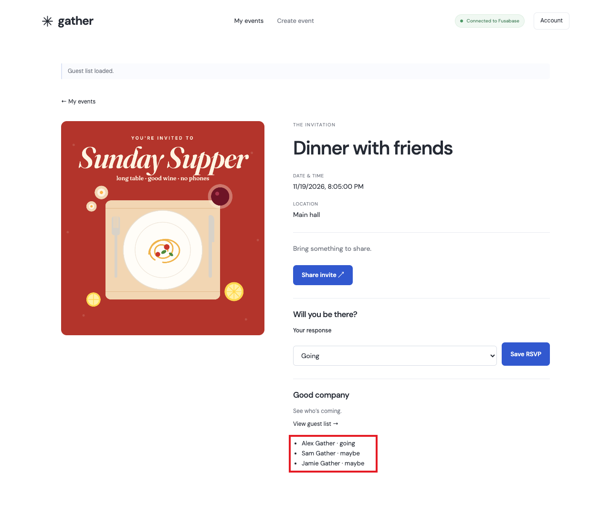
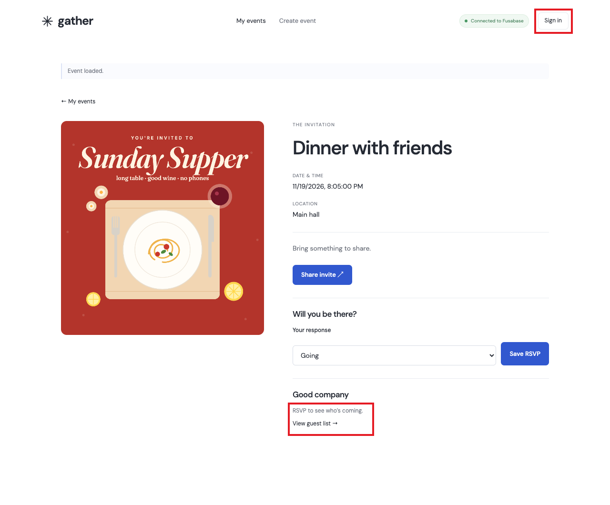

# Add Google sign-in

## Introduction

In this optional lab, you will add Google sign-in to your app with the Oracle Backend with Supabase APIs JavaScript SDK. When you are done, users can sign in with Google and RSVP with their Google display name.

### Objectives

In this lab, you will:

- create a Google OAuth client and add the Fusabase redirect URI
- save the Google credentials in the Fusabase console
- sign in with Google using `client.auth.signInWithOAuth()`
- check the account, RSVP name, restored session, and sign-out

Estimated Time: 20 minutes

### Prerequisites

This lab assumes you have:

- Successfully completed all previous labs.
- A Google account.
- A Google Cloud project where you can create an OAuth client.

## Task 1: Copy the redirect URI

1. In the Fusabase console, select **LiveLab > Authentication > Social login**. Open **Add new provider > Google**, or edit the existing Google row.

2. In **Configure Google**, turn **Enable** on and click **Copy URI**. Keep the dialog open.

    

## Task 2: Create a Google OAuth client

1. Open the [Google Cloud console](https://console.cloud.google.com/) in a new tab and select your project. Open **APIs & Services > Credentials**.

2. Click **Create credentials > OAuth client ID**.

3. Set **Application type** to **Web application** and enter `livelabs-app` for **Name**.

4. Under **Authorized redirect URIs**, click **Add URI** and paste the URI you copied. Leave **Authorized JavaScript origins** empty.

    

5. Click **Create** and copy the **Client ID** and **Client secret**.

## Task 3: Save the Google credentials

1. Return to **Configure Google** in the Fusabase console. Paste the Google **Client Id** and **Client Secret**, then click **Save**.

2. You should see **Enabled** in the Google row.

    

## Task 4: Complete the Google action

1. In VS Code, open `starter/actions.js`. Google sign-in uses `client.auth`, the same auth client you used in Lab 3. The **Continue with Google** button calls `googleSignIn(client)`.

2. Find `socialProviders` directly above `googleSignIn`. Select the export and the whole placeholder function, including its declaration and closing brace.

    

3. `client.auth.signInWithOAuth()` starts sign-in with a configured provider. Read the code in four parts:

    - `socialProviders = ['google']` shows the Google button.
    - `provider: 'google'` selects the provider you enabled.
    - `skipBrowserRedirect: true` opens a popup and waits for it to finish, so your app's page and its event link stay open.
    - Check `error` and show a helpful message. The existing `watchAuth()` listener gets the session and uses `user.user_metadata.full_name` as the display name.

    Replace the selection with this complete block and save:

    ```javascript
    export const socialProviders = ['google'];

    export async function googleSignIn(client) {
      const { data, error } = await client.auth.signInWithOAuth({
        provider: 'google',
        options: { skipBrowserRedirect: true }
      });
      if (error) {
        throw new Error(
          'Google sign-in did not finish. Allow popups and check the Lab 8 provider setup, or use email/password.'
        );
      }
      return data;
    }
    ```

    

## Task 5: Verify Google sign-in in your app

1. Reload `http://localhost:8000/starter/`. If you're signed in, open **Account > Sign out**.

2. Click **Sign in > Continue with Google**.

    

3. In the popup, choose your Google account and continue.

4. When the popup closes, the account dialog should show your Google display name. Close and reopen **Account**, then reload and open it again. You should still be signed in.

    

5. Create an event or open an invitation link. Save an RSVP and click **View guest list**. You should see your name and response.

    

6. Open **Account > Sign out**. You should see **Sign in** again, with no organizer controls or guest list. Signing out of your app doesn't sign you out of Google.

    

7. If `starter/actions.js` does not work after this lab, navigate to the `checkpoints` folder in your repo, open `lab-8/actions.js`, and use that file's contents to replace `starter/actions.js`. Keep your own `starter/config.js`.

## Troubleshooting

- **Google says redirect\_uri\_mismatch:** make the URI in your Google client match **Copy URI** exactly, then save. Google can take time to apply changes.
- **Google says access is blocked:** check Audience, Testing test users, organization restrictions, and the selected Google project/client. Use an account the project allows.
- **The popup is blocked, canceled, or fails:** allow popups for `http://localhost:8000`, reload your app, and try again. Check that both credentials come from one Google client.
- **Different accounts show different events:** open the event's invitation link to RSVP with another account.

You may now **proceed to the next lab**.

## Acknowledgements

* **Author** - Killian Lynch, Senior Product Manager, Oracle AI Database
* **Last Updated By/Date** - Killian Lynch, November 2026
