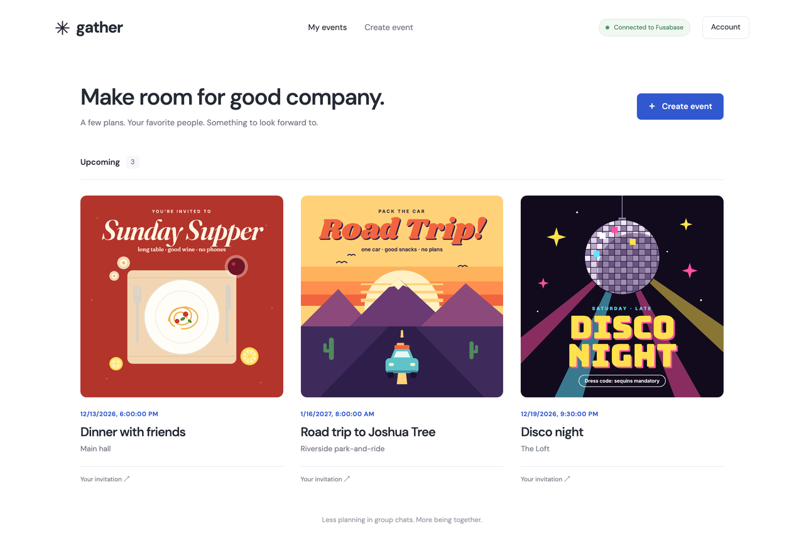

# Oracle Backend with Supabase APIs

## Introduction

In this workshop, you will build an event web app called Gather with Oracle Backend with Supabase APIs. In your app, organizers share event invitations, and signed-in guests RSVP to unlock the guest list.

### Objectives

In this workshop, you will:

- set up Oracle AI Database and ORDS locally with OCI IAM
- create a project and tables in the Fusabase console
- connect a web app with the Oracle Backend with Supabase APIs JavaScript SDK
- add sign-up and sign-in
- read and write related data
- protect data with Grants
- upload and display images
- add Google and GitHub sign-in (optional)

Estimated Workshop Time: 1.5 hours

## Task 1: Review the workshop overview

1. In this workshop, you will build Gather, an event app where organizers share invitations and guests RSVP. Oracle Backend with Supabase APIs gives your app four services on Oracle AI Database and ORDS. You manage them in the Fusabase console.

    - **Database** stores events and RSVPs.
    - **Authentication** handles email and password sign-in, plus optional Google and GitHub.
    - **Storage** holds event cover images.
    - **Grants** let the database control who can read or change data.

2. The app's UI is prebuilt, with no sample data. You'll paste configuration into `starter/config.js` and write SDK calls in `starter/actions.js`.

3. Before you start, you need:

    - an OCI account (Free Tier is fine; see Get Started)
    - Docker or Podman, Git, and Node.js 22 or later with npm
    - a web browser and a code editor, such as VS Code
    - for the optional labs, a Google account and Google Cloud project (Lab 8) or a GitHub account (Lab 9)

4. Here is what each lab covers.

    - In Lab 1, you will configure OCI IAM and start the local stack.
    - In Lab 2, you will create tables and connect your app.
    - In Lab 3, you will add sign-up, sign-in, and sign-out.
    - In Lab 4, you will save, edit, and share events.
    - In Lab 5, you will save and change RSVPs.
    - In Lab 6, you will protect the guest list with Grants.
    - In Lab 7, you will add event cover images.
    - In Labs 8 and 9 (optional), you will add Google and GitHub sign-in.

## Acknowledgements

* **Author** - Killian Lynch, Senior Product Manager, Oracle AI Database
* **Last Updated By/Date** - Killian Lynch, November 2026
