# Query and update related data

## Introduction

In this lab, you will let signed-in guests RSVP to an event with the Oracle Backend with Supabase APIs JavaScript SDK. When you are done, guests can change their saved response.

### Objectives

In this lab, you will:

- create Grants for own-row reads, inserts, and status updates
- read a response with `.select()` and `.eq()`
- save a response with `.insert()` and change it with `.update()`

Estimated Time: 15 minutes

### Prerequisites

This lab assumes you have:

- Successfully completed all previous labs.
- The Lab 4 event and accounts, for example:
    - Alex Gather (organizer)
    - Sam Gather (guest)

## Task 1: Create RSVP Grants

These Grants let signed-in guests read, add, and update only their own RSVP.

1. In the Fusabase console, open **Database > Table Editor > Grants**.

2. Click **Create grant** and fill in the dialog:

    - **Grant name**: `GATHER_RSVPS_OWN`
    - **Target object**: `GATHER_RSVPS`
    - **Roles**: `TESTUSER$authenticated_role` only

    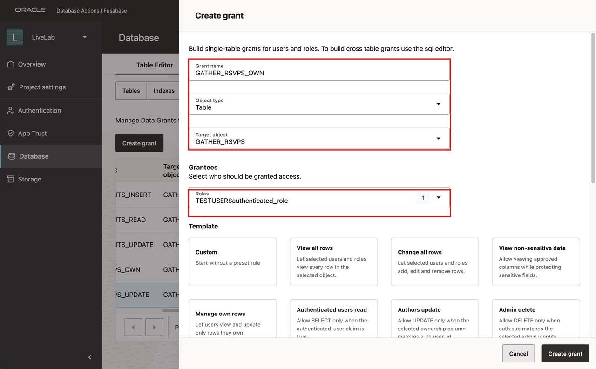

3. Select **Custom**, then **SELECT** and **INSERT**. Keep **All columns**, and set **Row scope** to **Custom condition**.

4. Click **Edit** beside **SQL editor** and replace the entire statement with this SQL. It lets guests read and add rows only when `USER_ID` matches their ID from the backend.

    ```sql
    <copy>CREATE OR REPLACE DATA GRANT GATHER_RSVPS_OWN AS
      SELECT, INSERT ON GATHER_RSVPS
      WHERE USER_ID =
        ORA_END_USER_CONTEXT.BAASSYS.EU_CONTEXT.auth.user_id
      TO TESTUSER$AUTHENTICATED_ROLE;</copy>
    ```

    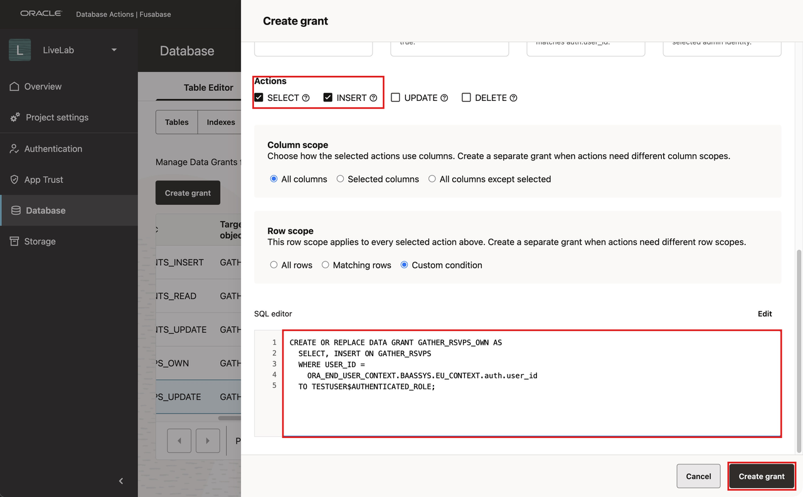

5. Click **Create grant**. You should see `GATHER_RSVPS_OWN` in the list.

6. Click **Create grant** again and fill in the dialog:

    - **Grant name**: `GATHER_RSVPS_UPDATE`
    - **Target object**: `GATHER_RSVPS`
    - **Roles**: `TESTUSER$authenticated_role` only
    - select **Custom**, then select only **UPDATE**
    - **Row scope**: **Custom condition**

7. Click **Edit** beside **SQL editor** and replace the entire statement with this SQL. `UPDATE(RSVP_STATUS)` lets guests change only their response.

    ```sql
    <copy>CREATE OR REPLACE DATA GRANT GATHER_RSVPS_UPDATE AS
      UPDATE(RSVP_STATUS) ON GATHER_RSVPS
      WHERE USER_ID =
        ORA_END_USER_CONTEXT.BAASSYS.EU_CONTEXT.auth.user_id
      TO TESTUSER$AUTHENTICATED_ROLE;</copy>
    ```

    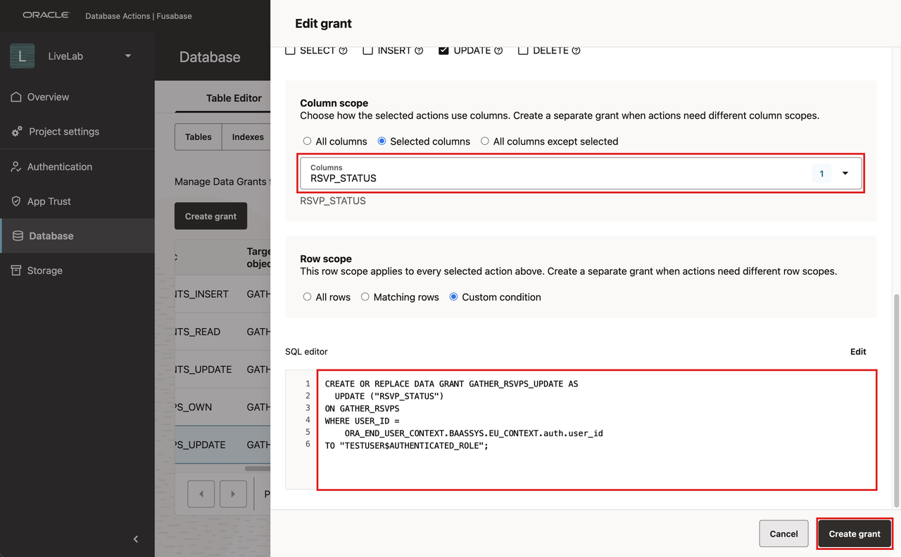

8. Click **Create grant**. You should see `GATHER_RSVPS_OWN` with **SELECT** and **INSERT**, and `GATHER_RSVPS_UPDATE` with **UPDATE**.

    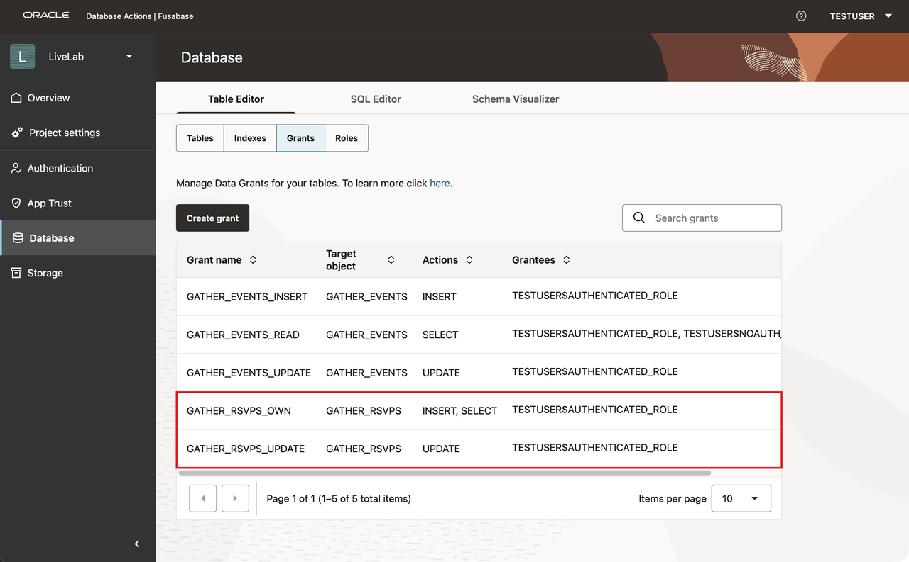

## Task 2: Read your response

1. Open `starter/actions.js` in VS Code. The `createClient` import and `connect()` already give you `client`, so you don't need a new import. Select the whole `loadOwnRsvp` function.

    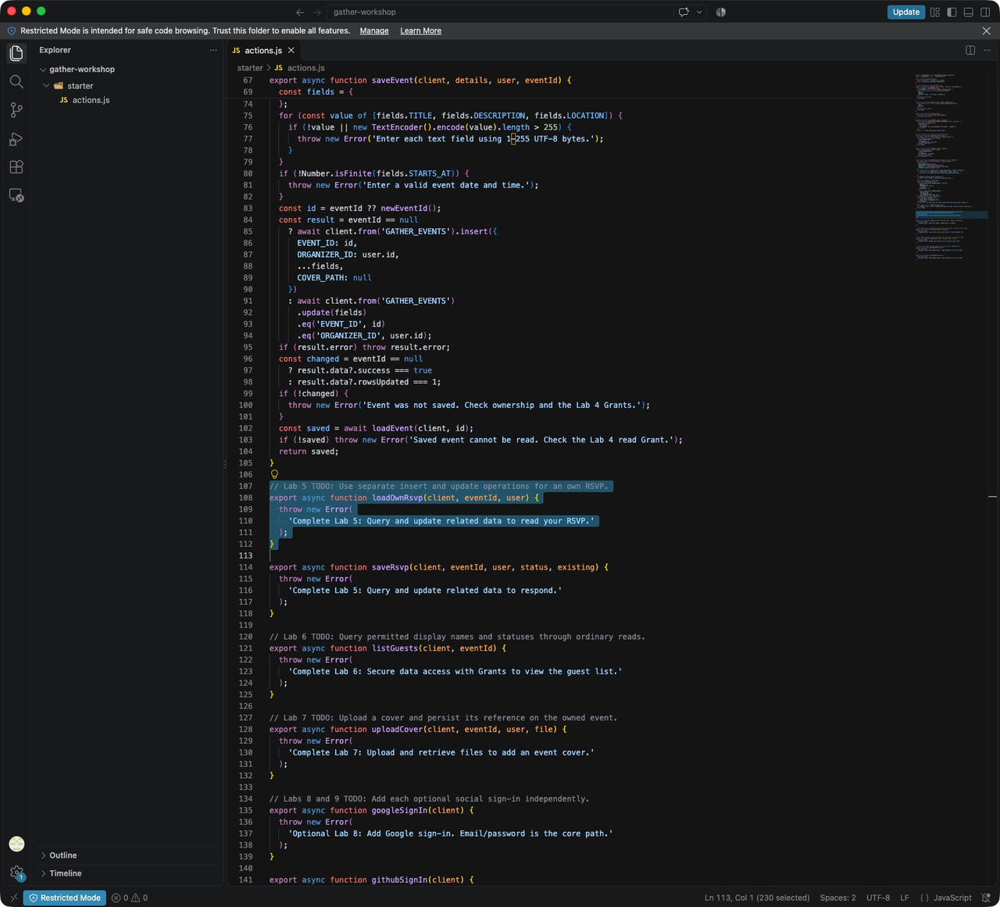

2. Read the query in three parts:

    - `client.from('GATHER_RSVPS').select(...)` reads the named columns.
    - The two `eq` filters pick the opened event and signed-in user.
    - After checking `error`, it returns the row, or `null` if there's no response.

    Replace the selected function with this code:

    ```javascript
    <copy>export async function loadOwnRsvp(client, eventId, user) {
      if (!user) return null;
      const { data, error } = await client
        .from('GATHER_RSVPS')
        .select('EVENT_ID,USER_ID,DISPLAY_NAME,RSVP_STATUS')
        .eq('EVENT_ID', eventId)
        .eq('USER_ID', user.id);
      if (error) throw error;
      return data[0] ?? null;
    }</copy>
    ```

    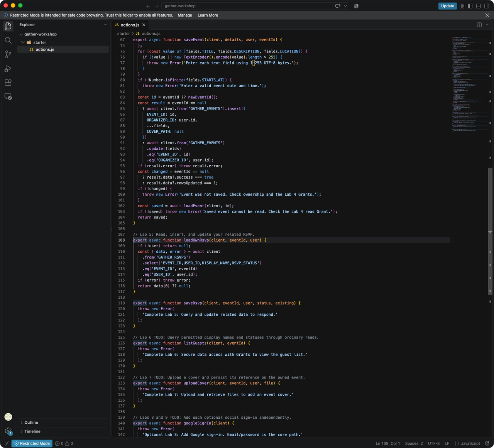

3. Save the file and open your event link while signed in. With no response yet, the selector should default to Going.

## Task 3: Save and change your response

1. In `starter/actions.js`, select the whole `saveRsvp` function. Keep `listGuests` and its Lab 6 TODO.

    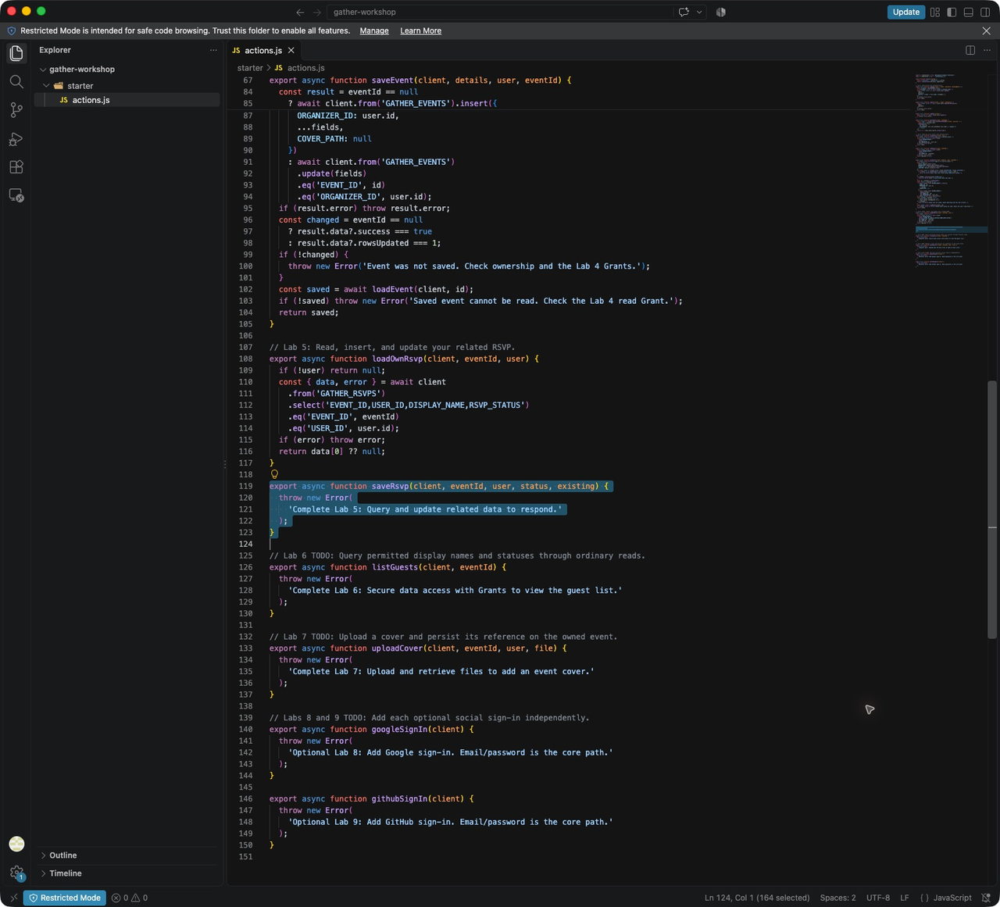

2. Read the code in three parts:

    - Each RSVP stores an `EVENT_ID` and `USER_ID`. The composite primary key from Lab 2 allows one response per pair.
    - The app passes `existing`, your saved response, if any. Without it, `insert` creates one. With it, `update` changes only `RSVP_STATUS`.
    - The code checks `error`, then `data.success` (insert) or `data.rowsUpdated === 1` (update). `loadOwnRsvp` then confirms the stored status.

    Replace the selected function with this code:

    ```javascript
    <copy>export async function saveRsvp(client, eventId, user, status, existing) {
      if (!user) throw new Error('Sign in to save your RSVP.');
      if (!['going', 'maybe', "can't go"].includes(status)) {
        throw new Error('Choose Going, Maybe, or Can’t go.');
      }
      const displayName = user.displayName?.trim();
      if (!displayName || new TextEncoder().encode(displayName).length > 255) {
        throw new Error('Use an account with a display name of 1–255 UTF-8 bytes.');
      }
      const result = existing
        ? await client.from('GATHER_RSVPS')
          .update({ RSVP_STATUS: status })
          .eq('EVENT_ID', eventId)
          .eq('USER_ID', user.id)
        : await client.from('GATHER_RSVPS').insert({
          EVENT_ID: eventId,
          USER_ID: user.id,
          DISPLAY_NAME: displayName,
          RSVP_STATUS: status
        });
      if (result.error) throw result.error;
      const changed = existing
        ? result.data?.rowsUpdated === 1
        : result.data?.success === true;
      if (!changed) {
        throw new Error('RSVP was not saved. Reload and check the Lab 5 Grants.');
      }
      const saved = await loadOwnRsvp(client, eventId, user);
      if (!saved || saved.RSVP_STATUS !== status) {
        throw new Error('Saved RSVP cannot be read. Check the Lab 5 read Grant.');
      }
      return saved;
    }</copy>
    ```

    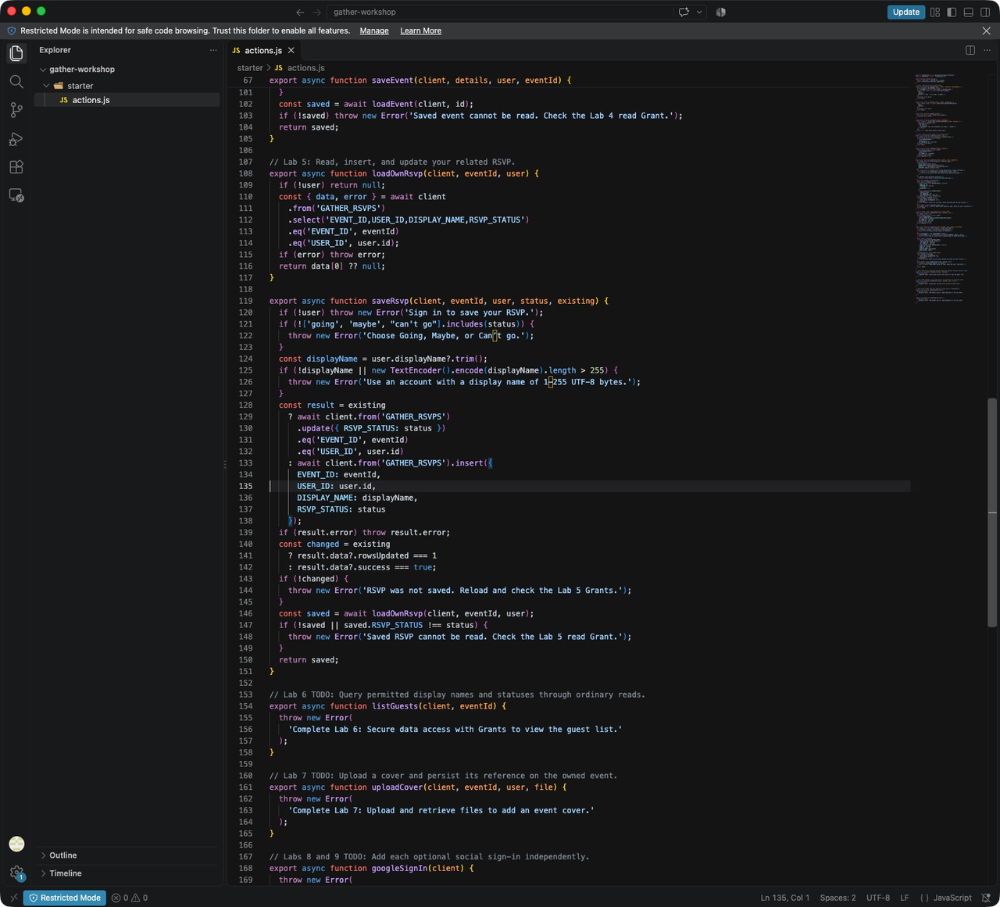

3. Save the file and reload the event link.

## Task 4: Verify responses in your app

1. Sign in as Alex, open your Lab 4 event, and click **Share invite** to copy the link.

2. Sign out, sign in as Sam, and open the copied link. Select **Going** and click **Save RSVP**. You should see **Your RSVP is saved: going.**

    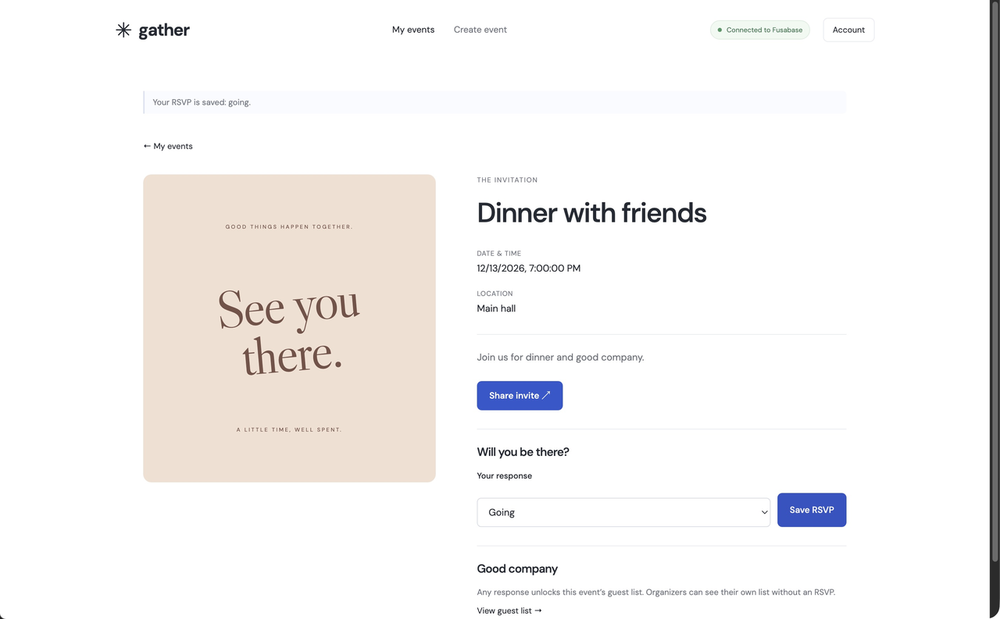

3. Select Maybe, save, and reload. Maybe should still be selected, and the app should report your saved response.

4. Select **Can’t go**, save, and reload. **Can’t go** should still be selected.

    

5. Sign out, open the same link, and try to save an RSVP. The app should ask you to sign in.

    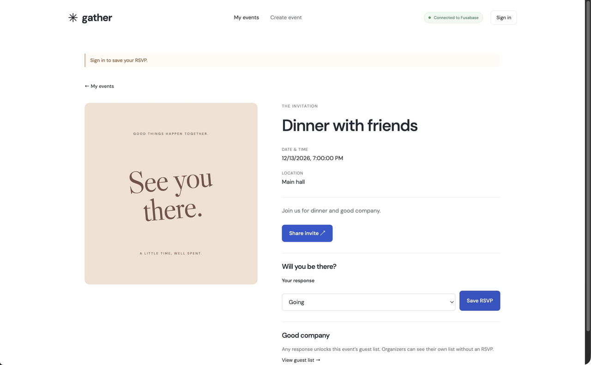

6. Sign in as Alex and open the link. Alex's selector shouldn't show Sam's response. Alex can save a separate response but can't edit Sam's.

7. Sign back in as Sam and reload. Sam's declined response should still be there.

8. In the Fusabase console, open **Database > Table Editor > Tables** and select `GATHER_RSVPS`. You should see one row for your event and Sam, with Sam's display name and `can't go` status.

    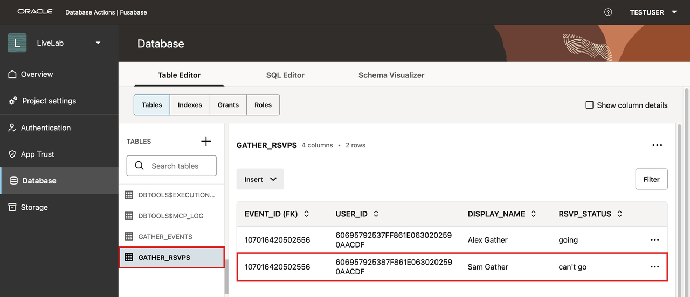

9. In your app, change your response to **Maybe** and save. Refresh the console and select `GATHER_RSVPS` again. The same row should now show `maybe`.

    

    > Note: As TESTUSER, you see every response in the console. Guests see only their own.

10. If `starter/actions.js` doesn't work after this lab, run this from the workshop root:

    ```bash
    cp checkpoints/lab-5/actions.js starter/actions.js
    ```

    Keep your own `starter/config.js`. The checkpoint doesn't create tables, keys, or Grants, so complete the console setup first.

## Troubleshooting

- **Duplicate response:** reload the event to load your RSVP, then save the new status. Keep the composite primary key.
- **Response cannot be saved or read:** check both Grants' table, role, ownership condition, and `UPDATE(RSVP_STATUS)`.
- **Lab 5 message:** save `starter/actions.js` and reload.

You may now **proceed to the next lab**.

## Acknowledgements

* **Author** - Killian Lynch, Senior Product Manager, Oracle AI Database
* **Contributors** -
* **Last Updated By/Date** - Killian Lynch, November 2026
