# Read and write data

## Introduction

In this lab, you will add Grants and use the Oracle Backend with Supabase APIs JavaScript SDK to create, list, and edit events. When you are done, you can share an invitation that works even when signed out.

### Objectives

In this lab, you will:

- create read, insert, and update Grants on `GATHER_EVENTS`
- list and load events with `client.from().select()`
- create and edit events with `.insert()` and `.update()`
- check that a second user can't edit your event

Estimated Time: 25 minutes

### Prerequisites

This lab assumes you have:

- Successfully completed all previous labs.
- The account you created in Lab 3 (Alex Gather in the examples). You'll create a second account, Sam Gather, in Task 6.
- Example event details that you can make public.

## Task 1: Let anyone read events

A **Grant** is a rule the database enforces. It sets who can read or change a table, and which rows and columns they can use. Signing in tells your app who the user is. Grants decide what they can do.

1. In the Fusabase console, open **LiveLab > Database > Table Editor > Grants**. It shouldn't list any `GATHER_EVENTS` Grants yet.

    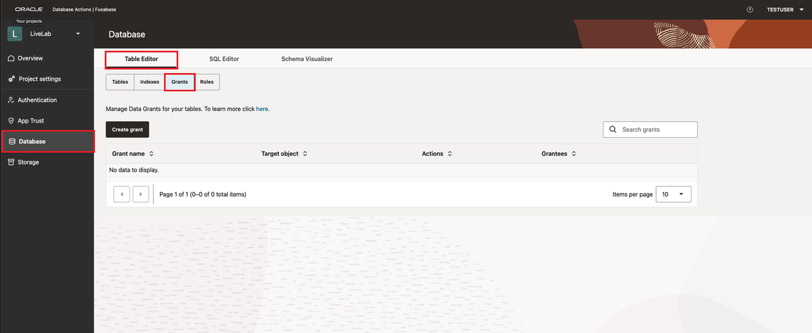

2. Click **Create grant** and fill in the dialog:

    - **Grant name**: `GATHER_EVENTS_READ`
    - **Target object**: search for `GATHER_EVENTS` and select it

3. In **Roles**, select `TESTUSER$noauth_role` (signed-out visitors) and `TESTUSER$authenticated_role` (signed-in users). If your schema differs, use its roles.

4. Select **View all rows**. Only **SELECT** should be selected, with **All columns** and **All rows**.

    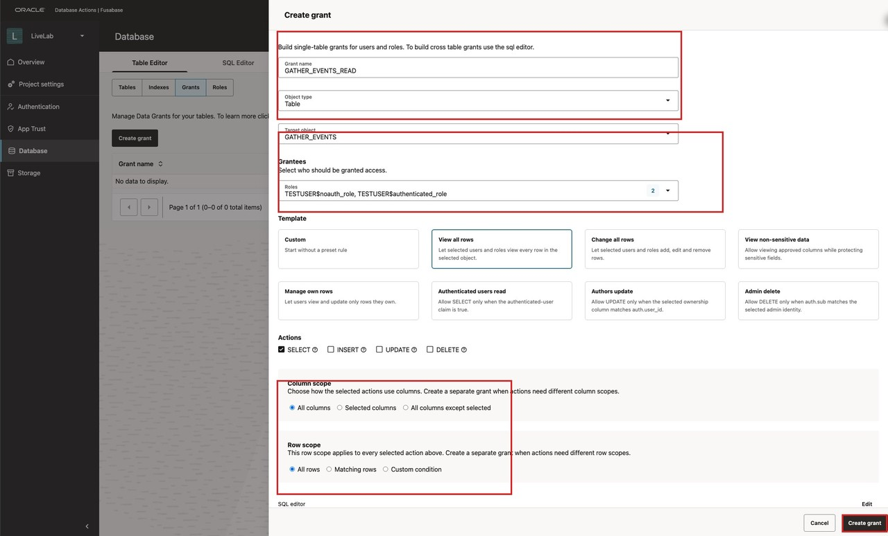

5. Click **Create grant**. You should see `GATHER_EVENTS_READ` in the list. It lets signed-out and signed-in users read events, but not change them.

## Task 2: Let users create their own events

1. Click **Create grant** and fill in the dialog:

    - **Grant name**: `GATHER_EVENTS_INSERT`
    - **Target object**: `GATHER_EVENTS`
    - **Roles**: `TESTUSER$authenticated_role` only
    - keep **Custom** as the template, then select only **INSERT**
    - keep **All columns**
    - **Row scope**: **Custom condition**

    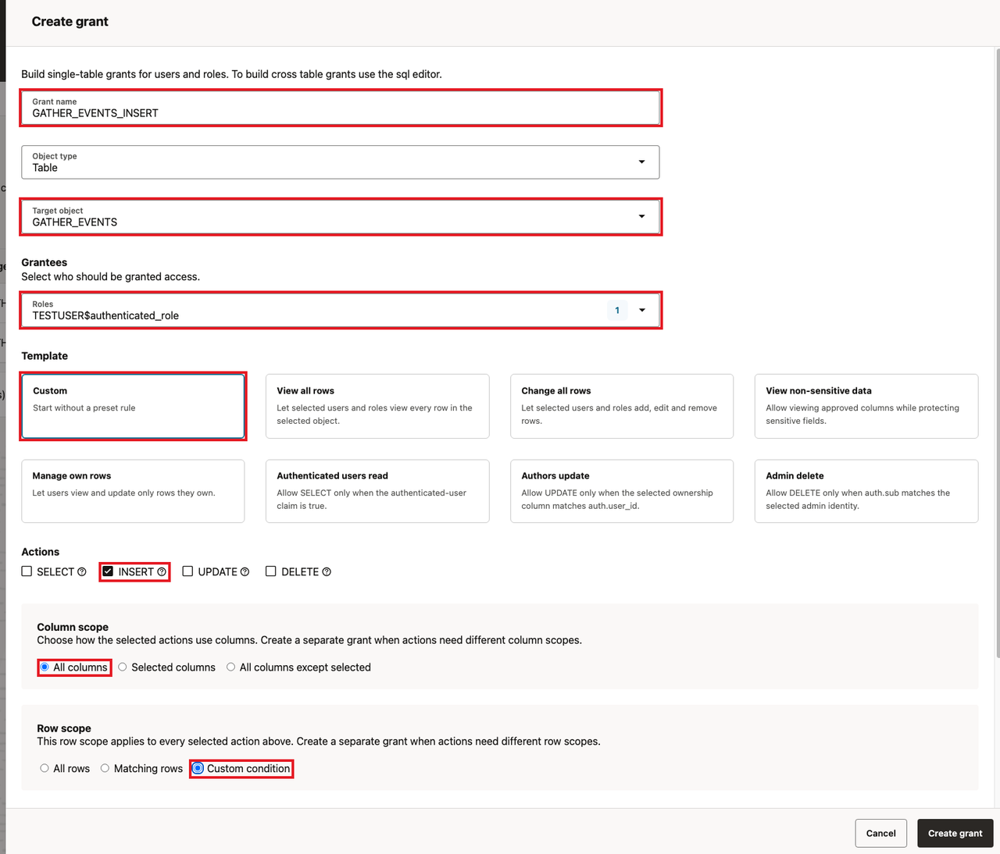

2. Scroll to **SQL editor**, click **Edit**, and replace the generated definition with this SQL. It checks the `ORGANIZER_ID` the app sends against the signed-in user's ID from the backend. A mismatch is rejected.

    ```sql
    CREATE OR REPLACE DATA GRANT GATHER_EVENTS_INSERT AS
      INSERT ON GATHER_EVENTS
      WHERE ORGANIZER_ID =
        ORA_END_USER_CONTEXT.BAASSYS.EU_CONTEXT.auth.user_id
      TO "TESTUSER$AUTHENTICATED_ROLE";
    ```

    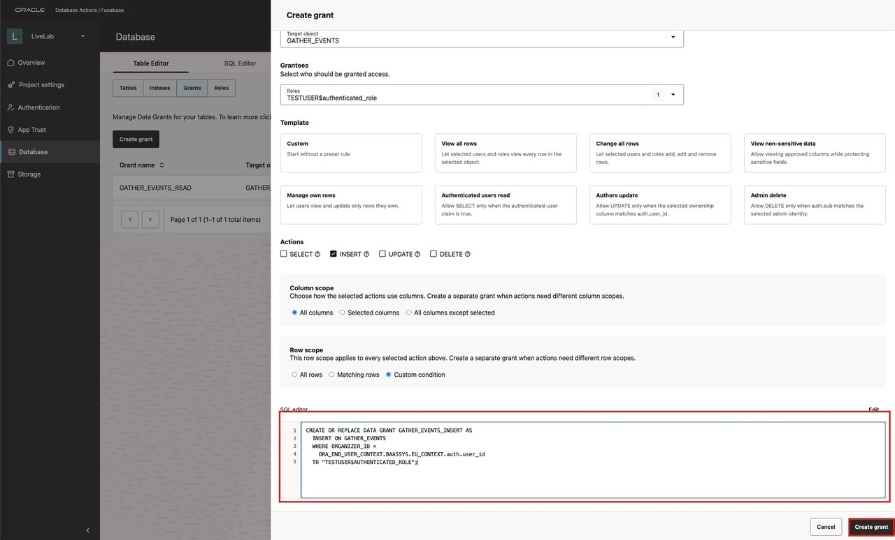

3. Click **Create grant**. You should see `GATHER_EVENTS_INSERT` with **INSERT** and the authenticated role. Users can now create events only as themselves, even if they edit the request.

## Task 3: Let organizers edit their events

1. Click **Create grant** and fill in the dialog:

    - **Grant name**: `GATHER_EVENTS_UPDATE`
    - **Target object**: `GATHER_EVENTS`
    - **Roles**: `TESTUSER$authenticated_role` only
    - select **Authors update**, and check that only **UPDATE** is selected

2. In **Column scope**, choose **Selected columns** and add `TITLE`, `DESCRIPTION`, `STARTS_AT`, `LOCATION`, and `COVER_PATH`. Don't add `EVENT_ID` or `ORGANIZER_ID`.

3. In **Matching rows**, set **Column name** to `ORGANIZER_ID`, keep **Operator** as `=`, and keep `ORA_END_USER_CONTEXT.BAASSYS.EU_CONTEXT.auth.user_id` as **Value**. The generated SQL should be equivalent to this:

    ```sql
    CREATE OR REPLACE DATA GRANT GATHER_EVENTS_UPDATE AS
      UPDATE (TITLE, DESCRIPTION, STARTS_AT, LOCATION, COVER_PATH)
      ON GATHER_EVENTS
      WHERE ORGANIZER_ID =
        ORA_END_USER_CONTEXT.BAASSYS.EU_CONTEXT.auth.user_id
      TO "TESTUSER$AUTHENTICATED_ROLE";
    ```

    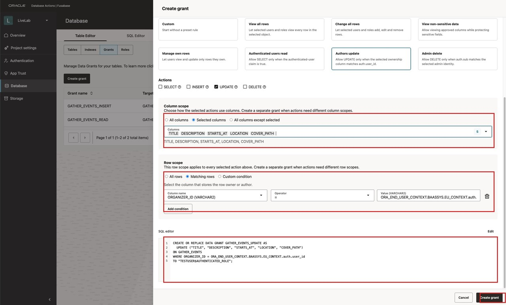

4. Click **Create grant**. You should see all three event Grants and their actions, with no **DELETE**. `COVER_PATH` stores an optional cover image path for Lab 7.

    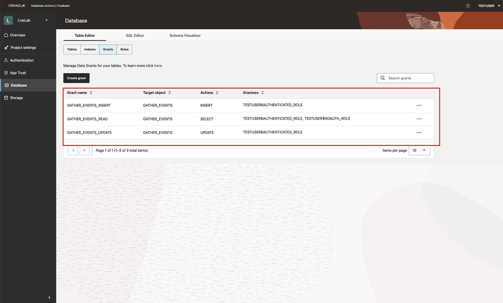

    > Note: Grants are additive. Adding an owner-only update Grant doesn't cancel an existing Grant that lets everyone update all events.

## Task 4: List and load events

Your app reads events in two places. **My events** lists the signed-in organizer's events, and an event link loads one invitation.

1. Open `starter/actions.js` in VS Code. In this lab, change only the functions named in each step.

2. Find `listEvents`. The app calls it when you select **My events**, and passes the client and current user. Select the whole function, including its declaration and closing brace.

    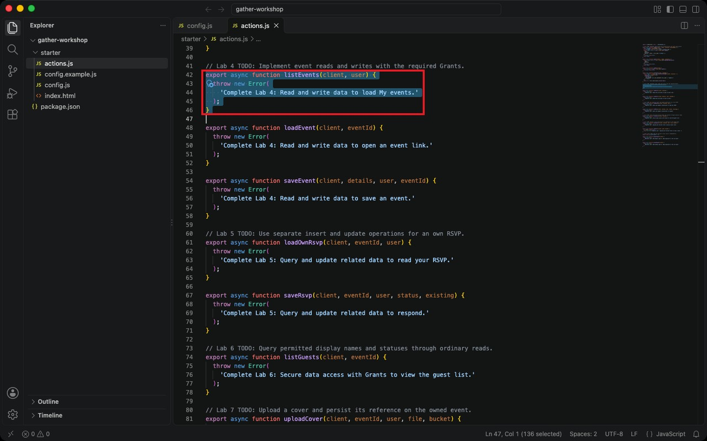

3. Read the query in four parts:

    - The first line asks the user to sign in if no one is signed in.
    - `.from('GATHER_EVENTS')` chooses the table. `.select('*')` requests all its columns.
    - `.eq('ORGANIZER_ID', user.id)` keeps rows where the organizer is the signed-in user. `eq` means "equals."
    - The SDK returns `data`, the matching rows, and `error`. `throw error` shows a failure, and `return data` gives the app the rows for event cards.

    Replace the selected function with this code:

    ```javascript
    export async function listEvents(client, user) {
      if (!user) throw new Error('Sign in to load My events.');
      const { data, error } = await client
        .from('GATHER_EVENTS')
        .select('*')
        .eq('ORGANIZER_ID', user.id);
      if (error) throw error;
      return data;
    }
    ```

4. Save the file and compare it with this view.

    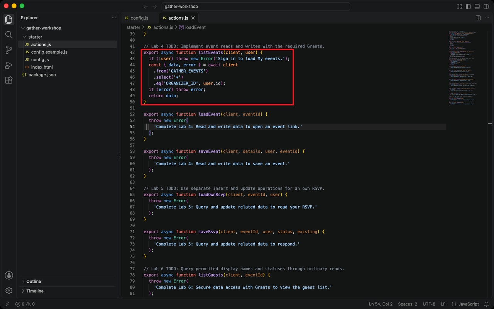

5. Find `loadEvent`. The app calls it when someone opens or refreshes an event link, and passes the client and the numeric event key from the URL as `eventId`. Select the whole function, as before.

    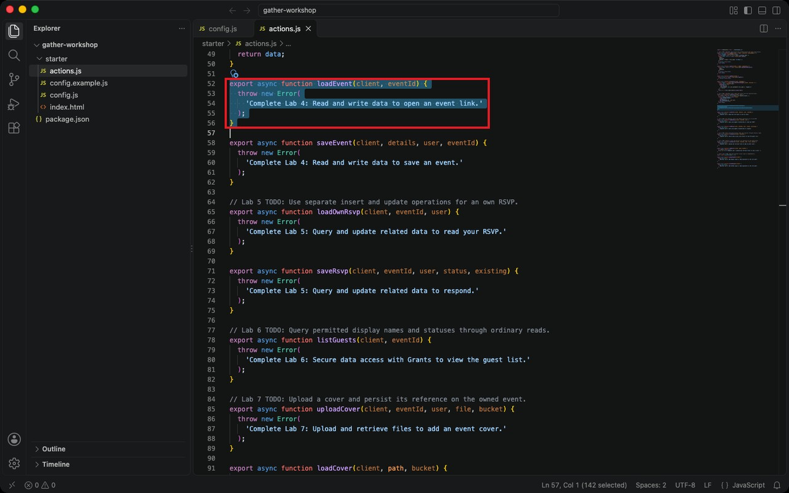

6. This query works like `listEvents`. Here's what's different:

    - `.eq('EVENT_ID', eventId)` requests the event that matches the link. It doesn't filter by organizer, so the public read Grant lets guests open any invitation.
    - The SDK still returns an array. `EVENT_ID` is the primary key, so at most one row matches.
    - `data[0] ?? null` returns that row, or `null` if no event was found. The app shows `null` as **Event not found or not available.**

    Replace the selected function with this code:

    ```javascript
    export async function loadEvent(client, eventId) {
      const { data, error } = await client
        .from('GATHER_EVENTS')
        .select('*')
        .eq('EVENT_ID', eventId);
      if (error) throw error;
      return data[0] ?? null;
    }
    ```

7. Save the file and compare it with this view.

    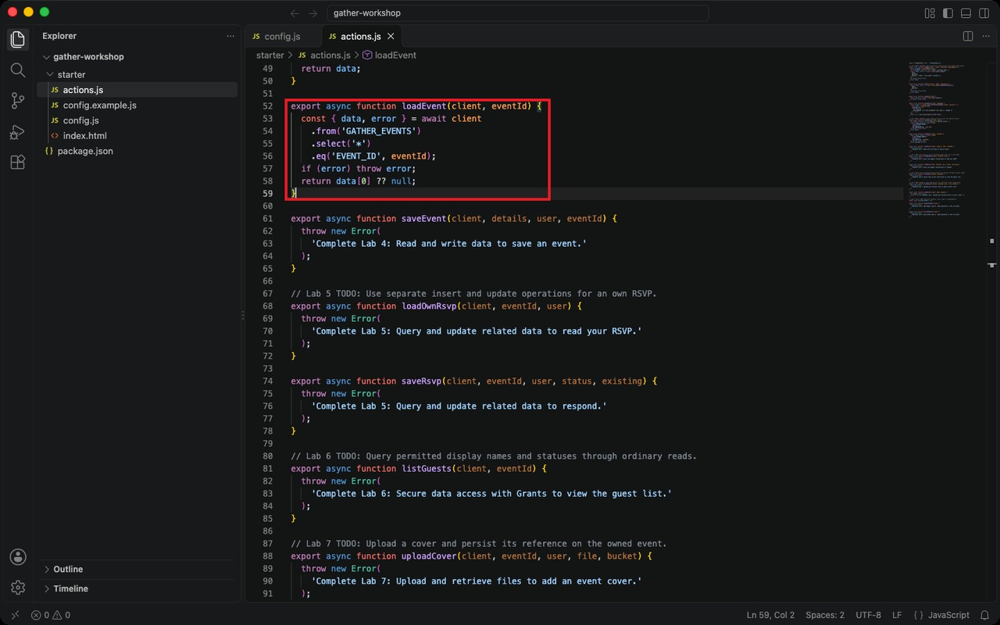

## Task 5: Save new and edited events

1. Find `saveEvent`. The app calls it when you select **Save event**, and passes the client, event details, current user, and, when editing, the event key. Select the whole function, including its declaration and closing brace.

    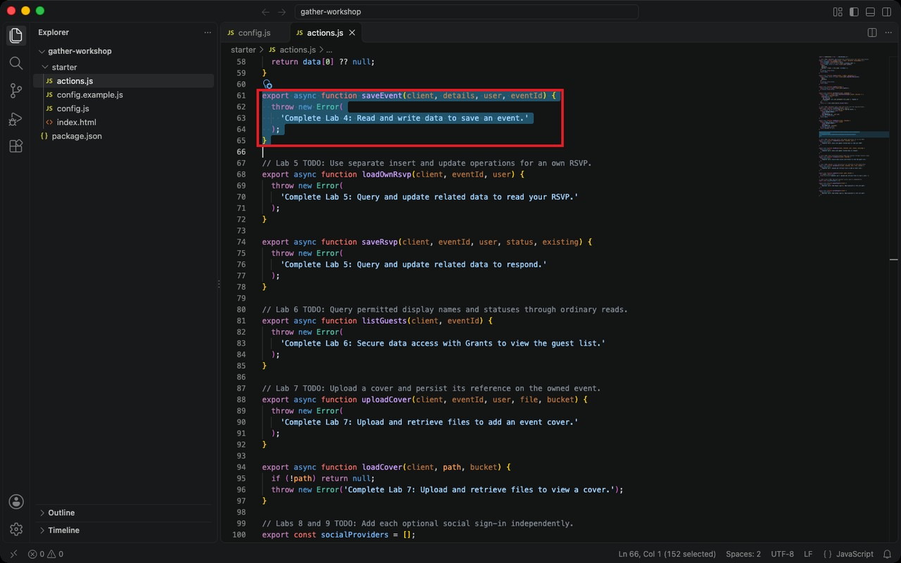

2. The function checks that you're signed in and the details are valid, then saves the event:

    - **Create an event:** `.insert()` adds a row with a new event key from `newEventId()`, your user ID as the organizer, and your details. `newEventId()` is a small helper in `shared/data.js`, already imported at the top of the file, that generates a random numeric key.
    - **Edit an event:** `.update(fields)` saves the details for the event and organizer matched by `.eq()`. The Grant allows only your own events.
    - The code checks `error` and confirms the save. For an edit, `rowsUpdated` must be `1`; `0` means nothing changed.
    - Finally, `loadEvent()` reads the saved event so the app can show the invitation.

    Replace the selected function with this code:

    ```javascript
    export async function saveEvent(client, details, user, eventId) {
      if (!user) throw new Error('Sign in to save an event.');
      const fields = {
        TITLE: details.title.trim(),
        DESCRIPTION: details.description.trim(),
        STARTS_AT: new Date(details.startsAt).getTime(),
        LOCATION: details.location.trim()
      };
      for (const value of [fields.TITLE, fields.DESCRIPTION, fields.LOCATION]) {
        if (!value || new TextEncoder().encode(value).length > 255) {
          throw new Error('Enter each text field using 1–255 UTF-8 bytes.');
        }
      }
      if (!Number.isFinite(fields.STARTS_AT)) {
        throw new Error('Enter a valid event date and time.');
      }
      const id = eventId ?? newEventId();
      const result = eventId == null
        ? await client.from('GATHER_EVENTS').insert({
          EVENT_ID: id,
          ORGANIZER_ID: user.id,
          ...fields,
          COVER_PATH: null
        })
        : await client.from('GATHER_EVENTS')
          .update(fields)
          .eq('EVENT_ID', id)
          .eq('ORGANIZER_ID', user.id);
      if (result.error) throw result.error;
      const changed = eventId == null
        ? result.data?.success === true
        : result.data?.rowsUpdated === 1;
      if (!changed) {
        throw new Error('Event was not saved. Check ownership and the Lab 4 Grants.');
      }
      const saved = await loadEvent(client, id);
      if (!saved) throw new Error('Saved event cannot be read. Check the Lab 4 read Grant.');
      return saved;
    }
    ```

3. Save the file and compare it with this view.

    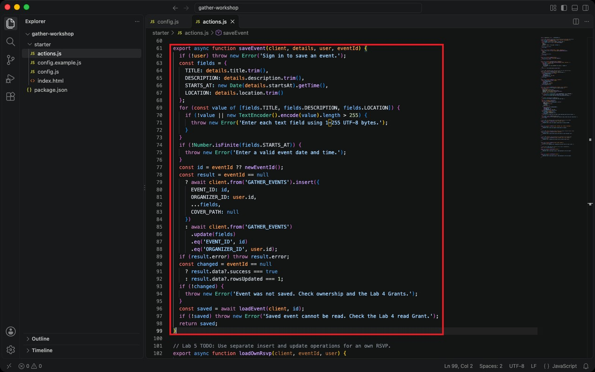

## Task 6: Verify events in your app

1. Reload `http://localhost:8000/starter/`. Sign in as Alex Gather, your organizer account, and select **My events**. You should see zero events and an invitation to create your first event.

    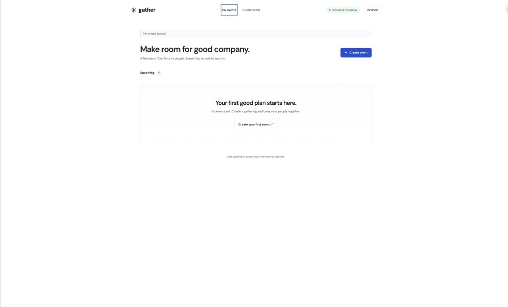

2. Click **Create event** and enter these details:

    - title: `Dinner with friends`
    - date and time: your choice
    - location: `Community kitchen`
    - description: `Bring something to share.`

    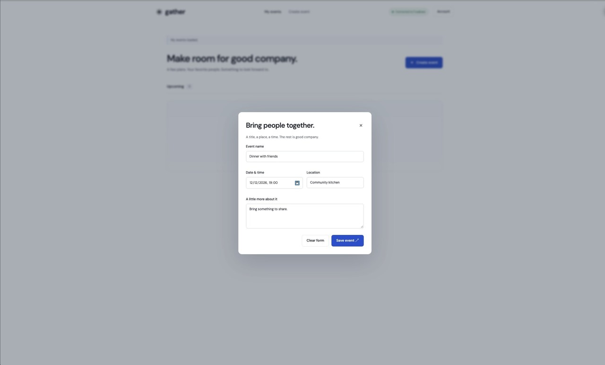

3. Click **Save event**. You should see the invitation with your title, time, location, and description. The URL should contain `?event=` followed by a numeric key.

    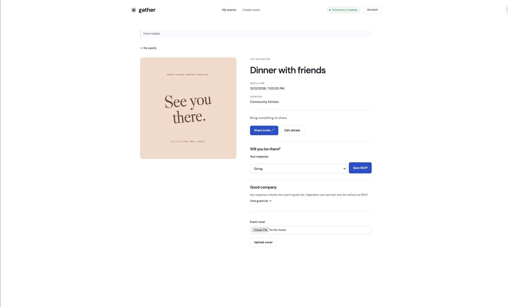

    The cover controls don't work yet. You'll add uploads in Lab 7.

4. Select **My events**. You should see one card for your event. Open it and reload the page to check that it's still saved.

    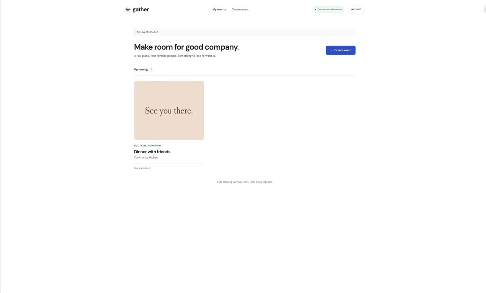

5. Click **Edit details**, change the location to `Main hall`, and save. Reload the page. You should see `Main hall`, with the same event key in the URL.

    

6. In the Fusabase console, open **Database > Table Editor > Tables** and select `GATHER_EVENTS`. You should see one row: the event your app saved, with `Main hall` as its `LOCATION` and your user ID as its `ORGANIZER_ID`. Your app created this row with `.insert()` and changed it with `.update()`.

    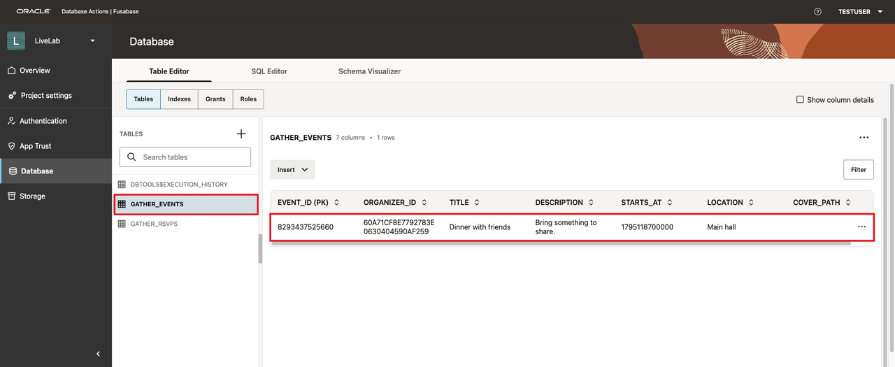

7. Return to your app and click **Share invite**. You should see **Event link copied**. Keep the URL, then open **Account** and select **Sign out**.

8. Open the copied URL and reload. You should still see the invitation with `Main hall`, plus **Sign in** in the header and no **Edit details** button.

    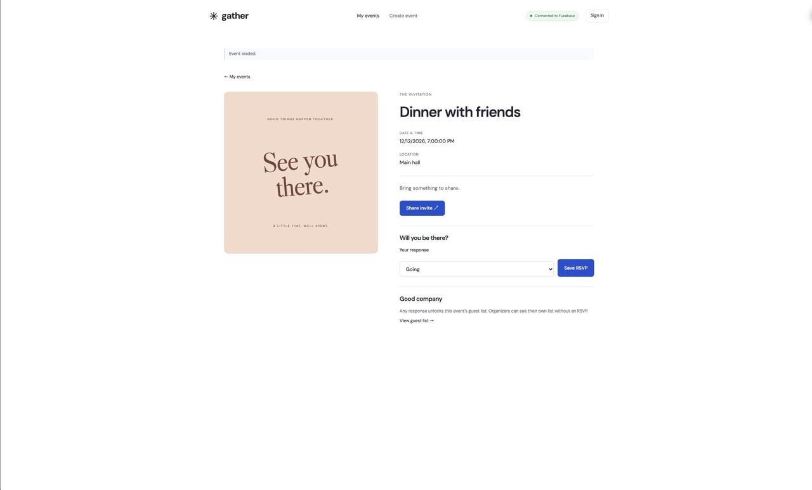

    You're signed out, so the database now treats your requests as `TESTUSER$noauth_role`, and the Grants you created in Tasks 1–3 decide what you can do:

    - `GATHER_EVENTS_READ` lets anyone read events, signed in or not, so the invitation still loads.
    - `GATHER_EVENTS_INSERT` and `GATHER_EVENTS_UPDATE` let only signed-in users create or change events they organize, so a signed-out visitor can't change anything.

9. While on that event URL, select **Sign in > Create account** and create a second account for your guest:

    - display name: `Sam Gather`
    - email: `sam@example.com`
    - a password that meets the Lab 3 policy

    The form closes and you're signed in as Sam. You should see the event details but no **Edit details** button.

    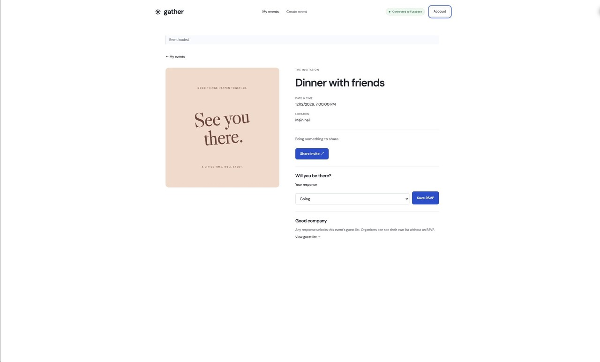

10. Select **My events**. The organizer's event shouldn't appear. Return to the shared link.

11. The key lesson: hiding **Edit details** only guides users. The `GATHER_EVENTS_UPDATE` Grant is what stops another user from changing the event, even with a direct SDK request.

12. If `starter/actions.js` does not work after this lab, navigate to the `checkpoints` folder in your repo, open `lab-4/actions.js`, and use that file's contents to replace `starter/actions.js`. Keep your own `starter/config.js`.

## Troubleshooting

- **Sign in to save/load My events:** sign in with a Lab 3 app account, not the console database user.
- **No rows or failed save:** check the project, table, roles, ownership condition, and saved Grants. An update that changed zero rows didn't save.
- **Saved event cannot be read:** the event might already be saved. Fix the read Grant and check **My events** before creating another.
- **Another user can edit:** check every Grant on `GATHER_EVENTS`, and remove any broad Grant that allows it.

You may now **proceed to the next lab**.

## Acknowledgements

* **Author** - Killian Lynch, Senior Product Manager, Oracle AI Database
* **Contributors** -
* **Last Updated By/Date** - Killian Lynch, November 2026
