# Secure data access with Grants

## Introduction

In this lab, you will let organizers and guests who have responded see an event’s guest list. When you are done, your app shows their display names and responses, and hides the list from everyone else.

### Objectives

In this lab, you will:

- create a helper function that checks event access
- add a SELECT-only Grant for the guest list
- read the guest list with the Oracle Backend with Supabase APIs JavaScript SDK
- check access before and after a response, and after declining

Estimated Time: 20 minutes

### Prerequisites

This lab assumes you have:

- Successfully completed all previous labs.

## Task 1: Create the event-access helper

Organizers and guests who have responded should see the guest list. A Grant on `GATHER_RSVPS` can’t check `GATHER_RSVPS` directly, because the check would loop forever. Instead, you’ll create a helper function, `GATHER_CAN_VIEW`. It returns `1` if the user organizes the event or has any RSVP for it, and `0` if not.

1. In the **Fusabase console**, open your **LiveLab** project and **Database > SQL Editor**. Replace the worksheet content with this block, including the final `/` on its own line.

    ```sql
    <copy>CREATE OR REPLACE FUNCTION GATHER_CAN_VIEW (
      P_EVENT_ID NUMBER,
      P_USER_ID VARCHAR2
    ) RETURN NUMBER AUTHID DEFINER AS
      L_COUNT NUMBER;
    BEGIN
      SELECT COUNT(*) INTO L_COUNT
      FROM GATHER_EVENTS
      WHERE EVENT_ID = P_EVENT_ID AND ORGANIZER_ID = P_USER_ID;
      IF L_COUNT > 0 THEN RETURN 1; END IF;
      SELECT COUNT(*) INTO L_COUNT
      FROM GATHER_RSVPS
      WHERE EVENT_ID = P_EVENT_ID AND USER_ID = P_USER_ID;
      RETURN CASE WHEN L_COUNT > 0 THEN 1 ELSE 0 END;
    END;
    /</copy>
    ```

    `AUTHID DEFINER` lets the function check these tables using TESTUSER’s database permissions.

2. Click **Run Script (F5)**. Under **Script Output**, you should see **Function GATHER\_CAN\_VIEW compiled** with no errors.

    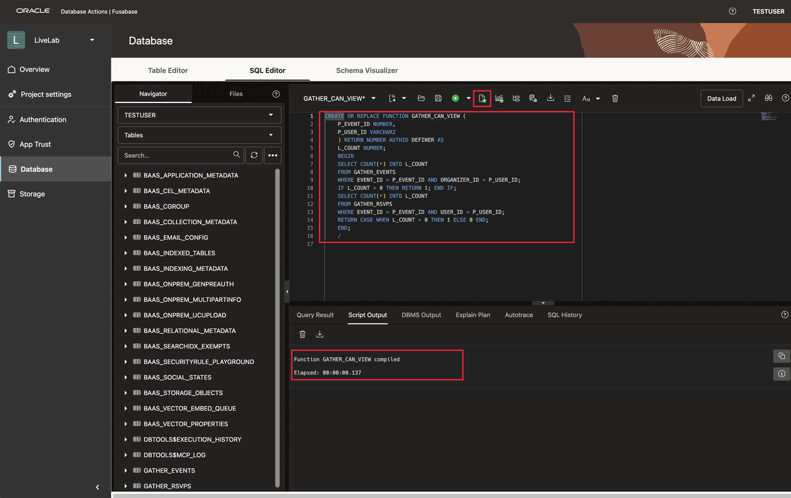

## Task 2: Add the guest-list Grant

1. Open **Database > Table Editor > Grants**. Leave the two Grants from Lab 5, `GATHER_RSVPS_OWN` and `GATHER_RSVPS_UPDATE`, as they are.

    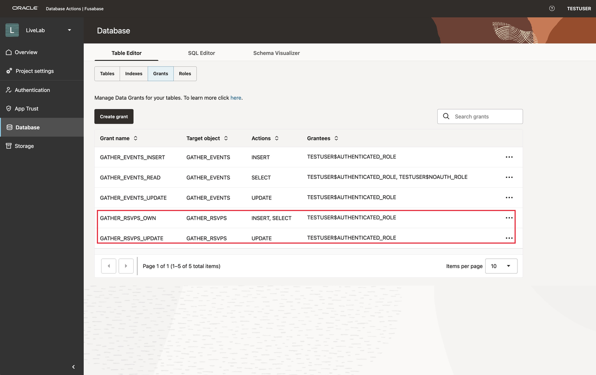

2. Click **Create grant** and fill in the dialog:

    - **Grant name**: `GATHER_RSVPS_GUESTS`
    - **Object type**: keep **Table**
    - **Target object**: `GATHER_RSVPS`
    - **Roles**: `TESTUSER$authenticated_role` only
    - select **Custom**, then select only **SELECT**

    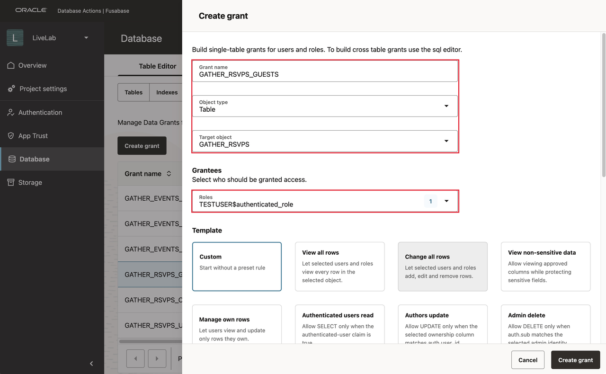

3. Under **Column scope**, choose **Selected columns** and select only `EVENT_ID`, `DISPLAY_NAME`, and `RSVP_STATUS`. The SDK’s event filter needs `EVENT_ID`. Other guests’ `USER_ID` values, and any columns added later, stay hidden.

    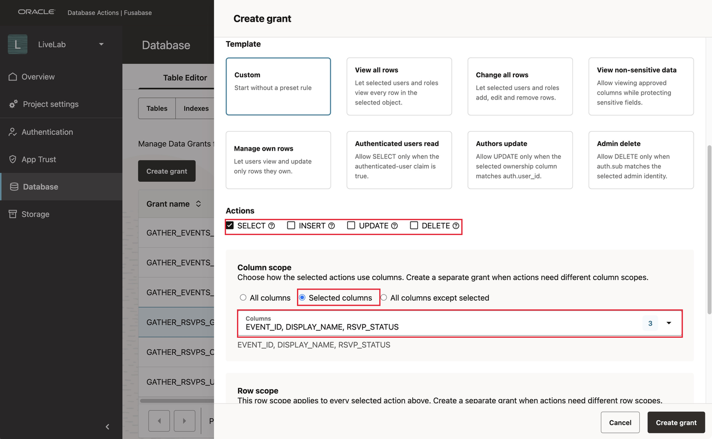

4. Under **Row scope**, choose **Custom condition**. This condition has three parts:

    - The first `WHEN` allows the user’s own RSVP row without calling the helper.
    - The second `WHEN` calls `GATHER_CAN_VIEW` only for `select` requests, so saving an RSVP never looks up the table it changes.
    - `JSON_VALUE` converts the signed-in user’s ID, which comes from the backend, into the SQL text (`VARCHAR2`) the helper expects.

    Learn more: [ORA\_END\_USER\_CONTEXT](https://docs.oracle.com/en/database/oracle/oracle-database/26/sqlrf/ora_end_user_context.html) and [JSON\_VALUE](https://docs.oracle.com/en/database/oracle/oracle-database/26/sqlrf/JSON_VALUE.html).

5. Click **Edit** beside **SQL editor** and replace the entire statement with:

    ```sql
    <copy>CREATE OR REPLACE DATA GRANT GATHER_RSVPS_GUESTS AS
      SELECT(EVENT_ID, DISPLAY_NAME, RSVP_STATUS) ON GATHER_RSVPS
      WHERE CASE
        WHEN USER_ID =
          ORA_END_USER_CONTEXT.BAASSYS.EU_CONTEXT.auth.user_id
          THEN 1
        WHEN ORA_END_USER_CONTEXT.BAASSYS.EU_CONTEXT.request.operation = 'select'
          THEN GATHER_CAN_VIEW(
            EVENT_ID,
            JSON_VALUE(
              ORA_END_USER_CONTEXT.BAASSYS.EU_CONTEXT.auth.user_id,
              '$' RETURNING VARCHAR2(256)
            )
          )
        ELSE 0
      END = 1
      TO TESTUSER$AUTHENTICATED_ROLE;</copy>
    ```

    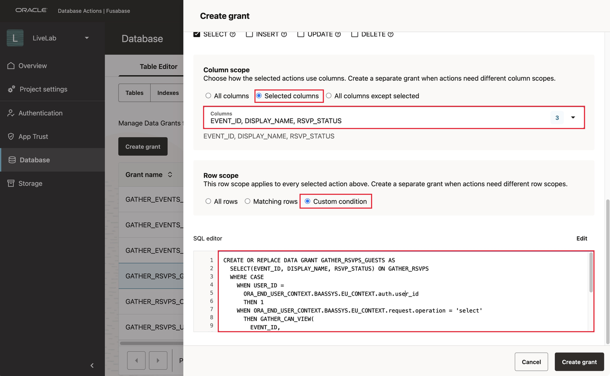

    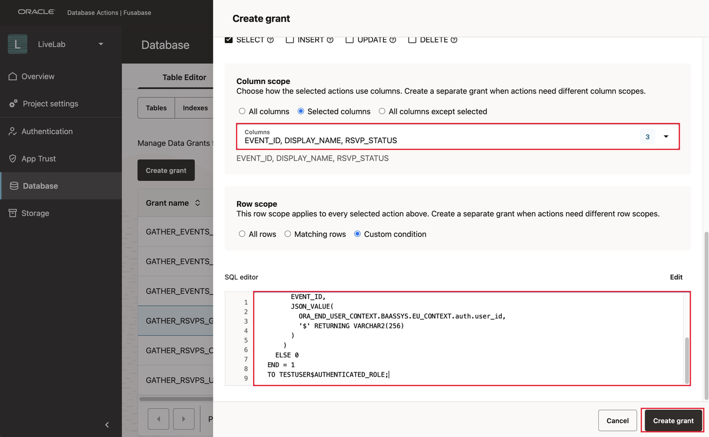

6. Click **Create grant**. You should see three Grants: `GATHER_RSVPS_GUESTS` with only **SELECT**, the OWN Grant with **INSERT, SELECT**, and the status-only UPDATE Grant.

    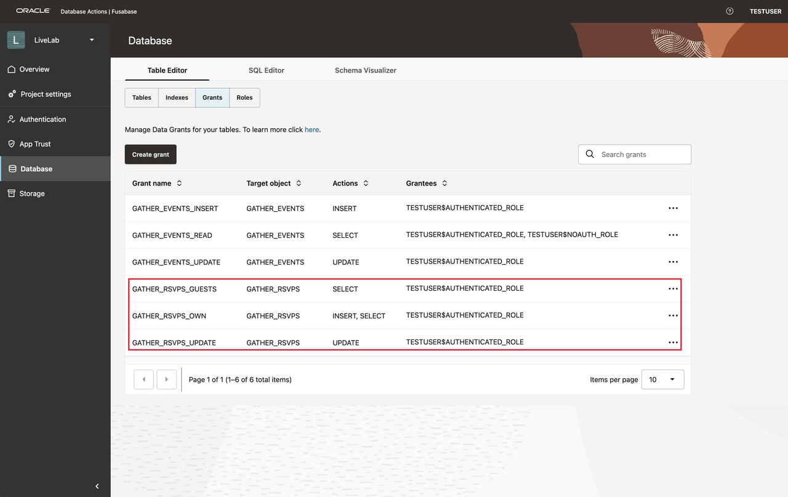

## Task 3: Query the guest list

When you click **View guest list**, the app calls `listGuests(client, eventId)`.

1. In VS Code, open `starter/actions.js`. The `createClient` import and `connect()` already give you `client`, so you don’t need a new import.

2. Select the Lab 6 TODO comment and the `listGuests` function only. Keep the Lab 7 and optional sign-in TODOs.

    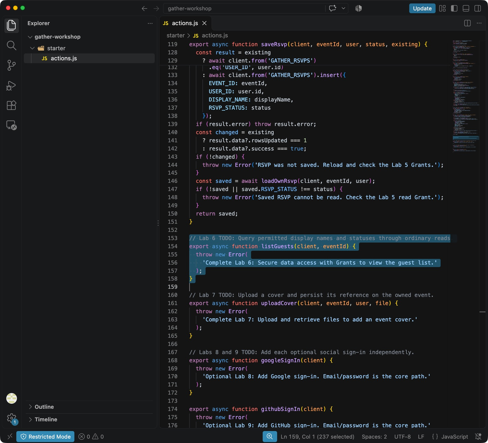

3. Read the code in four parts:

    - `from('GATHER_RSVPS')` selects the RSVP table.
    - `select('DISPLAY_NAME,RSVP_STATUS')` asks for the two fields the list shows. The Grant hides other guests’ `USER_ID`, even if the app asks for it.
    - `eq('EVENT_ID', eventId)` picks the opened event. The Grant checks access separately from this filter.
    - Check `error`, then return `data` for the page to show. The app doesn’t call the helper itself.

4. Replace the selection with this code and save the file:

    ```javascript
    <copy>// Lab 6: Read the guest list permitted by backend Grants.
    export async function listGuests(client, eventId) {
      const { data, error } = await client
        .from('GATHER_RSVPS')
        .select('DISPLAY_NAME,RSVP_STATUS')
        .eq('EVENT_ID', eventId);
      if (error) throw error;
      return data;
    }</copy>
    ```

    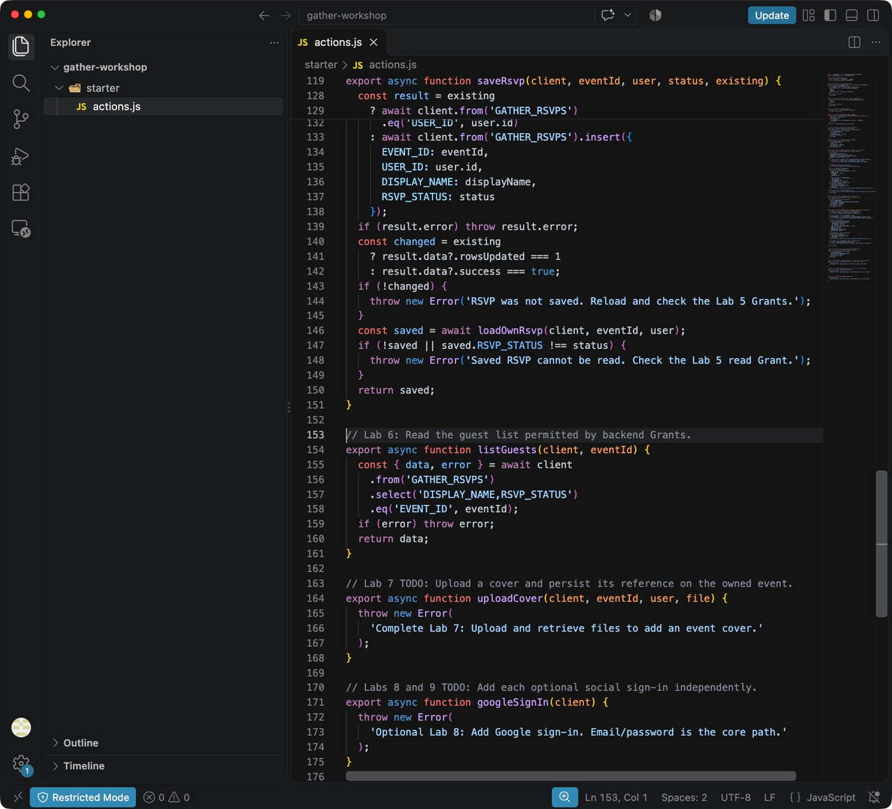

5. Reload the app and click **View guest list**. A signed-in guest who hasn’t responded sees **Submit an RSVP to view this event’s guest list.** An organizer sees their list right away. It stays empty until someone responds.

## Task 4: Verify access in your app

Use these accounts from earlier labs, or click **Create account** to add one. Sign out between accounts, or use separate browser profiles.

- Alex Gather (organizer)
- Sam Gather (guest)
- Jamie Gather (another guest)

1. As Alex, create a new event and copy its **Share invite** link. Don’t submit an RSVP as Alex.

2. As Jamie, open the link, choose **Maybe**, and click **Save RSVP**.

3. As Sam, open the same link and click **View guest list** without responding. You should see no names and a message about the RSVP requirement.

    

4. As Sam, choose **Going** and click **Save RSVP**. The list refreshes right away with Sam’s and Jamie’s names and statuses. No email addresses appear.

    

5. Change Sam’s response to **Can’t go** and save, then reload and click **View guest list**. Declining still counts as a response, so the list still appears with Sam’s declined status.

    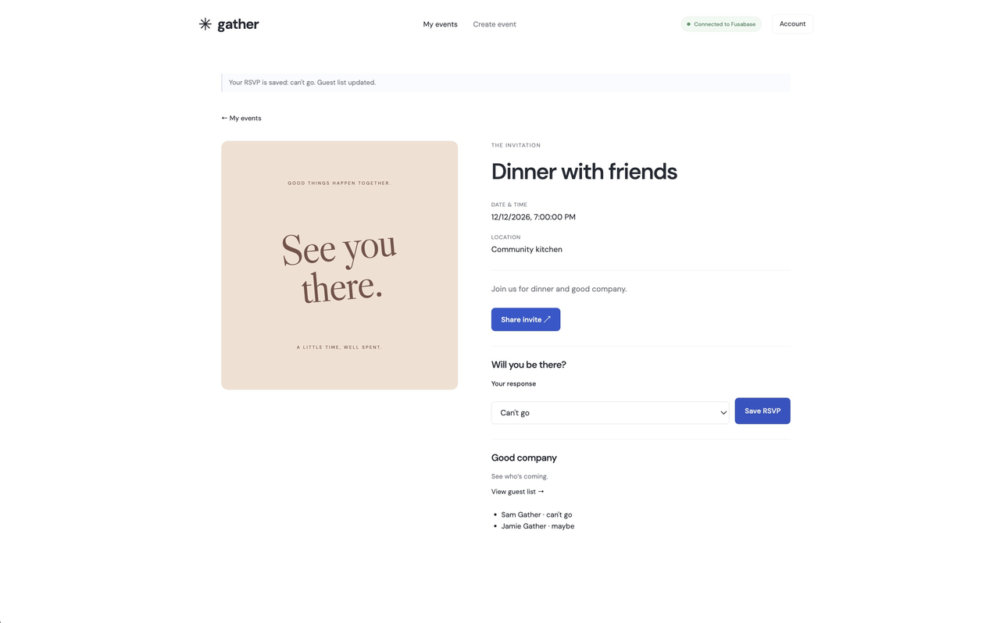

6. Sign out and click **View guest list**. The app asks you to sign in and shows no names.

    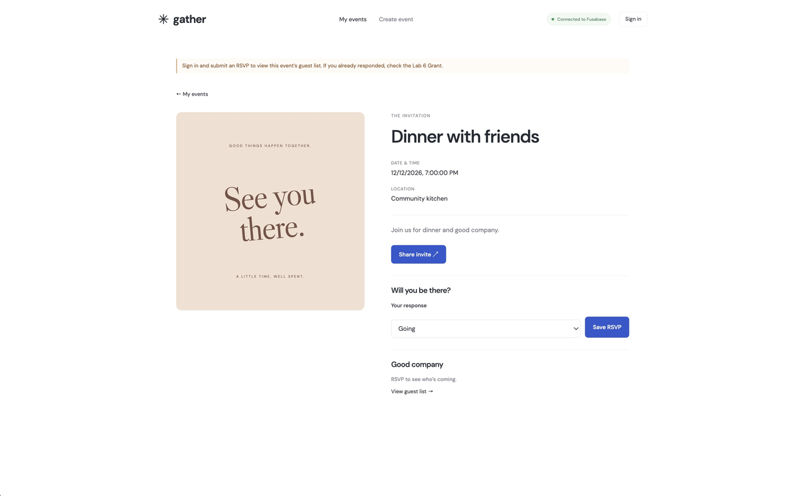

7. Sign in as Alex, open Alex’s event, and click **View guest list** without responding. You should see both guests and no Alex row, even though Alex’s selector defaults to Going.

    

8. As Jamie, create another event, submit an RSVP there, and share its link with Sam.

9. As Sam, open that link and click **View guest list** without responding. The list stays empty, because a response to Alex’s event doesn’t unlock another event’s guest list.

    

10. If `starter/actions.js` doesn’t work after this lab, run this from the workshop root:

    ```bash
    cp checkpoints/lab-6/actions.js starter/actions.js
    ```

    Keep your own `starter/config.js`. The checkpoint doesn’t create the helper or Grants, so complete Tasks 1 and 2 first.

## Troubleshooting

- **No names after responding:** check that the helper compiled, and that the guest Grant uses the exact condition, authenticated role, and table above.
- **Names appear before responding:** make sure the account isn’t the organizer. Remove any broad RSVP read Grant you added while testing, such as **View all rows**.
- **RSVP save fails after adding the Grant:** restore the full CASE condition with both `WHEN` branches. Don’t replace it with a helper-only condition.
- **Lab 6 message:** save the completed `listGuests` function and reload.

You may now **proceed to the next lab**.

## Acknowledgements

* **Author** - Killian Lynch, Senior Product Manager, Oracle AI Database
* **Last Updated By/Date** - Killian Lynch, November 2026
