# Set up the workshop environment

## Introduction

In this lab, you will configure OCI Identity and Access Management (IAM) and start Oracle Backend with Supabase APIs on your computer. When you are done, you can sign in to the Fusabase console.

### Objectives

In this lab, you will:

- install Docker or Podman with Compose
- download the workshop environment
- create two IAM applications and record their values
- add your IAM values to `.env`
- start the stack and sign in to the Fusabase console

Estimated Time: 45 minutes, plus installation and image download time

### Prerequisites

This lab assumes you have:

- Completed **Get Started**, with access to the OCI Console.
- A computer that can run Docker or Podman, with memory and disk space for Oracle AI Database Free and ORDS.
- Git, a browser, and a code editor such as Visual Studio Code.
- Permission to create and activate confidential applications and edit domain settings in an OCI IAM identity domain. If you don't have it, ask your tenancy administrator.
- Internet access to GitHub, the Oracle Container Registry, and your IAM domain. The containers must reach the IAM domain over HTTPS.
- Free local ports `1521`, `8080`, and `27017`.

## Task 1: Understand what this lab sets up

1. The backend runs in two containers on your computer, and your OCI tenancy provides identity.

    - Oracle AI Database Free stores the workshop data and enforces Deep Data Security (DDS).
    - Oracle REST Data Services (ORDS) provides the Fusabase console and the APIs your app uses.
    - An OCI IAM identity domain provides the identity configuration for DDS. You don't need an OCI database.

2. On startup, the stack installs Oracle Backend with Supabase APIs, configures the database, enables DDS, and prepares the `TESTUSER` demo schema. You create the two IAM applications it uses in Task 4.

## Task 2: Install Docker or Podman

1. Choose one container runtime. If Docker or Podman already works on your computer, use it.

2. If you choose Docker, install and start it for your operating system.

    - Windows: [Docker Desktop for Windows](https://docs.docker.com/desktop/setup/install/windows-install/).
    - macOS: [Docker Desktop for Mac](https://docs.docker.com/desktop/setup/install/mac-install/).
    - Linux: [Docker Desktop for Linux](https://docs.docker.com/desktop/setup/install/linux/) or [Docker Engine](https://docs.docker.com/engine/install/) with the [Compose plugin](https://docs.docker.com/compose/install/).

    Docker Desktop includes Compose. On Windows, set up WSL 2 if you use the WSL 2 backend.

3. If you choose Podman, follow the [Podman installation instructions](https://podman.io/docs/installation). On macOS or Windows, create a Podman machine if you don't have one, then start it:

    ```bash
    <copy>podman machine init
    podman machine start</copy>
    ```

    If you already have one, check it with `podman machine list` and start it if needed. Native Linux doesn't need a Podman machine.

4. Podman also needs an external Compose provider. If you don't have one, follow the [Podman Desktop instructions for setting up Compose](https://podman-desktop.io/docs/compose/setting-up-compose).

5. Check that your runtime can reach its engine and run Compose. Expand the section for your runtime.

    <details>
    <summary><b>Docker</b></summary>

    ```bash
    <copy>docker version
    docker compose version</copy>
    ```

    You should see client and server information and a Compose version. If the server is unavailable, start Docker Desktop or the Docker service.

    </details>

    <details>
    <summary><b>Podman</b></summary>

    ```bash
    <copy>podman info
    podman compose version</copy>
    ```

    Both commands should complete. On macOS or Windows, `podman machine list` should also show a running machine.

    </details>

6. Check that Git is available in your terminal.

    ```bash
    <copy>git --version</copy>
    ```

## Task 3: Download the demo environment

1. Open a terminal where you want to save the workshop files.

2. Create a directory for the workshop files and move into it.

    ```bash
    <copy>mkdir relational-workshop
    cd relational-workshop</copy>
    ```

3. Clone the repository that contains the Oracle Backend with Supabase APIs demo environment.

    ```bash
    <copy>git clone https://github.com/KillianLynch/fusabase-compose-relational.git</copy>
    ```

4. Move into the cloned repository directory.

    ```bash
    <copy>cd fusabase-compose-relational</copy>
    ```

5. Check that the repository contains these files and folders:

    - `compose.yml`
    - `.env.example`
    - `.gitignore`
    - `README.md`
    - `oracle/`
    - `ords_entrypoint.d/`
    - `scripts/`

    There's no `.env` file yet. You'll create it from `.env.example` in Task 5, and it's the only file you edit.

## Task 4: Configure IAM and collect your values

Create two applications in the same OCI IAM identity domain: `OracleDB` for the database and `fusabase` for ORDS. As you go, securely record these values for `.env` in Task 5.

| Environment variable | Where to get its value |
| --- | --- |
| `IAM_DOMAIN_URL` | The identity domain's **Domain URL**, including `https://`. |
| `IAM_DATABASE_APP_ID` | The **Application ID** on the `OracleDB` application's **Details** page. This differs from its OAuth **Client ID**. |
| `IAM_ORDS_CLIENT_ID` | The **Client ID** on the `fusabase` application's **OAuth configuration** page. |
| `IAM_ORDS_CLIENT_SECRET` | The **Client secret** on the same ORDS application's **OAuth configuration** page. |
| `IAM_DATABASE_SCOPE` | The fully qualified database scope authorized for the ORDS application. With the names in this lab, it is `OracleDBDB_ACCESS_SCOPE`. |

1. In the OCI Console, open **Identity & Security > Domains** and select your domain.

    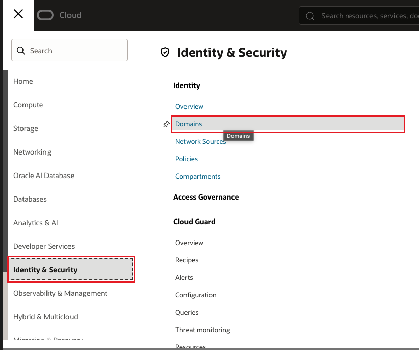

    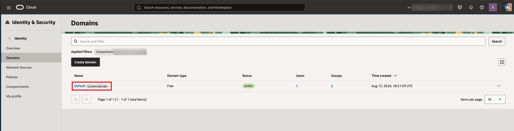

    Click **Copy** next to **Domain URL** for `IAM_DOMAIN_URL` and paste it into a text file. You'll collect the rest of your values in the same file as you go.

    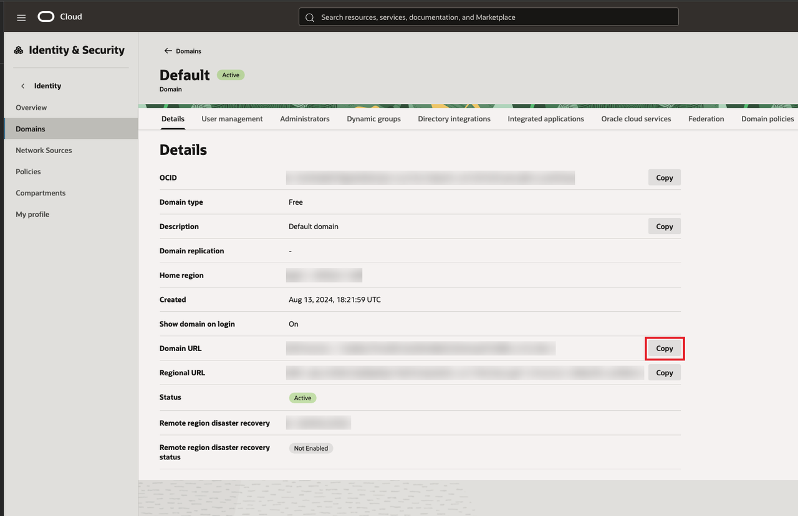

2. Click **Integrated applications**, then click **Add application**.

    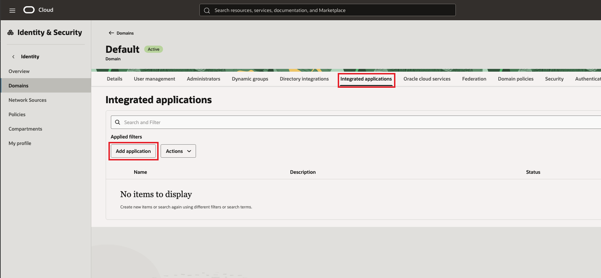

    Select **Confidential Application** and click **Launch workflow**.

    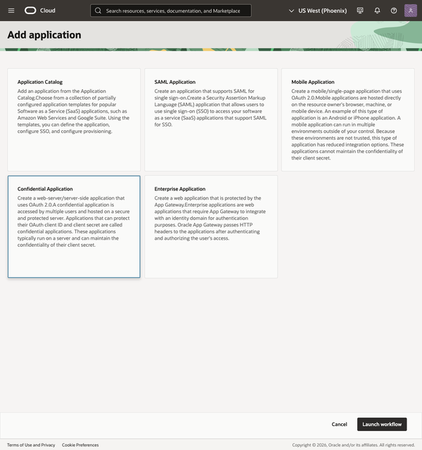

3. For **Name**, enter `OracleDB`. Leave the optional **Application URL** empty and click **Submit**.

4. Open **OAuth configuration > Edit OAuth configuration**.

    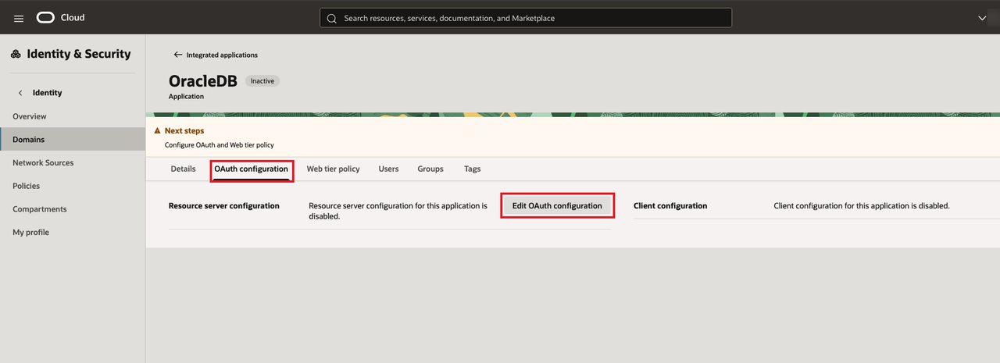

    Under **Resource server configuration**, select **Configure this application as a resource server now** and enter `OracleDB` for **Primary audience**. Keep this page open.

    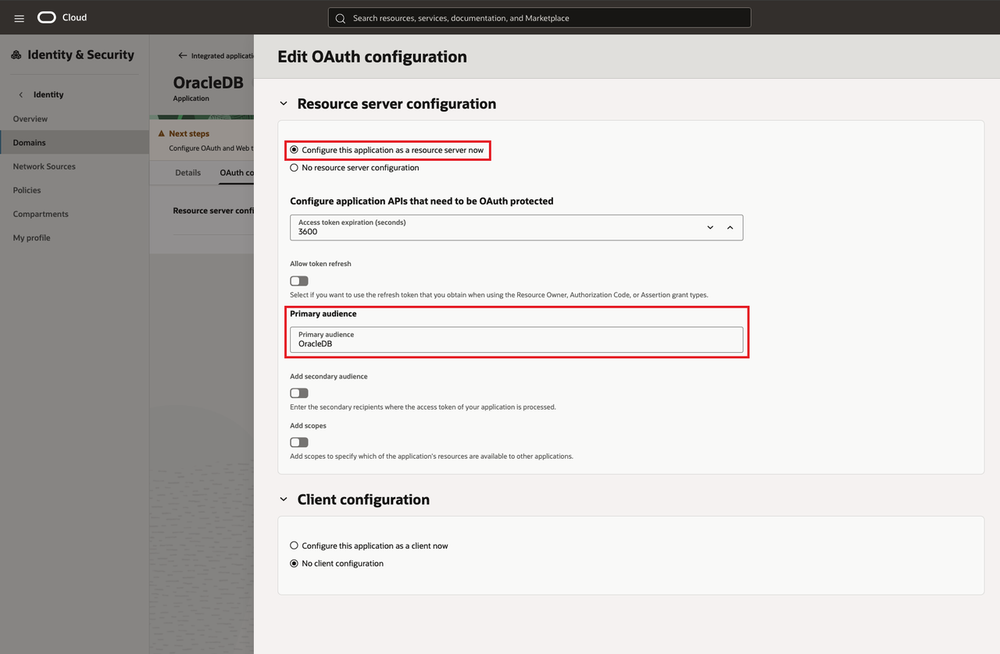

5. Enable **Add scopes** and click **Add**.

    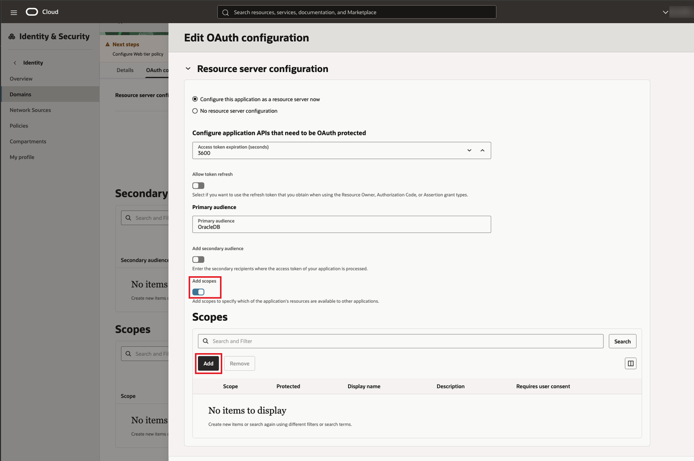

    Enter these values, leave **Requires user consent** off, and add the scope.

    | Field | Value |
    | --- | --- |
    | Scope | `DB_ACCESS_SCOPE` |
    | Display name | `DB Access` |
    | Description | `Access the database` |

    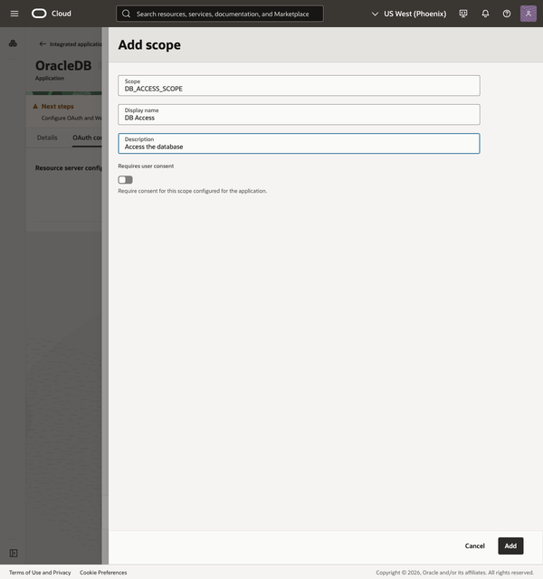

    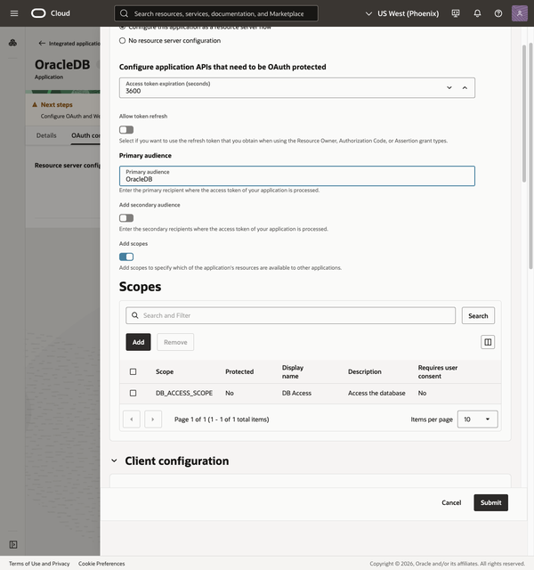

6. Scroll down the page. Under **Client configuration**:

    - select **Configure this application as a client now**
    - under **Allowed grant types**, enable **Client credentials**
    - under **Client IP address**, select **Anywhere**
    - under **Token issuance policy > Authorized resources**, select **Specific**

    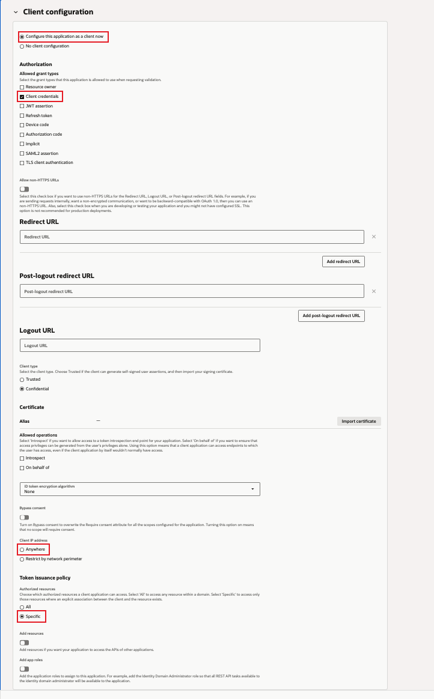

    > Note: This workshop uses **Anywhere** for **Client IP address**. If your domain uses a network perimeter, ask your administrator for a policy that lets the database and ORDS reach IAM.

7. Click **Submit**, then select **Actions > Activate**. In the confirmation dialog, click **Activate application**.

    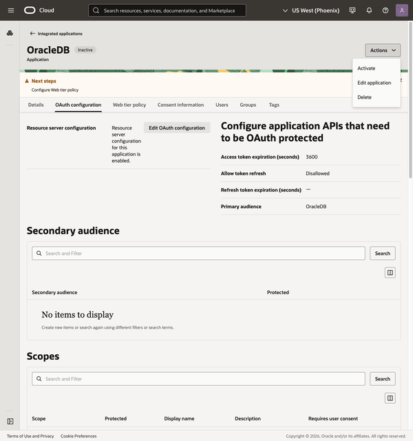

8. On the `OracleDB` application's **Details** page, copy the **Application ID**, not the OAuth **Client ID**, for `IAM_DATABASE_APP_ID`.

    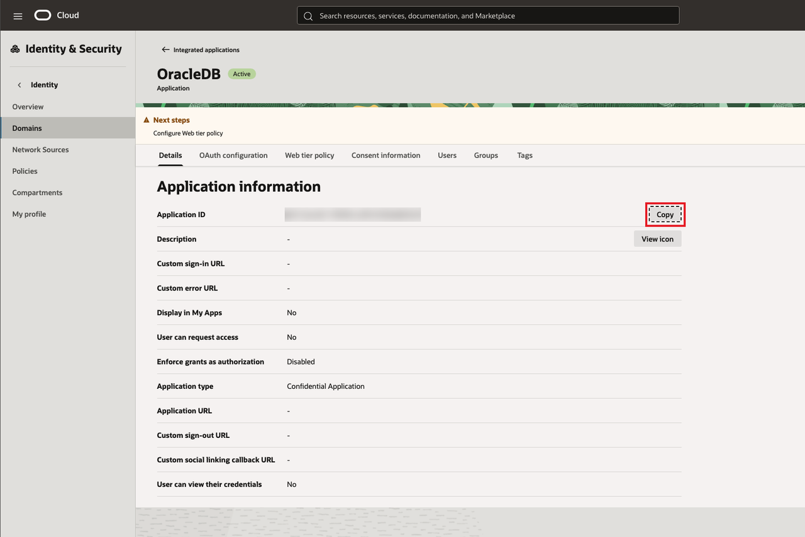

9. Create another confidential application named `fusabase` by repeating steps 2 and 3 with that name.

10. Open the `fusabase` application's **OAuth configuration > Edit OAuth configuration**. Under **Client configuration**:

    - select **Configure this application as a client now**
    - under **Allowed grant types**, enable **Client credentials**
    - under **Client IP address**, select **Anywhere**
    - under **Token issuance policy > Authorized resources**, select **Specific**

    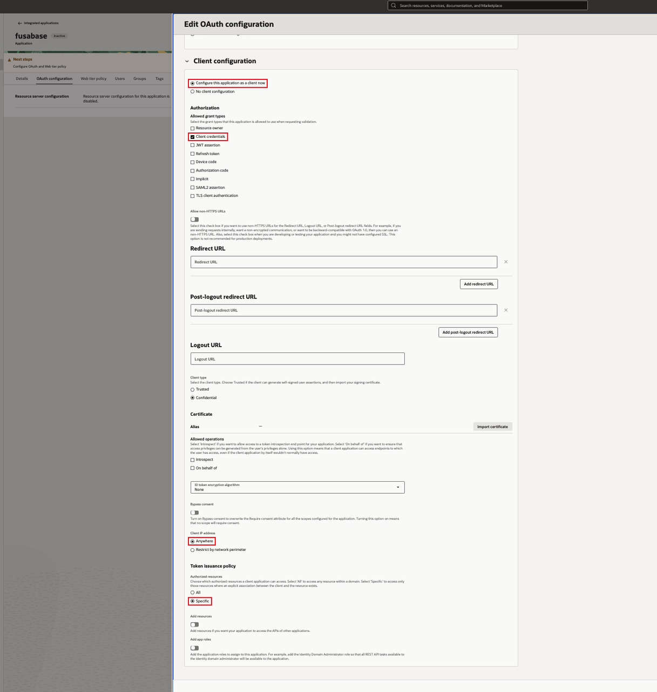

11. On the same screen, enable **Add resources** and click **Add scope**.

    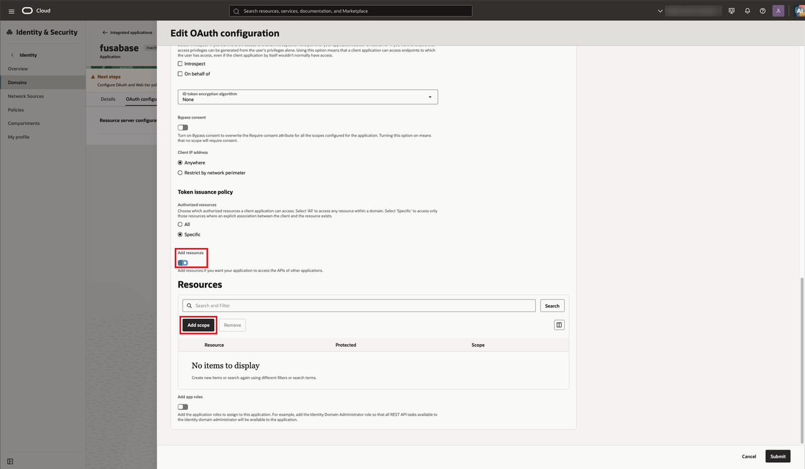

    Expand `OracleDB`, select `OracleDBDB_ACCESS_SCOPE`, and click **Add**.

    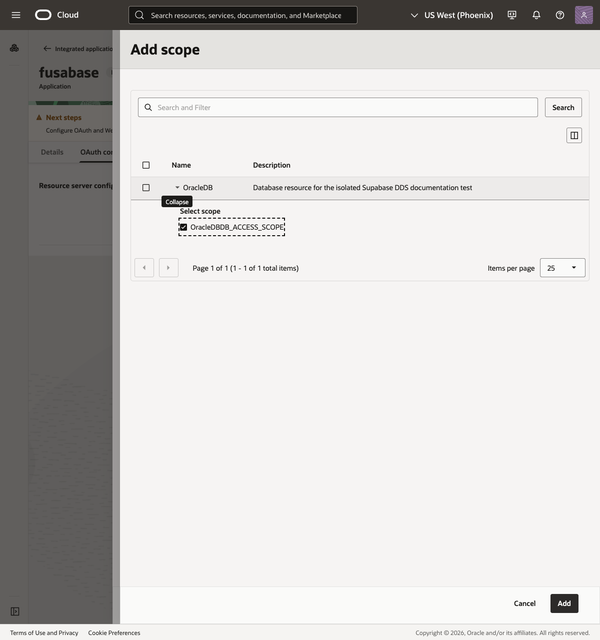

    Record `OracleDBDB_ACCESS_SCOPE` for `IAM_DATABASE_SCOPE`: the audience and scope name joined with no `/`. If you used different names, record the exact scope shown.

12. Click **Submit**, then select **Actions > Activate** and click **Activate application**.

13. On the `fusabase` application's **OAuth configuration** page, securely copy its **Client ID** for `IAM_ORDS_CLIENT_ID` and its **Client secret** for `IAM_ORDS_CLIENT_SECRET`.

    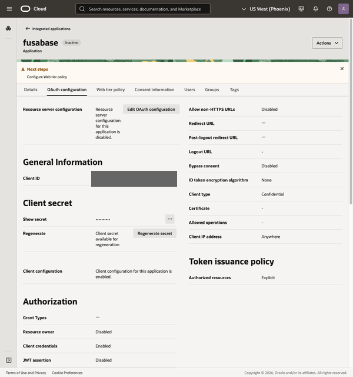

14. Return to **Integrated applications**. You should see both applications listed as **Active**.

    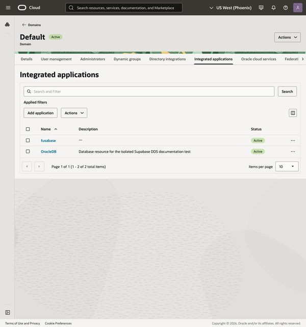

15. Open the domain's **Settings** tab.

    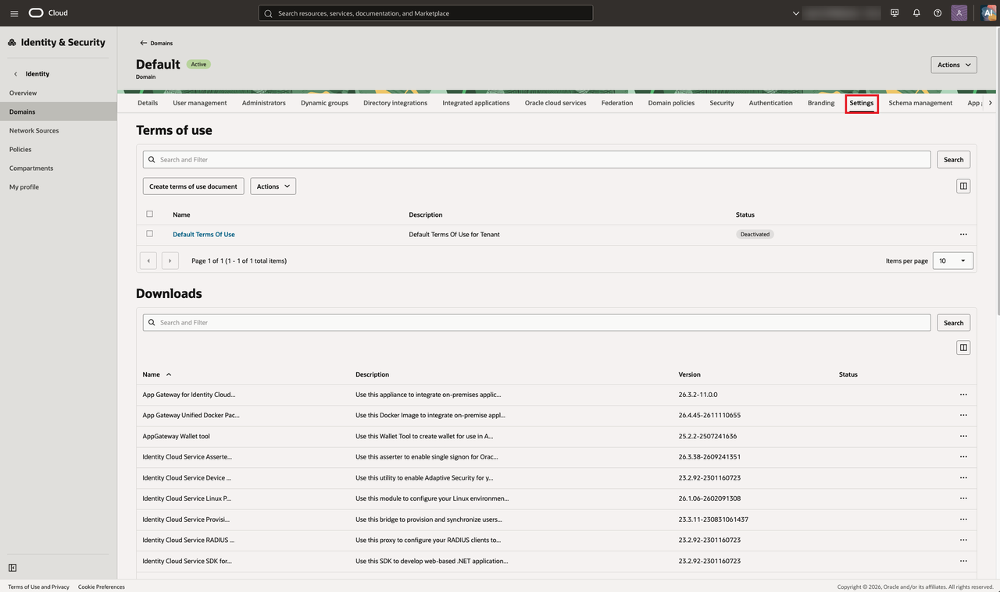

    Scroll down and click **Edit domain settings**.

    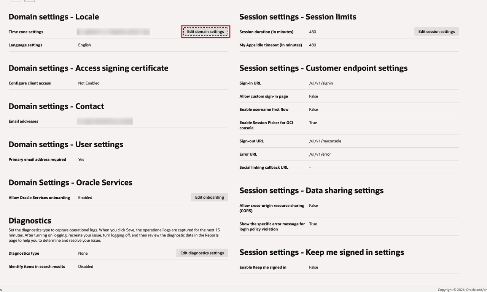

    Under **Access signing certificate**, enable **Configure client access**. This makes the public signing keys available to the database.

    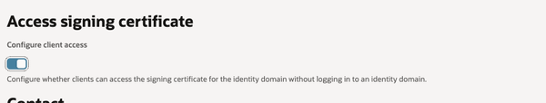

16. Click **Save changes**. In the **Save domain settings** confirmation, click **Save changes** again.

    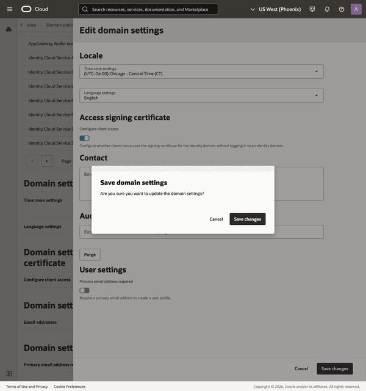

17. To check that the signing keys are public, open this address in a browser where you aren't signed in to OCI. Replace `DOMAIN_URL` with the **Domain URL** you saved in step 1.

    ```text
    DOMAIN_URL/admin/v1/SigningCert/jwk
    ```

    For example, if your Domain URL is `https://idcs-abc123.identity.oraclecloud.com:443`, open `https://idcs-abc123.identity.oraclecloud.com:443/admin/v1/SigningCert/jwk`.

    You should see JSON with a `keys` array. If you get `401 Unauthorized` or a sign-in prompt, repeat steps 15 and 16.

18. Check that you have all five values from the table.

## Task 5: Enter your IAM values in the IDE

1. In your IDE, open the `fusabase-compose-relational` folder. In Visual Studio Code, use **File > Open Folder**.

2. Open `.env` in the repository root. If it doesn't exist, duplicate `.env.example` and name the copy `.env`.

    Use exactly `.env`, with no `.txt` extension. If your IDE hides dotfiles, show them or use file search.

3. Paste your four values from Task 4 between the single quotes.

    ```text
    IAM_DOMAIN_URL=''
    IAM_ORDS_CLIENT_ID=''
    IAM_ORDS_CLIENT_SECRET=''
    IAM_DATABASE_APP_ID=''
    IAM_DATABASE_SCOPE='OracleDBDB_ACCESS_SCOPE'
    ```

    If you used the names from Task 4, leave `IAM_DATABASE_SCOPE` as shown. Otherwise, enter your exact fully qualified scope.

    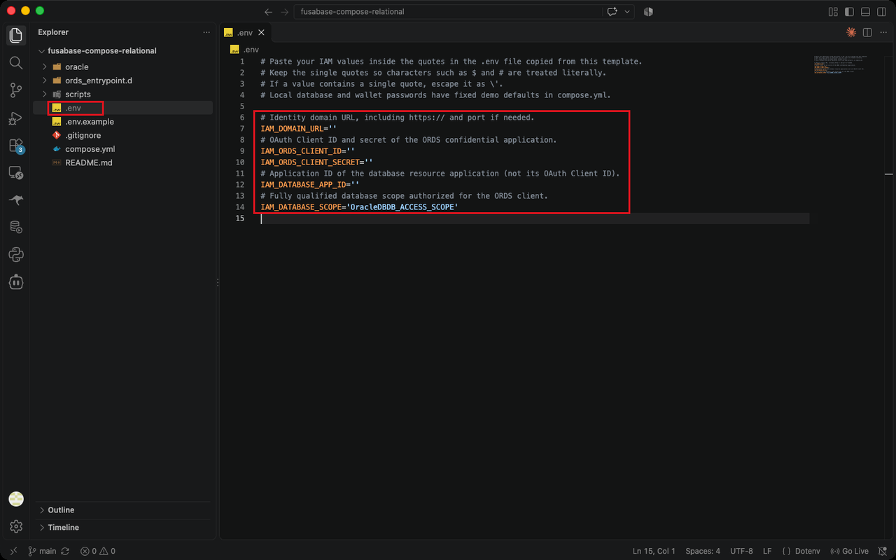

4. Save `.env` next to `compose.yml`. You don't need to change the database or wallet passwords.

    > Note: Keep `.env` private. Don't commit it or paste its contents into shared logs or screenshots.

5. Check that `IAM_DATABASE_APP_ID` holds the database **Application ID**, and that both `IAM_ORDS_*` values come from the ORDS application.

## Task 6: Start the demo environment

1. In a terminal, go to the `fusabase-compose-relational` directory that holds `compose.yml` and your saved `.env`. Stop any earlier workshop stack that's still running.

2. Start the stack with your runtime. Compose reads `.env` automatically.

    <details>
    <summary><b>Docker</b></summary>

    ```bash
    <copy>docker compose up -d</copy>
    ```

    </details>

    <details>
    <summary><b>Podman</b></summary>

    ```bash
    <copy>podman compose up -d</copy>
    ```

    </details>

3. Allow several minutes for the first startup. The images download, the database initializes, and then ORDS installs and configures the backend.

4. Follow startup progress with your runtime.

    <details>
    <summary><b>Docker</b></summary>

    ```bash
    <copy>docker compose logs -f fusabase_db fusabase_ords</copy>
    ```

    </details>

    <details>
    <summary><b>Podman</b></summary>

    ```bash
    <copy>podman compose logs -f fusabase_db fusabase_ords</copy>
    ```

    </details>

    Press **Ctrl+C** to stop following the logs. The containers keep running.

5. Check the service status.

    <details>
    <summary><b>Docker</b></summary>

    ```bash
    <copy>docker compose ps -a</copy>
    ```

    </details>

    <details>
    <summary><b>Podman</b></summary>

    ```bash
    <copy>podman compose ps -a</copy>
    ```

    </details>

    Wait until both `fusabase_db` and `fusabase_ords` report `healthy`. A container can show as running while it's still initializing.

## Task 7: Sign in to the Fusabase console

1. Open the ORDS landing page in your browser.

    ```text
    <copy>http://localhost:8080/ords/_/landing</copy>
    ```

    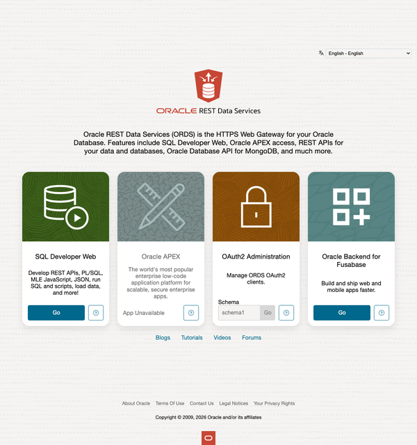

2. Click **Go** on the Fusabase console tile. It might say **Oracle Backend for Fusabase**, as in the screenshot, or **Oracle Backend with Supabase APIs**.

3. Sign in with the local demo schema.

    | Sign-in field | Value |
    | --- | --- |
    | Schema/path | `testuser` |
    | Username | `TESTUSER` |
    | Password | `testpwd` |

    These are local workshop credentials. Use the IAM client secret only in `.env`.

4. You should see the Fusabase console, ready to create an Oracle Backend with Supabase APIs project. You'll create it in the next lab.

## Troubleshooting

- **Port or name conflict at startup:** stop earlier workshop stacks on ports `1521`, `8080`, or `27017`. Containers named `fusbase-db-relational` or `fusabase-ords-relational` block startup, even when stopped.
- **Compose reports a missing IAM value:** fill in that field in `.env`, save it, and run the startup command again.
- **A value contains a single quote:** escape it as `\'`.
- **A service exits or reports `unhealthy`:** check the logs. For an IAM error, check that both applications are active, the ORDS secret and scope are correct, and the signing keys are public. Then rerun the startup command.
- **The console doesn't load or sign-in fails:** check that both containers are healthy, then retry with schema/path `testuser` and the demo credentials.

## Appendix: Stop and resume the environment

From the `fusabase-compose-relational` directory, run this to remove the containers. Your database and backend configuration stay.

<details>
<summary><b>Docker</b></summary>

```bash
<copy>docker compose down</copy>
```

</details>

<details>
<summary><b>Podman</b></summary>

```bash
<copy>podman compose down</copy>
```

</details>

To resume, repeat the startup command from Task 6 with the same `.env` file. Don't add `-v` to `compose down` unless you want to delete the volumes and all workshop data.

You may now **proceed to the next lab**.

## Acknowledgements

* **Author** - Killian Lynch, Senior Product Manager, Oracle AI Database
* **Last Updated By/Date** - Killian Lynch, November 2026
