# Photo upload

## Introduction

In this lab, you will let organizers add a cover image to an event. Anyone with the event link can see the cover, even when signed out.

### Objectives

In this lab, you will:

- add storage Grants so anyone can view covers and users can upload only to their own path
- upload an image with `client.storage.from(bucket).upload()`
- save the cover's storage path on the event
- download the image with `download()` when the invitation opens

Estimated Time: 20 minutes

### Prerequisites

This lab assumes you have:

- Successfully completed all previous labs.

## Task 1: Check storage and event permissions

1. In the **Fusabase console**, open **LiveLab > Storage > Storage settings**. You should see **Basic file system** and the bucket name from Lab 2. Leave them as they are.

    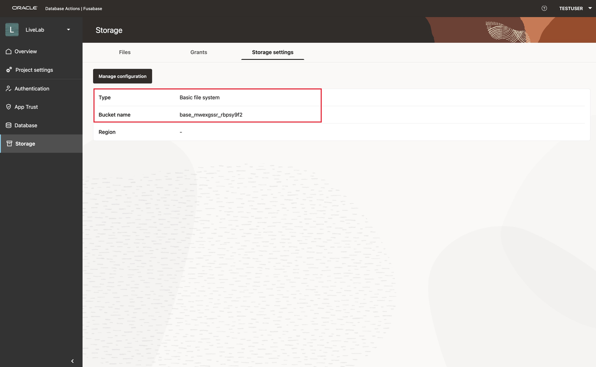

2. Open **Database > Table Editor > Grants** and choose **Actions > Edit** for `GATHER_EVENTS_UPDATE`. It should list Lab 4's five columns, including `COVER_PATH`, and the `ORGANIZER_ID` condition. You don't need to change it, so click **Cancel**.

    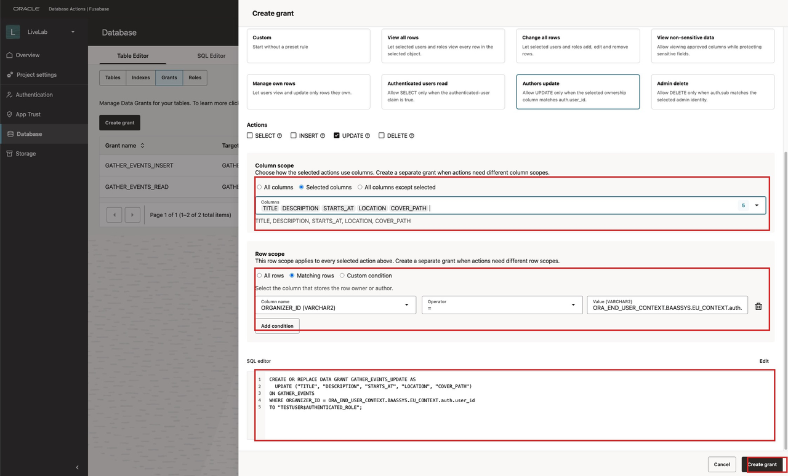

## Task 2: Let guests view cover images

This Grant lets anyone view cover images, signed in or not, but not change them. It covers only this project's files under `covers/` whose upload has finished.

1. Open **Database > SQL Editor** and replace the worksheet with this statement:

    ```sql
    <copy>CREATE OR REPLACE DATA GRANT GATHER_COVERS_READ AS
  SELECT ON BAAS_STORAGE_OBJECTS
  WHERE OBJS_ID = JSON_VALUE(
      ORA_END_USER_CONTEXT.BAASSYS.EU_CONTEXT.project.objs_id,
      '$' RETURNING VARCHAR2(60))
    AND ORA_END_USER_CONTEXT.BAASSYS.EU_CONTEXT.request.service = 'objs'
    AND ORA_END_USER_CONTEXT.BAASSYS.EU_CONTEXT.request.operation
      IN ('get', 'head', 'list')
    AND SUBSTR(OBJECT_NAME, 1, 7) = 'covers/'
    AND OBJECT_STATUS = 'committed'
  TO TESTUSER$NOAUTH_ROLE, TESTUSER$AUTHENTICATED_ROLE;</copy>
    ```

2. Click **Run Script (F5)**. Under **Script Output**, you should see **Data GRANT created.**

    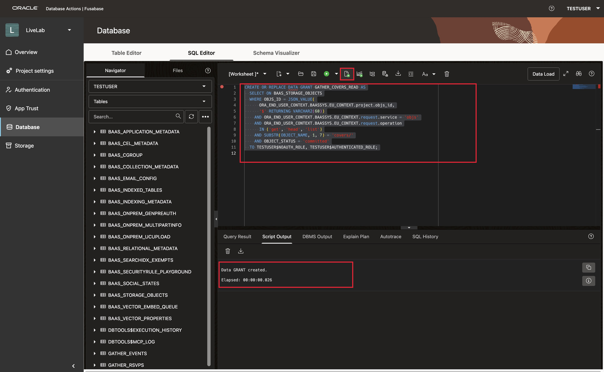

## Task 3: Allow uploads under each user's path

A storage upload needs INSERT and UPDATE, plus SELECT to read its own object. This Grant allows them only for signed-in users uploading to their own path.

1. In **SQL Editor**, replace the worksheet with the statement below. Its last condition checks the path:

    - The app saves covers at `covers/USER_ID/EVENT_ID/RANDOM_ID`. `REGEXP_SUBSTR(..., 1, 2)` takes the user ID part and compares it with the signed-in user's ID.

    ```sql
    <copy>CREATE OR REPLACE DATA GRANT GATHER_COVERS_OWN AS
  SELECT, INSERT, UPDATE ON BAAS_STORAGE_OBJECTS
  WHERE OBJS_ID = JSON_VALUE(
      ORA_END_USER_CONTEXT.BAASSYS.EU_CONTEXT.project.objs_id,
      '$' RETURNING VARCHAR2(60))
    AND ORA_END_USER_CONTEXT.BAASSYS.EU_CONTEXT.request.service = 'objs'
    AND ORA_END_USER_CONTEXT.BAASSYS.EU_CONTEXT.request.operation = 'put'
    AND SUBSTR(OBJECT_NAME, 1, 7) = 'covers/'
    AND REGEXP_SUBSTR(OBJECT_NAME, '[^/]+', 1, 2) = JSON_VALUE(
      ORA_END_USER_CONTEXT.BAASSYS.EU_CONTEXT.auth.user_id,
      '$' RETURNING VARCHAR2(256))
  TO TESTUSER$AUTHENTICATED_ROLE;</copy>
    ```

2. Click **Run Script (F5)**. You should see **Data GRANT created.**

    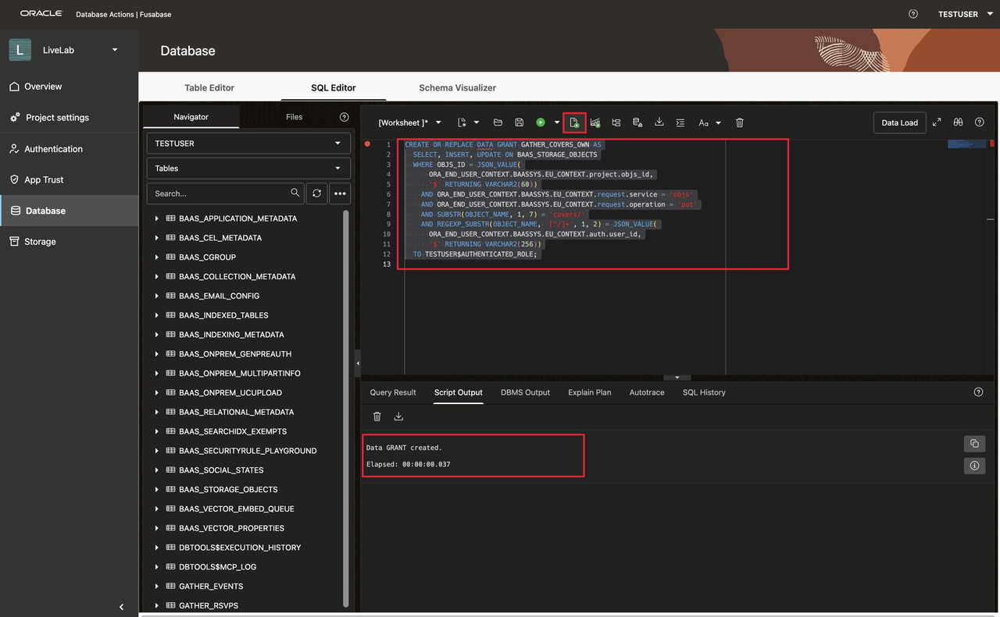

3. Open **Storage > Grants**. You should see `GATHER_COVERS_READ` (SELECT, both default roles) and `GATHER_COVERS_OWN` (INSERT, SELECT, and UPDATE, authenticated role only).

    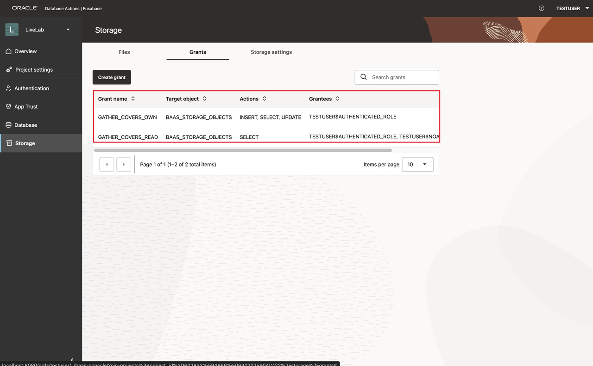

4. Choose **Actions > Edit** for `GATHER_COVERS_OWN` and scroll through its role, **Custom condition**, and SQL. Check the `put` and user-path conditions, then click **Cancel**.

    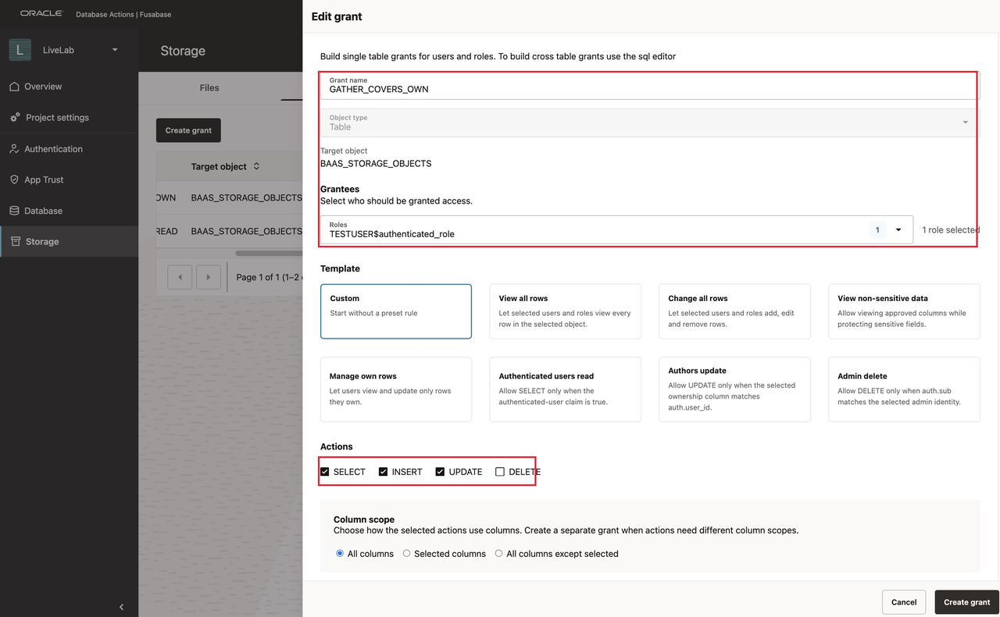

    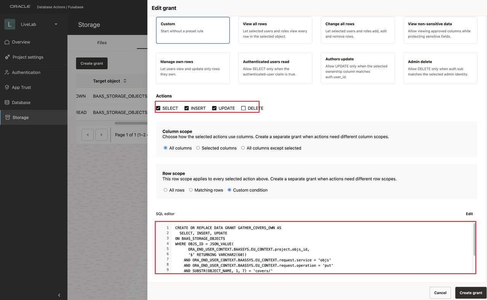

    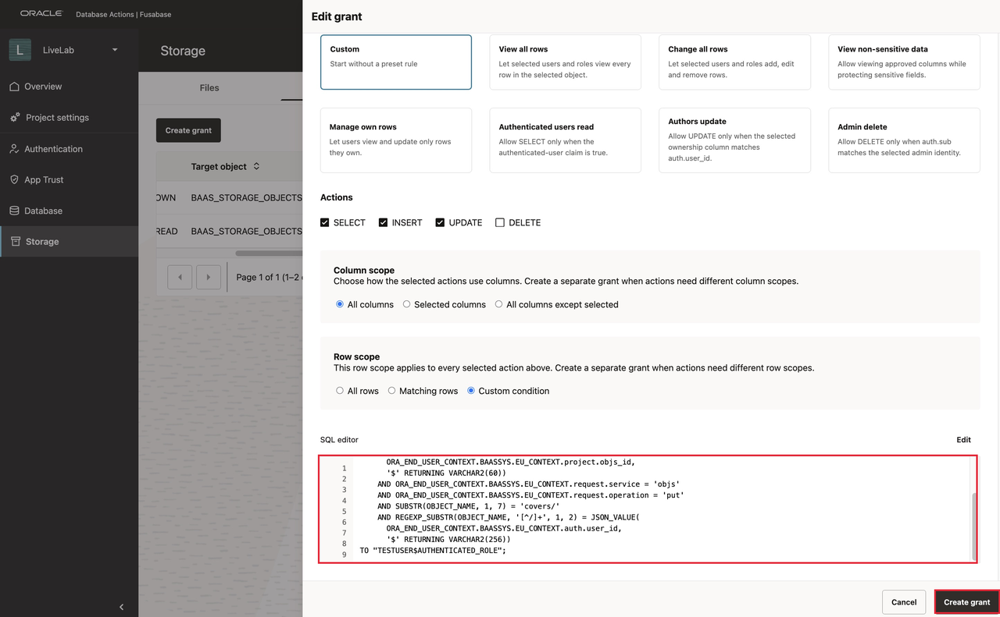

    > Note: Grants add up. Don't add **View all rows** or **Change all rows** for storage, and remove any broader storage Grant you added.

## Task 4: Upload and attach the cover

When you click **Upload cover**, the app passes the event ID, signed-in user, selected file, and bucket to `uploadCover()`.

1. Open `starter/actions.js` in VS Code. The `createClient` import and `connect()` already give you `client`, so you don't need a new import.

2. Select the Lab 7 TODO comment and the whole `uploadCover()` function. Keep `listGuests()`, `loadCover()`, and the optional sign-in TODOs.

    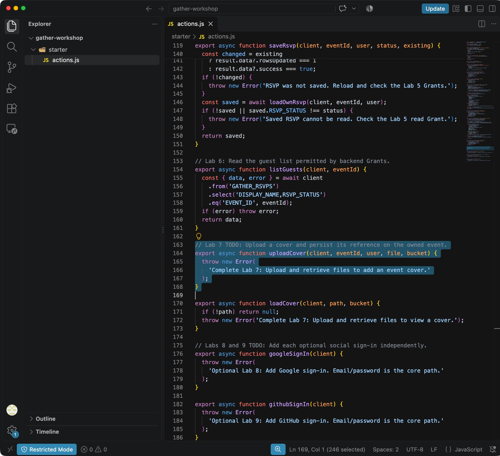

3. Read the code in four parts:

    - The function checks the image and the organizer before uploading. The Grants enforce access separately from this app check.
    - `storage.from(bucket)` selects your bucket, and `upload(path, file, { contentType })` stores the image at a new path. Check `uploadError` before attaching it.
    - `update({ COVER_PATH: path })` saves the storage path on the event. Check that exactly one row changed, so a blocked update doesn't look like a success.
    - The function reads the event again to check the saved path.

4. Replace the selection with this code and save the file:

    ```javascript
    <copy>// Lab 7: Upload a cover and save its durable object path.
export async function uploadCover(client, eventId, user, file, bucket) {
  if (!user) throw new Error('Sign in to upload a cover.');
  if (
    !file?.size ||
    !['image/jpeg', 'image/png', 'image/webp'].includes(file.type) ||
    file.size > 5 * 1024 * 1024
  ) {
    throw new Error('Choose a JPEG, PNG, or WebP image up to 5 MB.');
  }
  const event = await loadEvent(client, eventId);
  if (!event || event.ORGANIZER_ID !== user.id) {
    throw new Error('Only the organizer can add a cover to this event.');
  }
  const path = `covers/${user.id}/${eventId}/${crypto.randomUUID()}`;
  const { error: uploadError } = await client.storage.from(bucket)
    .upload(path, file, { contentType: file.type });
  if (uploadError) {
    throw new Error('Upload failed. Check the Lab 7 storage Grant.');
  }
  const { data, error } = await client.from('GATHER_EVENTS')
    .update({ COVER_PATH: path })
    .eq('EVENT_ID', eventId)
    .eq('ORGANIZER_ID', user.id);
  if (error || data?.rowsUpdated !== 1) {
    throw new Error('Cover uploaded but not attached. Check the event Grant and try again.');
  }
  const saved = await loadEvent(client, eventId);
  if (saved?.COVER_PATH !== path) {
    throw new Error('Reload to check the saved cover.');
  }
  return saved;
}</copy>
    ```

    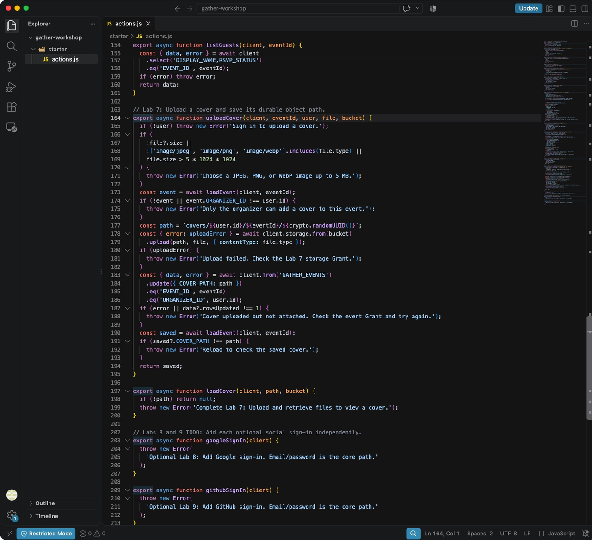

## Task 5: Download the saved image

The app calls `loadCover(client, path, bucket)` when it opens an event. The SDK's `download(path)` returns the image as a Blob, which holds the file's bytes for the page to display.

1. Select the whole `loadCover()` placeholder.

    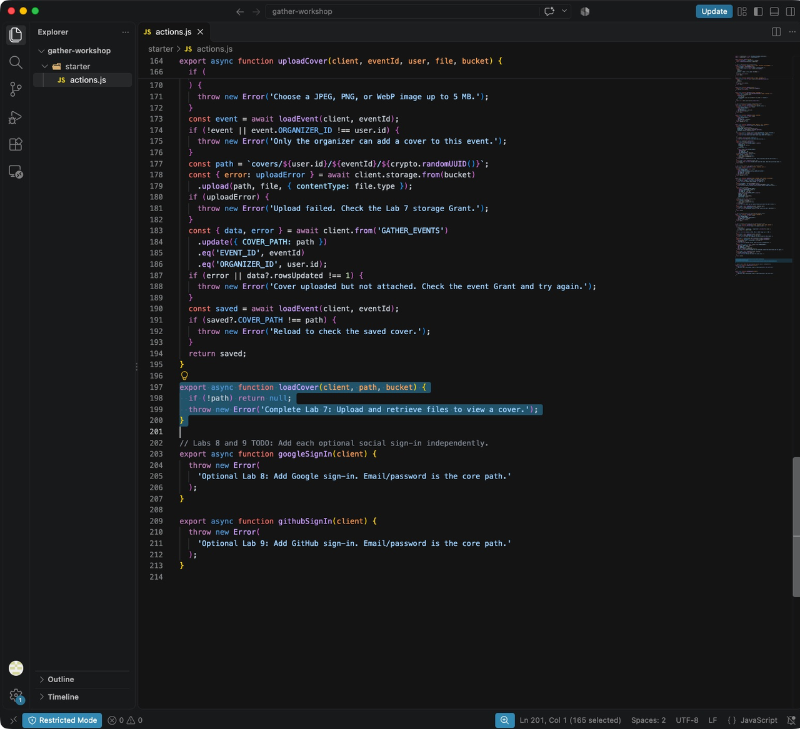

2. Replace it with this function and save the file. An event with no cover returns `null`, so its normal invitation still displays.

    ```javascript
    <copy>export async function loadCover(client, path, bucket) {
  if (!path) return null;
  const { data, error } = await client.storage.from(bucket).download(path);
  if (error) throw new Error('Cover could not load. Check the Lab 7 read Grant.');
  return data;
}</copy>
    ```

    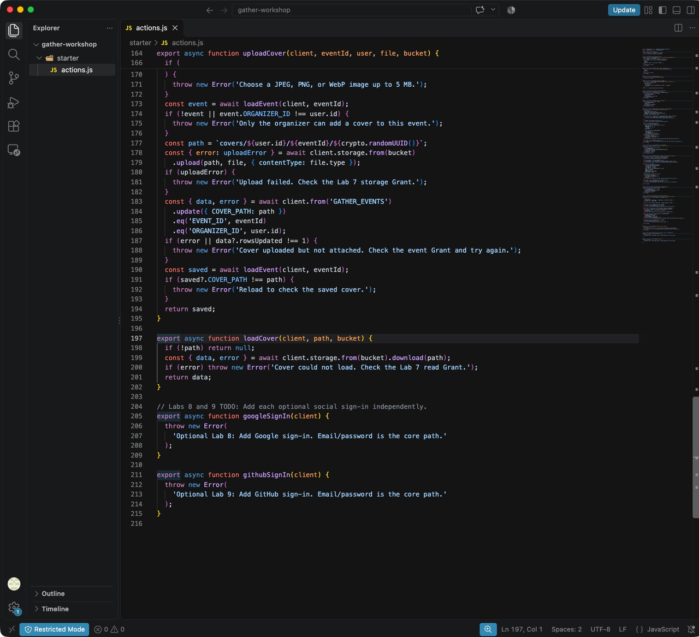

## Task 6: Verify the cover in your app

Use your accounts from earlier labs. Sign out between accounts, or use separate browser profiles.

- Alex Gather (organizer)
- Sam Gather (guest)

1. As Alex, create an event or open one you organize. Under **Event cover**, click **Choose File** and select the sample image from your repo:

    - `starter/images/sunday-supper-cover.png`

    You should see its filename beside the file picker.

    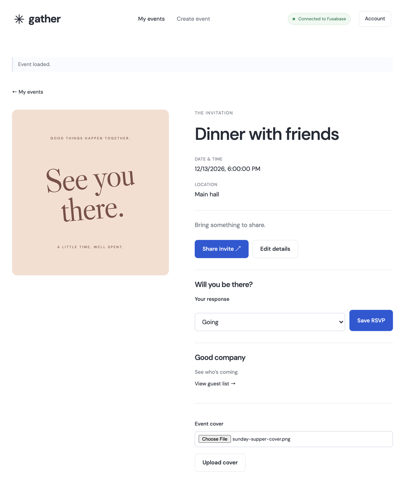

2. Click **Upload cover**. You should see **Cover saved.** and your image.

3. Return to **My events**. Your event card now shows the cover. Open the invitation again and reload it. The same image appears, because the event stores its path.

    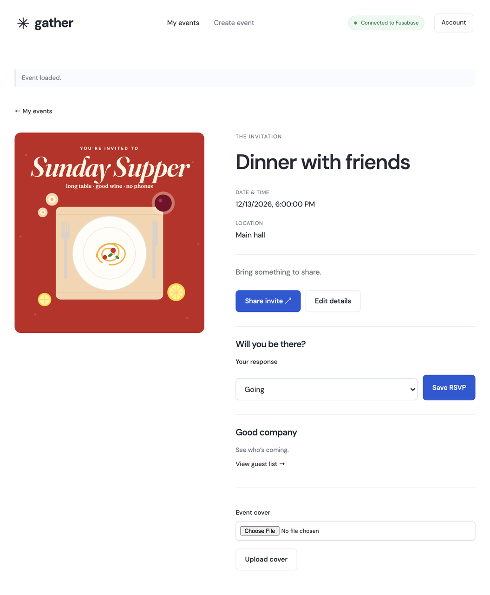

4. Copy **Share invite**, sign out, and open the invitation link. The cover and event details are still visible.

    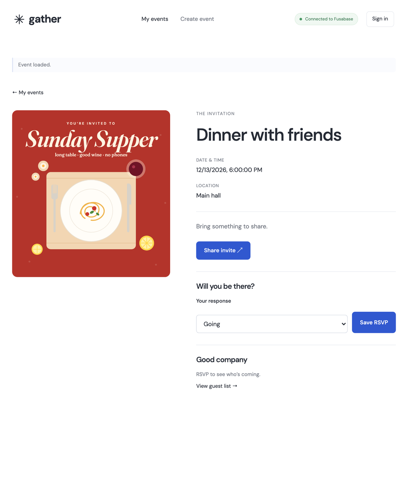

5. Sign in as Sam and open Alex's invitation. Sam can see the cover, but has no **Event cover** upload control or **Edit details** button.

    

6. Sign back in as Alex. The cover is unchanged. Hiding controls only makes the app clearer; the Grants enforce access.

7. If `starter/actions.js` doesn't work after this lab, run this from the workshop root:

    ```bash
    cp checkpoints/lab-7/actions.js starter/actions.js
    ```

    Keep your own `starter/config.js`. The checkpoint doesn't create the storage Grants, so complete Tasks 1–3 first.

## Troubleshooting

- **Upload fails:** choose a JPEG, PNG, or WebP image up to 5 MB. Check the bucket and the complete `GATHER_COVERS_OWN` Grant from Task 3.
- **Uploaded but not attached:** check that `GATHER_EVENTS_UPDATE` includes `COVER_PATH` and its organizer condition, then try again.
- **Cover can't load:** check `GATHER_COVERS_READ`, including both default roles, the read operations, and committed status.
- **Lab 7 message:** save both completed functions in `starter/actions.js` and reload.

You may now **proceed to the next lab**.

## Acknowledgements

* **Author** - Killian Lynch, Senior Product Manager, Oracle AI Database
* **Last Updated By/Date** - Killian Lynch, November 2026
