# Build a Service Demand Watchlist with Oracle Machine Learning

## Introduction

Otto Spencer, Seer Utility Network's data scientist, is building a demand watchlist for service planners. They need to see predicted demand alongside request value and operational activity.

Train a model in Oracle AI Database to classify services as `SURGE` or `STABLE`, then join its scores to the service details planners need.

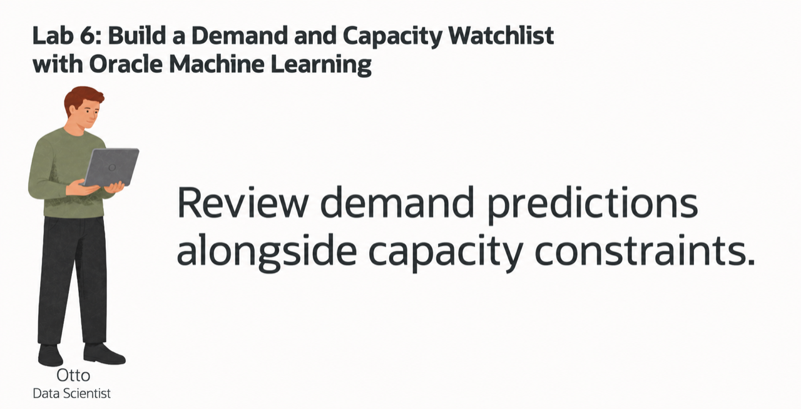

<details>
<summary><strong>Key terms: model, feature, classification, probability, and in-database machine learning</strong></summary>

> - A **model** is a set of learned rules that turns input data into a prediction.
>
> - A **feature** is an input value used by the model. In this lab, features include service category, price, operational signals, and request value.
>
> - **Classification** predicts a label. Otto's model predicts either `SURGE` or `STABLE`.
>
> - A **probability** is the model's value for a class. In this lab, the value is displayed as a `SURGE_SCORE` to rank utility services for review. It is not a guarantee.
>
> - **In-database machine learning** means the model is trained or scored where the source data already lives. The SQL result can include the prediction and the data used to explain it.

</details>

### Objectives

- Read the prepared training data and identify the model target.
- Optionally use AutoML to compare classification models and inspect their predictions.
- Create the selected Generalized Linear Model inside Oracle AI Database.
- Score utility services with `PREDICTION` and `PREDICTION_PROBABILITY`.
- Combine model output with service, request value, and engagement data for a dashboard result.

Estimated Time: **10 minutes**

<video controls width="100%">
  <source src="https://c4u04.objectstorage.us-ashburn-1.oci.customer-oci.com/p/EcTjWk2IuZPZeNnD_fYMcgUhdNDIDA6rt9gaFj_WZMiL7VvxPBNMY60837hu5hga/n/c4u04/b/livelabsfiles/o/livestack%2FVideos%2FUtilities%2FWorkshop%2FScene-08-Service-Demand-Watchlist-Branded.mp4">
  Your browser does not support the video tag.
</video>

> **SQL Worksheet:** [Getting Started: open SQL Worksheet as LLUSER](?lab=getting-started), Task 2.

## Task 1: Read the training data

> **Training data:** The loader creates `LL_UTILITY_DEMAND_TRAINING_V` and `LL_UTILITY_DEMAND_OUTCOMES`. Predictors use records through 31 August 2026; the synthetic labels describe the separate September window. The labels are assigned independently of predictor formulas, with 30 SURGE and 30 STABLE rows. This dataset teaches the workflow and does not establish operational predictive accuracy.

Otto starts with `LL_UTILITY_DEMAND_TRAINING_V`: one row per service with operational signals, request activity, and the synthetic `DEMAND_CLASS` label.

The outcome table records the predictor cutoff and later outcome window. Keep the target label out of the input features.

1. Run the training-data query:

    ```sql
    <copy>
    SELECT product_id,
           category,
           unit_price,
           signal_count,
           signal_sentiment,
           critical_signals,
           rising_signals,
           units_requested,
           request_value,
           demand_class
    FROM ll_utility_demand_training_v
    ORDER BY product_id
    FETCH FIRST 10 ROWS ONLY;
    </copy>
    ```

2. Identify the parts of each row.

    The numeric and category columns are the model inputs. `DEMAND_CLASS` is the answer the model learns to predict. `PRODUCT_ID` identifies the service but is not a business feature for this example.

    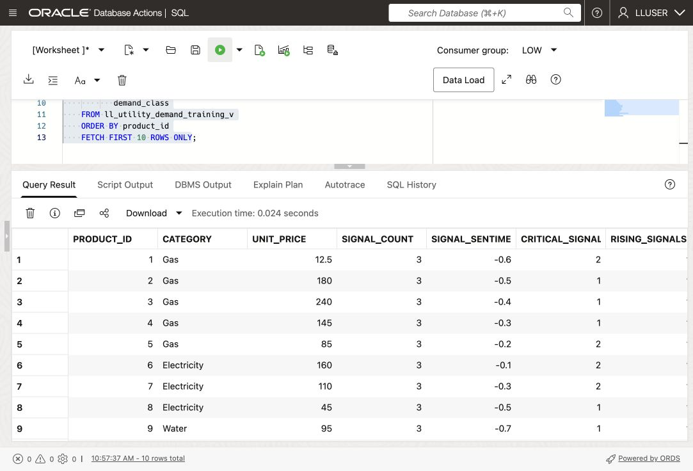

## Task 2: Compare models with AutoML (optional)

Otto uses Oracle Machine Learning AutoML to compare candidate models and see how well they identify utility services labeled `SURGE` or `STABLE`.

AutoML may take several minutes. Skip to Task 3 to train and score the named model with SQL.

1. Open **Machine Learning** from Database Actions.

    Sign in as `LLUSER` with your workshop credentials.

    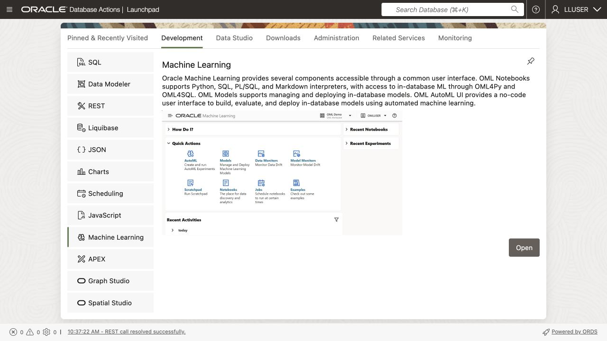

2. Select **AutoML**.

    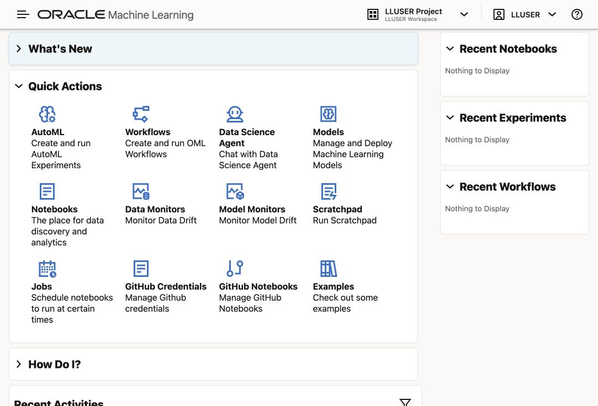

3. Create a new experiment with these settings:

    | Setting | Value |
    | --- | --- |
    | Experiment name | `Utility Demand Surge` |
    | Data source | `LL_UTILITY_DEMAND_TRAINING_V` |
    | Predict | `DEMAND_CLASS` |
    | Prediction type | `Classification` |
    | Case ID | `PRODUCT_ID` |

    **Note:** The **Predict**, **Prediction Type**, and **Case ID** fields become available after you enter a data source.

    To select the data source:

    1. Enter `Utility Demand Surge` in the **Name** field.
    2. Select the magnifying-glass icon beside **Data Source**.
    3. In the **Select Table** window, select `LLUSER` from the **Schema** list.
    4. Select `LL_UTILITY_DEMAND_TRAINING_V` from the **Table** list.
    5. Select **OK**.

    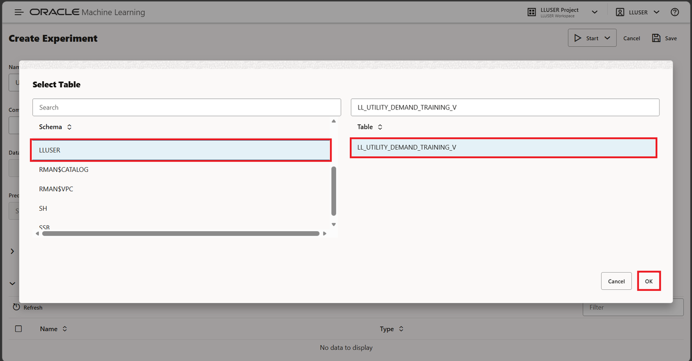

    Select `DEMAND_CLASS` for **Predict**, `Classification` for **Prediction Type**, and `PRODUCT_ID` for **Case ID**.

    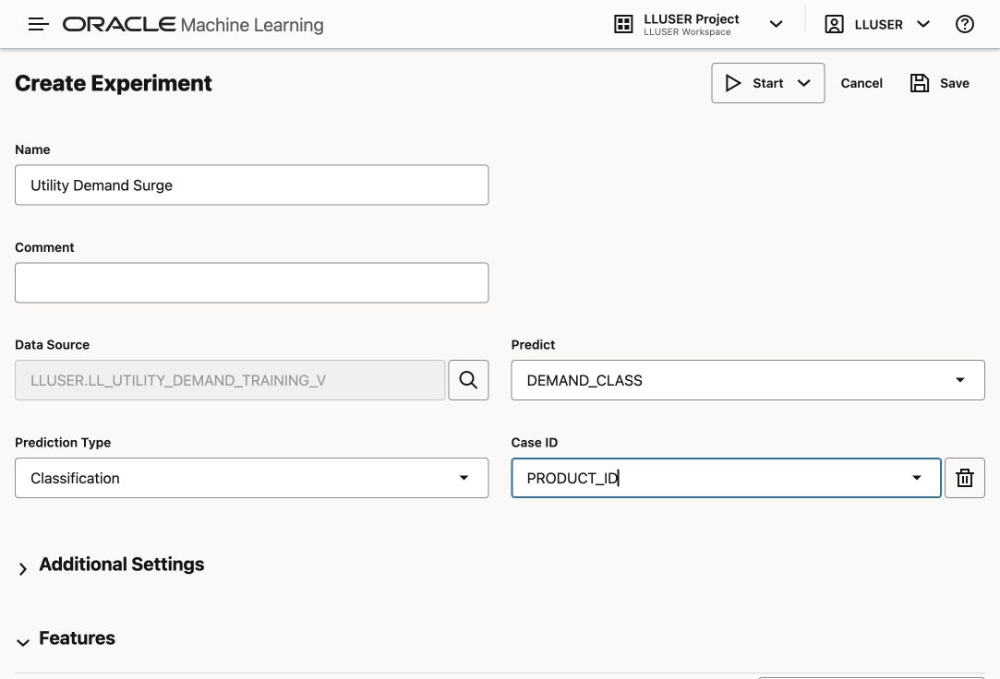

    Review the predictors. Keep the service category, price, operational-signal, and request-activity columns as inputs. `PRODUCT_ID` identifies each case, and `DEMAND_CLASS` is the target; neither should be an ordinary predictor.

4. Choose **Start → Faster Results** and wait for the leaderboard. Runtime varies and may take several minutes.

    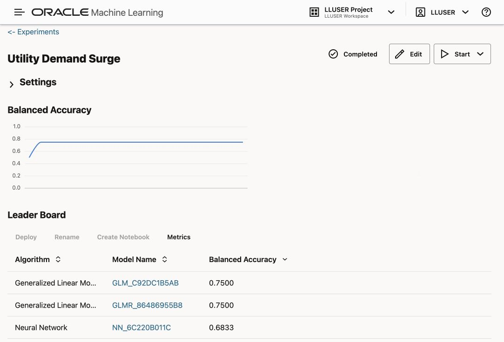

5. Review the leaderboard and model details.

    Open candidate model details and compare their confusion matrices. Check false positives and false negatives for both classes. The training data has 30 `SURGE` and 30 `STABLE` rows, so compare how each class is identified. A model that always predicts `STABLE` misses every surge case.

    The captured AutoML run shows both Generalized Linear Model variants at 0.75 balanced accuracy. Your result may differ. Use the metrics and confusion matrices from your experiment; this small synthetic dataset is for learning, not operational model selection.

    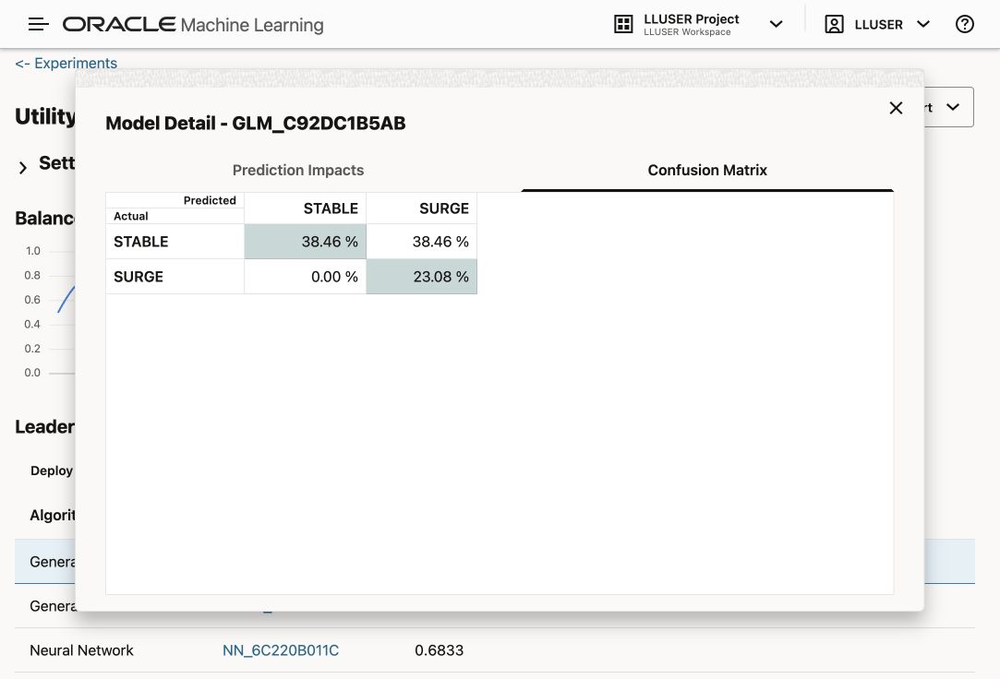

    Review feature impact when available. Signal counts or request activity can help explain a model’s behavior, but feature influence does not prove an operational cause.

    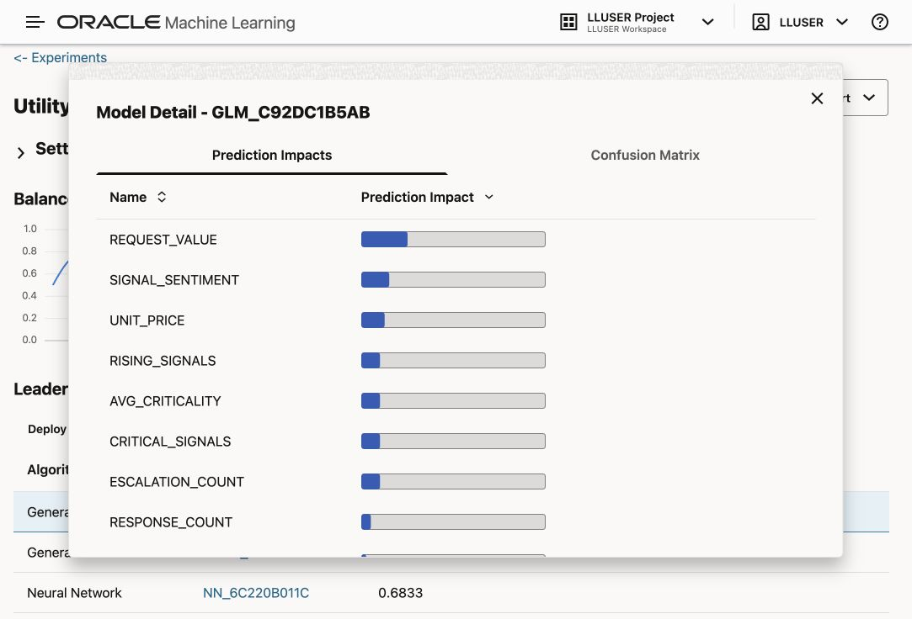

    **Expected output: An experiment leaderboard and model details**

    | Review | Question for Otto |
    | --- | --- |
    | Confusion matrix | Does the model identify examples from both classes? |
    | Balanced accuracy and class errors | How does it perform on `SURGE` and `STABLE` cases? |
    | Feature impact | Which inputs influence this fitted model? |

Task 3 uses a Generalized Linear Model so you can inspect a named model and score it with SQL. It uses that model whether or not you ran AutoML; it does not assume the GLM won the experiment.

## Task 3: Create the selected model in SQL Developer Web

> **Learner-owned objects:** This lesson creates `LL_UTILITY_DEMAND_SETTINGS`, `LL_UTILITY_DEMAND_GLM` and `LL_UTILITY_DEMAND_SCORING`. The loader deliberately leaves them absent. The reset statements affect only these lab-owned names in your temporary workshop schema.

Create `LL_UTILITY_DEMAND_GLM`, a named model that SQL can call. Use Generalized Linear Model for this exercise whether or not you ran AutoML.

The settings table selects the algorithm. `PREP_AUTO` enables automatic preparation of input columns.

1. Create the settings table and train the model by selecting **Run Script (F5)**.

    ```sql
    <copy>

    DROP TABLE IF EXISTS ll_utility_demand_settings;

    CREATE TABLE ll_utility_demand_settings (
          setting_name  VARCHAR2(30),
          setting_value VARCHAR2(4000)
        );

    INSERT INTO ll_utility_demand_settings (setting_name, setting_value)
    VALUES ('ALGO_NAME', 'ALGO_GENERALIZED_LINEAR_MODEL');

    INSERT INTO ll_utility_demand_settings (setting_name, setting_value)
    VALUES ('PREP_AUTO', 'ON');

    INSERT INTO ll_utility_demand_settings (setting_name, setting_value)
    VALUES ('ODMS_RANDOM_SEED', '20260604');

    COMMIT;

    DECLARE
      l_model_count NUMBER;
    BEGIN
      SELECT COUNT(*)
      INTO l_model_count
      FROM user_mining_models
      WHERE model_name = 'LL_UTILITY_DEMAND_GLM';

      IF l_model_count > 0 THEN
        DBMS_DATA_MINING.DROP_MODEL('LL_UTILITY_DEMAND_GLM');
      END IF;
    END;
    /

    BEGIN
      DBMS_DATA_MINING.CREATE_MODEL(
        model_name           => 'LL_UTILITY_DEMAND_GLM',
        mining_function      => DBMS_DATA_MINING.CLASSIFICATION,
        data_table_name      => 'LL_UTILITY_DEMAND_TRAINING_V',
        case_id_column_name  => 'PRODUCT_ID',
        target_column_name   => 'DEMAND_CLASS',
        settings_table_name  => 'LL_UTILITY_DEMAND_SETTINGS'
      );
    END;
    /
    </copy>
    ```

    The model reads the training view, learns the relationship between the features and `DEMAND_CLASS`, and stores the trained model in the database. No service or signal data leaves Oracle Database during training.

2. Confirm that Oracle created the model:

    ```sql
    <copy>
    SELECT model_name,
           mining_function,
           algorithm
    FROM user_mining_models
    WHERE model_name = 'LL_UTILITY_DEMAND_GLM';
    </copy>
    ```

    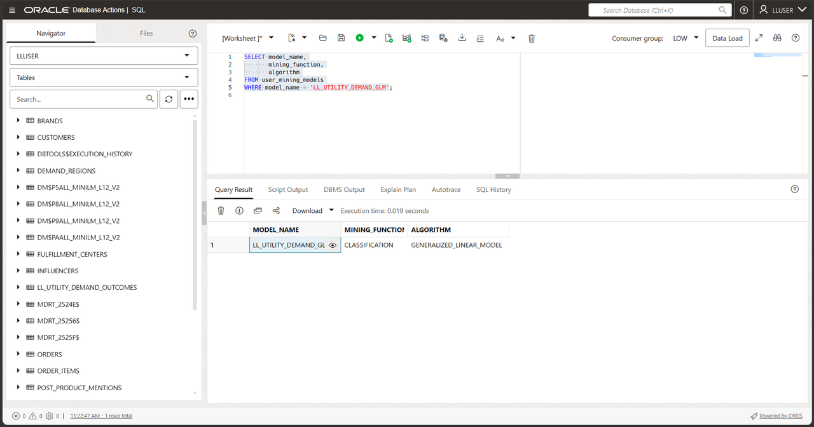

    The result should show `CLASSIFICATION` and `GENERALIZED_LINEAR_MODEL`. Otto now has a database model that SQL can call.

## Task 4: Score new service activity in SQL

Create a what-if scoring table by changing selected training-row inputs. These synthetic rows demonstrate scoring; they are not independent observations for measuring accuracy.

1. Create the scoring table and add the new activity snapshot by selecting **Run Script (F5)**.

    ```sql
    <copy>

    DROP TABLE IF EXISTS ll_utility_demand_scoring;

    CREATE TABLE ll_utility_demand_scoring (
      product_id    NUMBER,
      category      VARCHAR2(100),
      unit_price    NUMBER,
      signal_count   NUMBER,
      signal_sentiment NUMBER,
      response_count   NUMBER,
      escalation_count  NUMBER,
      signal_reach   NUMBER,
      avg_criticality  NUMBER,
      critical_signals   NUMBER,
      rising_signals  NUMBER,
      units_requested    NUMBER,
      request_value       NUMBER
    );

    INSERT INTO ll_utility_demand_scoring (
      product_id,
      category,
      unit_price,
      signal_count,
      signal_sentiment,
      response_count,
      escalation_count,
      signal_reach,
      avg_criticality,
      critical_signals,
      rising_signals,
      units_requested,
      request_value
    )
    SELECT product_id,
           category,
           unit_price,
           signal_count + 4,
           signal_sentiment,
           response_count + 25,
           escalation_count + 10,
           signal_reach + 500,
           LEAST(1, avg_criticality + 0.05),
           critical_signals + 1,
           rising_signals + 1,
           units_requested + 3,
           request_value + (unit_price * 3)
    FROM (
      SELECT product_id,
             category,
             unit_price,
             signal_count,
             signal_sentiment,
             response_count,
             escalation_count,
             signal_reach,
             avg_criticality,
             critical_signals,
             rising_signals,
             units_requested,
             request_value,
             ROW_NUMBER() OVER (ORDER BY product_id) AS row_num
      FROM ll_utility_demand_training_v
    )
    WHERE row_num <= 12;

    COMMIT;
    </copy>
    ```

    The scoring table omits `DEMAND_CLASS`; the target label must not be supplied as a predictor.

2. Run the scoring query:

    ```sql
    <copy>
    WITH scored_products AS (
      SELECT product_id,
             category,
             units_requested,
             request_value,
             signal_count,
             critical_signals,
             rising_signals,
             PREDICTION(
               LL_UTILITY_DEMAND_GLM USING
               category, unit_price, signal_count, signal_sentiment,
               response_count, escalation_count, signal_reach, avg_criticality,
               critical_signals, rising_signals, units_requested, request_value
             ) AS predicted_surge,
             PREDICTION_PROBABILITY(
                 LL_UTILITY_DEMAND_GLM,
                 'SURGE' USING
                 category, unit_price, signal_count, signal_sentiment,
                 response_count, escalation_count, signal_reach, avg_criticality,
                 critical_signals, rising_signals, units_requested, request_value
             ) AS surge_score
      FROM ll_utility_demand_scoring
    )
    SELECT p.product_id,
           p.product_name,
           sp.category,
           sp.predicted_surge,
           sp.surge_score,
           ROUND(sp.surge_score * 100, 2) AS surge_pct,
           sp.units_requested,
           sp.request_value,
           sp.signal_count,
           sp.critical_signals,
           sp.rising_signals
    FROM scored_products sp
    JOIN products p
      ON p.product_id = sp.product_id
    ORDER BY sp.surge_score DESC,
             p.product_id;
    </copy>
    ```

3. Read the result as a dashboard user.

    `PREDICTED_SURGE` tells the dashboard which label the model selected. `SURGE_SCORE` is the model value between 0 and 1, while `SURGE_PCT` presents the same value as a percentage for a dashboard user. The request value and activity columns give the business user something to review alongside the prediction.

    In the captured run, all twelve illustrative scenarios are classified as `STABLE`, with very small, nonzero surge probabilities. Keep the unrounded score for sorting; the percentage rounds to zero. Increasing selected inputs does not guarantee a surge prediction. Review the training distribution and evaluate the model on independent data before using these scores for planning.

    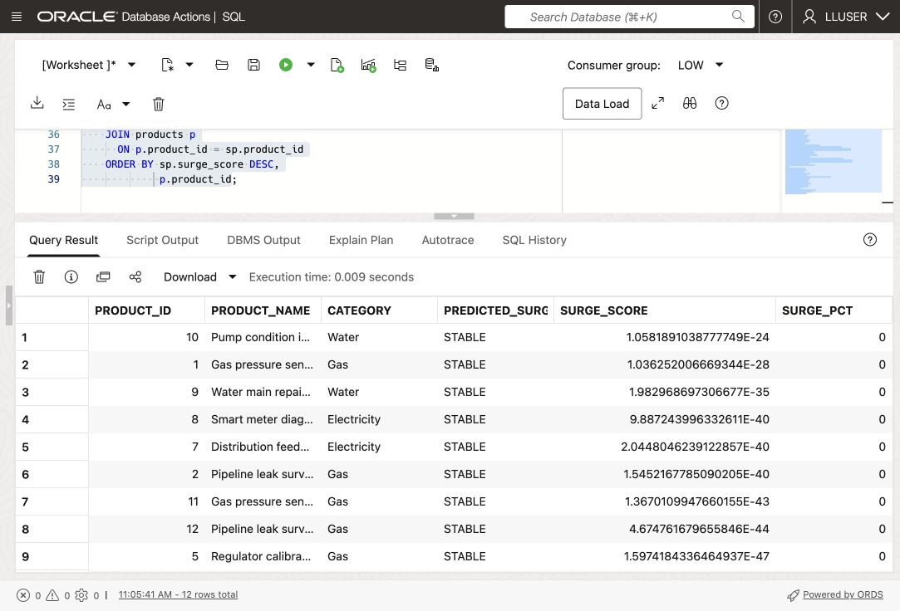

## Conclusion: Put the Prediction Beside the Business Data

Otto has a query that returns predictions with their supporting service activity. Before using the watchlist for planning, evaluate the model on independent observations.

## Acknowledgements

* **Authors** - Matt Kowalik
* **Contributors** - Teodor C. Nechita
* **Last Updated By/Date** - Teodor C. Nechita, October 2026
