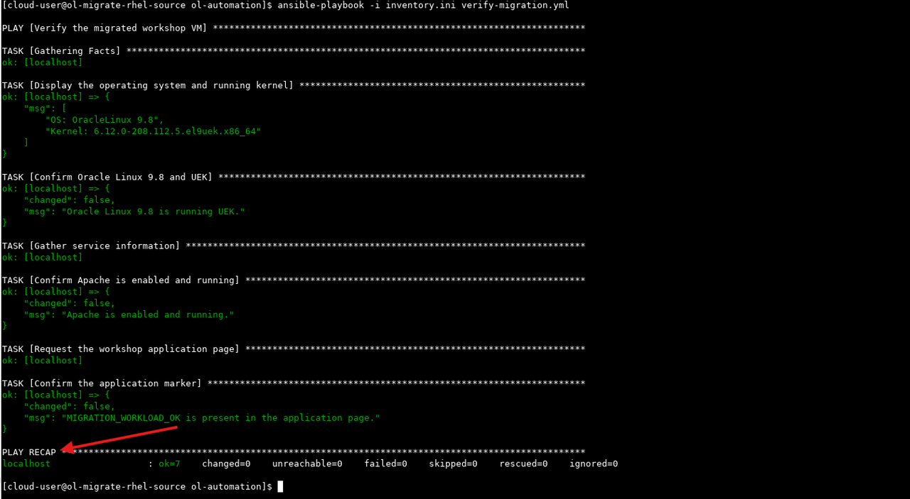

# Automate Post-Migration Verification with Oracle Linux Automation Engine

## Introduction

In the earlier labs, you ran individual commands to verify the operating system, kernel, Apache service, and application. In this lab, you will combine those checks into a reusable automation playbook and run it against the same migrated VM. Lab 8 is required to complete the workshop.

Oracle Linux Automation Engine uses `ansible-core` to execute playbooks: YAML files that describe a sequence of tasks. An inventory identifies the systems those tasks run against. You will install the Engine on the workshop VM and use a local connection so that it checks that same VM.

The playbook gathers system information and verifies the expected results. Running it again repeats the checks without changing the operating system, kernel, or application. This exercise introduces Automation Engine; Oracle Linux Automation Manager adds a web interface for managing inventories and jobs and is outside this lab.

### Objectives

- Install Oracle Linux Automation Engine on the migrated VM.
- Create an inventory and a verification playbook.
- Automate the Oracle Linux, UEK, Apache, and application checks.
- Interpret the results and repeat the verification.

Estimated Time: 45 minutes for automation, plus 15-30 minutes for saving results and cleanup

### Prerequisites

Complete Labs 6 and 7. Use the same Oracle Linux 9.8 VM running UEK, with Apache working and the Oracle Linux 9 AppStream software source attached through OSMH. Continue as `cloud-user` in the VM's SSH session with sudo access and internet connectivity.

## Task 1: Install Automation Engine

The Engine runs the playbook and reports each task's result. Install it on the migrated VM so you can automate checks on the system you have already verified manually.

1. In your SSH session on `ol-migrate-rhel-source`, install the Engine:

    ```bash
    <copy>
    sudo dnf install ansible-core
    </copy>
    ```

    Review the transaction and confirm with `y`. The `ansible-core` package is available from Oracle Linux AppStream. DNF also installs required dependencies, including Python libraries; these additional packages are expected.

1. Confirm the installation:

    ```bash
    <copy>
    ansible --version
    ansible-playbook --version
    </copy>
    ```

    Both commands should display the installed Ansible core version. For example, the tested workshop run showed:

    ```text
    <copy>
    ansible [core 2.14.18]
    ansible-playbook [core 2.14.18]
    </copy>
    ```

    Your installed version can vary. The remaining output shows configuration paths and Python details. The Engine is now ready to run playbooks.

## Task 2: Create the workshop inventory

An inventory groups the systems to manage. For this exercise, the `workshop` group contains `localhost`, which means the migrated VM where you are running the Engine.

1. Create a working directory and inventory:

    ```bash
    <copy>
    mkdir -p "$HOME/ol-automation"
    cd "$HOME/ol-automation"
    cat > inventory.ini <<'EOF'
    [workshop]
    localhost ansible_connection=local
    EOF
    </copy>
    ```

    `ansible_connection=local` runs tasks directly on this VM. Keep running these commands in the VM's SSH session.

1. Display the inventory:

    ```bash
    <copy>
    ansible-inventory -i inventory.ini --graph
    </copy>
    ```

    Confirm that the output lists the `workshop` group and `localhost` beneath it.

## Task 3: Create the verification playbook

The playbook turns the checks from Labs 4 through 7 into named tasks. Facts describe the current system, and assertions compare the results with the workshop's expected state.

1. Create the playbook by copying the complete block below, including its final `EOF` line:

    ```bash
    <copy>
    cat > verify-migration.yml <<'EOF'
    ---
    - name: Verify the migrated workshop VM
      hosts: workshop
      gather_facts: true
      become: false
      vars:
        ansible_python_interpreter: "{{ ansible_playbook_python }}"

      tasks:
        - name: Display the operating system and running kernel
          ansible.builtin.debug:
            msg:
              - "OS: {{ ansible_facts['distribution'] }} {{ ansible_facts['distribution_version'] }}"
              - "Kernel: {{ ansible_facts['kernel'] }}"

        - name: Confirm Oracle Linux 9.8 and UEK
          ansible.builtin.assert:
            that:
              - ansible_facts['distribution'] == 'OracleLinux'
              - ansible_facts['distribution_version'] == '9.8'
              - "'el9uek' in ansible_facts['kernel']"
            success_msg: Oracle Linux 9.8 is running UEK.
            fail_msg: Review the OS and kernel checks from Labs 4 and 6.

        - name: Gather service information
          ansible.builtin.service_facts:

        - name: Confirm Apache is enabled and running
          ansible.builtin.assert:
            that:
              - ansible_facts['services'].get('httpd.service', {}).get('state') == 'running'
              - ansible_facts['services'].get('httpd.service', {}).get('status') == 'enabled'
            success_msg: Apache is enabled and running.
            fail_msg: Review the Apache service checks from the earlier labs.

        - name: Request the workshop application page
          ansible.builtin.uri:
            url: http://127.0.0.1/
            return_content: true
            status_code: 200
            use_proxy: false
            timeout: 10
          register: workshop_page

        - name: Confirm the application marker
          ansible.builtin.assert:
            that:
              - "'MIGRATION_WORKLOAD_OK' in workshop_page['content']"
            success_msg: MIGRATION_WORKLOAD_OK is present in the application page.
            fail_msg: The application responded but the workshop marker is missing.
    EOF
    </copy>
    ```

    YAML uses spaces for indentation. Preserve the indentation when copying. The interpreter setting uses the same Python that runs the Engine for this local connection.

1. Review what the playbook checks:

    | Check | Connection to the workshop |
    | --- | --- |
    | Oracle Linux 9.8 | Confirms the OS identity verified after migration in Lab 4. |
    | Running UEK kernel | Confirms the kernel selected and booted in Lab 6. |
    | Apache enabled and running | Repeats the service checks used throughout the workshop. |
    | HTTP 200 and application marker | Confirms that the original application still responds after the changes. |

## Task 4: Run and interpret the automated checks

Run the playbook to see each verification task's result, then repeat it to demonstrate reusable checks.

1. Check the playbook syntax:

    ```bash
    <copy>
    ansible-playbook -i inventory.ini verify-migration.yml --syntax-check
    </copy>
    ```

    Expect the playbook filename with no syntax errors. This checks the playbook structure; the next command runs its verification tasks.

1. Run the playbook:

    ```bash
    <copy>
    ansible-playbook -i inventory.ini verify-migration.yml
    </copy>
    ```

    Read the OS and kernel information and the success messages for Oracle Linux, Apache, and the application marker. A successful run of this playbook ends with:

    

    | Result | Meaning |
    | --- | --- |
    | `ok=7` | Fact gathering and the six named tasks succeeded. |
    | `changed=0` | The verification tasks made no configuration changes. |
    | `unreachable=0` | The local target was accessible. |
    | `failed=0` | All checks passed. |

    If a task fails, read its name and message to identify which check needs attention. The playbook reports the current state; it does not repair a failed check.

1. Run the same command again:

    ```bash
    <copy>
    ansible-playbook -i inventory.ini verify-migration.yml
    </copy>
    ```

    Expect the same successful checks and `changed=0`. The playbook repeats your verification without reconfiguring the system.

    You have completed the workshop, from migration to automated verification of the same Oracle Linux VM. Keep the inventory and playbook in `$HOME/ol-automation` for use during the workshop.

## Task 5: Save your results and clean up OCI resources

1. Finish the verification and repeat run before cleanup. In a second **local terminal**, download your inventory, playbook, and reports. Replace `<public-ip>` and use the key you created in Lab 1:

    ```text
    <copy>
    scp -i ~/.ssh/ol-migrate -r cloud-user@<public-ip>:~/ol-automation ./
    scp -i ~/.ssh/ol-migrate -r cloud-user@<public-ip>:~/ol-migration-reports ./
    scp -i ~/.ssh/ol-migrate -r cloud-user@<public-ip>:~/ol-practice-reports ./
    </copy>
    ```

    Confirm the downloaded files open locally. Keep your package-update result and playbook recap with these records. If a directory is missing, check its actual path on the VM before retrying.

1. Open your workshop resource inventory. Confirm each resource belongs to this workshop and record anything you intentionally retain. Retained resources can incur charges.

1. In OSMH, save any needed job history and wait for running work requests to finish. Open **Instances**, select the workshop VM, and select **Unregister**. Keep the VM and agent running until unregistering completes. Confirm that the instance disappears from OSMH. Unregistering removes its job history; disabling the plugin alone does not remove its registration. See [Oracle's unregister procedure](https://docs.oracle.com/en-us/iaas/osmh/doc/unregister-instance.htm).

1. Delete the registration profile created for this workshop after no instances use it. Remove only software sources added exclusively for this workshop and no longer referenced. Keep shared vendor sources and profiles.

1. In **Compute > Instances**, open `ol-migrate-rhel-source` and select **Terminate**. Select the option to permanently delete its attached boot volume. Confirm the instance and compartment before submitting. This deletes the workshop VM and its on-VM files.

1. Open **Block Storage > Boot volumes** and **Boot volume backups**. Delete any workshop boot volumes, optional backups, and volumes restored during recovery that you no longer need. Check for additional recovery instances before removing their disks.

1. Open **Compute > Custom images** and delete the imported workshop image when it is no longer needed. If you created your own Object Storage export, remove that workshop object and its pre-authenticated request. Do not delete the workshop owner's shared image.

1. Open the workshop VCN and use **Delete VCN** to review and remove its dependencies. Remove only workshop resources. Check public and private subnets, VNIC attachments, gateways, security lists or NSGs, route tables, DHCP options, and any reserved public IP. The wizard can create unused private-subnet and gateway resources; include them in this check.

1. Ask the tenancy administrator to remove policies and dynamic groups created solely for this workshop after confirming no other resources use them. Remove a dedicated workshop group or compartment only if empty and unused. Keep shared IAM resources.

1. Recheck Compute, storage, images, networking, and OSMH in the workshop region and compartment. Review Cost Analysis later because usage data can arrive after cleanup. Stopping a VM alone does not remove its storage or backups.

    You have completed the required Automation Engine lab and the workshop cleanup. Keep the downloaded evidence for your own review.

## Learn More

- [Write a playbook with Oracle Linux Automation Engine](https://docs.oracle.com/en/learn/olae-playbook/)
- [Oracle Linux Automation Manager and Engine](https://docs.oracle.com/en/operating-systems/oracle-linux-automation-manager/)
- [Running Ansible playbooks locally](https://docs.ansible.com/ansible/latest/playbook_guide/playbooks_delegation.html#local-playbooks)
- [Ansible assertions](https://docs.ansible.com/ansible/latest/collections/ansible/builtin/assert_module.html)

## Acknowledgements

- Perside Foster, Principal Solution Engineer, Oracle
- Rosario Spiezia, Principal Sales Consultant, Oracle
- Mitch Dsouza, Principal Presales Consultant, Oracle Cloud Infrastructure Software
- Nick Mader, Global Channel Enablement & Strategy Director, Open Source Solutions, Oracle
- Last Updated By/Date - Perside Foster, Nov 2026
