# Build and Verify the Migration Environment

## Introduction

A migration starts with a working system and a clear record of its condition. In this lab, you will build the RHEL environment used throughout the workshop and verify its application before making any operating-system changes.

The lab provides a prepared RHEL 9.8 image with Apache installed. Using your computer, you will create a network in your workshop compartment, import the image, launch the VM, and connect through SSH.

You will confirm the RHEL version, check that Apache is enabled and running, and verify the application page. These checks establish a baseline that you will use after migration to verify that the same application still works on Oracle Linux. Keep this VM throughout the workshop.

### Objectives

- Create or select a destination compartment and create a VCN with internet connectivity.
- Import the image and launch the destination VM.
- Verify RHEL 9.8, Apache, the HTML application, and registration cleanup.

Estimated Time: 45 minutes

### Prerequisites

- Your own OCI tenancy and permission to create networking, import a custom image, and launch a VM in a workshop compartment.
- Available capacity for `VM.Standard.E5.Flex` with 1 OCPU, 12 GB RAM, and a boot volume of at least 50 GB or the image minimum.
- A local browser and terminal. Task 1 checks the SSH tools and creates your key pair.
- Access to the prepared RHEL 9.8 image URL for Task 5.

## Task 1: Prepare your SSH key

1. Open a local terminal and check that `ssh` and `scp` are available.

    On Windows, run in PowerShell:

    ```powershell
    <copy>
    Get-Command ssh, scp
    </copy>
    ```

    On macOS or Linux, run in Terminal:

    ```bash
    <copy>
    command -v ssh scp
    </copy>
    ```

    Confirm that the output lists a location for both tools. If either tool is missing, install the OpenSSH client before continuing.

1. Create the `.ssh` directory in your local home directory if it does not exist.

    On Windows, run in PowerShell:

    ```powershell
    <copy>
    New-Item -ItemType Directory -Force -Path "$HOME/.ssh"
    </copy>
    ```

    On macOS or Linux, run in Terminal:

    ```bash
    <copy>
    mkdir -p "$HOME/.ssh"
    </copy>
    ```

1. Create a new key pair on your computer. If `ol-migrate` already exists in your `.ssh` directory, choose a different filename and use it in every later SSH and SCP command. Do not overwrite an existing private key. Run this command in your local terminal:

    ```text
    <copy>
    ssh-keygen -t rsa -b 4096 -f "$HOME/.ssh/ol-migrate"
    </copy>
    ```

    Leave the passphrase blank by pressing Enter at both passphrase prompts.

1. Keep `ol-migrate` private. Upload only `ol-migrate.pub` when launching the instance. On macOS or Linux, restrict private-key permissions:

    ```bash
    <copy>
    chmod 600 ~/.ssh/ol-migrate
    </copy>
    ```

## Task 2: Prepare the workshop compartment

1. Sign in at [OCI Console](https://cloud.oracle.com/) with your own tenancy credentials and multifactor authentication.

1. Open the navigation menu, select **Identity & Security**, and then select **Compartments**.

1. Locate the parent compartment approved by your organization. If your workshop compartment already exists, open it, confirm that it is **Active**, and record its name. Continue to Task 3.

1. If you need a new compartment and have permission to create one, select **Create compartment** and enter the values below. If you do not have permission, ask your tenancy administrator to create it before continuing.

    - Name:

        ```bash
        <copy>
        ol-migrate-lab
        </copy>
        ```

    - Description:

        ```bash
        <copy>
        Resources for the RHEL to Oracle Linux migration workshop
        </copy>
        ```

    - Parent compartment: the parent approved by your organization

    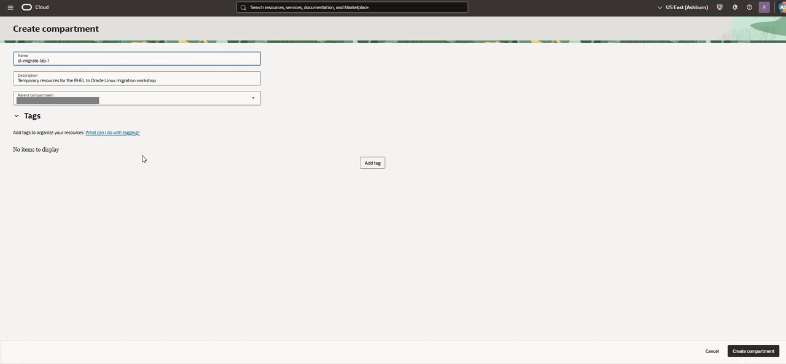

1. Select **Create compartment**. Open the new compartment when it appears, confirm that its state is **Active**, and record its name.

## Task 3: Create the virtual cloud network

1. Click the **Navigation menu** in the upper left, navigate to **Networking**, and select **Virtual cloud networks**.

    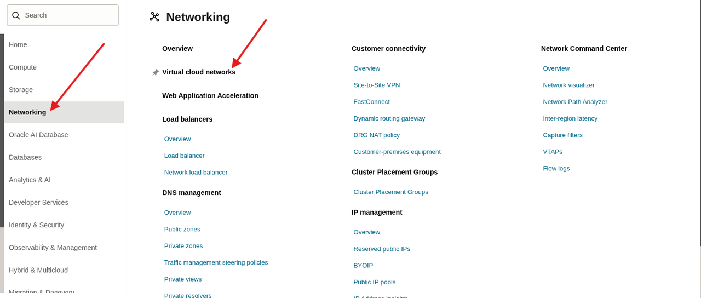

1. Select your workshop compartment in the compartment selector.

1. Click **Actions**, then **Start VCN Wizard**.

    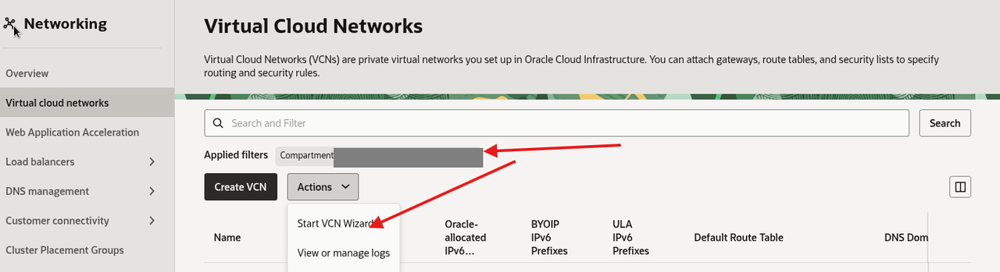

    > **Note:** Console labels can change. Match the task and selected resources if your page differs from the recorded screenshots.

1. In the **Start VCN Wizard** dialog box, select **Create VCN with Internet Connectivity**, and click **Start VCN Wizard**.

    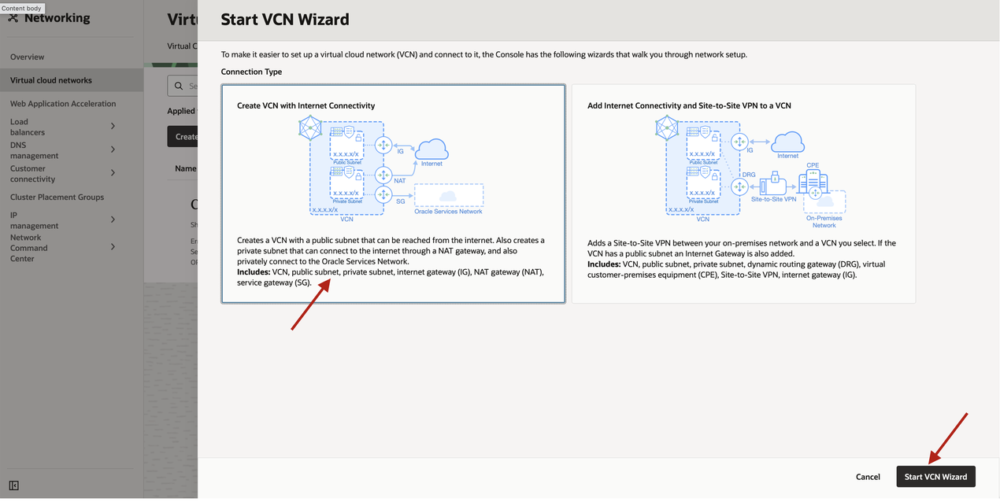

1. Under **Basic information**, provide a **VCN name**:

    ```bash
    <copy>
    ol-migrate-vcn
    </copy>
    ```

1. Click **Next**.

    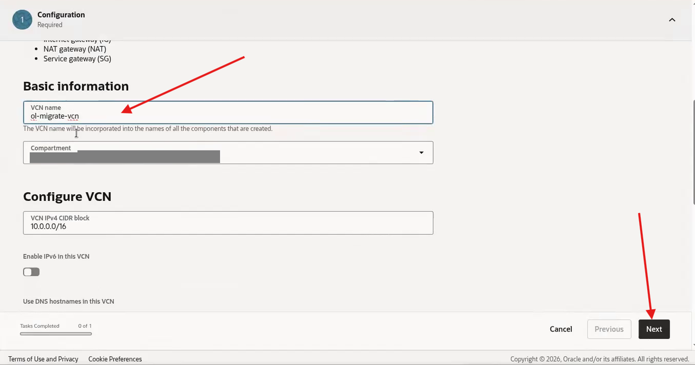

1. Review Oracle Virtual Cloud Network (VCN), Subnets, and Gateways, and click **Create**.

    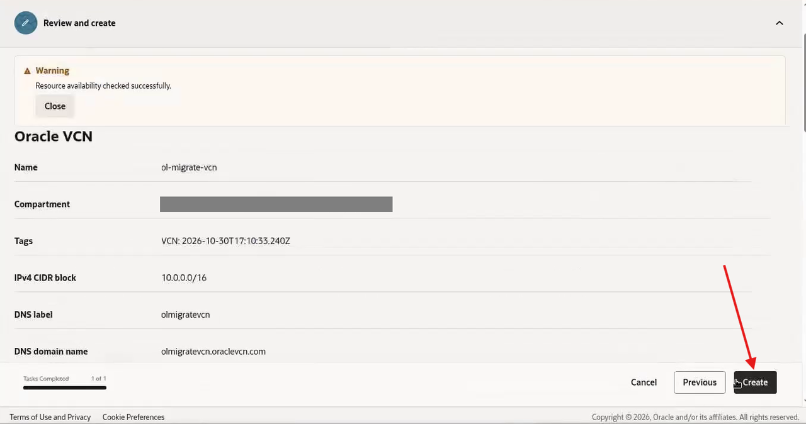

1. When the Virtual Cloud Network is created, click **View VCN** to display the created VCN.

    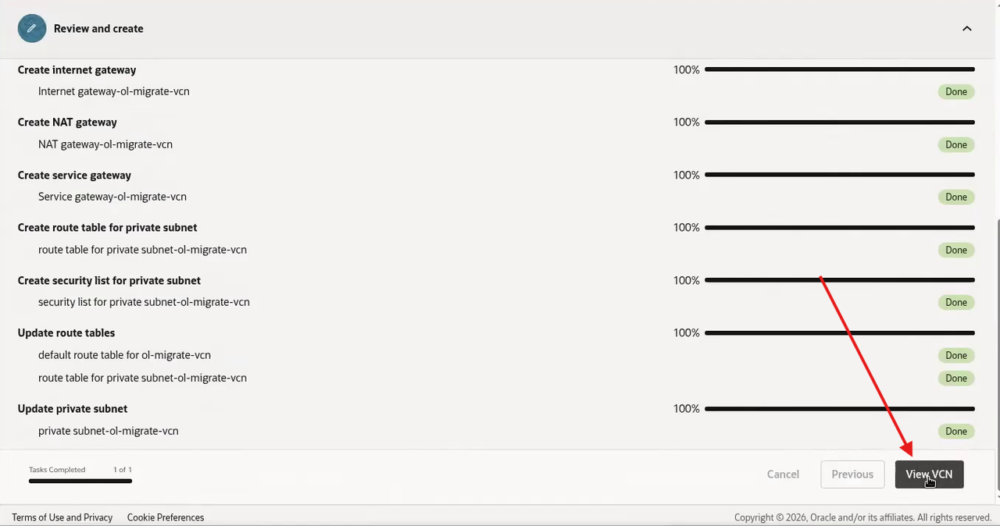

## Task 4: Configure SSH and HTTP access

1. In the workshop VCN, select the **Security tab** click the **Default Security List**.

1. Select **Security rules**.

    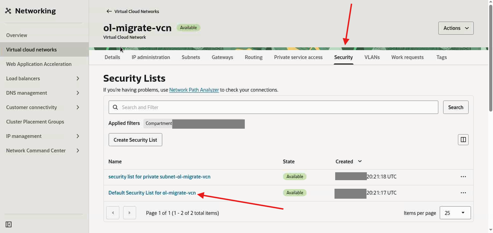

1. Confirm that the existing stateful TCP port 22 ingress rule uses source CIDR `0.0.0.0/0`. If the rule is missing, add it with source type **CIDR**, source CIDR `0.0.0.0/0`, source port range **All**, and destination port **22**.

1. Add a stateful TCP ingress rule for HTTP with these values:

    | Field | Value |
    | --- | --- |
    | Source type | CIDR |
    | Source CIDR | `0.0.0.0/0` |
    | IP protocol | TCP |
    | Source port range | All |
    | Destination port range | 80 |
    | Description | Workshop HTTP access |

    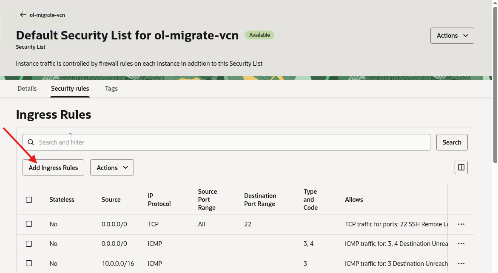

1. Confirm that TCP ports 22 and 80 allow source CIDR `0.0.0.0/0`. Keep existing ICMP and egress rules.

1. Confirm that the public subnet has a `0.0.0.0/0` route to the internet gateway.

## Task 5: Import the working RHEL VM image

1. Confirm that the destination region and compartment selected in Task 2 are still selected.

1. Open **Compute**, then **Custom images**, and select **Import image**.

1. Enter as the image name:

    ```bash
    <copy>
    rhel-9-8-apache-source
    </copy>
    ```

1. Select **Red Hat Enterprise Linux**.

1. Choose **Import from an Object Storage URL** and paste the following complete PAR URL:

    ```bash
    <copy>
    https://objectstorage.us-ashburn-1.oraclecloud.com/p/5cCz6xJ700aKu3iGGOlglQ9T4O_etfbUaM5JXvURXgX7URJMqYSwTInAaShXzC1j/n/idhwewbjlvpy/b/custom-image/o/rhel-9-8-apache-source-image-20261025-0915
    </copy>
    ```

    **Keep the PAR URL private**

1. Select **OCI** as the image type. The launch mode is selected from the exported metadata automatically.

    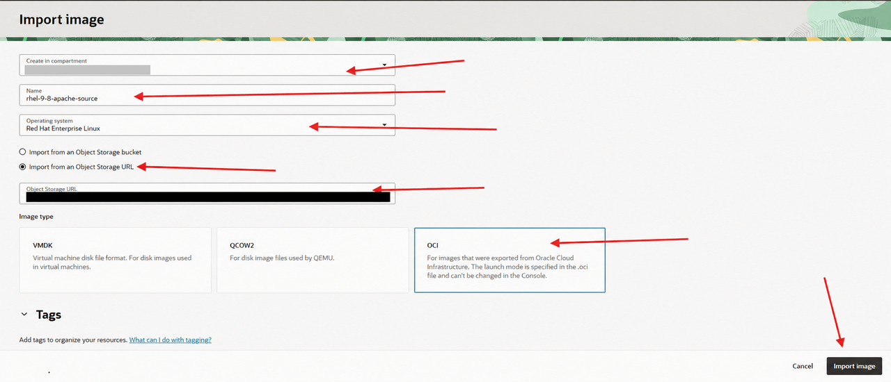

1. Select **Import image** and wait until its state is Available.
    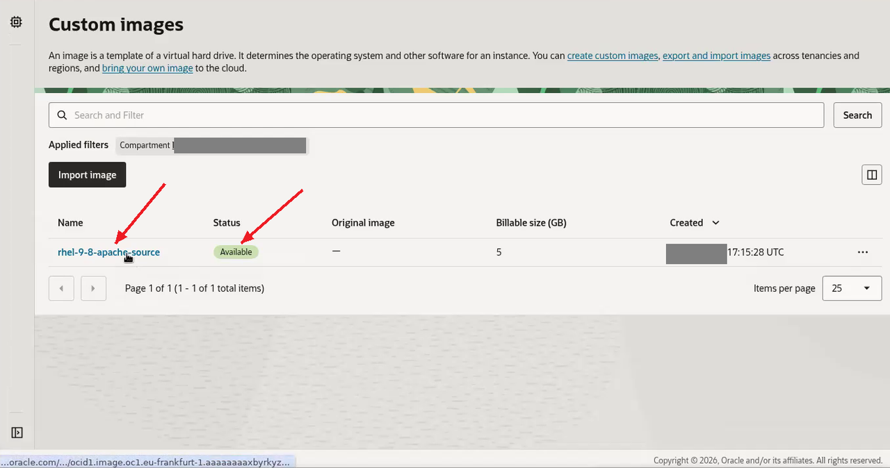

## Task 6: Launch the destination instance

1. Open the destination `rhel-9-8-apache-source` image. Select **Create instance**:

    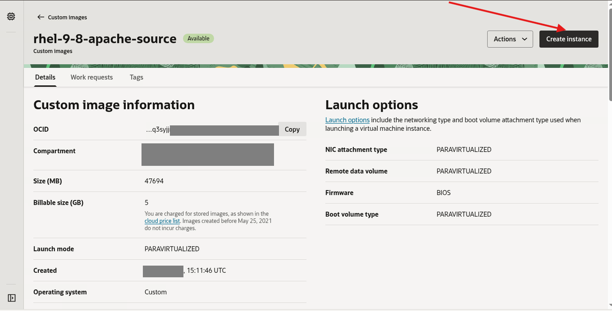

1. Enter the following as the instance name:

    ```bash
    <copy>
    ol-migrate-rhel-source
    </copy>
    ```

1. Under Basic information, keep the default availability domain. Confirm that the image is `rhel-9-8-apache-source` and the shape is `VM.Standard.E5.Flex` with 1 OCPU and 12 GB.

    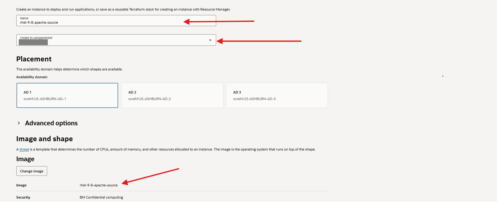

1. Under **Networking**, select the VCN and public subnet created in Task 3. Keep automatic private IPv4 assignment. The subnet security list configured in Task 4 provides SSH and HTTP access.

    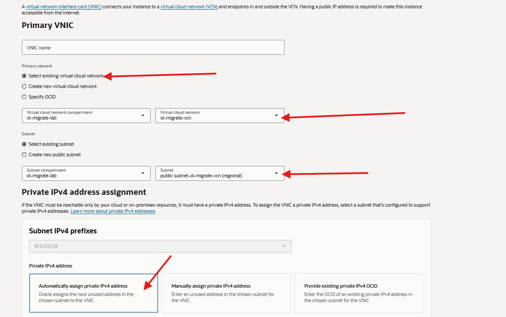

1. Enable **Automatically assign public IPv4 address** and leave IPv6 disabled for this workshop.

1. Under **Add SSH keys**, select **Upload public key file (.pub)** and upload the `ol-migrate.pub` file created in Task 1. Your local file dialog can differ from the source screenshots. Confirm that the selected file is the public key, not the private key.

1. Under **Storage**, enable **Specify a custom volume size and performance setting**. Set the boot volume to at least 50 GB or the image minimum, whichever is larger.

    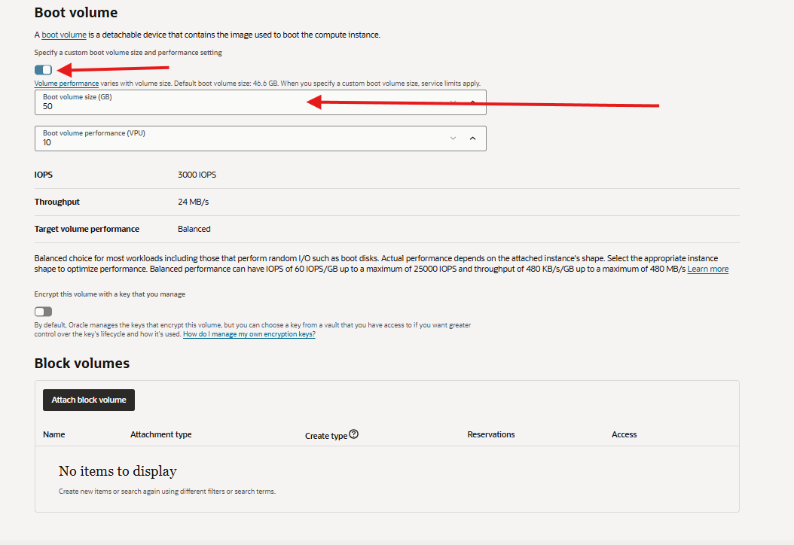

1. Under **Review**, confirm the instance name, selected image, shape, memory, networking, and SSH key. Select **Create**.

    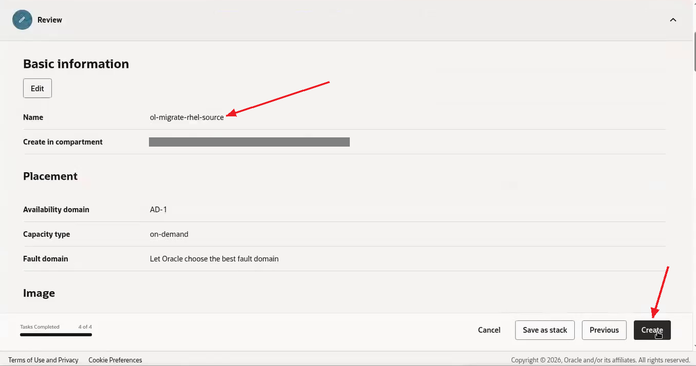


1. When the instance is **Running**, click **ol-migrate-rhel-source**. On the **Details** tab, locate **Instance access** and copy the **Public IP address**. Open the local text editor and record the instance name and public IP for use throughout the workshop.

    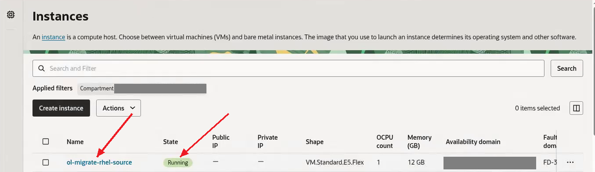

    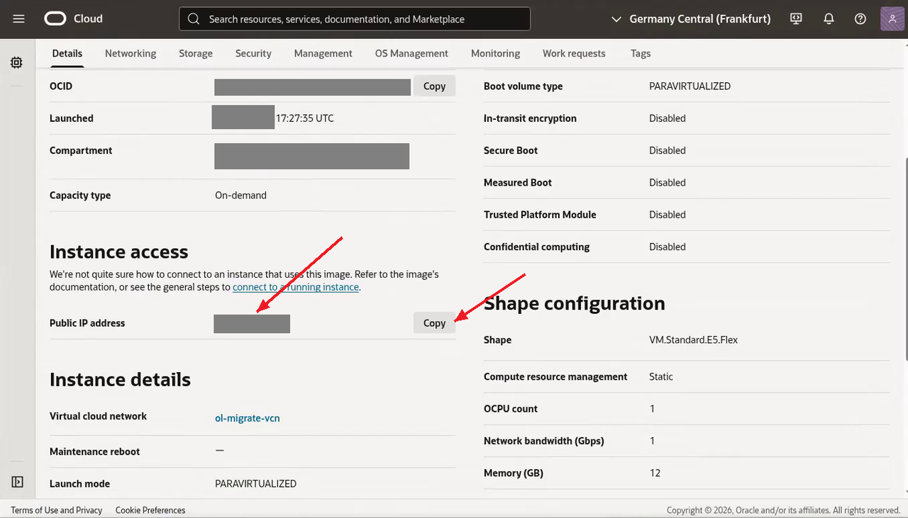


## Task 7: Connect to the instance and verify the source

1. Connect from a local terminal using the public IP recorded in Task 6:

    ```bash
    <copy>
    ssh -i ~/.ssh/ol-migrate cloud-user@<public-ip>
    </copy>
    ```

    Replace `<public-ip>` with your instance's public IPv4 address. Use the private key that matches the `ol-migrate.pub` file uploaded in Task 6.

1. Verify the operating system and application:

    ```bash
    <copy>
    cat /etc/os-release
    systemctl is-enabled httpd
    systemctl is-active httpd
    curl --fail --silent http://127.0.0.1/ | grep MIGRATION_WORKLOAD_OK
    </copy>
    ```

    Expected results are RHEL 9.8, `enabled`, `active`, and the workload marker.

    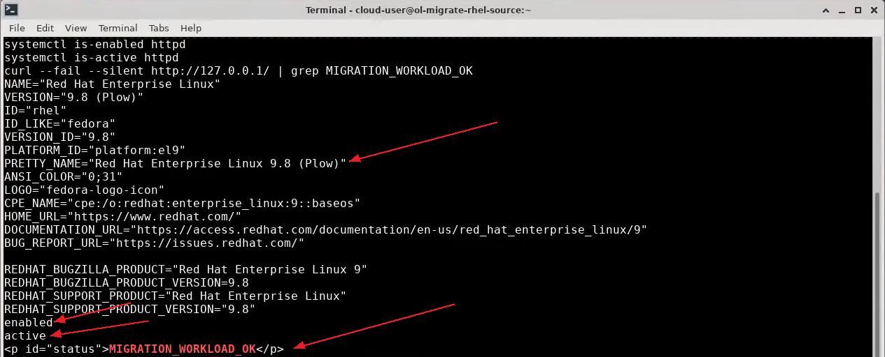

1. Verify registration cleanup:

    ```bash
    <copy>
    sudo find /etc/pki/consumer /etc/pki/entitlement \
      -type f -name '*.pem' -print 2>/dev/null
    sudo grep '^enabled=' \
      /etc/dnf/plugins/subscription-manager.conf \
      /etc/dnf/plugins/product-id.conf
    </copy>
    ```

    No registration certificate files should be listed, and both plugins must show `enabled=0`. The login banner suggesting `rhc connect` is not proof of registration. Do not run that command.

    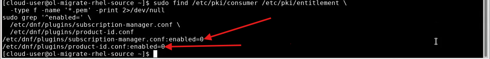

1. Enter the full URL `http://<public-ip>/` in your browser's address bar, replacing `<public-ip>` with your instance's public IPv4 address. Include `http://` explicitly rather than entering only the IP address. Confirm that the HTML page displays `MIGRATION_WORKLOAD_OK`.

    If the page does not load, check that the address starts with `http://` and re-enter the full URL.

    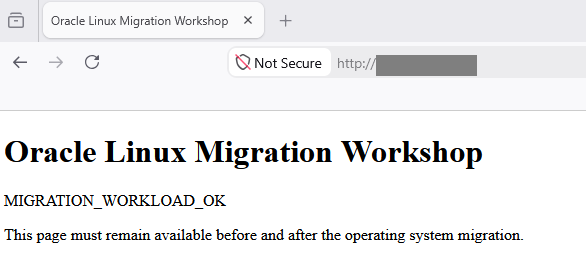

1. Continue to Lab 3 on this instance to assess migration readiness. For additional Linux command-line practice, complete optional Lab 2 before Lab 3.

You may now **proceed to the next lab**.

## Learn More

- [Create a VCN with Internet Connectivity](https://docs.oracle.com/en-us/iaas/Content/Network/Tasks/quickstartnetworking.htm)
- [OCI security rules](https://docs.oracle.com/en-us/iaas/Content/Network/Concepts/securityrules.htm)
- [Importing a custom image](https://docs.oracle.com/en-us/iaas/Content/Compute/Tasks/custom-images-import.htm)
- [Creating an OCI Compute instance](https://docs.oracle.com/en-us/iaas/Content/Compute/Tasks/launchinginstance.htm)
- [Connecting to a Linux instance](https://docs.oracle.com/en-us/iaas/Content/Compute/Tasks/connect-to-linux-instance.htm)

## Acknowledgements

- Perside Foster, Principal Solution Engineer, Oracle
- Rosario Spiezia, Principal Sales Consultant, Oracle
- Mitch Dsouza, Principal Presales Consultant, Oracle Cloud Infrastructure Software
- Nick Mader, Global Channel Enablement & Strategy Director, Open Source Solutions, Oracle
- Last Updated By/Date - Perside Foster, Nov 2026
