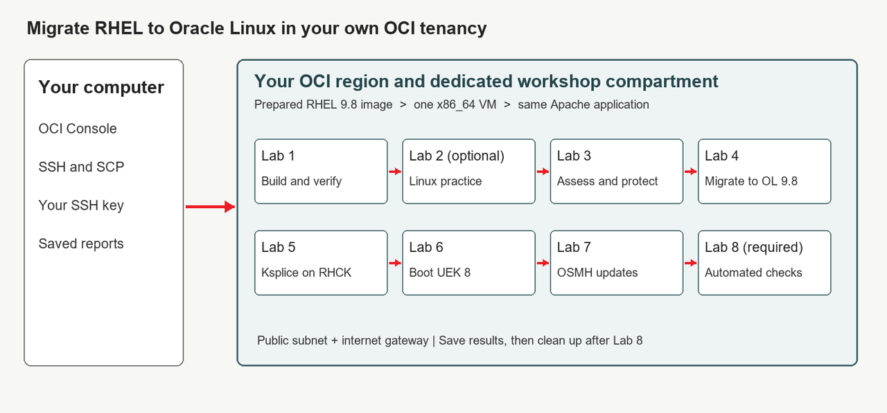

# Migrate Red Hat Enterprise Linux to Oracle Linux

## Introduction

### About this Workshop

Oracle Linux is an enterprise operating system designed to run demanding applications reliably and securely, on premises and in the cloud.

Migrating from Red Hat Enterprise Linux (RHEL) to Oracle Linux gives organizations greater control over operating costs while preserving a familiar Linux environment. Key reasons to consider Oracle Linux include:

- **Control software and support costs.** Oracle Linux is free to download, use, and update. Choose commercial support where needed, with coverage beyond the operating system depending on the support level.
- **Preserve application compatibility.** Oracle Linux provides application binary compatibility with RHEL, allowing organizations to retain existing applications while building on familiar administration skills.
- **Simplify patching and management.** Ksplice applies eligible security fixes without rebooting, while OS Management Hub centralizes package updates and monitoring. Access depends on the deployment environment and support entitlement.
- **Choose the kernel that fits your workload.** Oracle Linux offers the Red Hat Compatible Kernel (RHCK) and Unbreakable Enterprise Kernel (UEK). Choose based on workload requirements and software certification.

In this workshop, you will practice an in-place migration from RHEL 9.8 to Oracle Linux 9.8 using one VM in your own OCI tenancy on Oracle Cloud Infrastructure (OCI). Familiar Linux commands and services remain in use while the operating-system identity, repositories, packages, and kernel change. You will inspect these changes and verify that the existing Apache application continues to work.

The eight labs take you from environment setup and Linux command practice through migration readiness, conversion, ongoing system management, and automated verification with Oracle Linux Automation Engine.

You will create the network and VM in your workshop compartment, complete Lab 1, and then complete Labs 3 through 8 in order. Lab 2 is optional Linux command-line practice before Lab 3.

Estimated Workshop Time: 6 hours 45 minutes, including optional Lab 2, orientation, downloads, provisioning, reboots, agent registration, and job execution. Allow another 30-60 minutes for tenancy setup and 15-30 minutes for cleanup.

### About Product/Technology

**Oracle Linux** is an enterprise operating system for running applications on premises and in the cloud. It is the migration target for the RHEL VM used in this workshop.

**The migrate-to-oracle-linux utility** checks migration readiness, converts distribution packages and repositories, installs the selected kernel, and produces reports. This workshop uses a pinned script version from Oracle's `migrate-to-ol` repository. The repository describes the scripts as community-based and not officially supported by Oracle.

**Red Hat Compatible Kernel (RHCK)** and **Unbreakable Enterprise Kernel (UEK)** are the two kernel choices used here. RHCK provides compatibility with the corresponding RHEL kernel; UEK is Oracle's kernel for performance and scalability.

**Oracle Ksplice** applies supported fixes to running Linux components without requiring a reboot. This workshop uses the Uptrack client for live kernel patching; access and patch availability depend on the kernel and service requirements.

**OS Management Hub (OSMH)** is an OCI service for centrally viewing software inventory and managing operating-system updates.

**Oracle Linux Automation Engine** runs Ansible playbooks to automate system administration. Lab 8 uses it to repeat the workshop's OS, kernel, service, and application checks.

**Oracle Cloud Infrastructure (OCI)** supplies the workshop's compute, networking, and storage. Your computer provides the browser and terminal used to access your tenancy and workshop VM.

**Apache HTTP Server** hosts the workshop's HTML application. Its `MIGRATION_WORKLOAD_OK` marker provides a simple application check at the lab checkpoints.

### Objectives

- Create the destination network and import a RHEL application image.
- Launch and verify a RHEL VM built from the imported image.
- Practice Linux commands and assess migration readiness.
- Convert the VM to Oracle Linux 9.8 with RHCK and verify application continuity.
- Review the migration reports and package exceptions.
- Apply available Ksplice patches on RHCK and verify that the VM has not rebooted.
- Install UEK, select it as the default kernel, and verify it after reboot.
- Register the VM with OSMH, inspect its inventory, and verify an available package update.
- Automate post-migration verification with Oracle Linux Automation Engine.

### Prerequisites

- Your own OCI tenancy, a dedicated workshop compartment, a selected commercial OCI region, and administrator-approved permissions.
- Capacity for one x86\_64 `VM.Standard.E5.Flex` VM with 1 OCPU, 12 GB RAM, and at least 50 GB boot storage or the image minimum.
- A local browser, OpenSSH tools, and a private SSH key that you control.
- The prepared RHEL 9.8 image URL supplied privately by the workshop owner.
- Eligible Ksplice access and OSMH setup completed by your administrator.

Complete the shared Get Started page, then review the prerequisites in [Lab 1](../environment/environment.md). This workshop uses billable resources. OSMH is not available on Free Tier instances; see [Oracle's service prerequisites](https://docs.oracle.com/en-us/iaas/osmh/doc/getstarted.htm).

Allow extra time for tenancy preparation and cleanup beyond the source agenda. Lab 2 is optional. Labs 1 and 3 through 8 are required.

### Workshop Architecture

All eight labs use the same VM in your workshop compartment. After migration, patching, kernel selection, and OSMH management, Lab 8 automates verification of the OS, kernel, Apache, and application.

### Workshop Schedule

The agenda totals 335 minutes of planned student activity, including optional Lab 2. Allow about six hours and 45 minutes including downloads, provisioning, reboots, agent registration, and job execution. Use the same workshop VM for every lab you complete.

| Session | Minutes |
| --- | ---: |
| Orientation | 15 |
| Lab 1: Build and Verify the Migration Environment | 45 |
| Lab 2: Linux Command-Line Quickstart (Optional) | 60 |
| Lab 3: Assess Readiness and Protect the Source | 30 |
| Lab 4: Migrate to Oracle Linux | 40 |
| Lab 5: Explore Rebootless Patching with Ksplice | 30 |
| Lab 6: Explore Oracle Linux Kernel Choices | 30 |
| Lab 7: OS Management Hub Quickstart on OCI | 40 |
| Lab 8: Automate Post-Migration Verification with Oracle Linux Automation Engine | 45 |
| Resource cleanup after Lab 8 | 15-30 extra |
| **Workshop activity total** | **335** |

The table allows 40 minutes for Lab 7 tasks; agent registration and job execution require additional time.

### Learn More

- [Creating a VCN with internet connectivity](https://docs.oracle.com/en-us/iaas/Content/Network/Tasks/quickstartnetworking.htm)
- [Importing a custom image](https://docs.oracle.com/en-us/iaas/Content/Compute/Tasks/custom-images-import.htm)
- [Oracle Linux](https://www.oracle.com/linux/)
- [Migration utility documentation](https://github.com/oracle/migrate-to-ol/blob/main/README-migrate-to-oracle-linux.md)
- [Oracle Linux kernel choices](https://docs.oracle.com/en/operating-systems/oracle-linux/9/boot/oracle_linux9_kernel_version_matrix.html)
- [Ksplice availability](https://docs.oracle.com/en/operating-systems/oracle-linux/ksplice-user/ksplice-AboutOracleKsplice.html)
- [Getting started with OSMH](https://docs.oracle.com/en-us/iaas/osmh/doc/getstarted.htm)

## Acknowledgements

- Perside Foster, Principal Solution Engineer, Oracle
- Rosario Spiezia, Principal Sales Consultant, Oracle
- Mitch Dsouza, Principal Presales Consultant, Oracle Cloud Infrastructure Software
- Nick Mader, Global Channel Enablement & Strategy Director, Open Source Solutions, Oracle
- Last Updated By/Date - Perside Foster, Nov 2026
