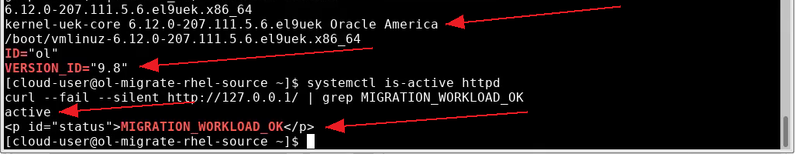
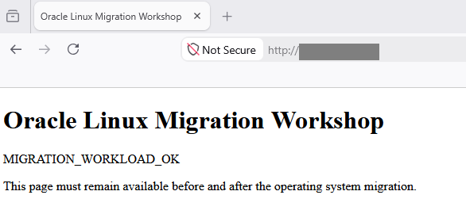

# Explore Oracle Linux Kernel Choices

## Introduction

You migrated to Oracle Linux RHCK in Lab 4 and tested Ksplice on that running kernel in Lab 5. In this lab, install Unbreakable Enterprise Kernel (UEK) 8, select it for boot, reboot, and verify the running kernel. Keep the working RHCK installed.

Kernel choice depends on workload requirements, hardware, and software certification. This lab demonstrates switching from RHCK to UEK. This deliberate reboot happens after the Ksplice test is complete; it does not invalidate the earlier demonstration of live patching without a reboot.

### Objectives

In this lab, you will:

- Distinguish RHCK from UEK.
- Install UEK 8 from Oracle repositories.
- Select and boot UEK, then verify the running kernel.

Estimated Time: 30 minutes

### Prerequisites

Complete Labs 4 and 5 and retain the Ksplice patch results. Use the same Oracle Linux 9.8 x86\_64 destination VM, still running RHCK, and keep your SSH key and connection details available. Run these changes only on the workshop VM.

## Task 1: Check the current kernel and compare choices

1. Confirm the operating system, running kernel, and default boot kernel:

    ```bash
    <copy>
    grep -E '^(ID|VERSION_ID)=' /etc/os-release
    uname -r
    sudo grubby --default-kernel
    </copy>
    ```

    Expect `ID="ol"`, `VERSION_ID="9.8"`, and a running RHCK version without `uek`. The default kernel should match the booted RHCK used in Lab 5. Its `uname -r` value remains the boot version even after Ksplice has advanced the effective kernel version.

1. Inspect the installed kernels and available repositories:

    ```bash
    <copy>
    rpm -qa 'kernel*' | sort
    sudo grubby --info=ALL
    sudo dnf repolist --all | grep -E 'ol9_(baseos_latest|appstream|UEKR)'
    </copy>
    ```

    RHCK is the compatibility-focused kernel used for the conversion. UEK is Oracle's alternative kernel with its own release cadence and engineering. `uname -r` reports the running kernel; `grubby --default-kernel` identifies the one selected for the next normal boot. The two can differ before a reboot.

## Task 2: Select the UEK 8 repository and install the kernel

1. Confirm that `ol9_UEKR8` is defined, then select it:

    ```bash
    <copy>
    sudo dnf config-manager --disable ol9_UEKR7
    sudo dnf config-manager --enable ol9_UEKR8
    sudo dnf repolist --enabled
    </copy>
    ```

    This exercise selects UEK 8. Disable the UEK R7 repository and enable UEK R8 using the commands above.

1. Preview the kernel installation without changes:

    ```bash
    <copy>
    sudo dnf install --assumeno kernel-uek
    </copy>
    ```

    `Operation aborted` is expected for the preview. Review dependencies and disk requirements. Stop if the transaction proposes removing the working RHCK, replacing unrelated applications, or cannot resolve dependencies.

1. Install the selected kernel interactively:

    ```bash
    <copy>
    sudo dnf install kernel-uek
    rpm -q kernel-uek
    df -h / /boot
    </copy>
    ```

    Confirm with `y` only when the transaction matches the reviewed preview. Keep the installed RHCK packages. If installation fails, retain the output and current boot selection; do not reboot into an incomplete installation. This step selects a kernel package, not a full-system upgrade.

## Task 3: Select UEK and reboot

1. Find the installed UEK boot image and inspect its ownership:

    ```bash
    <copy>
    UEK_KERNEL="$(find /boot -maxdepth 1 -type f -name 'vmlinuz-*el9uek*' | sort -V | tail -1)"
    printf 'UEK boot image: %s\n' "$UEK_KERNEL"
    test -f "$UEK_KERNEL" && rpm -qf "$UEK_KERNEL" \
      --qf '%{NAME} %{VERSION}-%{RELEASE} %{VENDOR}\n'
    </copy>
    ```

    Compare your output with these checks. Version numbers can vary.

    | What to check | Example output |
    | --- | --- |
    | A file path after `UEK boot image:` | `/boot/vmlinuz-6.12.0-208.112.5.2.el9uek.x86_64` |
    | The path contains `el9uek` | `el9uek` appears in the filename above. |
    | Package name, version, and Oracle vendor | `kernel-uek-core 6.12.0-208.112.5.2.el9uek Oracle America` |

    If the path is blank or the package details are missing, stop before selecting the kernel.

1. Select UEK and verify the resulting default:

    ```bash
    <copy>
    if test -n "$UEK_KERNEL" && test -f "$UEK_KERNEL"; then
      sudo grubby --set-default "$UEK_KERNEL"
    fi
    sudo grubby --default-kernel
    </copy>
    ```

    The first output line confirms the boot entry selected by `grubby --set-default`. The last line, from `grubby --default-kernel`, shows the kernel that will boot next.

    | What to check | Example output |
    | --- | --- |
    | The last line matches the `UEK boot image:` path from Step 1 | `/boot/vmlinuz-6.12.0-208.112.5.2.el9uek.x86_64` |

    Version numbers can vary. If the paths match, continue to the reboot step. This selects UEK for the next boot; the running kernel changes only after rebooting.

1. Reboot, then reconnect from the local terminal using the same destination IP and key:

    ```bash
    <copy>
    sudo reboot
    </copy>
    ```

    ```bash
    <copy>
    ssh -i ~/.ssh/ol-migrate cloud-user@<public-ip>
    </copy>
    ```

    Wait for SSH to accept connections again. The following task runs in the new SSH session; shell variables from before the reboot are no longer set.

## Task 4: Verify the running UEK kernel

1. Verify the booted kernel, default, and OS identity:

    ```bash
    <copy>
    uname -r
    rpm -qf "/boot/vmlinuz-$(uname -r)" --qf '%{NAME} %{VERSION}-%{RELEASE} %{VENDOR}\n'
    sudo grubby --default-kernel
    grep -E '^(ID|VERSION_ID)=' /etc/os-release
    </copy>
    ```

    Expect Oracle Linux 9.8, an Oracle-owned kernel with `el9uek` in its version, and a matching boot default. Record the actual version; do not require a fixed build number.

1. Verify that Apache still responds after the kernel change:

    ```bash
    <copy>
    systemctl is-active httpd
    curl --fail --silent http://127.0.0.1/ | grep MIGRATION_WORKLOAD_OK
    </copy>
    ```

    Expect `active` and the workload marker. 

    

1. Open `http://<public-ip>/` in the local browser and confirm that the application page appears.

    

    You have completed Lab 6. Keep your VM, kernel results, and patching results for review. Continue to Lab 7 to register and manage this same VM with OSMH.

You may now **proceed to the next lab**.

## Learn More

- [Oracle Linux 9.8 kernel installation guidance](https://docs.oracle.com/en/operating-systems/oracle-linux/9/relnotes9.8/ol9-features-Installation.html)
- [Changing the default kernel](https://docs.oracle.com/en/operating-systems/oracle-linux/9/boot/boot-UsinggrubbyToManageKernels_change_the_default_kernel.html)
- [Oracle Linux kernel reference](https://docs.oracle.com/en/operating-systems/oracle-linux/9/boot/oracle_linux9_kernel_version_matrix.html)

## Acknowledgements

- Perside Foster, Principal Solution Engineer, Oracle
- Rosario Spiezia, Principal Sales Consultant, Oracle
- Mitch Dsouza, Principal Presales Consultant, Oracle Cloud Infrastructure Software
- Nick Mader, Global Channel Enablement & Strategy Director, Open Source Solutions, Oracle
- Last Updated By/Date - Perside Foster, Nov 2026
