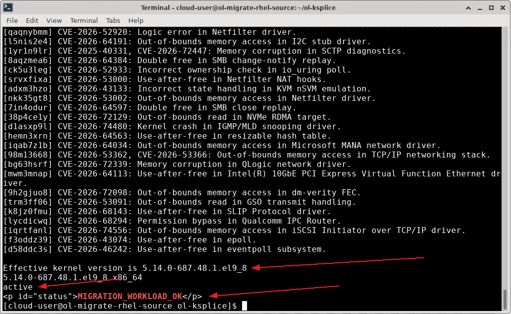

# Explore Rebootless Patching with Ksplice

## Introduction

Continue on the Oracle RHCK used for migration in Lab 4. Uptrack is the Ksplice client. It downloads and applies supported kernel fixes without rebooting the system. You will inspect available patches, apply them when available, and check the boot identity and application response afterward. Lab 6 introduces UEK after this patching test is complete.

**BYOI (Bring Your Own Image)** means importing your own operating-system image into OCI to create a VM. In this workshop, you imported the prepared workshop RHEL image, launched a VM from it, and migrated that VM to Oracle Linux.

OCI gives your VM access to the Ksplice update service without registration with the Unbreakable Linux Network (ULN).

This VM started from a custom RHEL image. Task 2 checks for Uptrack and installs it if it is missing.

For on-premises systems, Ksplice requires an eligible Oracle Linux support subscription, such as Premier Support, and the installation procedure for that environment.

### Objectives

In this lab, you will:

- Check kernel maintenance and Ksplice access requirements.
- Install Uptrack on the converted OCI instance.
- Inspect and apply available live kernel updates when supported.
- Verify the applied patches, unchanged boot identity, and application response.
- Distinguish live patching from on-disk package maintenance.

Estimated Time: 30 minutes

### Prerequisites

Complete the migration, report review, reboot, and webpage checks in Lab 4. Keep the script-generated migration reports unchanged. Use the same healthy Oracle Linux 9.8 destination VM, still running its maintained Oracle RHCK, with internet access and sudo privileges.

To complete the full live-patching test, at least one available patch must actually be applied. A successful client installation or no-updates check is a useful result, but leaves the patch-application test incomplete. Resolve access, kernel-support, or availability issues with the workshop owner before claiming the full test passed.

## Task 1: Check the starting kernel and application

1. Create a separate report directory for this attempt and record the starting boot state:

    ```bash
    <copy>
    REPORT="$HOME/ol-practice-reports/ksplice/$(date -u +%Y%m%dT%H%M%SZ)"
    mkdir -p "$REPORT"
    printf 'Report directory: %s\n' "$REPORT"
    cat /proc/sys/kernel/random/boot_id > "$REPORT/boot-id-before.txt"
    uname -r | tee "$REPORT/boot-kernel-before.txt"
    rpm -qf "/boot/vmlinuz-$(uname -r)" --qf '%{NAME} %{VERSION}-%{RELEASE} %{VENDOR}\n'
    </copy>
    ```

    Confirm the running kernel belongs to Oracle, has no `uek` in its version, and is the RHCK verified in Lab 4. Keep this SSH session open so `REPORT` remains available. If you reconnect, set `REPORT` to the directory printed above.

1. Check the application before patching:

    ```bash
    <copy>
    systemctl is-active httpd
    curl --fail --silent http://127.0.0.1/ | grep MIGRATION_WORKLOAD_OK
    </copy>
    ```

    Expect `active` and the workload marker. Resolve an application failure before continuing.

## Task 2: Install the client on the OCI BYOI instance

1. Check whether the Uptrack client is already available:

    ```bash
    <copy>
    command -v uptrack-show
    rpm -q uptrack
    </copy>
    ```

    A missing command/package is expected on this converted custom image. If installed, retain it and continue to Task 3. First-time installation is covered below.

1. On the OCI instance only, download the official installer into a working directory:

    ```bash
    <copy>
    mkdir -p "$HOME/ol-ksplice"
    cd "$HOME/ol-ksplice"
    curl --fail --location --output install-uptrack-oc \
      https://www.ksplice.com/uptrack/install-uptrack-oc
    </copy>
    ```

    Continue only after a successful download from the official HTTPS endpoint. If the download or installation fails, retain the error; do not disable TLS or package-signature checks or download a replacement from an unverified source.

1. Run the installer without enabling unattended updates:

    ```bash
    <copy>
    sudo sh install-uptrack-oc
    command -v uptrack-show
    rpm -q uptrack
    </copy>
    ```

    Do not pass `--autoinstall` in this exercise. Inspect the installer's output because setup may apply updates while configuring the client. Record any such patches. If installation fails, save the error and review access and kernel support with the workshop owner before proceeding.

## Task 3: Inspect and apply available live kernel updates

1. Inspect the applied state, effective kernel, and available updates:

    ```bash
    <copy>
    sudo uptrack-show | tee "$REPORT/installed-updates-before.txt"
    sudo uptrack-upgrade -n > "$REPORT/available-updates.txt" 2>&1
    UPTRACK_STATUS=$?
    cat "$REPORT/available-updates.txt"
    printf "Preview exit status: %s\n" "$UPTRACK_STATUS"
    printf '\nBooted kernel version: '
    uname -r
    printf 'Effective kernel version: '
    sudo uptrack-uname -r | tee "$REPORT/effective-kernel-after-install.txt"
    </copy>
    ```

    Review the available-update messages and preview exit status above the two labeled kernel versions at the end of the output. `Booted kernel version` comes from `uname -r`; `Effective kernel version` comes from `uptrack-uname -r` and accounts for live patches recognized by Uptrack. Both versions can be the same if live patches have not changed the effective kernel version. This preview does not apply updates.

1. If supported updates are listed, apply them and record the resulting state:

    ```bash
    <copy>
    sudo uptrack-upgrade -y
    PATCH_STATUS=$?
    printf 'Apply exit status: %s\n' "$PATCH_STATUS"
    sudo uptrack-show | tee "$REPORT/applied-updates.txt"
    printf '\nEffective kernel version after patching: '
    sudo uptrack-uname -r | tee "$REPORT/effective-kernel-after.txt"
    </copy>
    ```

    Run the apply command only when the preview lists applicable updates. Confirm a successful apply result and actual patch identifiers in `uptrack-show`. If the command fails, save the output and investigate with the workshop owner before retrying.

1. If no updates are available, record the kernel and outcome. If setup already applied patches, review its output and the installed patch identifiers. A newly released kernel can have no published patches yet; see the [maintained-kernels guidance](https://docs.oracle.com/en/operating-systems/oracle-linux/ksplice-user/ksplice-MaintainedKernels.html).

    Patch counts and effective kernel versions depend on the booted kernel and available updates. If your RHCK has no updates, ask the workshop owner to review the kernel and available patches before continuing. Leave the patch-application test incomplete until actual updates can be applied. Do not remove patches to create an artificial before state.

    An access, network, or unsupported-kernel error also requires investigation. Preserve the output for the workshop owner.

## Task 4: Verify the applied patches and running system

1. Confirm the VM has not rebooted and the boot-kernel version is unchanged:

    ```bash
    <copy>
    cat /proc/sys/kernel/random/boot_id > "$REPORT/boot-id-after.txt"
    uname -r > "$REPORT/boot-kernel-after.txt"
    diff -u "$REPORT/boot-id-before.txt" "$REPORT/boot-id-after.txt"
    diff -u "$REPORT/boot-kernel-before.txt" "$REPORT/boot-kernel-after.txt"
    </copy>
    ```

    Expected result: no output. Both values match their pre-patching records, confirming no reboot and no change to the booted kernel version. If differences or errors appear, resolve them before continuing.

1. Review the patch state and check the application:

    ```bash
    <copy>
    sudo uptrack-show | tee "$REPORT/installed-updates-after.txt"
    sudo uptrack-uname -r
    sudo uptrack-show --available
    systemctl is-active httpd
    curl --fail --silent http://127.0.0.1/ | grep MIGRATION_WORKLOAD_OK
    </copy>
    ```

    Expected results:

    - `uptrack-show` lists the patch IDs applied in Task 3, such as `[9yuc0xxk]`. Compare them with `$REPORT/applied-updates.txt`.
    - `uptrack-show --available` reports `Available updates: None`.
    - The final two commands print `active` and a line containing `MIGRATION_WORKLOAD_OK`.

    If an applied patch ID is missing, available updates are listed, or either application check fails, save the output and ask the workshop owner for help before continuing.

    

## Task 5: Complete the lab

1. The live-patching exercise is complete when Tasks 3 and 4 confirm that patches were applied, the boot identity remained unchanged, and the application still responds. Keep the reports already saved in `$REPORT`, then continue to Lab 6: Explore Oracle Linux Kernel Choices.

    Live patches update the running kernel. Updating on-disk packages remains part of normal maintenance so that a future boot uses current software.

You may now **proceed to the next lab**.

## Learn More

- [Installing Ksplice on OCI BYOI](https://docs.oracle.com/en-us/iaas/oracle-linux/oci/install-ksplice.htm)
- [Maintained Ksplice kernels](https://docs.oracle.com/en/operating-systems/oracle-linux/ksplice-user/ksplice-MaintainedKernels.html)
- [Uptrack command reference](https://docs.oracle.com/en/operating-systems/oracle-linux/ksplice-user/ksplice-UsingtheuptrackupgradeCommandtoManageKspliceUpdates.html)
- [Ksplice availability and entitlement](https://docs.oracle.com/en/operating-systems/oracle-linux/ksplice-user/ksplice-AboutOracleKsplice.html)

## Acknowledgements

- Perside Foster, Principal Solution Engineer, Oracle
- Rosario Spiezia, Principal Sales Consultant, Oracle
- Mitch Dsouza, Principal Presales Consultant, Oracle Cloud Infrastructure Software
- Nick Mader, Global Channel Enablement & Strategy Director, Open Source Solutions, Oracle
- Last Updated By/Date - Perside Foster, Nov 2026
