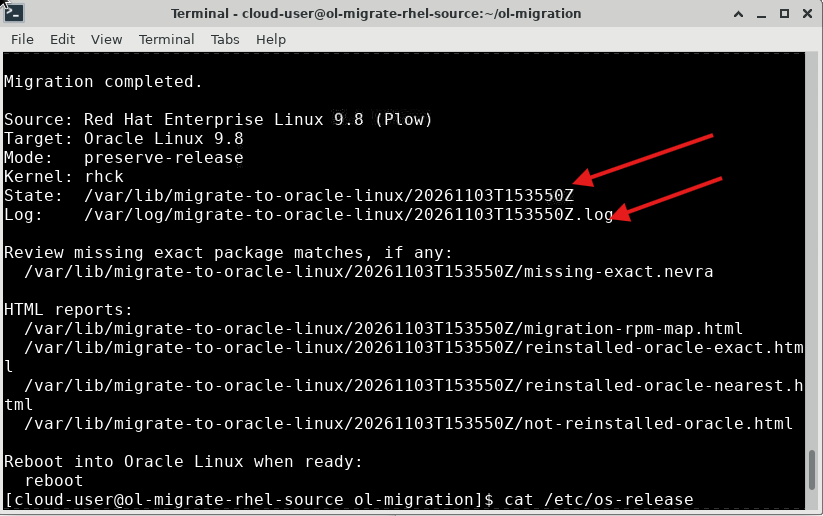
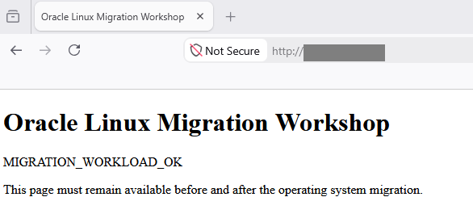

# Migrate to Oracle Linux

## Introduction

After completing the readiness checks and dry run in Lab 3, convert the RHEL VM to Oracle Linux 9.8. The script replaces distribution release packages, configures Oracle repositories, replaces packages with Oracle builds, installs Oracle Linux RHCK, and writes migration reports.

The VM remains the same OCI instance. Its operating-system identity, repositories, packages, and kernel change.

### Objectives

In this lab, you will:

- Execute a same-major-version in-place migration.
- Review package and repository changes.
- Reboot into an Oracle Linux RHCK.
- Confirm that SSH and the workload survived the conversion.

Estimated Time: 40 minutes


### Prerequisites

- Complete [Lab 3: Assess Readiness and Protect the Source](../workshops/tenancy/index.html?lab=migration-readiness#Introduction), including a successful dry run and review of the proposed package changes. Resolve any reported errors before continuing.
- Choose the recovery path described in Lab 3. If you created a boot-volume backup, confirm that it is Available and restart Apache before continuing.
- Use the same RHEL workshop VM with working internet access, SSH access, and sudo privileges. Confirm that Apache serves `MIGRATION_WORKLOAD_OK`.
- Keep the verified migration script from Lab 3 in `$HOME/ol-migration`. Use that pinned script for this lab.

## Task 1: Execute the migration

1. Start the migration to Oracle Linux 9.8 and select RHCK:

    ```bash
    <copy>
    cd "$HOME/ol-migration"
    sudo ./migrate-to-oracle-linux.sh \
      -y \
      --target-version 9.8 \
      --kernel rhck
    </copy>
    ```

    The operation changes repositories, distribution packages, and the installed kernel. Do not close the SSH session while the command is running.

1. Follow the migration output. The [script documentation](https://github.com/oracle/migrate-to-ol/blob/main/README-migrate-to-oracle-linux.md) describes the main operations:

    - Check the source, target, RPM database, and running kernel.
    - Record the starting OS, repositories, and installed packages.
    - Configure Oracle repositories and replace the distribution release packages.
    - Replace packages with Oracle builds. This same-release migration uses exact package matches where available and nearest-release replacements where needed.
    - Install the selected RHCK kernel, set the boot default, and write the final reports.

    This workshop uses the script version verified in Lab 3. The current repository documentation can describe newer versions.

1. Check the completion result. Continue only after the script reports `Migration completed.` If it reports an error, keep the displayed log path and review it with the workshop owner before retrying. The documentation explains the migration modes and report files; use the log from your run to identify the failed operation.

1. At successful completion, find the **State:** and **Log:** lines in the summary below `Migration completed.` Copy and save the complete path after each label in your workshop notes. You will use the **State:** directory in Task 2.

    

    When the script displays `Reboot into Oracle Linux when ready:`, first complete Task 2 below. Reboot in Task 3.

## Task 2: Inspect the converted system before reboot

1. Verify that the installed user space identifies as Oracle Linux:

    ```bash
    <copy>
    cat /etc/os-release
    rpm -q oraclelinux-release oraclelinux-release-el9
    </copy>
    ```

1. Verify Oracle repositories:

    ```bash
    <copy>
    sudo dnf repolist --enabled
    </copy>
    ```

1. Inspect installed Oracle Linux kernel packages and the default kernel:

    ```bash
    <copy>
    rpm -qa 'kernel*' | sort
    sudo grubby --default-kernel
    </copy>
    ```

    The selected Oracle RHCK build may differ from the source RHEL kernel, including a lower release suffix. Verify that it is installed and selected for boot; the running kernel is checked after reboot.

1. Open and read the migration HTML report:

    **Prepare the reports on the VM.** In your existing SSH session, use the **State:** directory saved in Task 1. Replace `<run-id>` below with its timestamp. Use the completed migration run, not the Lab 3 dry run.

    ```bash
    <copy>
    RUN_DIR="/var/lib/migrate-to-oracle-linux/<run-id>"
    mkdir -p "$HOME/ol-migration-reports"
    sudo install -m 0644 "$RUN_DIR"/*.html "$HOME/ol-migration-reports/"
    </copy>
    ```

    **Download the reports to your computer.** Open a second terminal on your **local computer**. Run the following command there, replacing `<public-ip>` with your VM's public IP:

    ```bash
    <copy>
    scp -i ~/.ssh/ol-migrate -r cloud-user@<public-ip>:~/ol-migration-reports "./"
    </copy>
    ```

    **Open and read the report.** In the **local browser**, press **Ctrl+O**. Open the downloaded `ol-migration-reports` folder in the local directory where you ran SCP and select `migration-rpm-map.html`. Compare the original packages with their Oracle replacements, noting version changes and any exceptions. Ask the workshop owner about unfamiliar exceptions before continuing.

    The other HTML reports provide more detail when needed:

    | Reference report | Contents |
    | --- | --- |
    | `reinstalled-oracle-exact.html` | Packages reinstalled with exact Oracle matches. |
    | `reinstalled-oracle-nearest.html` | Packages replaced with a different Oracle release. |
    | `not-reinstalled-oracle.html` | Packages that were not reinstalled from Oracle repositories. |

    See the [report documentation](https://github.com/oracle/migrate-to-ol/blob/main/README-migrate-to-oracle-linux.md) for details. Return to your existing SSH session and continue to Task 3.

## Task 3: Reboot into Oracle Linux RHCK

1. Reboot the VM:

    ```bash
    <copy>
    sudo reboot
    </copy>
    ```

1. Wait for the VM to finish rebooting and accept SSH connections again. A Running status alone does not prove SSH is ready.

1. Reconnect using the same public IP, SSH private key, and `cloud-user` account:

    ```bash
    <copy>
    ssh -i ~/.ssh/ol-migrate cloud-user@<public-ip>
    </copy>
    ```

1. Confirm the operating system and running kernel:

    ```bash
    <copy>
    cat /etc/os-release
    uname -r
    rpm -qf "/boot/vmlinuz-$(uname -r)" --qf '%{NAME} %{VERSION}-%{RELEASE} %{VENDOR}\n'
    </copy>
    ```

    Expected results:

    - `ID="ol"`
    - `VERSION_ID="9.8"`
    - The running kernel package vendor identifies Oracle.
    - The kernel name does not contain `uek` on the core RHCK path.

    The exact kernel build can vary. The vendor and RHCK checks establish the selected boot path; do not require the pre-migration kernel version string to stay unchanged.

1. Open `http://<public-ip>/` in your browser and confirm the page still displays `MIGRATION_WORKLOAD_OK`.

    

    If the page is unavailable, keep the migration log and ask the workshop owner to investigate before continuing.

You may now **proceed to the next lab**.

## Learn More

- [Migration script documentation](https://github.com/oracle/migrate-to-ol/blob/main/README-migrate-to-oracle-linux.md)
- [Managing kernels and system boot on Oracle Linux](https://docs.oracle.com/en-us/iaas/oracle-linux/boot/boot-about-system-boot-kernels.htm)
- [Oracle Linux 9 package repositories](https://yum.oracle.com/oracle-linux-9.html)

## Acknowledgements

- Perside Foster, Principal Solution Engineer, Oracle
- Rosario Spiezia, Principal Sales Consultant, Oracle
- Mitch Dsouza, Principal Presales Consultant, Oracle Cloud Infrastructure Software
- Nick Mader, Global Channel Enablement & Strategy Director, Open Source Solutions, Oracle
- Last Updated By/Date - Perside Foster, Nov 2026
