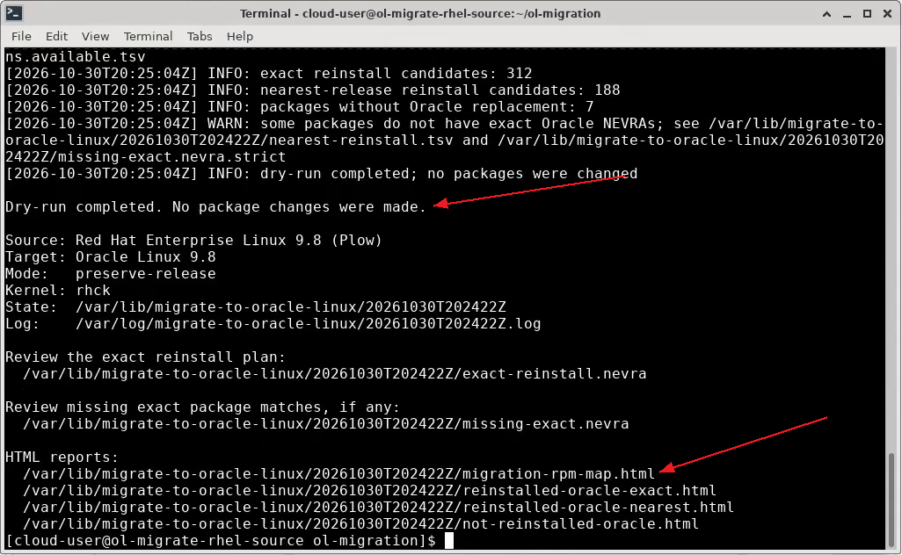

# Assess Readiness and Protect the Source

## Introduction

Begin this lab after importing the prepared image and launching your destination VM in Lab 1. Connect using its public IP, SSH key, and `cloud-user` account. You verified cleanup in Lab 1; no registration is required here.

In this lab, inspect the operating system, running kernel, disk space, RPM database, repositories, and package vendors. Then execute the pinned migration script in dry-run mode.

The migration script is maintained in an Oracle-owned GitHub repository, but the repository states that the scripts are community-based and are not officially supported by Oracle.

### Objectives

In this lab, you will:

- Assess the source system for common migration risks.
- Download and verify a pinned migration script.
- Run a non-changing migration dry run.

Estimated Time: 30 minutes

### Prerequisites

Complete Lab 1, including the connection and verification checks in Task 7. Connect as cloud-user to the destination VM. Apache must already serve MIGRATION_WORKLOAD_OK. No Red Hat registration or additional packages are needed.

## Task 1: Assess the source operating system

1. Confirm the source version and architecture:

    ```bash
    <copy>
    . /etc/os-release
    printf 'ID=%s VERSION_ID=%s ARCH=%s\n' "$ID" "$VERSION_ID" "$(uname -m)"
    </copy>
    ```

    Continue only when the source is RHEL 9.8 on x86\_64.

1. Verify that the newest installed kernel is running:

    ```bash
    <copy>
    uname -r
    rpm -q kernel-core | sort -V
    sudo grubby --default-kernel
    </copy>
    ```

    If the default or newest kernel differs from the running kernel, reboot and repeat this check.

1. Check disk space and the RPM database:

    ```bash
    <copy>
    df -h /
    sudo rpm --verifydb
    sudo dnf check
    </copy>
    ```

1. Inventory enabled repositories:

    ```bash
    <copy>
    sudo dnf repolist --enabled
    sudo find /etc/yum.repos.d -maxdepth 1 -type f -name '*.repo' -print
    </copy>
    ```

    No enabled source repositories are expected in the prepared workshop image. Oracle repositories are configured by the migration script.

1. Identify packages with a different or unspecified vendor:

    ```bash
    <copy>
    rpm -qa --qf '%{NAME}\t%{VENDOR}\n' \
      | awk -F '\t' '$2 !~ /Red Hat/ {print}' \
      | sort | head -50
    </copy>
    ```

    No third-party packages are expected in the prepared workshop image.

## Task 2: Download and verify the pinned migration script

1. Create a working directory:

    ```bash
    <copy>
    mkdir -p "$HOME/ol-migration"
    cd "$HOME/ol-migration"
    </copy>
    ```

1. Download the script from the tested commit:

    ```bash
    <copy>
    MIGRATION_COMMIT=82947c960535cfbb632977c70b0fea67f8e0de7a
    curl --fail --location --output migrate-to-oracle-linux.sh \
      "https://raw.githubusercontent.com/oracle/migrate-to-ol/${MIGRATION_COMMIT}/migrate-to-oracle-linux.sh"
    </copy>
    ```

1. Verify its SHA-256 checksum:

    ```bash
    <copy>
    echo '5435b59e2f0e672111fd1545b2b428cabe473e7c116a353716c2f7de869d0a42  migrate-to-oracle-linux.sh' \
      | sha256sum --check
    </copy>
    ```

    Expected output:

    ```text
    <copy>
    migrate-to-oracle-linux.sh: OK
    </copy>
    ```

1. Make the verified script executable and check its version:

    ```bash
    <copy>
    chmod 0755 migrate-to-oracle-linux.sh
    ./migrate-to-oracle-linux.sh --version
    </copy>
    ```

## Task 3: Run the migration dry run

1. Run the non-changing assessment for an Oracle Linux 9.8 RHCK target:

    ```bash
    <copy>
    sudo ./migrate-to-oracle-linux.sh \
      --dry-run \
      --target-version 9.8 \
      --kernel rhck
    </copy>
    ```

1. Review the final status and the run directory reported by the script.

    Expected completion is `Dry-run completed. No package changes were made.` Exact and nearest-release candidate counts can vary as repositories change. Printed removal and installation commands describe the proposed migration; they are not executed in this dry run.

    Use the [migration script documentation](https://github.com/oracle/migrate-to-ol/blob/main/README-migrate-to-oracle-linux.md) to interpret the summary. This workshop keeps the tested script version pinned; the current documentation can describe newer versions.

    | Result | What it means | What to do |
    | --- | --- | --- |
    | Exact reinstall candidates | An Oracle package with the same name, epoch, version, release, and architecture is available. | Review the planned replacements. |
    | Nearest-release reinstall candidates | An exact match is unavailable, but another Oracle package release is available. | Review the proposed version changes for packages your application needs. |
    | Packages without an Oracle replacement | The plan could not find an Oracle replacement for these source packages. | Review the listed packages with the workshop owner before continuing. |

    Follow the state and log paths printed by your own run. The state directory contains package plans and HTML reports, including `migration-rpm-map.html`. These describe a proposed conversion. A package listed as unavailable during assessment can be removed or replaced later in the actual migration.

    

    The dry run does not perform the package conversion or test the next boot. It writes assessment files and reports, so successful completion is not proof that the migration has finished.

    If the run reports an error, resolve it with the workshop owner before moving to Lab 4. Pay particular attention to source or target compatibility, the running kernel, RPM database errors, disk space, and access to Oracle repositories. Do not bypass a failed check to continue.

## Task 4: Create a boot-volume backup (Optional)

This task is optional. To skip it, keep Apache running and continue to Lab 4: Migrate to Oracle Linux. You can rebuild this disposable workshop VM from the imported prepared image if needed. Rebuilding loses all changes since image capture, so download any results you need first.

1. If you want to retain your current VM state, confirm backup permission, storage allowance, and cost before creating the boot-volume backup below.

    A backup is recommended for systems with valuable data. Rebuilding from the prepared image does not recover changes made after image capture. If you choose a backup, continue below.

1. Flush filesystem changes and stop the workshop application:

    ```bash
    <copy>
    sync
    sudo systemctl stop httpd
    </copy>
    ```

1. In the OCI Console, open the `ol-migrate-rhel-source` instance.

1. Under **Resources**, open the boot volume.

1. Select **Create manual backup**.

1. Enter the following as the backup name and create the backup:

    ```bash
    <copy>
    ol-migrate-before-conversion
    </copy>
    ```

1. Monitor the backup until its state becomes Available.

1. Return to the SSH session and restart the application:

    ```bash
    <copy>
    sudo systemctl start httpd
    curl --fail --silent http://127.0.0.1/ | grep MIGRATION_WORKLOAD_OK
    </copy>
    ```

1. Record the backup OCID and creation time in your workshop notes. See [Recovery](../recovery/recovery.md) for the rebuild and backup restore procedures. Do not assume the migration tool provides an automatic rollback.

You may now **proceed to the next lab**.

## Learn More

- [Oracle migration repository](https://github.com/oracle/migrate-to-ol)
- [Migration script documentation](https://github.com/oracle/migrate-to-ol/blob/main/README-migrate-to-oracle-linux.md)
- [Creating a boot-volume backup](https://docs.oracle.com/en-us/iaas/Content/Block/Tasks/backingupavolume.htm)

## Acknowledgements

- Perside Foster, Principal Solution Engineer, Oracle
- Rosario Spiezia, Principal Sales Consultant, Oracle
- Mitch Dsouza, Principal Presales Consultant, Oracle Cloud Infrastructure Software
- Nick Mader, Global Channel Enablement & Strategy Director, Open Source Solutions, Oracle
- Last Updated By/Date - Perside Foster, Nov 2026
