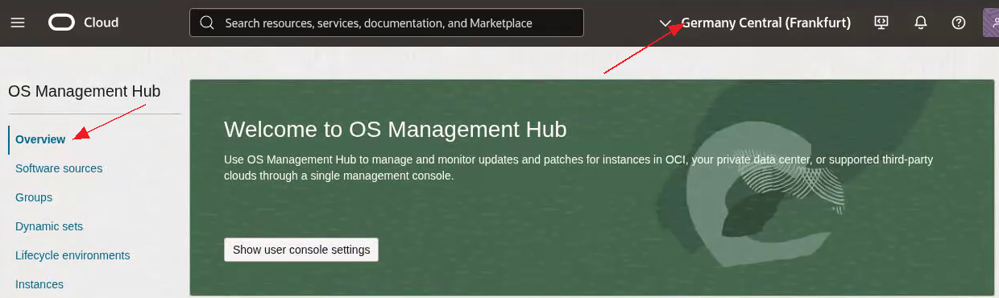
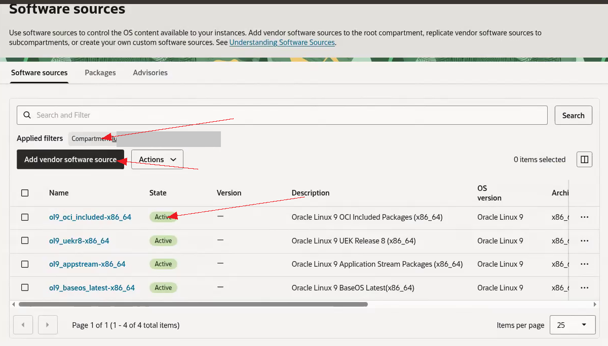
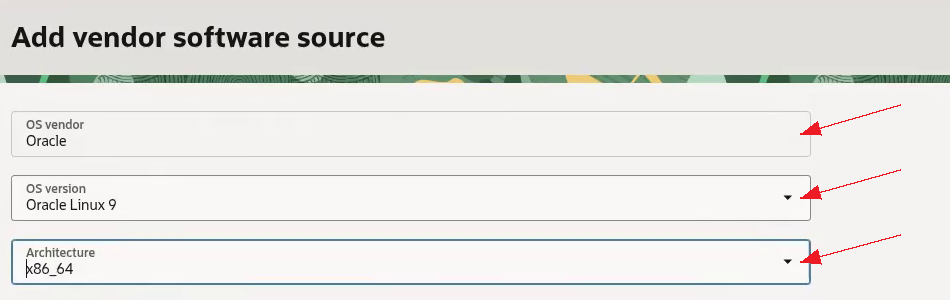
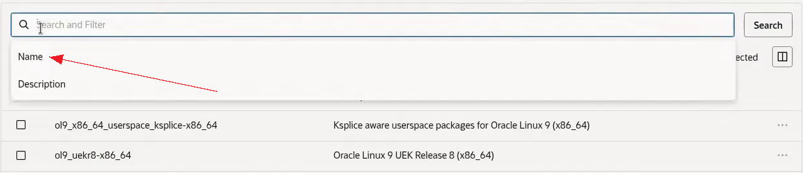
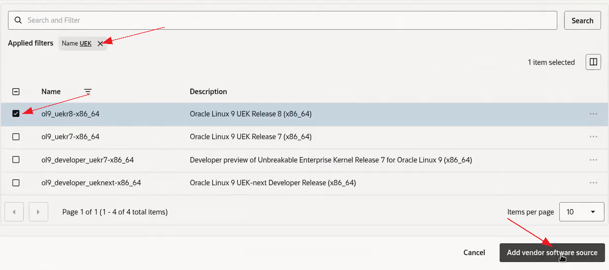
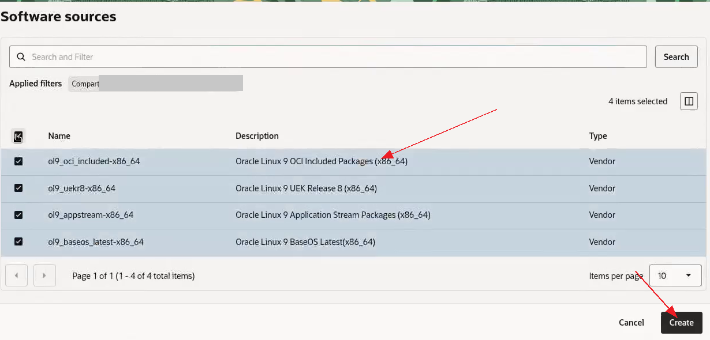
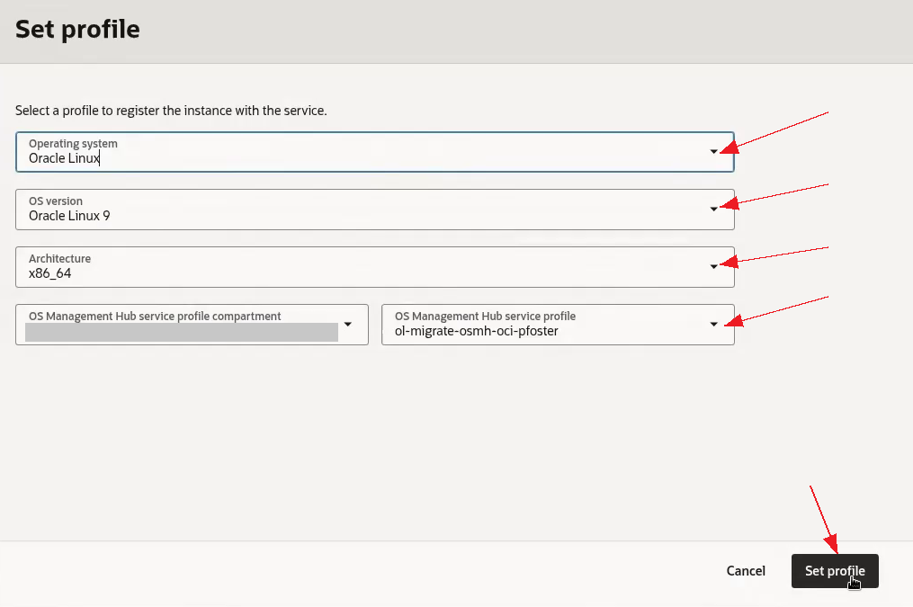
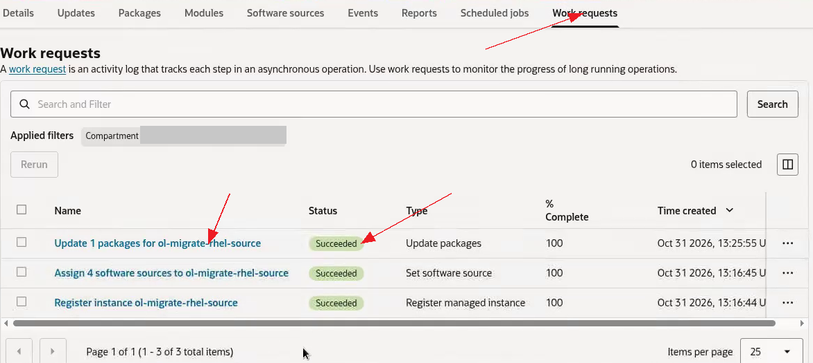
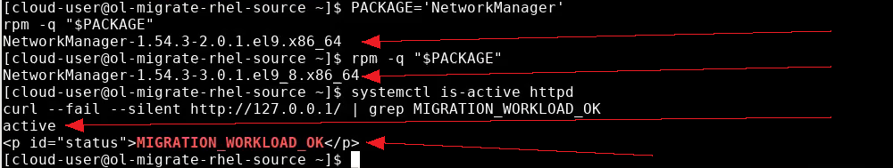

# OS Management Hub Quickstart on OCI

## Introduction

Complete this lab after Lab 6 to learn how OS Management Hub (OSMH) manages software inventory and package updates from the OCI Console. Lab 7 is required to complete the workshop.

Follow Tasks 1 through 5 below using the same `ol-migrate-rhel-source` VM and its Apache application. Confirm the permissions and connectivity listed below before starting.

You will set up OSMH for your compartment, register this VM, and run an update job. Oracle Cloud Agent runs on the VM and provides the OS Management Hub Agent plugin used for registration.

### Objectives

- Set up software sources and a registration profile.
- Register the migrated OCI VM and view its inventory.
- Apply an available package update and verify the job and application.

Estimated Time: 40 minutes, plus agent registration and job execution time. This lab is included in the workshop schedule.

### Prerequisites

These prerequisites apply to Tasks 1 through 5 on the migrated VM.

- Complete the migration, Ksplice, and kernel-choice exercises. Keep their results.
- Use the same OCI region, compartment, VM, SSH account, and key as the earlier labs.
- Have Console permissions to manage OSMH resources, software sources, and the VM's agent plugins. Complete [Administrator setup](../administrator-setup/administrator-setup.md) before continuing.
- The VM must reach the OSMH service and software sources. Use the network from Lab 1; resolve any connectivity failure before registering.

## Task 1: Check the migrated VM and Oracle Cloud Agent

1. Connect to `ol-migrate-rhel-source` using your existing SSH connection. Confirm its identity and check for Oracle Cloud Agent:

    ```bash
    <copy>
    hostname
    grep -E '^(ID|VERSION_ID)=' /etc/os-release
    uname -m
    rpm -q oracle-cloud-agent
    </copy>
    ```

    Expect the workshop hostname, `ID="ol"`, version 9.8, and `x86_64`. OSMH requires Oracle Cloud Agent 1.40 or later. A missing agent is possible on this imported image.

2. If the agent is missing or older than 1.40, check for the OCI software repository:

    ```bash
    <copy>
    sudo dnf repolist --all | grep -i oci
    </copy>
    ```

    Oracle Cloud Agent is supplied through the OCI software source. If `ol9_oci_included` is already defined but disabled, enable it with `sudo dnf config-manager --enable ol9_oci_included`.

    If the command prints nothing, add the repository using the block below. In the OCI Console, look at the region name in the top-right corner, such as **US East (Ashburn)**. The Console shows a display name here. Match that name to the table below and replace `YOUR_OCI_REGION` with the value in the second column:

    | OCI Console region | Value for `OCI_REGION` |
    | --- | --- |
    | US East (Ashburn) | `us-ashburn-1` |
    | Germany Central (Frankfurt) | `eu-frankfurt-1` |

    For Ashburn, enter `OCI_REGION='us-ashburn-1'`, including the `us-` prefix. For another region, find its **Region Identifier** in [Oracle's region table](https://docs.oracle.com/en-us/iaas/Content/General/Concepts/regions.htm). This block uses the commercial OCI domain `oraclecloud.com`:

    ```bash
    <copy>
    OCI_REGION='YOUR_OCI_REGION'
    sudo tee /etc/yum.repos.d/oci-included-ol9.repo >/dev/null <<EOF
    [ol9_oci_included]
    name=Oracle Software for OCI users on Oracle Linux 9 (\$basearch)
    baseurl=https://yum.${OCI_REGION}.oci.oraclecloud.com/repo/OracleLinux/OL9/oci/included/\$basearch/
    gpgkey=file:///etc/pki/rpm-gpg/RPM-GPG-KEY-oracle
    gpgcheck=1
    enabled=1
    EOF
    </copy>
    ```

    Refresh the source and check package availability:

    ```bash
    <copy>
    sudo dnf --refresh --disablerepo='*' --enablerepo=ol9_oci_included list --available oracle-cloud-agent
    </copy>
    ```

    When the package is listed, install it:

    ```bash
    <copy>
    sudo dnf install oracle-cloud-agent
    </copy>
    ```

    If repository access or package lookup fails, save the error and review the [Oracle repository example](https://blogs.oracle.com/linux/ocifs-oke-and-object-storage) and [agent installation guidance](https://docs.oracle.com/en-us/iaas/Content/Compute/Tasks/manage-plugins.htm) with your workshop owner or tenancy administrator. Resolve this before continuing.

3. Start the agent and check the application:

    ```bash
    <copy>
    sudo systemctl enable --now oracle-cloud-agent
    rpm -q oracle-cloud-agent
    systemctl is-active oracle-cloud-agent
    systemctl is-active httpd
    curl --fail --silent http://127.0.0.1/ | grep MIGRATION_WORKLOAD_OK
    </copy>
    ```

    Expect a current agent, both services `active`, and the workload marker.

## Task 2: Set up OSMH in the Console

1. Sign in to the OCI Console. Select the VM's region and compartment, then open **OS Management Hub > Overview**.

    

1. Confirm that your administrator completed the OSMH group, dynamic group, and policy setup. If the Console cannot confirm policies or denies access, review [Administrator setup](../administrator-setup/administrator-setup.md). Resolve required permissions before creating sources or registering the VM.

1. Add the four software sources that the registration profile will use. Software sources provide the packages and updates managed by OSMH.

    1. Return to **OS Management Hub > Software sources** in the VM's region. Check the **Compartment** filter and review the sources already listed. Reuse any required source that is already **Active**. Use the source compartment shown in the Console, which can be the root compartment.

        

    1. Select **Add vendor software source**. Set **OS vendor** to **Oracle**, **OS version** to **Oracle Linux 9**, and **Architecture** to **x86\_64**. Wait for the available sources to load.

        

    1. In the **Software sources** table, use **Search and Filter** to search by **Name**. Use the search text below to find each source, then select the checkbox beside its exact name.

        | Search text | Source name to select |
        | --- | --- |
        | `baseos` | `ol9_baseos_latest-x86_64` |
        | `appstream` | `ol9_appstream-x86_64` |
        | `uekr8` | `ol9_uekr8-x86_64` |
        | `oci_included` | `ol9_oci_included-x86_64` |

        Use **UEK Release 8** to match the kernel installed in Lab 6. For OCI Included Packages, select `ol9_oci_included-x86_64`; `ol9_oracle_software-x86_64` is a different source.

        

    1. Select **Add vendor software source** at the bottom of the page to add your selection. Repeat for any remaining required sources. Before each new search, remove the previous **Name** filter using the **X** beside it so that the old filter does not hide the next source.

        If a required source is absent from the available list, select **Cancel** and check the main **Software sources** list with its name filters cleared. It may already have been added. Confirm the region and compartment filters before searching again.

        

    1. On the main **Software sources** page, clear the **Name** filter and confirm that all four sources in the table above are **Active**. These are the four sources to select when creating the profile in Step 5. Leave **UEK Release 7** unselected for this profile.

1. Open **Profiles > Create profile**. Enter a unique name such as `ol-migrate-osmh-oci-STUDENT_ID`, replacing `STUDENT_ID` with your suffix. Select your lab compartment and the following settings:

    | Setting | Value |
    | --- | --- |
    | Instance location | Oracle Cloud Infrastructure |
    | OS vendor | Oracle |
    | OS version | Oracle Linux 9 |
    | Architecture | x86\_64 |
    | Profile type | Software source |
    | Software sources | The Oracle Linux 9 sources added in Step 4 |

    

1. Review the profile and select **Create**. Keep its name for the next task.

## Task 3: Register this VM with OSMH

1. Open **Compute > Instances** and select `ol-migrate-rhel-source`. Open **Management**, then locate **Oracle Cloud Agent**.

1. Find **OS Management Hub Agent** and select **Enable** from its actions menu. Choose the profile you created in Task 2, then select **Set profile**.

    

    Because the VM came from a custom image, you might need to select **Oracle Linux 9** and **x86\_64** manually to display matching profiles. If the plugin is missing or reports `NOT_SUPPORTED`, stop and review the image and agent with your workshop owner or tenancy administrator.

1. Allow up to 10 minutes for the plugin to start. Open **OS Management Hub > Instances** in the same compartment and find your VM. Confirm its status is **Active**.

1. Open its details. Confirm the hostname, Oracle Linux 9 identity, software sources, and installed-package inventory. Inventory can take a few additional minutes to appear.

## Task 4: Apply one available package update

1. On the VM's OSMH details page, open **Updates**. Choose one available update for a small, installed non-kernel package. Review its dependencies and target version.

    If no suitable update is available, record **No package update available** and continue to Task 5. Registration and inventory can still be verified, but do not claim an update was applied.

1. In the same SSH session, set the selected package name and display its current version:

    ```bash
    <copy>
    PACKAGE='YOUR_PACKAGE'
    rpm -q "$PACKAGE"
    </copy>
    ```

    Replace `YOUR_PACKAGE` before running. Note this version so you can compare it after the job.

1. In the Console, select the package update and select **Update**. On the **Update packages** page, select **Immediately**. Enter a name such as `ol-migrate-update-STUDENT_ID` in **Work request name**. Review the target VM and selected package, then select **Update** to submit the request.

1. Open the instance's **Work requests** tab and select the resulting request. Wait for successful completion and review its messages. If it fails, inspect the error messages before retrying.

    

## Task 5: Verify the result and application

1. If you ran an update, query the package again in the same SSH session:

    ```bash
    <copy>
    rpm -q "$PACKAGE"
    </copy>
    ```

    Compare the installed version with the earlier value and the job's target version. A submitted job alone does not confirm that the package changed.

1. Check the application:

    ```bash
    <copy>
    systemctl is-active httpd
    curl --fail --silent http://127.0.0.1/ | grep MIGRATION_WORKLOAD_OK
    </copy>
    ```

    Expect `active` and the workload marker. Open `http://<public-ip>/` in your browser and confirm the workshop page still appears. Review any reboot requirement reported by the update job before planning further maintenance.

    

1. Confirm the instance remains Active in OSMH. Keep the VM, profile, networking, and workshop results until you finish Lab 8.

    Continue to Lab 8 to automate the verification checks on this same VM.

You may now **proceed to the next lab**.

## Learn More

- [Getting started with OSMH](https://docs.oracle.com/en-us/iaas/osmh/doc/getstarted.htm)
- [Registering an OCI instance](https://docs.oracle.com/en-us/iaas/osmh/doc/register-oci-instance.htm)
- [Installing individual updates](https://docs.oracle.com/en-us/iaas/osmh/doc/install-updates-instance.htm)
- [Viewing job messages](https://docs.oracle.com/en-us/iaas/osmh/doc/view-job-logs-errors.htm)

## Acknowledgements

- Perside Foster, Principal Solution Engineer, Oracle
- Rosario Spiezia, Principal Sales Consultant, Oracle
- Mitch Dsouza, Principal Presales Consultant, Oracle Cloud Infrastructure Software
- Nick Mader, Global Channel Enablement & Strategy Director, Open Source Solutions, Oracle
- Last Updated By/Date - Perside Foster, Nov 2026
