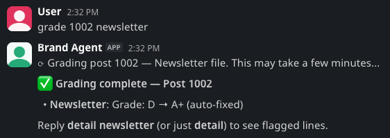
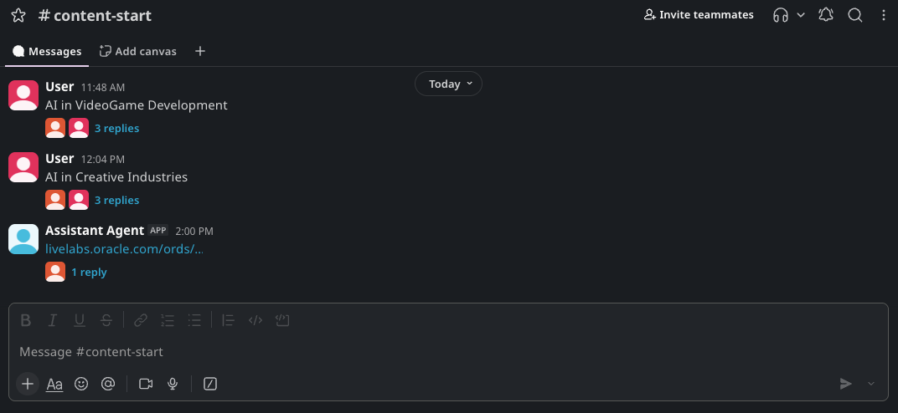

# Lab 6: Explore Slack Agent Features

## Introduction

AI Staff uses Slack direct messages, shared channels, and threads for different kinds of work. Direct messages give you a personal control surface. Channels make team activity visible. Threads keep each request, approval, and delivery action attached to the correct job.

This lab documents the features shown in the current Slack examples. You will review each featured agent and its approval controls. You will also inspect `#content-start`, `#ideas`, and `#inbox`.

Estimated Time: 30 minutes

### Objectives

In this lab, you will:

- Review the Assistant Agent command groups and cross-agent routing.
- Follow Content Agent research, artifact approval, Drive delivery, and Publish Agent handoff.
- Review Creative Agent image revision and approval controls.
- Review Brand Agent grading and automatic edits.
- Understand the purpose of the featured Slack channels.

### Prerequisites

- Finish Lab 5.
- Access to the Slack workspace configured in Lab 3.
- AI Staff services running and the featured Slack apps installed.
- Gmail, Calendar, Drive, and publishing features configured in Lab 4 if you want to reproduce those examples.

## Task 1: Use the Assistant Agent as Your Personal Control Surface

1. Open a direct message with **Assistant Agent** and enter _what can you do?_ to display the command guide.

    

    The guide groups the available work into four areas:

    - **Status and pipeline:** Check platform health, locate a post, list work in flight, identify runs waiting for you, inspect a post record, or diagnose a stalled run. When the Assistant proposes a restart, you confirm it before the restart runs.
    - **Content:** Submit a source URL, start a content run, request a LinkedIn draft, grade text, send approved work to Publish, upload a post to Drive, or ask Creative Agent to regenerate an infographic or stories package.
    - **Your day:** Create an approved calendar event, check or sort email, request a calendar and inbox brief, review weekly metrics, log a receipt, import a CSV file, list event signups, or prepare an outbound email for approval.
    - **Reminders, ideas, and personal context:** Create and list reminders, review saved ideas, upload a resume, compare it with a job role, or ask a career or personal request based on approved documents.

    The Assistant also sends proactive briefings and due reminders when you enable those automations. Available commands depend on the external services configured for your system.

2. Use the Assistant to check the platform and inspect current work.

    

    In this example, `status` confirms that the agents and database are available. `where is post 1002` returns the post state and links to its run thread. `what is waiting for me` reports whether a workflow waits at an approval pause.

3. Paste a Topic or a Supported Link into the Assistant DM to start a content request.

    

    The Assistant acknowledges the request, forwards the URL to Content Agent, and names the target channel. Continue the content run in the linked `#content-start` thread so its updates remain together.

4. Ask the Assistant to schedule an event in a direct message.

    

    The Assistant collects the event purpose, invitees, place, and meeting-link choice. It then posts an event preview. React with the green check mark to create the event or the red cross to reject it. The preview expires after the displayed approval window.

5. Create a reminder with a natural-language date or time.

    

    The reply repeats the reminder text and the delivery time in the configured time zone. The reminder service sends the reminder when it becomes due.

6. Ask the Assistant to check your email.

    

    The direct message stays concise. It reports that the inbox check started, then points you to `#inbox` for the shared result.

## Task 2: Follow Content Agent Runs, Approvals, and Delivery

1. Open `#content-runs`, select a post, and open its thread.

    

    Content Agent posts each pipeline as a top-level message in `#content-runs`. The thread holds every update for that post. In this example, the agent reports the research phase as running, marks it complete, and stops at **PAUSE 1**. The research brief appears in the same thread so you can review its topic, evidence, opportunities, and trade-offs before format creation begins.

2. Review the generated Markdown artifacts and approve their Drive delivery.

    

    Here, the user replies `skip` at **PAUSE 3**, and Content Agent resumes the post. It displays the research brief, LinkedIn post, and newsletter with their artifact filenames and previews.

    The **Markdown Drive approval** message lists every file awaiting delivery. React with the green check mark to approve all listed Markdown artifacts for Drive. Keep the approval in the post thread so it applies to the correct files.

3. Confirm the Drive upload and Publish Agent handoff.

    

    After approval, Content Agent records the decision, verifies the files, and uploads each artifact. The completion message links to the delivered LinkedIn, newsletter, and research files. Publish Agent then confirms that it received the approved brief and uploaded it to Drive. These messages close the approval trail for the post.

## Task 3: Review Creative Agent Image Approval

1. Send an image request to Creative Agent in the #creative_studio channel.

    

    Creative Agent posts a candidate with a version number and asks for one of two responses:

    - Reply `approve` to accept the displayed revision.
    - Reply `revise: <changes>` to generate another candidate from your feedback.

2. Review the new candidate after requesting a change, then approve the correct version.

    The approval message identifies the accepted image and version. Only the approved PNG becomes eligible for later delivery. This gate prevents an older draft from moving forward by mistake.

## Task 4: Review Brand Agent Grading

1. Ask Brand Agent to grade a post format, such as `grade 1002 newsletter`.

    

    Brand Agent evaluates the selected artifact against the approved brand strategy. In this example, it reports the original grade and the improved grade after automatic edits. Reply `detail newsletter`, or the shorter `detail`, to see the lines that triggered feedback.

## Task 5: Understand the Featured Channels

1. Use `#content-start` for new content topics and supported source URLs.

    

    Each top-level message represents one intake request. Content Agent replies in a thread so the format choice, progress, failures, approvals, and final handoff stay with that request. Requests can originate in the channel or arrive through Assistant Agent routing.

2. Use `#ideas` as a shared capture queue for future work.

    

    Post a short idea, a link, or a goal as a top-level message. Assistant Agent records the item and replies in its thread. Separate threads keep follow-up details attached to each idea without turning the channel into one long chat.

3. Review `#inbox` after an email check or inbox sweep.

    

    The summary shows new-message counts, categories, suggested work, internal labels, drafts awaiting approval, and any immediate need. The channel holds shared results, while commands and approvals can remain in the Assistant DM.

## Acknowledgements

- Authors: Cyrce Salinas Rojas and Ilan Gómez Guerrero
- Last Updated: Ilan Gómez Guerrero, October 2026
