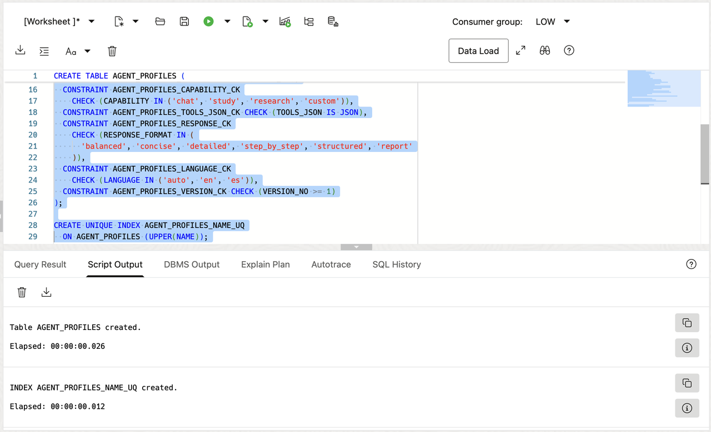
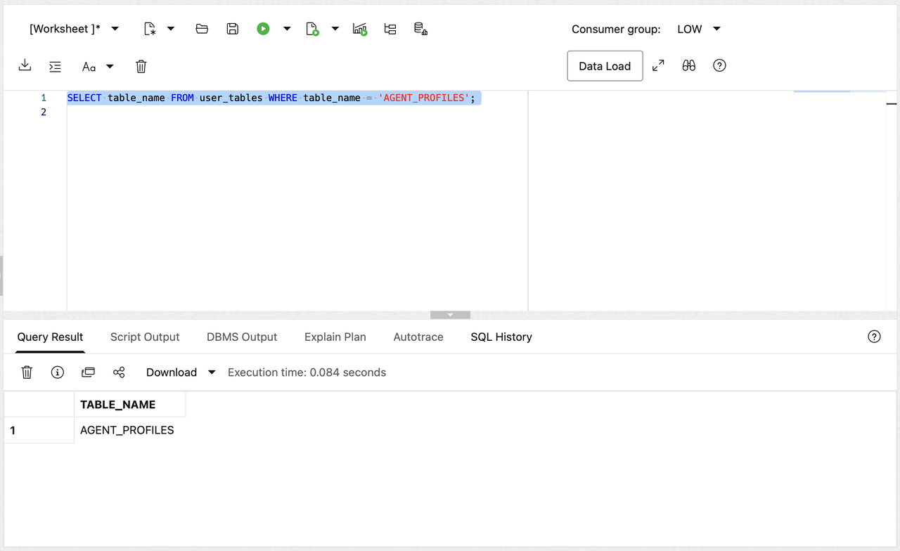
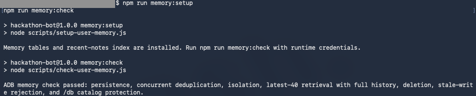
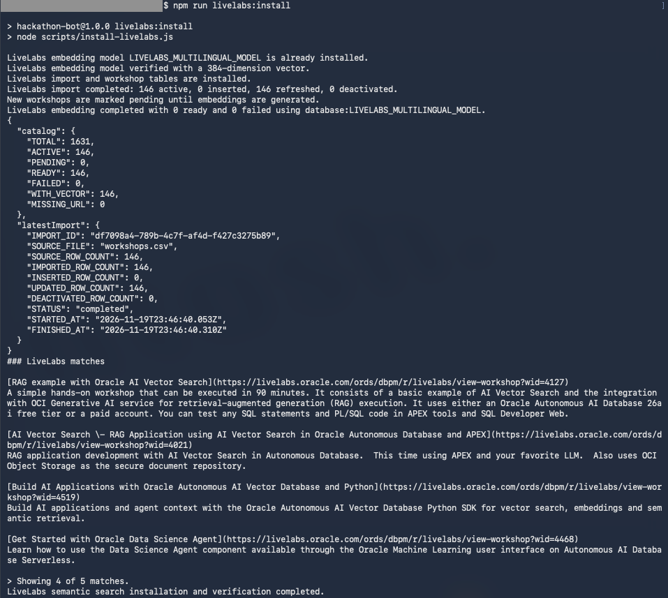
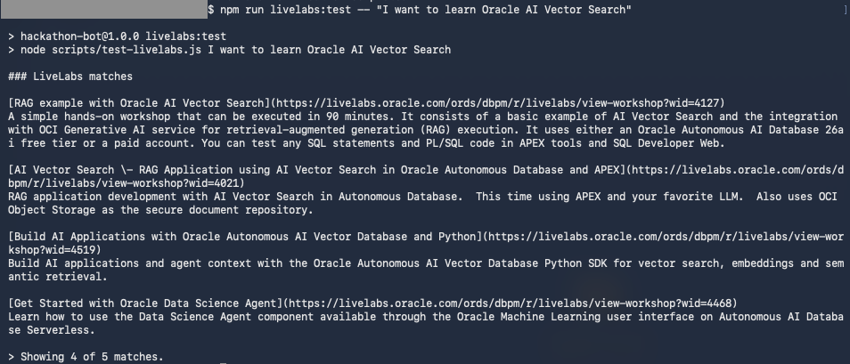

# Lab 3: Configure Database Storage and LiveLabs Search

## Introduction

Connect the bot to Autonomous Database. Create private agent and memory tables, then install the prevalidated LiveLabs catalog and its in-database embedding model. The recommended workshop setup uses one non-`ADMIN` database user. Optional settings can separate these features later.

Estimated Time: 35 minutes.

### Objectives

In this lab, you will:

- Configure one database user for the workshop features.
- Create the agent profile and personal-memory tables.
- Validate wallet-backed node-oracledb connections without exposing secrets.
- Install the LiveLabs catalog, model, and vector embeddings.
- Verify database status, private storage, and semantic search.

### Prerequisites

- Finish Labs 1 and 2. Extract the current bot package on Compute.
- Autonomous Database is available, and its wallet is under `/home/opc/hackathon-bot/wallet`.
- Turn on Database Actions for the Autonomous Database.
- Database credentials for a non-`ADMIN` user with a quota on `DATA`.

## Task 1: Prepare the Database User

1. Use one non-`ADMIN` database user for this workshop. It owns the private bot tables and the LiveLabs model. The empty optional settings in `.env` will fall back to `ADB_USER` and `ADB_PASSWORD`.

2. In Database Actions, connect as `ADMIN`. Replace `<BOT_DATABASE_USER>` with the existing workshop user and grant only the privileges needed for setup.

    ```sql
    <copy>
    GRANT CREATE SESSION, CREATE TABLE, CREATE MINING MODEL
      TO <BOT_DATABASE_USER>;
    ALTER USER <BOT_DATABASE_USER> QUOTA 100M ON DATA;
    GRANT READ, WRITE ON DIRECTORY DATA_PUMP_DIR
      TO <BOT_DATABASE_USER>;
    </copy>
    ```

    `CREATE MINING MODEL` and directory access let the one-time installer load Oracle's public ONNX model. They do not grant access to another application's tables.

3. Make sure the workshop user can sign in to Database Actions. In **Administration > Database Users**, enable **Web Access** for that user. See [Oracle Database Actions access instructions](https://docs.oracle.com/en/cloud/paas/autonomous-database/serverless/adbsb/connect-database-actions.html).

## Task 2: Create the Agent Profile Table

1. In Database Actions, connect as the workshop database user. Run this fresh-install schema with **Run Script**. If `AGENT_PROFILES` already exists, use the retry-safe `db/agent-store-schema.sql` from the current bot package instead.

    ```sql
    <copy>
    CREATE TABLE AGENT_PROFILES (
      AGENT_ID VARCHAR2(36 CHAR) NOT NULL,
      OWNER_USER_ID VARCHAR2(32 CHAR) NOT NULL,
      NAME VARCHAR2(32 CHAR) NOT NULL,
      GOAL VARCHAR2(1000 CHAR) NOT NULL,
      STYLE VARCHAR2(300 CHAR) NOT NULL,
      CAPABILITY VARCHAR2(16 CHAR) NOT NULL,
      PRESET VARCHAR2(32 CHAR) DEFAULT 'custom' NOT NULL,
      TOOLS_JSON VARCHAR2(500 CHAR) DEFAULT '[]' NOT NULL,
      RESPONSE_FORMAT VARCHAR2(32 CHAR) DEFAULT 'balanced' NOT NULL,
      LANGUAGE VARCHAR2(8 CHAR) DEFAULT 'auto' NOT NULL,
      VERSION_NO NUMBER(10) DEFAULT 1 NOT NULL,
      CREATED_AT TIMESTAMP WITH TIME ZONE DEFAULT SYSTIMESTAMP NOT NULL,
      UPDATED_AT TIMESTAMP WITH TIME ZONE DEFAULT SYSTIMESTAMP NOT NULL,
      CONSTRAINT AGENT_PROFILES_PK PRIMARY KEY (AGENT_ID),
      CONSTRAINT AGENT_PROFILES_CAPABILITY_CK
        CHECK (CAPABILITY IN ('chat', 'study', 'research', 'custom')),
      CONSTRAINT AGENT_PROFILES_TOOLS_JSON_CK CHECK (TOOLS_JSON IS JSON),
      CONSTRAINT AGENT_PROFILES_RESPONSE_CK
        CHECK (RESPONSE_FORMAT IN (
          'balanced', 'concise', 'detailed', 'step_by_step', 'structured', 'report'
        )),
      CONSTRAINT AGENT_PROFILES_LANGUAGE_CK
        CHECK (LANGUAGE IN ('auto', 'en', 'es')),
      CONSTRAINT AGENT_PROFILES_VERSION_CK CHECK (VERSION_NO >= 1)
    );

    CREATE UNIQUE INDEX AGENT_PROFILES_NAME_UQ
      ON AGENT_PROFILES (UPPER(NAME));
    </copy>
    ```

    

2. Confirm the table exists.

    ```sql
    <copy>
    SELECT table_name FROM user_tables WHERE table_name = 'AGENT_PROFILES';
    </copy>
    ```

    

## Task 3: Configure and Validate Database Access

1. On Compute, identify a low service name in the wallet.

    ```sh
    <copy>
    grep -E '^[A-Za-z0-9_-]+_low[[:space:]]*=' \
      /home/opc/hackathon-bot/wallet/tnsnames.ora
    </copy>
    ```

2. Edit `/home/opc/hackathon-bot/.env`. Enter the database and wallet credentials. Keep the optional account overrides blank so they use the generic ADB account.

    ```text
    <copy>
    ADB_USER=<BOT_DATABASE_USER>
    ADB_PASSWORD=<BOT_DATABASE_USER_PASSWORD>
    ADB_CONNECT_STRING=<TNS_ALIAS_FROM_WALLET>
    ADB_WALLET_DIR=/home/opc/hackathon-bot/wallet
    ADB_WALLET_PASSWORD=<WALLET_PASSWORD_FROM_LAB_1>
    ADB_CATALOG_OWNER=
    AGENT_STORE_USER=
    AGENT_STORE_PASSWORD=
    AGENT_STORE_OWNER=
    USER_MEMORY_USER=
    USER_MEMORY_PASSWORD=
    USER_MEMORY_OWNER=
    LIVELABS_DB_USER=
    LIVELABS_DB_PASSWORD=
    </copy>
    ```

    | Optional setting | Default when blank |
    | --- | --- |
    | `AGENT_STORE_USER`, `AGENT_STORE_PASSWORD` | `ADB_USER`, `ADB_PASSWORD` |
    | `AGENT_STORE_OWNER` | `ADB_USER` |
    | `USER_MEMORY_USER`, `USER_MEMORY_PASSWORD` | Agent store account, then ADB account |
    | `USER_MEMORY_OWNER` | Agent store owner, then memory account |
    | `LIVELABS_DB_USER`, `LIVELABS_DB_PASSWORD` | `ADB_USER`, `ADB_PASSWORD` |

3. Protect `.env`, then run deployment preflight. It checks required variables, permissions, wallet files, ADB, agent storage, and the LiveLabs database connection without printing secret values.

    ```sh
    <copy>
    cd /home/opc/hackathon-bot
    chmod 600 .env
    npm run setup:check
    </copy>
    ```

## Task 4: Install Memory and LiveLabs Search

1. Install and verify personal memory. These commands use the configured account, create or upgrade the private tables, run isolation checks, and remove their synthetic test notes.

    ```sh
    <copy>
    npm run memory:setup
    npm run memory:check
    </copy>
    ```

    Confirm that setup installs the memory tables and that the check reports persistence, deduplication, isolation, retrieval, deletion, stale-write rejection, and `/db` catalog protection.

    

2. Review what the LiveLabs installer loads. The packaged `data/livelabs/workshops.csv` contains `Title`, `Description`, and `URL`. The workshop release contains 146 unique workshops whose links were confirmed accessible before packaging. Learners do not need to filter the CSV or edit its URLs. Semantic vectors are generated from each title and description; the URL is stored so Discord can return a direct link.

3. Install LiveLabs semantic search.

    ```sh
    <copy>
    npm run livelabs:install
    </copy>
    ```

    The installer downloads Oracle's public `all-MiniLM-L12-v2` ONNX file only when needed. It loads the model, creates or verifies the schema, merges the packaged CSV, deactivates catalog entries that are no longer packaged, generates missing embeddings, checks row state, and runs a semantic query. The initial embedding pass can take several minutes. Later runs reuse the model and unchanged vectors.

    

4. Confirm the final catalog check reports all active rows as `READY`, no `PENDING`, `FAILED`, or `MISSING_URL` rows, and the same number of `WITH_VECTOR` rows as active rows. For the packaged catalog in this workshop, a fresh installation reports 146 active, ready, and vectorized rows. An upgraded database can retain older rows as inactive, so `TOTAL` can be higher than 146.

5. Run a command-line semantic search without reinstalling the catalog.

    ```sh
    <copy>
    npm run livelabs:test -- "I want to learn Oracle AI Vector Search"
    </copy>
    ```

    Confirm that the result includes relevant workshop titles, descriptions, and clickable LiveLabs URLs.

    

## Task 5: Verify the Database-Backed Features

1. Start the bot temporarily and leave it running for these checks.

    ```sh
    <copy>
    npm start
    </copy>
    ```

2. In Discord, run `/db` and select **Check the bot connection to ADB**. Confirm the connection is available. Private agent, memory, and LiveLabs tables are intentionally excluded from generic `/db` discovery and queries.

3. Open `/agent`, create a small test agent, and confirm it remains available after a bot restart.

4. Keep the command-line LiveLabs result from Task 4 for comparison with the Discord result in Lab 4.

5. State a harmless preference in the channel, ask a generic follow-up, and use `/memory` to inspect the private channel-scoped note. Model-based automatic saving can skip ambiguous statements; use a clear first-person preference.

6. Leave the foreground process running. Lab 4 stops it before automated systemd setup.

## Acknowledgements

- Authors: Cyrce Salinas Rojas and Ilan Gómez Guerrero
- Last Updated: Ilan Gómez Guerrero, November 2026
- Learn More: [Use an in-database transformer model](https://docs.oracle.com/en/database/oracle/oracle-database/26/selai/use-retrieval-augmented-generation-and-vectors.html)
