# Lab 4: Run the Bot as a Service and Verify Its Features

## Introduction

Use the repository's production installer to test, register, and run the bot under systemd. Check Discord, database-backed features, Nginx, and service logs.

Estimated Time: 30 minutes.

### Objectives

In this lab, you will:

- Run automated preflight, tests, LiveLabs checks, command registration, and service installation.
- Confirm the Nginx HTTPS proxy and Discord interaction handshake.
- Test all nine bot commands, mentions, file handling, memory isolation, and agent behavior.
- Review service status, logs, and restart behavior.

### Prerequisites

- Completion of Labs 1 through 3.
- A PAR, Discord app, OpenRouter settings, database wallet, private schemas, LiveLabs vectors, and reserved IP certificate.
- The reserved Compute public IPv4 address and a valid, renewed Let’s Encrypt IP certificate.
- A private Discord server where you can test all bot features.

## Task 1: Run Automated Production Setup

1. Confirm that the Object Storage link in Lab 2 downloads the ZIP. Confirm the ZIP contains the approved source package and has no `.env`, wallet, credentials, private keys, or `node_modules`.

2. Set `opc` as the owner of `.env`, restrict the file to that user, and confirm that the application user can read it. Do not print the file contents.

    ```sh
    <copy>
    sudo chown opc:opc /home/opc/hackathon-bot/.env
    chmod 600 /home/opc/hackathon-bot/.env
    stat -c '%a %U %n' /home/opc/hackathon-bot/.env
    sudo -u opc test -r /home/opc/hackathon-bot/.env && echo '.env is readable by opc'
    </copy>
    ```

    The output must show mode `600`, owner `opc`, and `.env is readable by opc`.

3. Stop the foreground process from Lab 3 with `Ctrl+C`. Run the production setup from the application directory.

    ```sh
    <copy>
    cd /home/opc/hackathon-bot
    npm run setup:production
    </copy>
    ```

    The command installs locked dependencies, validates configuration and database access, runs tests, safely rechecks LiveLabs, registers nine commands, installs or updates the systemd unit, starts the service, and displays recent logs. It preserves an existing unit as `discord-example.service.previous`.

## Task 2: Inspect the Service and Nginx

1. Display the generated unit. Confirm it uses the actual repository path, current Node executable, and unprivileged `opc` account. The app loads `.env` through `dotenv` from its working directory.

    ```sh
    <copy>
    sudo systemctl cat discord-example.service
    sudo systemctl is-active discord-example.service
    sudo systemctl is-enabled discord-example.service
    </copy>
    ```

2. Review the current logs and confirm the bot reports `Listening on port 3000`.

    ```sh
    <copy>
    sudo journalctl -u discord-example.service --since '5 minutes ago' --no-pager
    sudo ss -ltnp | grep ':3000'
    </copy>
    ```

    Confirm that the service is active and that Node is listening on port `3000` before continuing.

    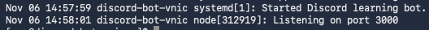

3. Confirm Nginx is active and can proxy to the bot on port 3000. From the Compute host, check the service and configuration if requests fail.

    ```sh
    <copy>
    sudo systemctl is-active nginx
    sudo nginx -t
    sudo journalctl -u nginx -n 40 --no-pager
    </copy>
    ```

    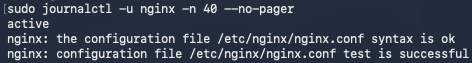

## Task 3: Verify the Discord Endpoint and Bot Features

1. In the Discord Developer Portal, confirm that **Interactions Endpoint URL** remains set to `https://<your-public-ip>/interactions`, using the reserved IP from Lab 1. Lab 2 saved and verified this URL while the bot was running in the foreground. The systemd service now handles the same endpoint.

2. In the private test server, enter `/` and confirm that the registered bot commands appear.

    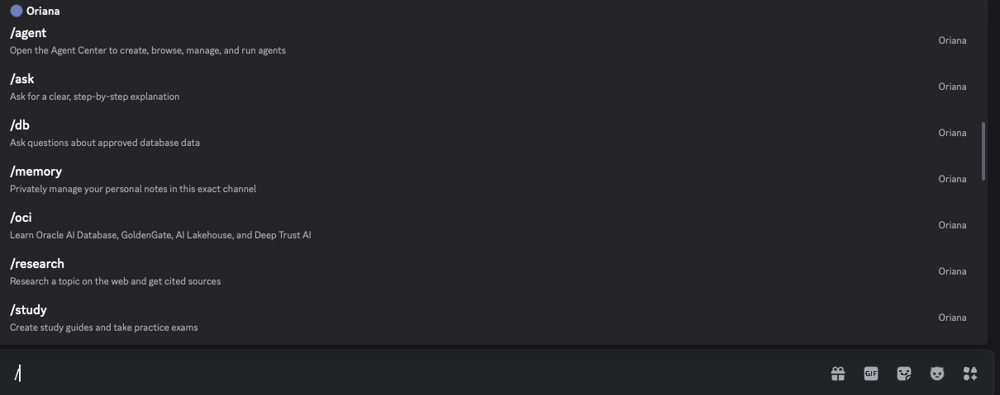

    Run `/ask` with a short learning question and confirm that the bot responds.

    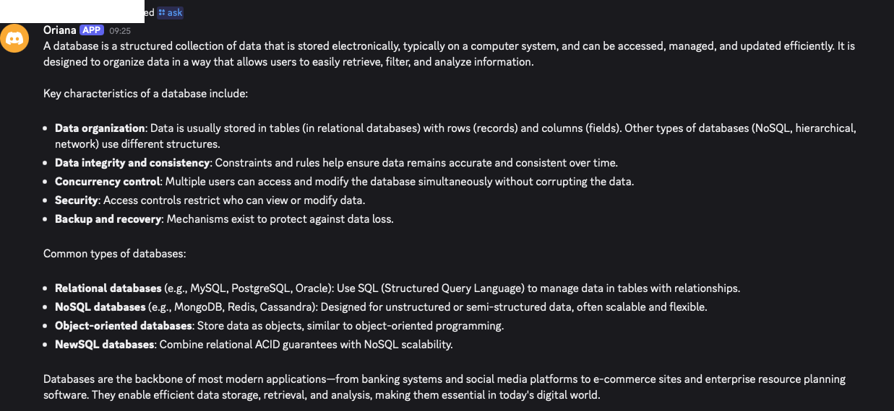

    Mention the bot in a message and confirm that it responds once.

    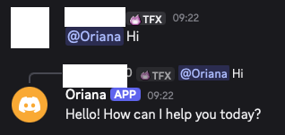

3. Run `/research` with a non-sensitive topic. Confirm the response contains source links.

    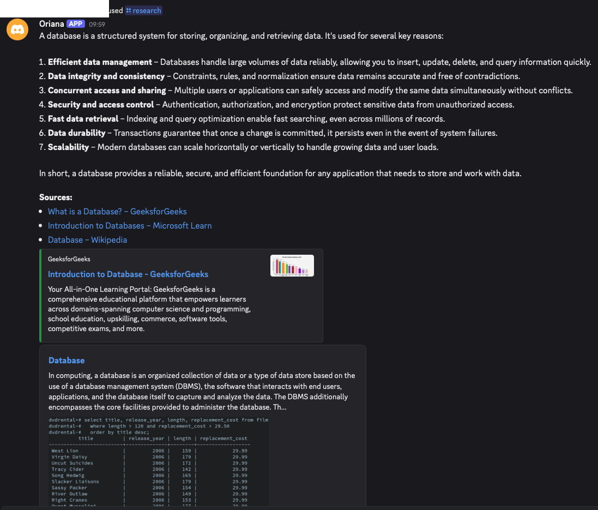

4. Run `/study`. Select **Guide: Create a study guide**, enter a non-sensitive topic, and submit the command.

    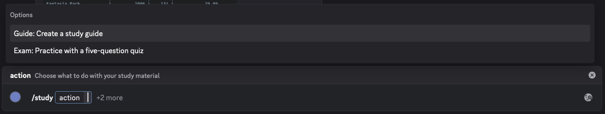

    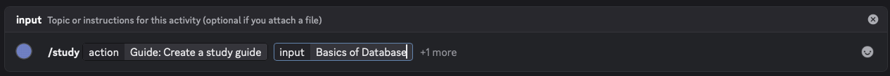

    Confirm that the bot returns the study guide as a Markdown attachment.

    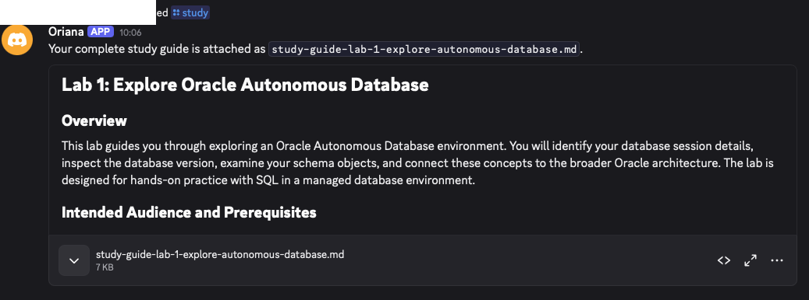

5. Run `/study` again with a non-sensitive PDF, TXT, Markdown, CSV, or JSON file. The file must not exceed 8 MB. Select **Exam: Practice with a five-question quiz**, submit the command, and answer the questions.

    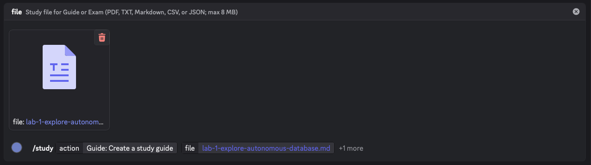

    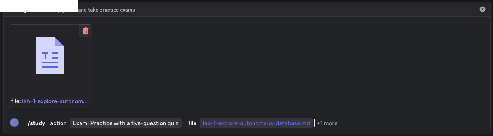

    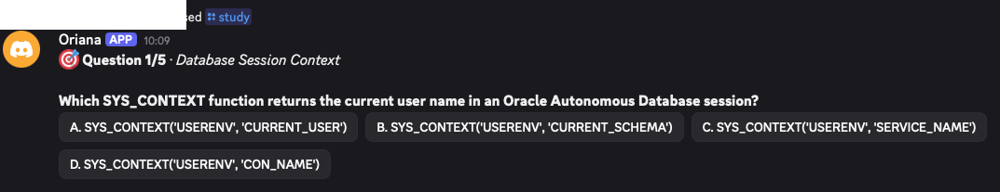

6. Run `/oci` with one of its supported topics: Oracle AI Database, GoldenGate, AI Lakehouse, or Deep Trust AI. Enter a technical question about the selected topic and submit the command.

    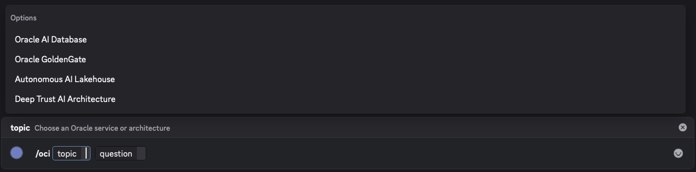

    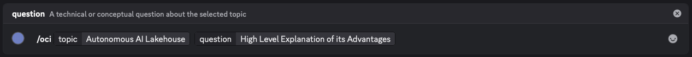

    Confirm that the response uses the selected topic. A long response can arrive as a Markdown attachment.

    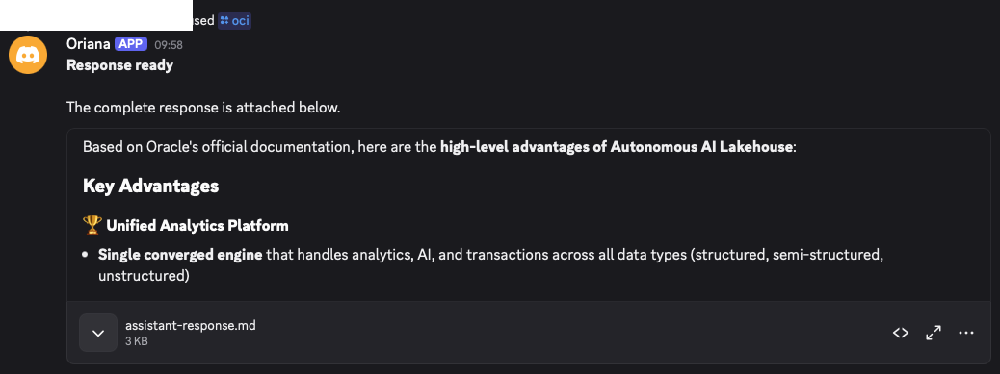

7. Run `/ai-db` with AI Vector Search or Select AI. Confirm that the response focuses on the selected Oracle AI Database topic.

8. Run `/db` and select **Check the bot connection to ADB**. Confirm the connection is available. Do not expect private agent, memory, or LiveLabs tables in generic schema discovery.

9. Enter `/live`, then select `/livelabs query` from the command list.

    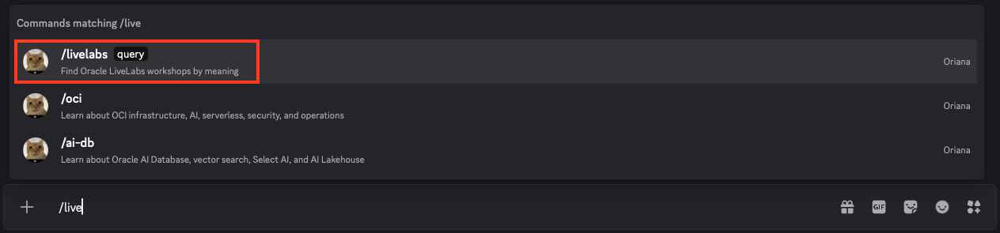

    In `query`, describe the Oracle product or skill you want to learn. For example, enter `I want to learn how to use OCI Object Storage`, then submit the command.

    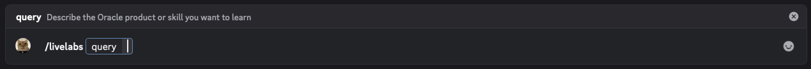

    Confirm that the bot returns semantically relevant workshop titles and descriptions. Select a blue title and verify that it opens the corresponding LiveLabs workshop.

    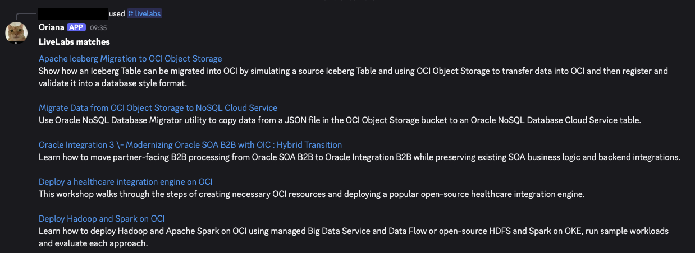

10. Enter `/agent` and submit the command. Confirm that the private Agent Center displays **Run agent**, **Create agent**, and **Browse agents**.

    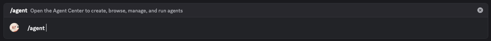

    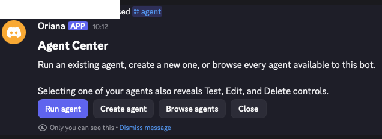

11. Select **Create agent**. Enter a non-sensitive name, goal, and response style. Select a preset and response language, submit the form, review the preview, and save the agent.

    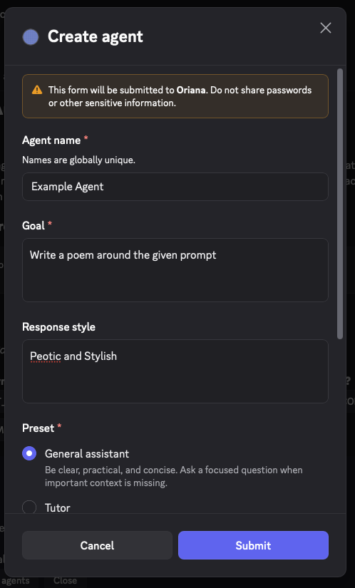

    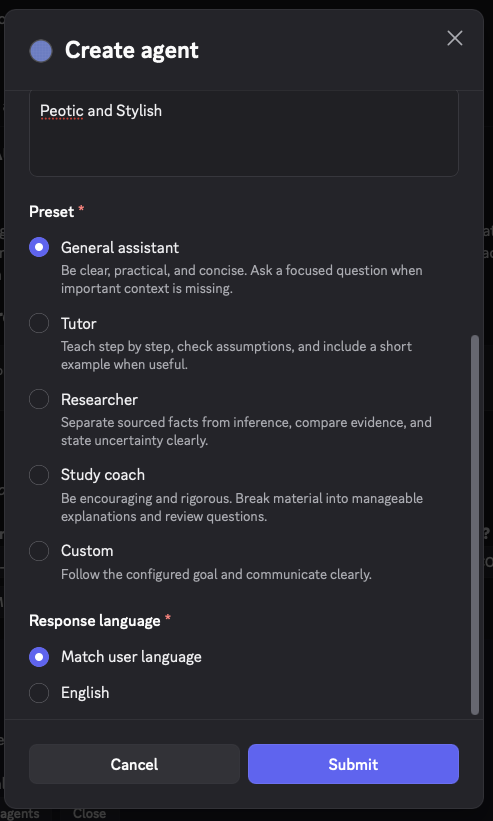

    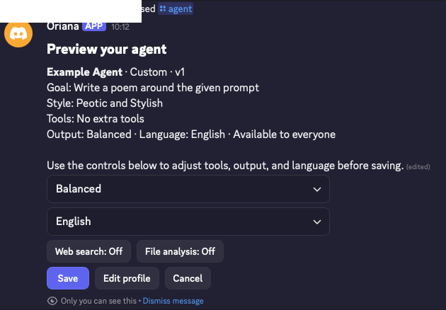

    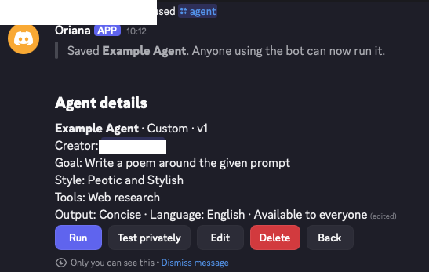

12. Select **Test privately** and enter a sample request. Confirm that the response says **Only you can see this**. Select **Edit**, change one profile field, and save the update.

    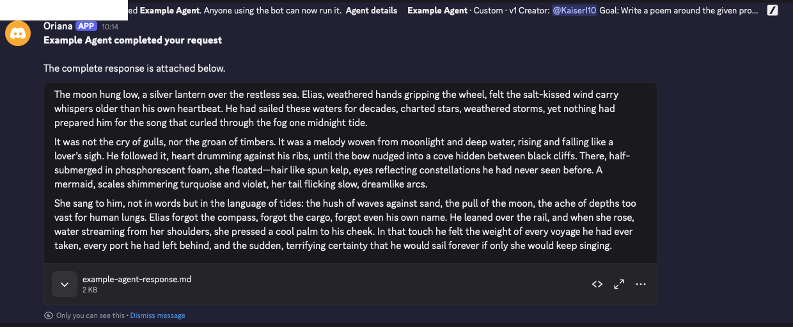

    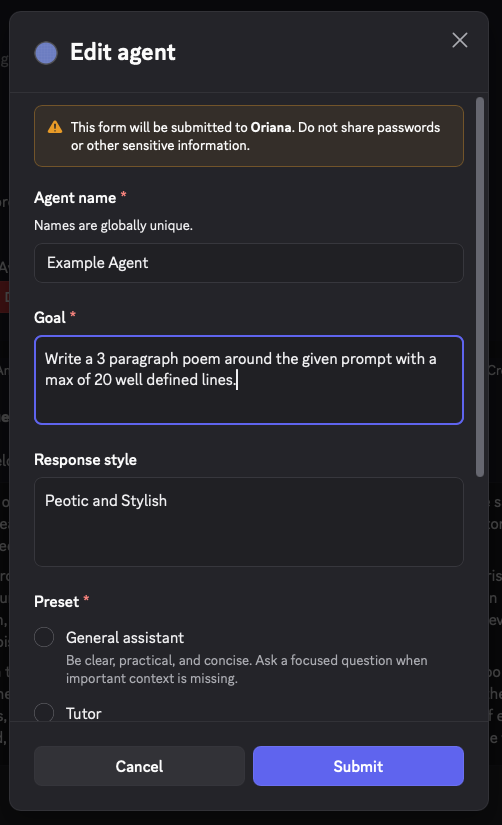

13. Return to **Run agent**, select the saved agent, and enter a non-sensitive request. Confirm that the normal response is visible in the server channel. Then browse the agent, review its details, and delete the workshop test agent.

    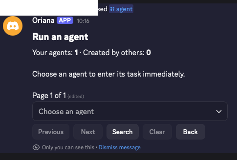

    

    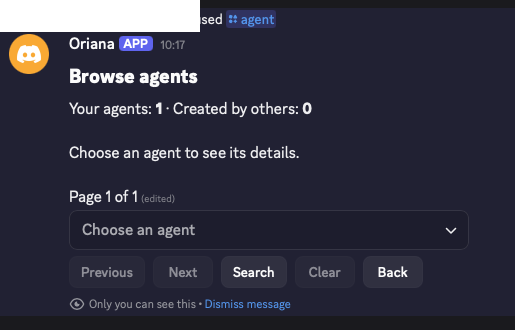

    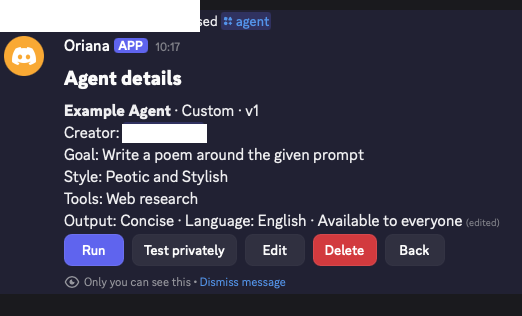

    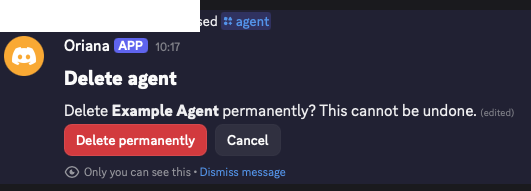

## Task 4: Verify Repeatable Updates

1. Run the update workflow. It repeats preflight, tests, command registration, service refresh, restart, and log checks without rebuilding unchanged LiveLabs vectors.

    ```sh
    <copy>
    cd /home/opc/hackathon-bot
    npm run deploy
    sudo systemctl is-active discord-example.service
    </copy>
    ```

2. If you deploy from a Git checkout, review `.github/workflows/deploy.yml`. The workflow pulls the approved branch, installs locked dependencies, synchronizes LiveLabs when configured, and runs the same deployment checks. The Object Storage ZIP workflow does not contain `.git`; keep ZIP delivery and Git deployment as separate options.

## Acknowledgements

- Authors: Cyrce Salinas Rojas and Ilan Gómez Guerrero
- Last Updated: Ilan Gómez Guerrero, November 2026
