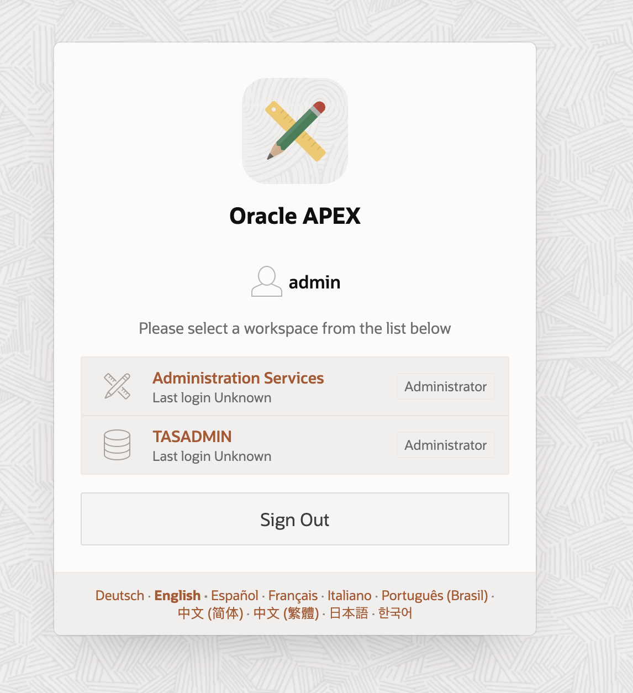
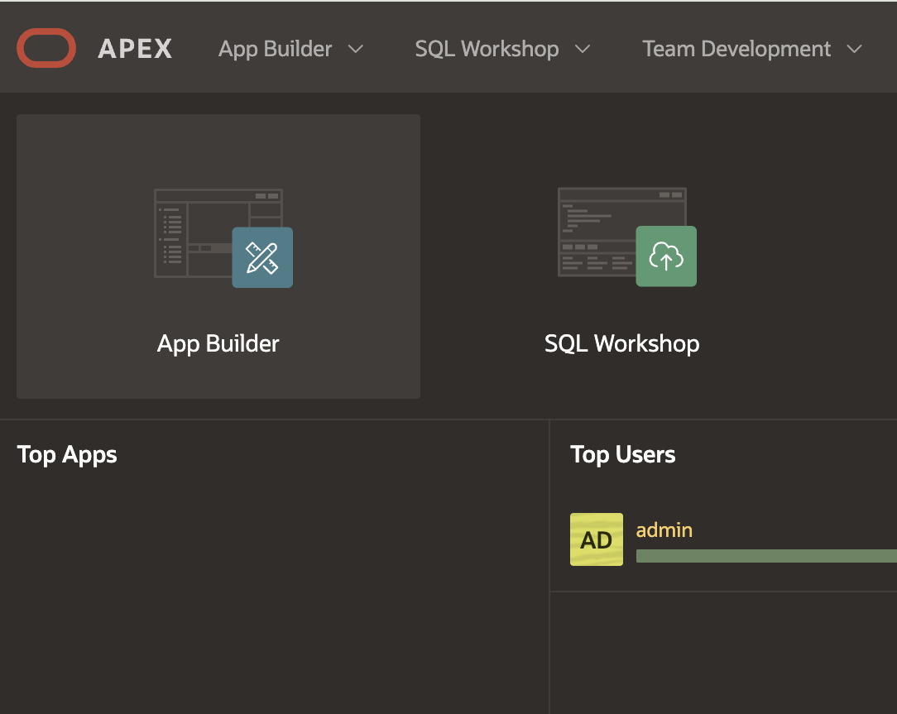

# Get Started

## Introduction

Trusted Answer Search can be deployed on **Oracle Autonomous Database Serverless (ADB-S)** or on-premises using Oracle Database 26ai. This workshop focuses on OCI ADB-S.

**Estimated time:** 5 minutes

### Objectives

* Verify that your green-button reservation has provisioned the Trusted Answer Search environment.
* Locate the Admin URL and Published Wiki Search URL, and confirm your TASADMIN credentials.
* Confirm where to begin the hands-on labs and continue to Lab 1.

### Prerequisites

* The **Admin URL** from your LiveLabs reservation or Terraform `admin_url` output.
* The **Published Wiki Search URL** from your LiveLabs reservation or Terraform `published_wiki_search_url` output.
* The `TASADMIN` username.
* The `TASADMIN` password.

## Task 1: Checkup

Confirm that you have these values:

```text
<copy>
Admin URL
Published Wiki Search URL
TASADMIN username
TASADMIN password
</copy>
```

### If the Direct Admin App URL Does Not Open

The green-button stack normally gives you a direct Admin app URL. If that URL does not open the app, use the APEX home URL instead.

1. Change the URL so it ends with:

    ```text
    <copy>
    /ords/apex
    </copy>
    ```

2. Sign in to the `TASADMIN` workspace with the same username and password.

    

3. Click **App Builder**.

    

4. Open or run **Oracle Trusted Answer Search - Admin App**.

You may now **proceed to the next lab**.

## Acknowledgements

**Authors** 

* Markus Kissling, Product Manager, Trusted Answer Search

**Last Updated Date** - October, 2026
