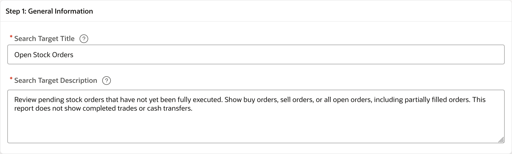
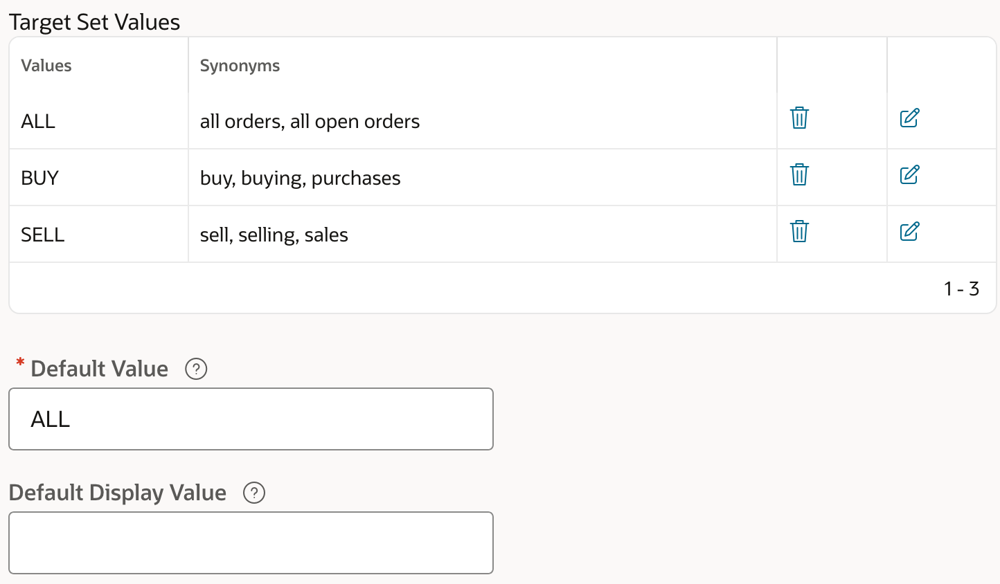
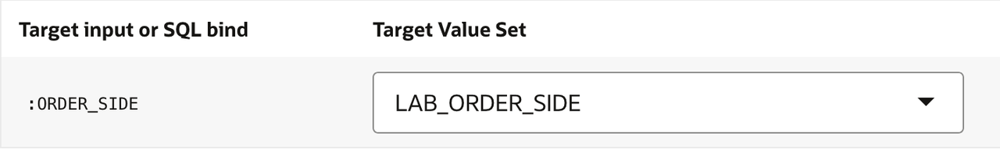
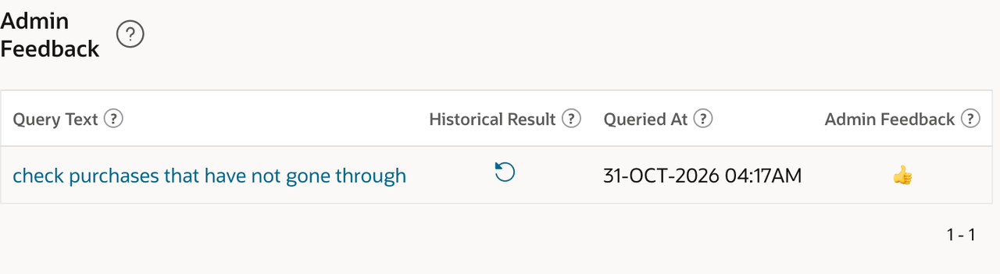
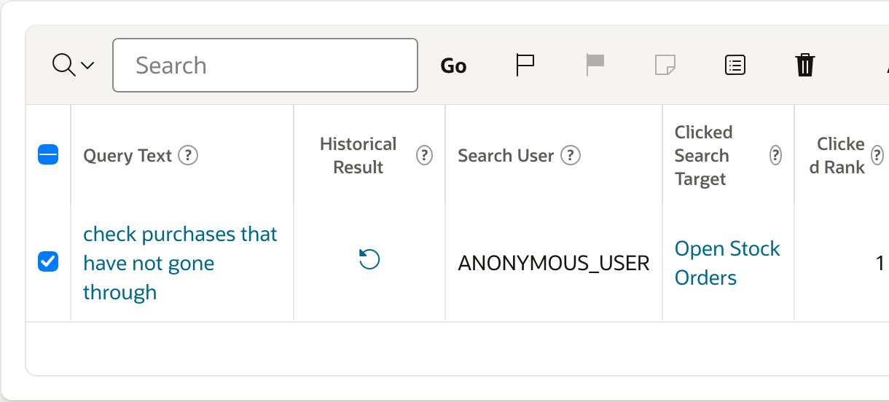
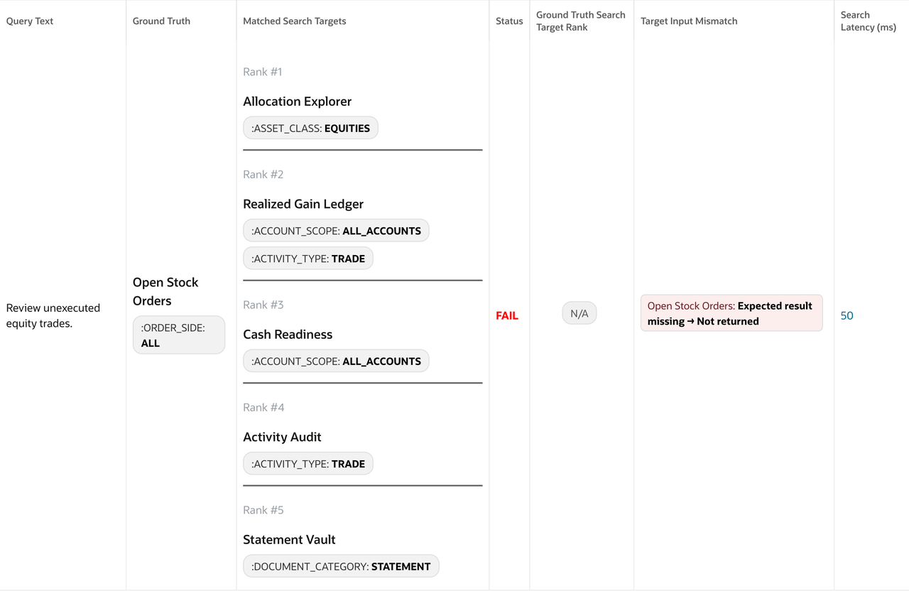
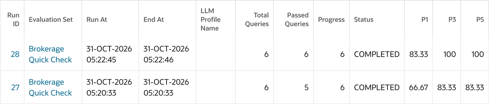

# Add and Evaluate a Search

## Introduction

Start in your new **Brokerage Lab** space and its **LiveLab Draft** version. The imported reports provide the starting configuration; Open Stock Orders is not yet a search target.

Your task is to make the **Open Stock Orders** report discoverable through natural-language search. The report shows stock orders still waiting to be fully executed, and accepts `BUY`, `SELL`, or `ALL` as its order-side input. You will enter the report's details as a search target, then create a target value set to connect words such as **purchases** to those accepted input values.

After completing the target, you will test the search, improve its ranking with administrator feedback, publish it, and save a recorded search as a repeatable evaluation.

## Task 1: Create a Search Target

A search target describes a destination and tells Trusted Answer Search which report to open. Start with the report details; when you reach its input mapping, create the value set from the same form.

### Enter the Report Details

1. Open **Search Targets**, confirm **LiveLab Draft**, and select **Create Target**.
2. Paste the following into **Search Target Title**:

    ```text
    <copy>
    Open Stock Orders
    </copy>
    ```

   Paste the following into **Search Target Description**:

    ```text
    <copy>
    Review pending stock orders that have not yet been fully executed. Show buy orders, sell orders, or all open orders, including partially filled orders. This report does not show completed trades or cash transfers.
    </copy>
    ```

    

    *Enter the report title and description in Step 1: General Information.*

3. In **Step 2: Select Target Action**, choose **URL**. Return to the **Open Stock Orders** report tab and copy its base URL ending in `/open-stock-orders/`, without a query string. Return to the target form, paste that URL, and append:

    ```text
    <copy>
    ?order_side=:ORDER_SIDE
    </copy>
    ```

   The finished URL ends in `/open-stock-orders/?order_side=:ORDER_SIDE`. The placeholder `:ORDER_SIDE` is replaced with `BUY`, `SELL`, or `ALL` when Trusted Answer Search resolves the query.

4. Below the URL, find the detected `:ORDER_SIDE` input. It needs a target value set to supply the report's accepted values and match words such as **purchases** to `BUY`.
5. Select **Create New Target Set** below the input mappings. The **Add Target Value Set** dialog opens over your target form. Complete the next section, then return to finish the target.

### Create the Target Value Set

1. In the dialog, paste the following into **Name**:

    ```text
    <copy>
    LAB_ORDER_SIDE
    </copy>
    ```

   Paste the following into **Description**:

    ```text
    <copy>
    Order side for the Open Stock Orders report
    </copy>
    ```

   For **Source**, select **Manual**.

   **Manual** means that you enter the allowed values and synonyms yourself. This exercise does not use an LLM.

2. Add these three rows. For each row, paste its **Value** and **Synonym(s)**, then select **+ Add** before entering the next row.

   **All orders — Value:**

    ```text
    <copy>
    ALL
    </copy>
    ```

   **Synonym(s):**

    ```text
    <copy>
    all orders, all open orders
    </copy>
    ```

   Select **+ Add**.

   **Buy orders — Value:**

    ```text
    <copy>
    BUY
    </copy>
    ```

   **Synonym(s):**

    ```text
    <copy>
    buy, buying, purchases
    </copy>
    ```

   Select **+ Add**.

   **Sell orders — Value:**

    ```text
    <copy>
    SELL
    </copy>
    ```

   **Synonym(s):**

    ```text
    <copy>
    sell, selling, sales
    </copy>
    ```

   Select **+ Add**.

3. Paste the following into **Default Value**, then select the offered `ALL` value:

    ```text
    <copy>
    ALL
    </copy>
    ```

   Leave **Default Display Value** blank and keep the remaining options unchanged. Select **Save** to return to the search-target form.

    

    *The three value rows, ALL default, and blank Default Display Value should match this view.*

When a query does not identify an order side, the default includes both buys and sells.

### Finish the Search Target

1. In the `:ORDER_SIDE` row under **Target Value Set**, choose the newly created `LAB_ORDER_SIDE`. This connects your values and synonyms to the report's URL input. If the input row is missing, paste the following into **Target input name**, select **Add mapping**, then choose the value set:

    ```text
    <copy>
    :ORDER_SIDE
    </copy>
    ```

    

    *Choose LAB_ORDER_SIDE for the detected :ORDER_SIDE input.*

2. In **Step 3: Target type**, select **Text Target**. This matches the meaning of a query to the target's title, description, and sample queries. Add each example below with **Add Sample Query**:

    ```text
    <copy>
    Show my open buy orders.
    </copy>
    ```

    ```text
    <copy>
    Show my pending sell orders.
    </copy>
    ```

3. Skip the optional tags. Select **Create Search Target** and check that **Open Stock Orders** appears in the draft's targets.

You have connected a new search destination to an existing webpage. Trusted Answer Search does not create the report or place stock orders.

## Task 2: Test Queries and Improve Ranking with Admin Feedback

1. Open **Query Tester**, select **LiveLab Draft**, enter this search query, and press **Enter**:

    ```text
    <copy>
    check purchases that have not gone through
    </copy>
    ```

2. Find **Open Stock Orders** and record its rank before feedback. Because you configured **purchases** as a synonym for `BUY`, that should be its order-side input. Open **Target URL**: the report should show **Buy orders**, **2** open orders, and **60** shares remaining. Return to Query Tester. In the workshop starting configuration, this target ranks third. If your result differs, check **Need Help?** before continuing.
3. Select **Upvote** on **Open Stock Orders** and check for **Admin Upvoted**.
4. Run the **same search query again**:

    ```text
    <copy>
    check purchases that have not gone through
    </copy>
    ```

   Press **Enter** and compare its new rank with the position you recorded. The saved feedback associates this query with the relevant target. Confirm that it moved to rank 1.

   The target value set maps **purchases** to `BUY`. Your upvote improves the ranking of **Open Stock Orders** for this query; it does not supply the `BUY` input.
5. Open **Search Targets** and select **Open Stock Orders**. In **Admin Feedback**, find the exact query **check purchases that have not gone through** and confirm its upvote. The query appears here separately from **Sample Queries**. Close the target and return to **Query Tester**. Use the copy button in step 4 to rerun the same purchase query before continuing.

    

    *The exact query and its upvote are saved under Admin Feedback on the target.*

6. Review a result that does not answer this query. **Income Timeline** shows income rather than unexecuted stock purchases. Select its **Downvote** and confirm the saved feedback. Rerun the query to inspect the results. Downvote applies to this query and target; it does not delete the target. Do not downvote a useful report simply to change the ranking.
7. Run this query:

    ```text
    <copy>
    Show my open orders.
    </copy>
    ```

   Check that its order-side input is `ALL`, the default. You already saw the corresponding four-order report in Get Started.

## Task 3: Publish and Try the Widget

Publishing lets the website's search widget use the tested configuration. Publish only in this disposable workshop environment.

1. Open **Search Spaces**, open the versions for **Brokerage Lab**, and open the three-dot menu for **LiveLab Draft**. Select **Publish**, confirm if prompted, and check that this version is marked **Published**.
2. In the Demo Brokerage website's search tab, paste this query and press **Enter** or select **Search**:

    ```text
    <copy>
    check purchases that have not gone through
    </copy>
    ```

3. Select **Open Stock Orders**. Confirm that the report opens with **Buy orders** selected. This result click is the activity you will inspect next.

## Task 4: Review Telemetry

1. Return to Admin and confirm **Brokerage Lab** is selected. Open **Dashboard** > **Telemetry**, set **Data interval** to **Last Day**, and open **Clicked Search Targets**. Find `check purchases that have not gone through` from the widget search.

    If your query appears under **Searches with No Clicked Search Target**, return to the Demo Brokerage widget and click **Open Stock Orders** in the search results. Then refresh the Dashboard and open **Clicked Search Targets**.

2. Read **Total Searches**, **Searches with a Clicked Result**, and **Click-Through Rate**. The rate divides searches with a clicked result by total searches. Explain which part of your widget activity contributes to each count; Query Tester searches are excluded.

A result click records usage; it does not prove correctness. Next, save the query with the expected target and input so you can check it again after changes.

Dashboard describes published search activity. Query Tester searches are separate and do not count toward the widget's **Total Searches** or **Click-Through Rate**.

## Task 5: Build an Evaluation Set and Improve Search Accuracy

An evaluation set stores queries and their expected targets and inputs. Import a benchmark and add your recorded widget search. Run the six-query set, investigate a failed check, then use administrator feedback and rerun the same set.

### Import the Benchmark and Add Your Widget Search

1. Open **Test Runs**. Confirm **Brokerage Lab** and **LiveLab Draft**, marked **Published**. Select **Create Evaluation Set** and paste this into **Name**:

    ```text
    <copy>
    Brokerage Quick Check
    </copy>
    ```

2. Upload `brokerage-quick-check.json` downloaded in Get Started and select **Create**. The file contains five queries and expected results: four for the imported reports and one for the Open Stock Orders target you created.
3. Open **Dashboard** > **Telemetry** > **Clicked Search Targets**. Set **Data interval** to **Last Day**. Select the checkbox beside `check purchases that have not gone through`, then select the checklist icon, **Add selected searches to an evaluation set**. Choose **Brokerage Quick Check** if prompted.

    

    *Select the query's checkbox, then the checklist icon between the comment and trash icons.*

4. For **Ground Truth Source**, choose **Curate manually**. Click **Search for a target...**, clear the prefilled target, scroll through the list, and select **Open Stock Orders**.
5. Click `:ORDER_SIDE` and select **BUY** from the offered values. Typing without selecting is insufficient. Select **Save to Eval Set**. Your set now contains six queries.

### Run the Evaluation Before Feedback

1. Open **Test Runs** > **Create Test Runs**. Open **Brokerage Quick Check** and confirm **six** queries. The details panel shows five rows per page; select **Next** to inspect the remaining row.

    | Query | Expected target | Expected input |
    | --- | --- | --- |
    | Show how much of my portfolio is in bonds. | Allocation Explorer | `:ASSET_CLASS = FIXED_INCOME` |
    | Show me Oracle stock performance. | Market Lens | `:STOCK_TICKERS = ORCL` |
    | Map my retirement accounts. | Portfolio Map | `:ACCOUNT_SCOPE = RETIREMENT` |
    | Open my brokerage statement. | Statement Vault | `:DOCUMENT_CATEGORY = STATEMENT` |
    | check purchases that have not gone through | Open Stock Orders | `:ORDER_SIDE = BUY` |
    | Review unexecuted equity trades. | Open Stock Orders | `:ORDER_SIDE = ALL` |

2. Close the details panel. Confirm **LiveLab Draft (Published)**. If an LLM selector appears under **Run Options**, choose **Disable LLM**. Clear **Search latency profiling enabled**, then select **Run** beside **Brokerage Quick Check**.
3. Open **View Test Runs** and wait for **COMPLETED**. Record this **Run ID** as your **Before feedback** run. Expect **6 Total Queries**, **5 Passed Queries**, and **P5 = 83.33%**.
4. **Why is P5 below 100%?** Open the **Run ID** and find the query with status **FAIL**: **Review unexecuted equity trades.** Compare its **Ground Truth** with **Matched Search Targets**. The expected result is **Open Stock Orders**, input `ALL`, but it is absent from the five returned results. Confirm that the other five queries pass before continuing. If a different check fails, stop and report the result to the workshop owner.

    

    *Ground Truth identifies the expected report and input. FAIL and Expected result missing show that the report was not returned.*

The customer uses different words: **equity** means stock, and **unexecuted** means awaiting execution. Open Stock Orders answers this request. No buy or sell side is specified, so the expected input is `ALL`. You already created the target; the failed check reveals a retrieval problem.

For these questions, **PASS** means the expected target is returned with the expected input, even below rank 1. **P1**, **P3**, and **P5** measure how often expected targets appear within the first one, three, and five results. Five of six targets within the top five gives P5 = 83.33%.

### Correct the Missing Match

For this comparison, use the following sequence:

1. Set **Edit Published Versions? → Yes** so you can save administrator feedback on the published version.
2. Apply feedback and rerun the evaluation against that **same version**.
3. Set **Edit Published Versions? → No** to prevent further edits. Your saved feedback remains effective.

Follow these steps to apply the feedback:

1. Open **Settings**. Under **Search Space Settings**, confirm **Brokerage Lab**, set **Edit Published Versions?** to **Yes**, and select **Save** in that section. This allows you to save feedback on the published version used in your first evaluation.
2. Open **Query Tester**, confirm **LiveLab Draft (Published)**, paste the same query, and press **Enter**:

    ```text
    <copy>
    Review unexecuted equity trades.
    </copy>
    ```

3. Select **Choose Another Target**. Paste the following into the search box and select **Go**:

    ```text
    <copy>
    Open Stock Orders
    </copy>
    ```

4. Select the radio button beside **Open Stock Orders**, then click **Choose to mark as best**. This upvotes the report for this query.
5. Back in **Query Tester**, click the query field and press **Enter** to rerun the same search. Confirm **Open Stock Orders** appears at **rank 1** with `:ORDER_SIDE = ALL`.

### Run the Same Evaluation Again

1. Open **Test Runs** > **Create Test Runs**. Keep **LiveLab Draft (Published)** and **Brokerage Quick Check** selected. Choose **Disable LLM** if shown and clear **Search latency profiling enabled** again; it can be selected again when you return to this page. Select **Run**.
2. Open **View Test Runs**, wait for **COMPLETED**, and record the new **Run ID** as **After feedback**. Compare it with your first run:

    | Check | Before feedback | After feedback |
    | --- | --- | --- |
    | Total Queries | 6 | 6 |
    | Passed Queries | 5 | 6 |
    | P5 | 83.33% | 100% |
    | Query: **Review unexecuted equity trades.** | Not returned | Rank 1, input `ALL` |

    

    *In this example, run 27 (lower row) is before feedback and run 28 (upper row) is after feedback. Your run IDs will differ.*

3. Open the new **Run ID**. Confirm **Review unexecuted equity trades.** now shows **PASS** with **Open Stock Orders**, rank **1**, and `:ORDER_SIDE = ALL`. Check that the other five queries still pass, including the purchase query with `BUY`.
4. Compare **P1** and **P3** as well. In the verified workshop run, P1 changed from **66.67% to 83.33%** and P3 from **83.33% to 100%**. The bond query still passed at rank 2, so P1 remained below 100%.
5. Return to **Settings** > **Search Space Settings** for **Brokerage Lab**, set **Edit Published Versions?** to **No**, and select **Save**. Your feedback remains saved.

You first improved a report that was already retrieved for the purchase query. Here, feedback brought a missing report into the results, and the unchanged evaluation measured the improvement. If the documented baseline or final checks differ, stop and report both run IDs to the workshop owner; do not change the expected answers to make the run pass.

## Task 6: Verify a Sell-Order Search

Check that the report also opens correctly for a sell-order query.

1. Open **Query Tester**. Select **Brokerage Lab** and the version labeled **LiveLab Draft**, now marked **Published**.
2. Paste this query and press **Enter**:

    ```text
    <copy>
    check sales that have not gone through
    </copy>
    ```

3. Find **Open Stock Orders** in the results. Record its rank and check that its resolved input is `:ORDER_SIDE = SELL`.
4. Select **Target URL** for that result. Check these fields on the report:

    | Report field | Expected value |
    | --- | --- |
    | Order side | **Sell orders** |
    | Open orders | **2** |
    | Shares remaining | **25** |

Your `LAB_ORDER_SIDE` value set maps **sales** to `SELL`. The search target's URL passes that value to the report. The saved evaluation contains **six** queries and checks both `BUY` and `ALL` for this report; this additional Query Tester search is not added to the evaluation set.

## Acknowledgements

**Authors:** Markus Kissling, Akshay S Kulkarni, and Kishy Kumar

**Last Updated Date:** October 2026
