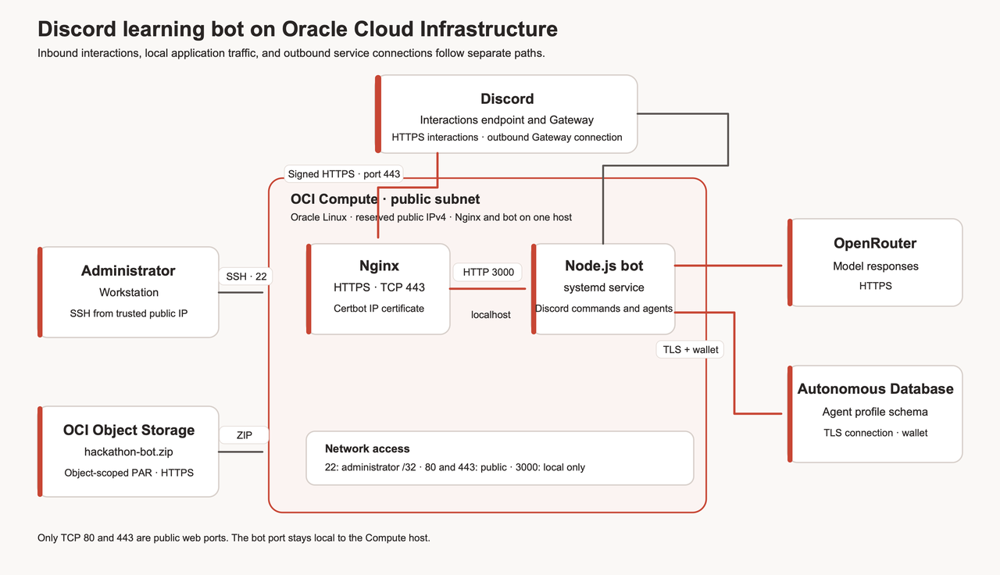

# Build the WeMakeDevs Discord Learning Bot with Oracle Autonomous Database

## Introduction

Build and deploy a Discord learning bot. It answers prompts, researches topics, creates study guides and quizzes, teaches Oracle Cloud topics, and runs reusable learning agents.

Run the bot on OCI Compute. Nginx handles Discord HTTPS and forwards requests to the bot on the same host. Certbot gets and renews a short-lived certificate for the reserved public IP. You do not need a domain. The bot uses a separate Discord Gateway connection for mentions. OpenRouter supplies model responses. Autonomous Database stores agent profiles.

Estimated Workshop Time: 120 minutes.

### Objectives

In this workshop, you will:

- Prepare an OCI host, network rules, Autonomous Database, and TLS endpoint.
- Download an approved bot package from OCI Object Storage.
- Configure a Discord application and OpenRouter without committing credentials.
- Set up database access and scan the agent-profile schema.
- Run the bot as a Linux service and verify its current features.

### Prerequisites

- OCI access to create Compute, VCN, Autonomous Database, and Object Storage resources.
- Discord Developer Portal access and a private server where you can install a test bot.
- An OpenRouter API key and a model available to your account.
- Reserve a public IPv4 address. The workshop uses an IP certificate, so you do not need a domain or DNS account.
- The [hackathon-bot ZIP in OCI Object Storage](https://c4u02.objectstorage.us-ashburn-1.oci.customer-oci.com/p/9DEArLjsgbKXuJgQtSG95E8hMXRFtxgHR8jiHbqz4HgyVYXVnSo0SC_s-zq5CJA3/n/c4u02/b/hosted-files/o/hackathon-bot.zip).
- A workstation with a browser, SSH/SFTP client, and a secure password manager.

## Architecture

Keep Compute port 3000 closed to public ingress. Nginx proxies traffic locally to the bot on that port. Permit public TCP 80 for Certbot validation and redirects, and TCP 443 for Discord HTTPS. Keep SSH limited to the administrator IP.

The ZIP excludes `.env`, wallet files, and credentials. Download the wallet from Autonomous Database, transfer it securely to Compute, and create `.env` there. Use synthetic data. Channel members can see bot replies in a server channel.

## Workshop Labs

1. Lab 1: Prepare OCI Compute, Autonomous Database, wallet access, and an HTTPS endpoint (35 minutes).
2. Lab 2: Download the bot package and configure Discord and OpenRouter (25 minutes).
3. Lab 3: Set up Autonomous Database accounts and connect the bot (30 minutes).
4. Lab 4: Run the service and verify Discord workflows (30 minutes).

## Acknowledgements

- Authors: Cyrce Salinas Rojas and Ilan Gómez Guerrero
- Last Updated: Ilan Gómez Guerrero, November 2026
