# Lab 1: Prepare OCI Compute, Autonomous Database, and HTTPS

## Introduction

Prepare OCI for the bot. Create a Linux host and an Autonomous Database. Download the wallet from the database console. Use Nginx and a Let’s Encrypt IP certificate for HTTPS. You do not need a domain.

Estimated Time: 35 minutes.

### Objectives

In this lab, you will:

- Create an OCI Compute host and restrict administrator access.
- Install system-wide Node.js 24 for the bot service.
- Create an Autonomous Database for agent profiles.
- Download and securely transfer the database wallet.
- Configure Nginx HTTPS on the Compute host and keep the bot port private.
- Confirm the host, database, and network are ready for the bot package.

### Prerequisites

- Completion of the workshop Introduction.
- OCI Console permissions for Compute, VCN, and Autonomous Database.
- A reserved public IPv4 address for Compute. Use it for Discord HTTPS and the IP certificate. You do not need a domain or DNS setup.
- A secure location for the SSH private key and wallet ZIP.
- A region and compartment with service limits and capacity for these resources.

### Architecture and Port Plan

| Flow | Destination | Allowed source |
| --- | --- | --- |
| SSH administration | Compute TCP 22 | Your public IP with `/32` mask |
| Public Discord endpoint | Compute TCP 80 and 443 | Internet; Nginx serves HTTP challenge files and HTTPS |
| Bot traffic | Compute TCP 3000 | Nginx on the same host; do not allow it in OCI ingress rules |
| Bot outbound calls | OpenRouter, Discord Gateway, ADB TLS | Compute host |

Keep Compute TCP 3000 closed to the internet. Nginx accepts HTTPS on port 443 and proxies requests to the bot at `127.0.0.1:3000`.

## Task 1: Create Compute and Network Access

1. Sign in to the [OCI Console](https://cloud.oracle.com/) and open **Compute** > **Instances**. Select **Create instance**.

    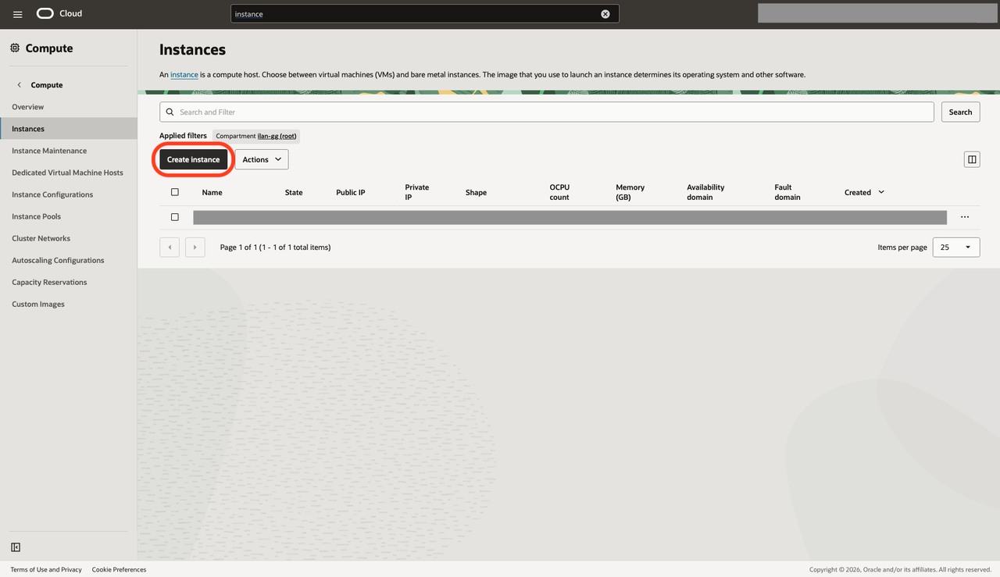

2. Enter a name such as `discord-bot-host`. Choose **Oracle Linux 9** as the image. The example uses an Arm-based `VM.Standard.A1.Flex` shape. If your region has no A1 capacity, select another supported flexible shape and use the same Oracle Linux release.

    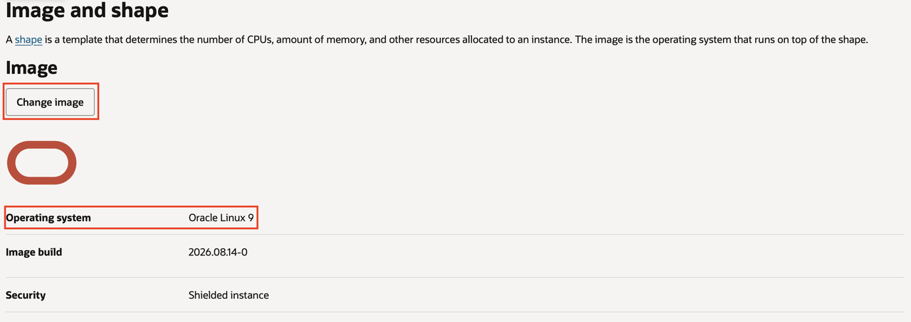

3. Set the shape to 2 OCPUs and 12 GB of memory. Review the estimated cost and confirm that the shape is available in your region before launching.

    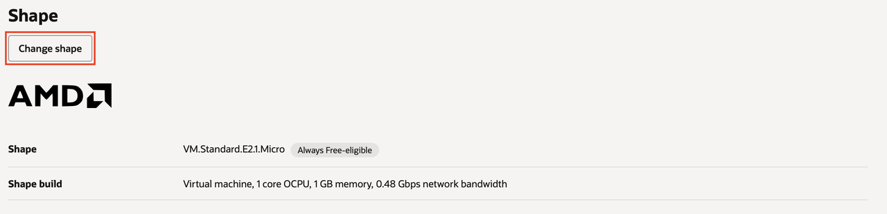

    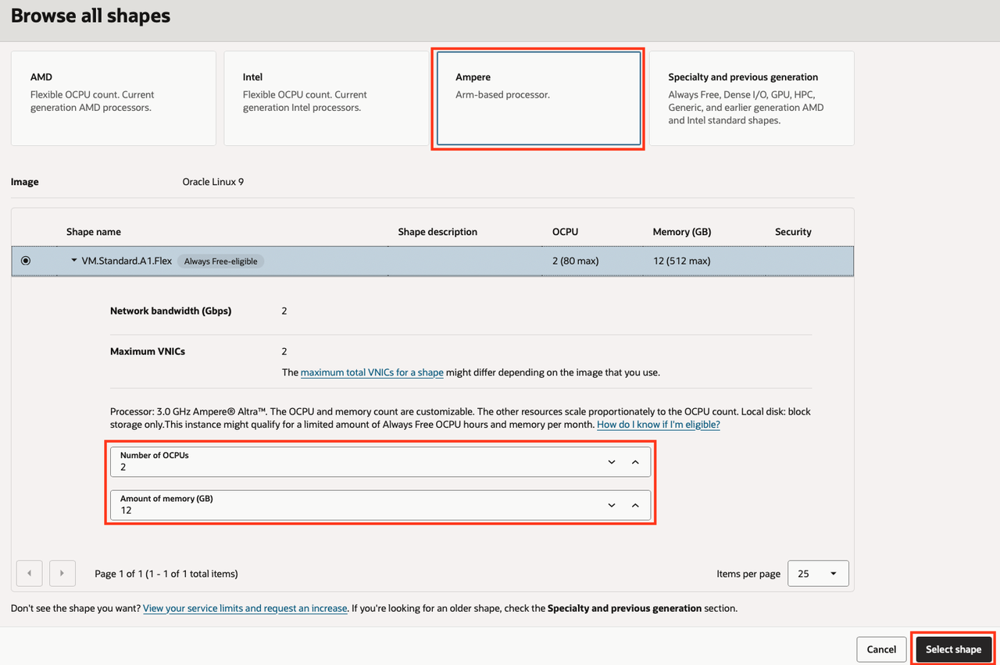

4. Under **Networking**, create a VCN if you do not already have one for this workshop. Use a VCN CIDR such as `10.0.0.0/16` and a public subnet CIDR such as `10.0.0.0/24`. Ensure the subnet route table has a route to an Internet Gateway. Associate the primary VNIC of the instance with this subnet.

    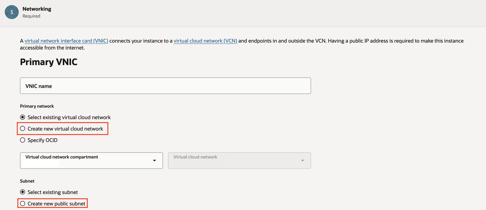

5. Under **Add SSH keys**, choose **Generate a key pair** and download the private key. Or provide a public key you control. Store the private key securely; OCI will not let you download it again.

    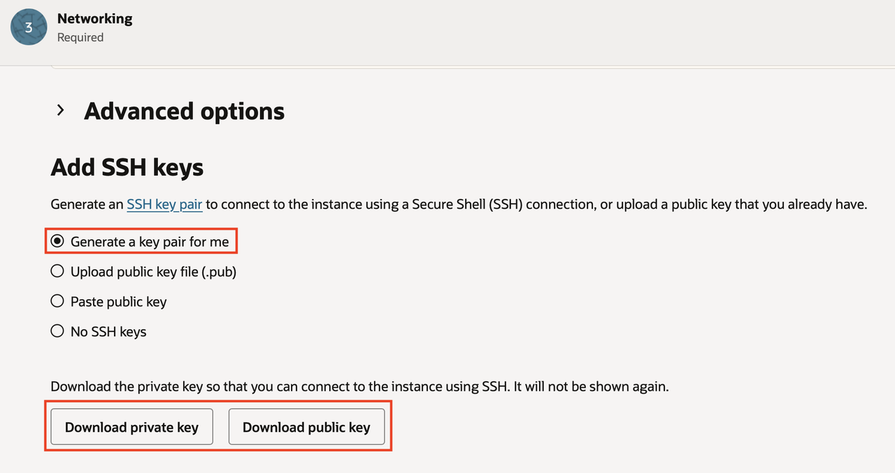

6. Review the remaining settings and select **Create**. Wait until the instance state is **Running**.

7. Open the instance details, then follow **Primary VNIC** to the subnet and its attached **Security Lists**.

    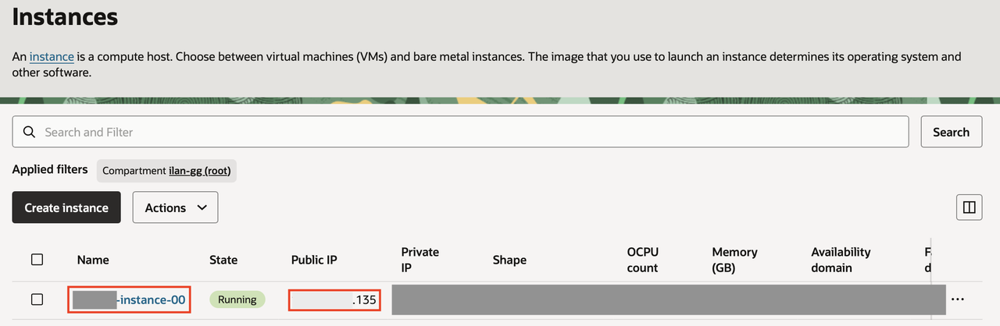

    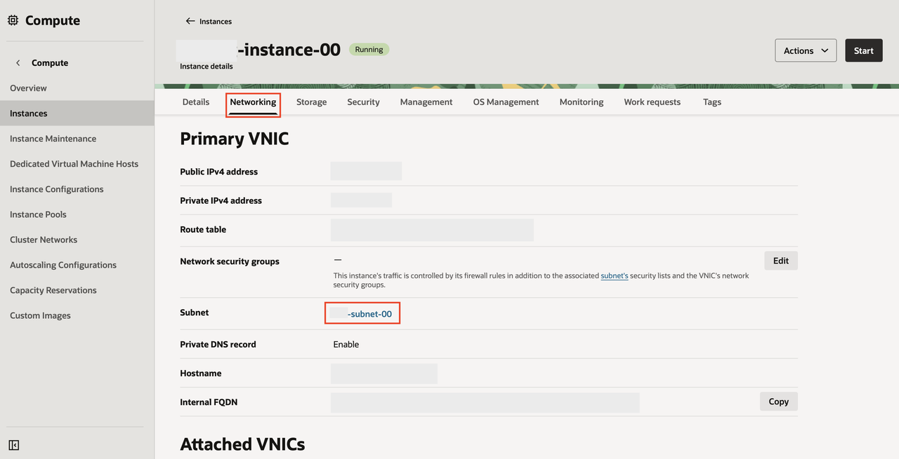

    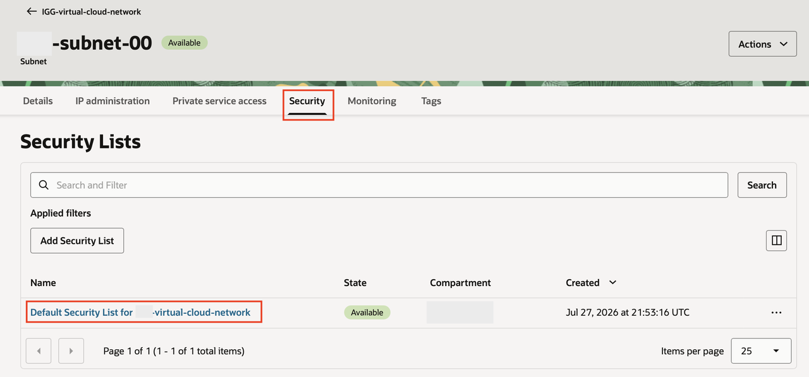

8. Add an **Ingress Rule** for SSH from your administrator workstation. Use your current public IP with a `/32` mask. Do not use `0.0.0.0/0` for SSH.

    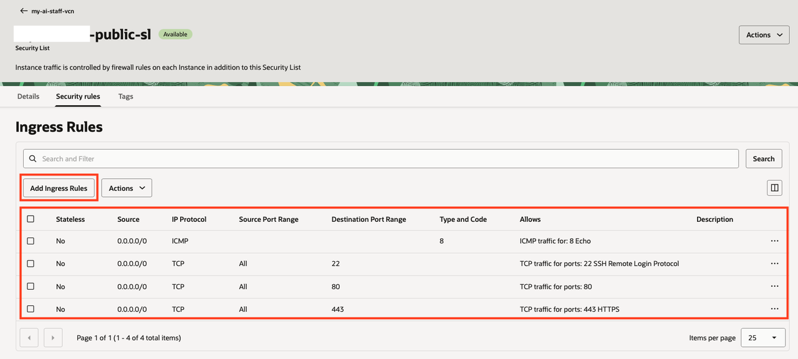

    | Field | Value |
    | --- | --- |
    | Source type | CIDR |
    | Source CIDR | `<your-public-ip>/32` |
    | IP protocol | TCP |
    | Destination port range | `22` |
    | Description | `SSH from administrator workstation` |

    This rule lets you administer the host. Discord does not use SSH. The screenshot shows an existing SSH rule from `0.0.0.0/0`; delete it, then add the `/32` rule above. TCP `80` and `443` may remain public for Nginx and Certbot. Keep port `3000` closed to the internet.

    In Task 4, add these web rules:

    | Resource | Ingress rule | Purpose |
    | --- | --- | --- |
    | Compute host | TCP `80` from `0.0.0.0/0` | Nginx serves Certbot checks and redirects HTTP. |
    | Compute host | TCP `443` from `0.0.0.0/0` | Nginx receives Discord HTTPS requests. |

    Do not add an ingress rule for port `3000`. Nginx and the bot run on the same host. Discord Gateway uses outbound connections and needs no inbound rule.

    Keep existing egress rules unless your tenancy has a custom network policy.

9. Check whether the primary VNIC already has a public IPv4 address. If it does, record it for SSH and continue. If the field shows `-`, open **Networking** and select the **Primary VNIC**.

    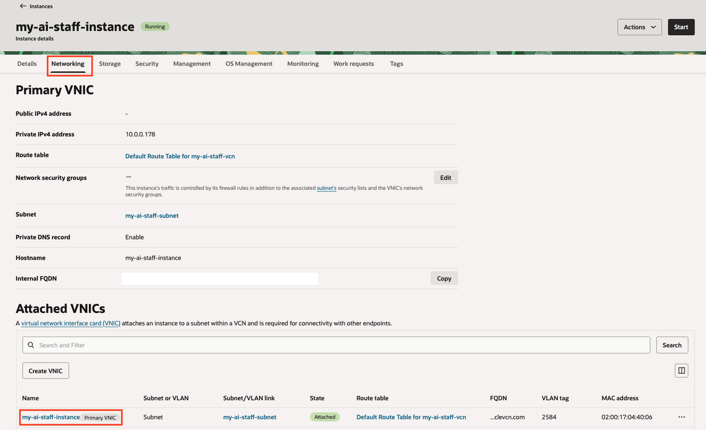

10. On the VNIC page, open **IP administration**. In the private IP row, open the actions menu and select **Edit**.

    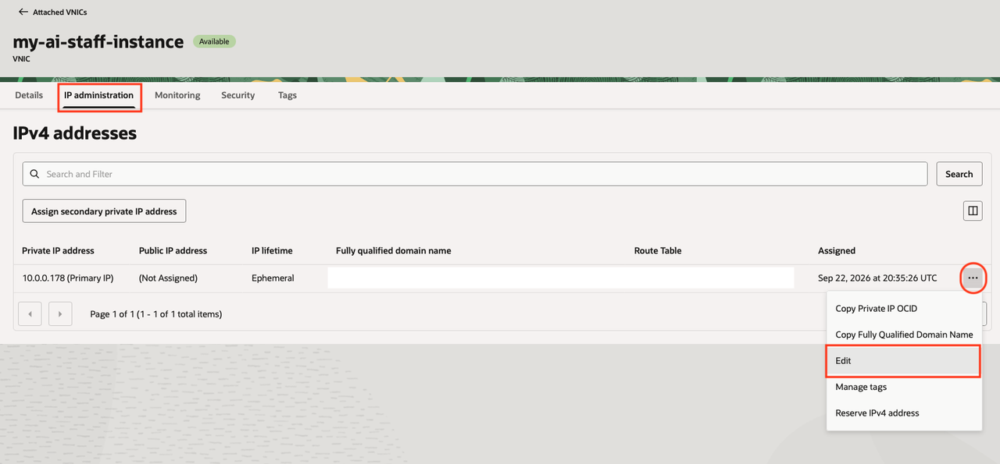

11. Select **Reserved public IP**. Create or select a reserved address for this instance; the IP certificate and Discord endpoint depend on a stable address. Keep **Use VCN, subnet or VNIC route table** selected, then select **Update**.

    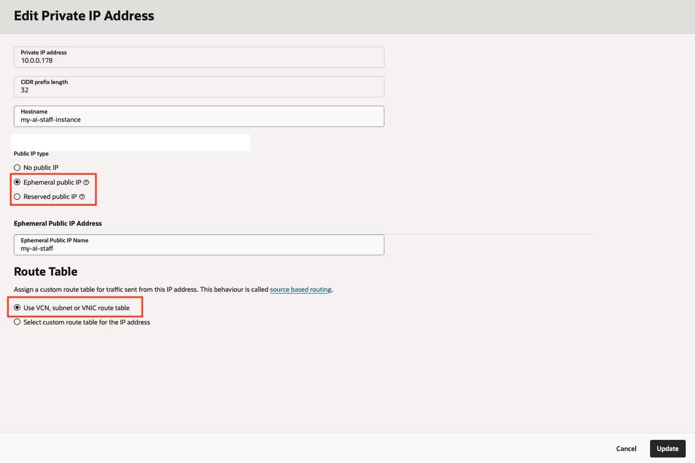

12. Return to the instance details and record the **Reserved Public IPv4 address**. Restrict SSH to your workstation IP as described above. Use this IP directly for the certificate and Discord endpoint; you do not need a domain or DNS record.

## Task 2: Install Node.js and Host Tools

1. On your workstation, open a terminal. Use the private key you downloaded in Task 1 and the instance reserved public IP. Replace both placeholders with the actual file name and IP. Keep the key private.

    ```sh
    <copy>
    chmod 600 ~/Downloads/YOUR_PRIVATE_KEY
    ssh -i ~/Downloads/YOUR_PRIVATE_KEY opc@YOUR_RESERVED_PUBLIC_IP
    </copy>
    ```

    If you saved the key elsewhere, use its actual path. After the SSH command succeeds, verify that your prompt identifies the `opc` account on the Compute host.

2. From the SSH session, update Oracle Linux and install Nano and the ZIP utility.

    ```sh
    <copy>
    sudo dnf update -y
    sudo dnf install -y nano unzip
    </copy>
    ```

3. Install the system Node.js 24 module. Use the system executable for the bot service.

    ```sh
    <copy>
    sudo dnf module reset -y nodejs
    sudo dnf module install -y nodejs:24
    /usr/bin/node --version
    /usr/bin/npm --version
    </copy>
    ```

    Confirm that Node reports version 24. Do not install Node through NVM for this systemd service; the guide uses `/usr/bin/node`.

## Task 3: Create Autonomous Database and Download the Wallet

1. In OCI Console, open **Oracle AI Database** > **Autonomous AI Database** and select **Create Autonomous AI Database**. Enter the database name and compartment. The first image shows the creation form with Lakehouse selected; choose **Transaction Processing** for this workshop, as shown in the second image. Select a supported version and a shape and storage that fit the workshop. Always Free capacity varies by region and tenancy.

    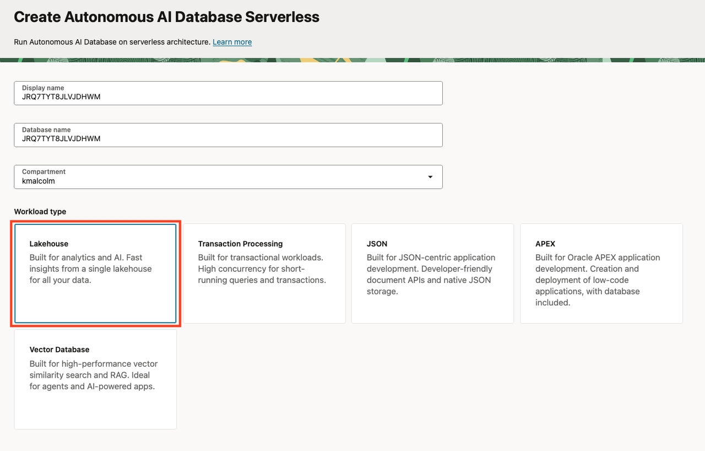

    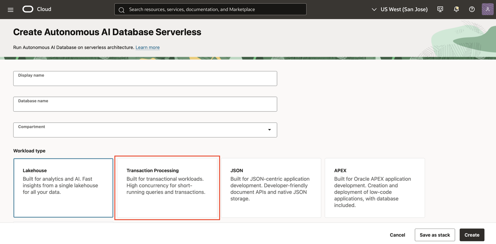

2. Set a database administrator password in your password manager. Start database creation and wait until the state is **Available**.

3. Open the database details page, select **Database connection**, and download the instance wallet. Set a strong wallet password. Keep the downloaded ZIP on your workstation until you transfer it over SSH.

    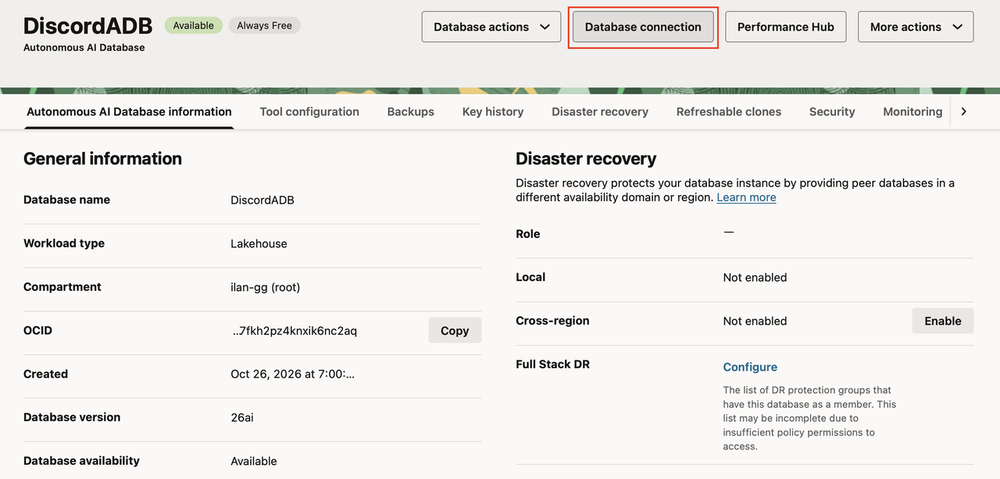

    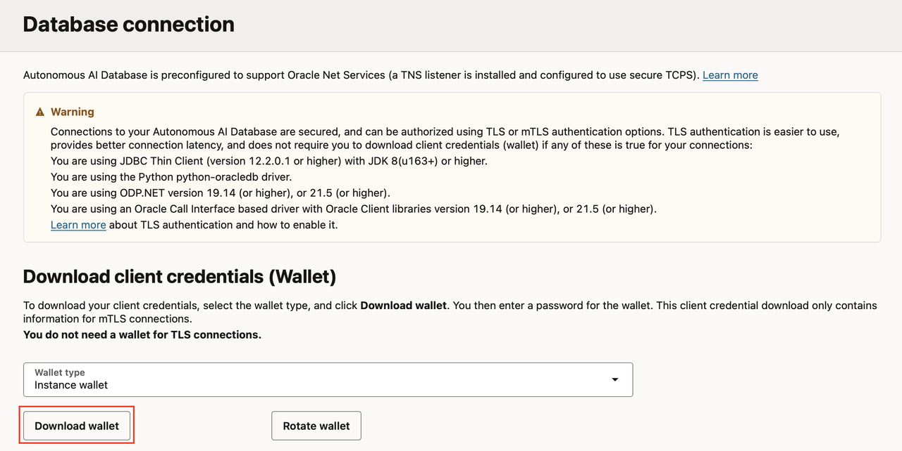

4. From your workstation, create the bot directory on Compute and transfer the wallet. Replace the key filename and host address. Do not put the wallet password in a command.

    ```sh
    <copy>
    ssh -i ~/Downloads/<private-key-file> opc@<compute-public-ip> \
      'install -d -m 700 /home/opc/hackathon-bot'
    scp -i ~/Downloads/<private-key-file> \
      ~/Downloads/<database-wallet.zip> \
      opc@<compute-public-ip>:/home/opc/hackathon-bot/wallet.zip
    </copy>
    ```

5. On Compute, extract the wallet into the protected directory. Keep the wallet ZIP in the bot directory. Restrict access to its owner.

    ```sh
    <copy>
    chmod 600 /home/opc/hackathon-bot/wallet.zip
    unzip -o /home/opc/hackathon-bot/wallet.zip \
      -d /home/opc/hackathon-bot/wallet
    chmod 600 /home/opc/hackathon-bot/wallet.zip
    chmod 700 /home/opc/hackathon-bot/wallet
    chmod 600 /home/opc/hackathon-bot/wallet/*
    ls -l /home/opc/hackathon-bot/wallet
    </copy>
    ```

6. Confirm that the wallet contains `tnsnames.ora` and `ewallet.pem`. Save the wallet password in your password manager. Do not put the wallet or its password in the Object Storage package.

## Task 4: Configure HTTPS with Nginx and Certbot

1. In the OCI Console, open the Compute subnet security list or the instance NSG. Add these ingress rules:

    | Source type | Source CIDR | Protocol | Destination port | Purpose |
    | --- | --- | --- | --- | --- |
    | CIDR | `0.0.0.0/0` | TCP | `80` | Certbot HTTP validation and HTTP redirect |
    | CIDR | `0.0.0.0/0` | TCP | `443` | Public HTTPS for Discord |

    Allow SSH only from your workstation IP with `/32`. Keep port `3000` closed.

2. Connect to the Compute host over SSH. Install Nginx and the text editor:

    ```sh
    <copy>
    sudo dnf install -y nginx nano
    </copy>
    ```

3. Allow Nginx to connect to the local Node.js app through SELinux. Open the HTTP and HTTPS services in `firewalld`:

    ```sh
    <copy>
    sudo setsebool -P httpd_can_network_connect 1
    sudo firewall-cmd --permanent --add-service=http
    sudo firewall-cmd --permanent --add-service=https
    sudo firewall-cmd --reload
    sudo systemctl enable --now nginx
    </copy>
    ```

4. Create the Certbot webroot and an HTTP Nginx site. Replace `YOUR_PUBLIC_IP` with the reserved IPv4 address from Task 1.

    ```sh
    <copy>
    sudo mkdir -p /usr/share/nginx/html/.well-known/acme-challenge
    sudo chmod -R 755 /usr/share/nginx/html/.well-known
    sudo tee /etc/nginx/conf.d/hackathon-bot.conf >/dev/null <<'EOF'
    server {
        listen 80;
        server_name YOUR_PUBLIC_IP;

        location /.well-known/acme-challenge/ {
            root /usr/share/nginx/html;
        }

        location / {
            proxy_pass http://127.0.0.1:3000;
            proxy_http_version 1.1;
            proxy_set_header Host $host;
            proxy_set_header X-Real-IP $remote_addr;
            proxy_set_header X-Forwarded-For $proxy_add_x_forwarded_for;
            proxy_set_header X-Forwarded-Proto $scheme;
        }
    }
    EOF
    sudo nginx -t
    sudo systemctl reload nginx
    </copy>
    ```

    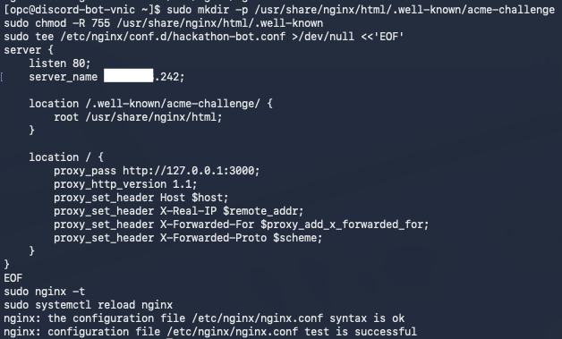

5. Test the HTTP challenge path. On Compute, create a test file and request it locally. From a computer outside OCI, request the same file by public IP. The response must not time out.

    ```sh
    <copy>
    sudo touch /usr/share/nginx/html/.well-known/acme-challenge/test
    curl -i http://127.0.0.1/.well-known/acme-challenge/test
    </copy>
    ```

    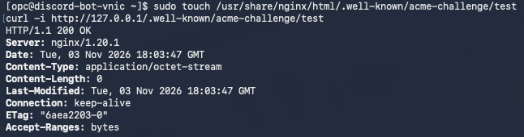

    From your workstation, replace `YOUR_PUBLIC_IP` and request the public path:

    ```sh
    <copy>
    curl -i http://YOUR_PUBLIC_IP/.well-known/acme-challenge/test
    </copy>
    ```

    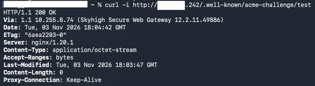

6. Install Certbot 5.4 or newer from Snap. After the reboot, reconnect to Compute and wait for Snap initialization before installing Certbot.

    ```sh
    <copy>
    sudo dnf install -y oracle-epel-release-el9
    sudo dnf config-manager --set-enable ol9_developer_EPEL
    sudo dnf install -y snapd
    sudo systemctl enable --now snapd.socket
    sudo ln -sfn /var/lib/snapd/snap /snap
    sudo reboot
    </copy>
    ```

    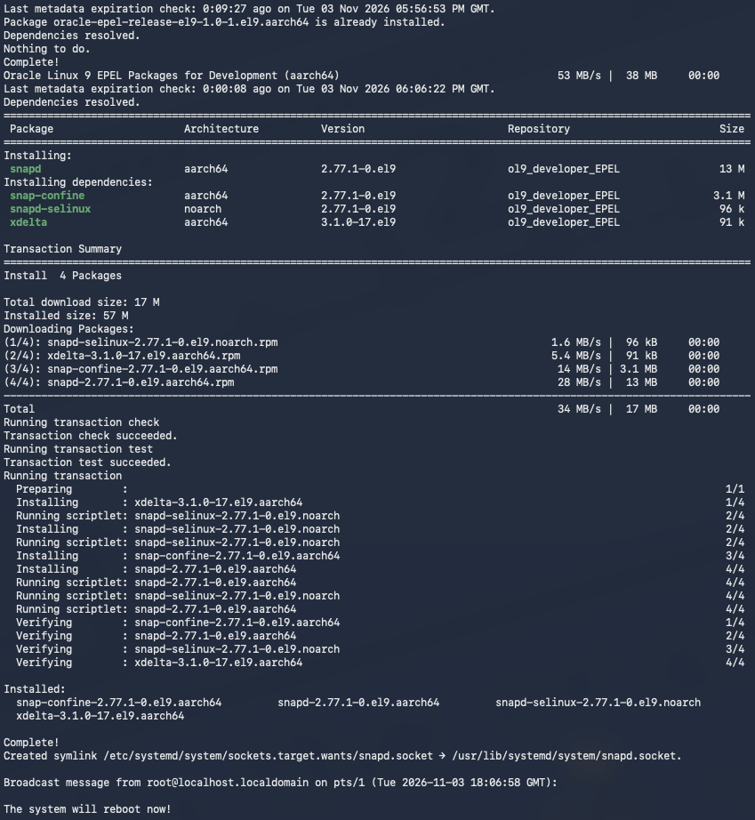

    After reconnecting, run:

    ```sh
    <copy>
    sudo snap wait system seed.loaded
    sudo snap install --classic certbot
    sudo ln -sf /snap/bin/certbot /usr/local/bin/certbot
    sudo /snap/bin/certbot --version
    </copy>
    ```

    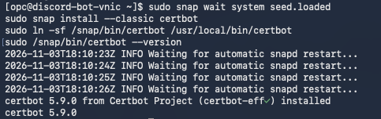

    Confirm the installed version is 5.4 or newer. Use `/snap/bin/certbot` with `sudo` so the command path is explicit.

7. First request a staging IP certificate. Replace `YOUR_PUBLIC_IP` with the reserved public address. At Certbot prompts, enter a contact email and accept the terms.

    ```sh
    <copy>
    sudo /snap/bin/certbot certonly --staging --preferred-profile shortlived --webroot --webroot-path /usr/share/nginx/html --cert-name ip-test --ip-address YOUR_PUBLIC_IP
    </copy>
    ```

    If the staging request succeeds, remove the test certificate:

    ```sh
    <copy>
    sudo /snap/bin/certbot delete --cert-name ip-test
    </copy>
    ```

    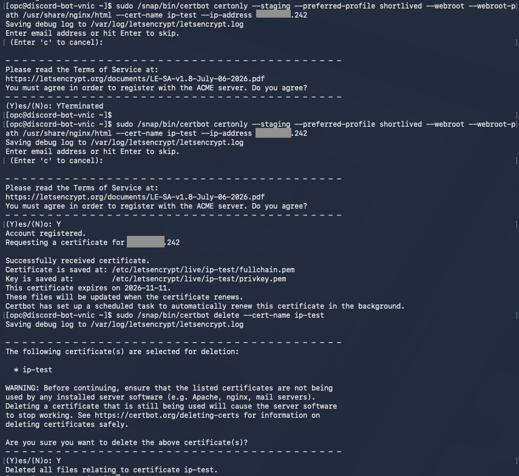

8. Request the publicly trusted IP certificate:

    ```sh
    <copy>
    sudo /snap/bin/certbot certonly --preferred-profile shortlived --webroot --webroot-path /usr/share/nginx/html --ip-address YOUR_PUBLIC_IP
    sudo /snap/bin/certbot certificates
    </copy>
    ```

    Let’s Encrypt IP certificates expire after about six days. Certbot must renew them automatically. The certificate files are normally `/etc/letsencrypt/live/YOUR_PUBLIC_IP/fullchain.pem` and `/etc/letsencrypt/live/YOUR_PUBLIC_IP/privkey.pem`. Keep the private key off the workshop ZIP.

9. Replace the HTTP-only site with an HTTP redirect and HTTPS reverse proxy. Run this command as shown to create the configuration with `YOUR_PUBLIC_IP` placeholders:

    ```sh
    <copy>
    sudo tee /etc/nginx/conf.d/hackathon-bot.conf >/dev/null <<'EOF'
    server {
        listen 80;
        server_name YOUR_PUBLIC_IP;

        location /.well-known/acme-challenge/ {
            root /usr/share/nginx/html;
        }

        location / {
            return 301 https://$host$request_uri;
        }
    }

    server {
        listen 443 ssl;
        server_name YOUR_PUBLIC_IP;

        ssl_certificate /etc/letsencrypt/live/YOUR_PUBLIC_IP/fullchain.pem;
        ssl_certificate_key /etc/letsencrypt/live/YOUR_PUBLIC_IP/privkey.pem;
        ssl_protocols TLSv1.2 TLSv1.3;

        location / {
            proxy_pass http://127.0.0.1:3000;
            proxy_http_version 1.1;
            proxy_set_header Host $host;
            proxy_set_header X-Real-IP $remote_addr;
            proxy_set_header X-Forwarded-For $proxy_add_x_forwarded_for;
            proxy_set_header X-Forwarded-Proto $scheme;
        }
    }
    EOF
    </copy>
    ```

    Open the file in Nano:

    ```sh
    <copy>
    sudo nano /etc/nginx/conf.d/hackathon-bot.conf
    </copy>
    ```

    Press `Ctrl+\`, enter `YOUR_PUBLIC_IP`, and press **Enter**. Enter the reserved IPv4 address from Task 1, press **Enter**, then press `A` to replace every occurrence. Press `Ctrl+O`, **Enter** to save, then `Ctrl+X` to exit.

    Validate the edited configuration and reload Nginx:

    ```sh
    <copy>
    sudo nginx -t
    sudo systemctl reload nginx
    </copy>
    ```

    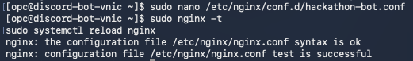

10. Add a deploy hook so Nginx reloads after Certbot renews the short-lived certificate. Then test renewal and confirm the Certbot timer is active.

    ```sh
    <copy>
    sudo mkdir -p /etc/letsencrypt/renewal-hooks/deploy
    sudo tee /etc/letsencrypt/renewal-hooks/deploy/reload-nginx.sh >/dev/null <<'EOF'
    #!/bin/sh
    systemctl reload nginx
    EOF
    sudo chmod +x /etc/letsencrypt/renewal-hooks/deploy/reload-nginx.sh
    sudo /snap/bin/certbot renew --dry-run
    sudo snap services certbot
    </copy>
    ```

    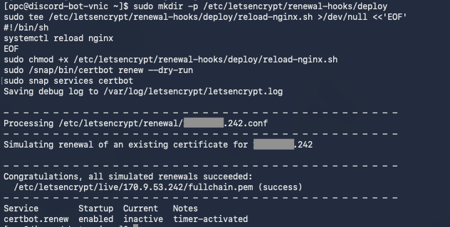

    The Discord interactions endpoint will be `https://YOUR_PUBLIC_IP/interactions`. Enter this URL in the Discord application settings in Lab 2. See [Let’s Encrypt IP certificate instructions](https://letsencrypt.org/2026/03/11/shorter-certs-certbot).

## Task 5: Check the Foundation

1. From the Compute host, confirm the expected Node.js version and the wallet files.

    ```sh
    <copy>
    node --version
    npm --version
    sudo systemctl is-active nginx
    sudo nginx -t
    test -r /home/opc/hackathon-bot/wallet/tnsnames.ora
    test -r /home/opc/hackathon-bot/wallet/ewallet.pem
    </copy>
    ```

2. From your workstation, replace `YOUR_PUBLIC_IP` and test HTTPS:

    ```sh
    <copy>
    curl -sS -o /dev/null -w 'HTTP %{http_code}; TLS verification %{ssl_verify_result}\n' https://YOUR_PUBLIC_IP/
    </copy>
    ```

    Expect a `502` until Lab 2 starts the bot. A TLS result of `0` confirms the certificate.

3. Continue to Lab 2. After the bot starts on port 3000, Nginx will proxy requests to it.

## Acknowledgements

- Authors: Cyrce Salinas Rojas and Ilan Gómez Guerrero
- Last Updated: Ilan Gómez Guerrero, November 2026
