# Lab 2: Download the Bot and Configure Discord and OpenRouter

## Introduction

Download and configure the bot. Set up Discord and OpenRouter on Compute, register the slash commands, and start the app.

Estimated Time: 25 minutes.

### Objectives

In this lab, you will:

- Download and inspect the bot ZIP through the workshop object-scoped PAR.
- Configure Discord slash-command and interaction settings.
- Add OpenRouter settings without recording credential values in the workshop.
- Install locked dependencies, register six commands, and start the bot.

### Prerequisites

- Finish Lab 1. You need system Node.js 24, SSH access, a reserved IP, and a valid IP certificate.
- The [hackathon-bot ZIP in OCI Object Storage](https://c4u02.objectstorage.us-ashburn-1.oci.customer-oci.com/p/9DEArLjsgbKXuJgQtSG95E8hMXRFtxgHR8jiHbqz4HgyVYXVnSo0SC_s-zq5CJA3/n/c4u02/b/hosted-files/o/hackathon-bot.zip).
- Discord Developer Portal access and a private test server.
- An OpenRouter API key and model name available to your account.

## Task 1: Download and Inspect the Bot Package

1. Open the [hackathon-bot ZIP link](https://c4u02.objectstorage.us-ashburn-1.oci.customer-oci.com/p/9DEArLjsgbKXuJgQtSG95E8hMXRFtxgHR8jiHbqz4HgyVYXVnSo0SC_s-zq5CJA3/n/c4u02/b/hosted-files/o/hackathon-bot.zip). Anyone with this link can download the file.

2. Download the package to the Compute host with the Object Storage PAR.

    ```sh
    <copy>
    curl --fail --location 'https://c4u02.objectstorage.us-ashburn-1.oci.customer-oci.com/p/9DEArLjsgbKXuJgQtSG95E8hMXRFtxgHR8jiHbqz4HgyVYXVnSo0SC_s-zq5CJA3/n/c4u02/b/hosted-files/o/hackathon-bot.zip' \
      --output /tmp/hackathon-bot.zip
    </copy>
    ```

3. Inspect the archive before extraction. Confirm its top-level folder is `hackathon-bot/`. Inside that folder, confirm it contains `.env.sample`, `LICENSE`, `package.json`, `package-lock.json`, `app.js`, `agents/`, and `db/`. Confirm it does not contain `.env`, wallets, keys, credentials, or `node_modules`.

    ```sh
    <copy>
    unzip -l /tmp/hackathon-bot.zip
    </copy>
    ```

    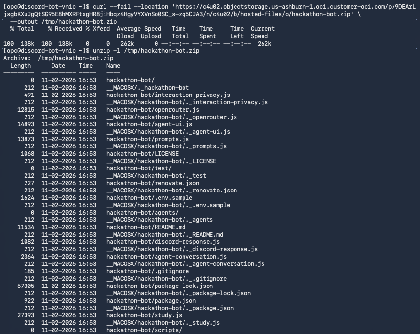

4. Extract the package into `/home/opc`. Because the ZIP already contains the `hackathon-bot/` folder, this places the files directly in `/home/opc/hackathon-bot` and preserves the wallet directory from Lab 1. Install production dependencies and create a private environment file.

    ```sh
    <copy>
    unzip -o /tmp/hackathon-bot.zip \
      -d /home/opc
    cd /home/opc/hackathon-bot
    npm ci --omit=dev
    cp .env.sample .env
    chmod 600 .env
    </copy>
    ```

    Keep the original `.env.sample` unchanged. Keep `.env` on Compute. Do not add it to the asset ZIP.

## Task 2: Create and Install a Discord Application

1. Open the [Discord Developer Portal](https://discord.com/developers/home), sign in, and select **Create**.

    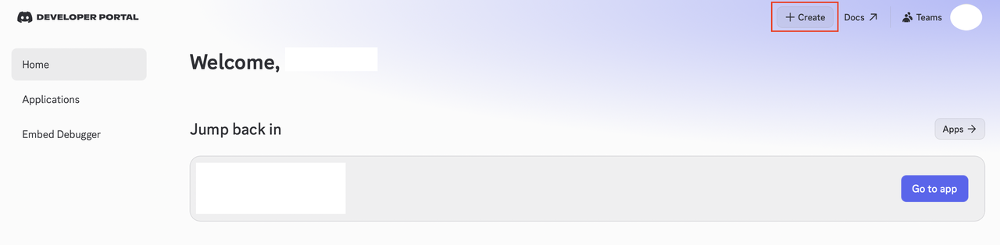

2. Under **Start building**, select **Create blank app**.

    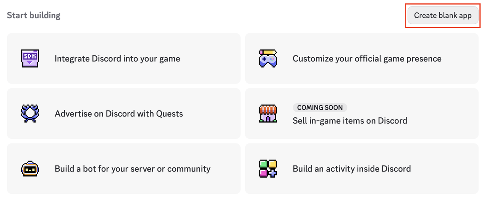

3. Enter an application name, review and accept the Discord Developer Terms of Service and Developer Policy, then select **Create**.

    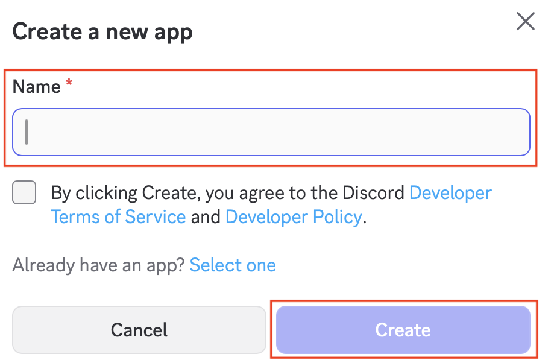

4. On **General Information**, copy the **Application ID** and **Public Key** into your password manager or another secure temporary location. The screenshot contains example identifiers; use the values from your application.

    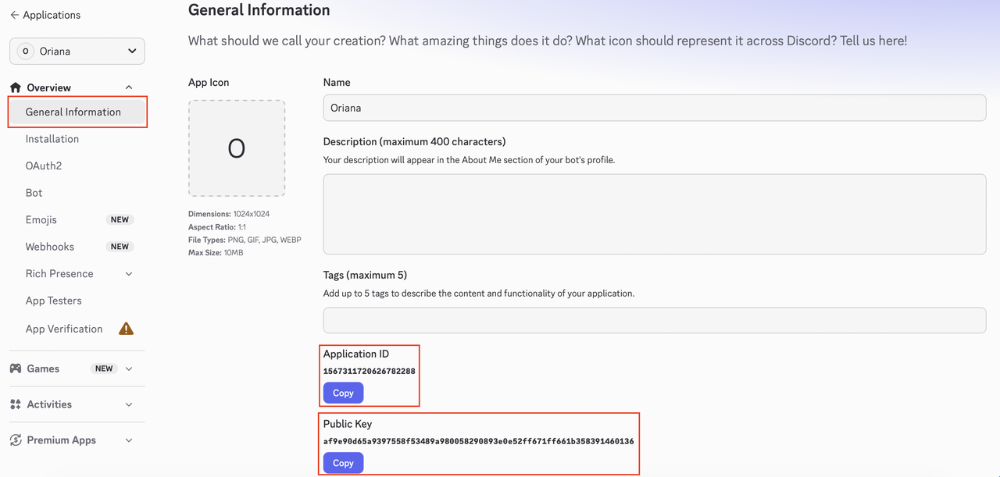

5. Select **Bot** from the left menu. Set the bot username if needed. In the **Token** section, select **Reset Token** to generate a token you can copy. Resetting a token immediately invalidates the previous token.

    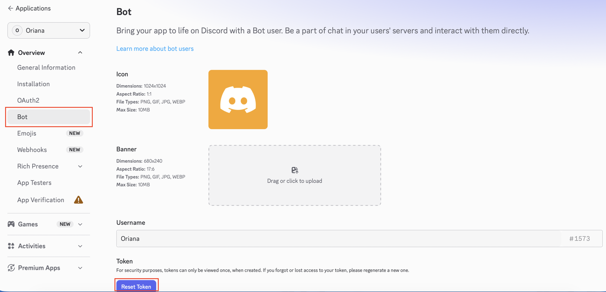

6. Confirm the reset by selecting **Yes, do it!**.

    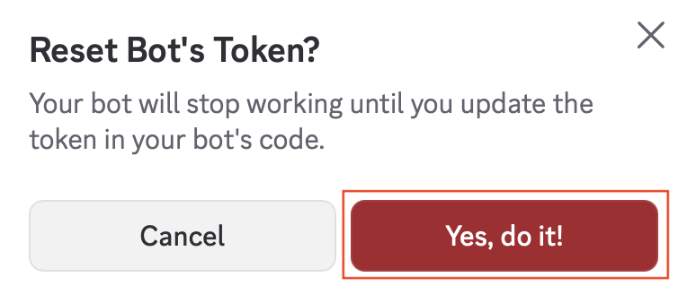

7. Select **Copy** and immediately save the new bot token in your password manager. Discord shows the complete token only when it is created or reset. Do not paste it into workshop notes, chat, or screenshots.

    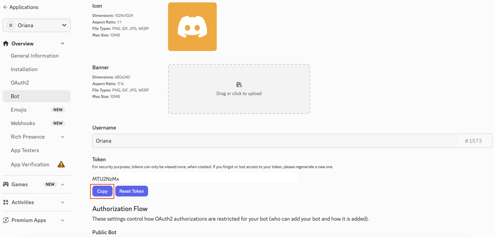

8. Select **Installation** and configure **Guild Install** with exactly these values:

    - **Scopes:** `applications.commands`, `bot`
    - **Permissions:** **View Channels**, **Send Messages**, **Read Message History**, **Attach Files**

    Remove every other permission, including **Ban Members** and **Create Polls**, then select **Save Changes**.

    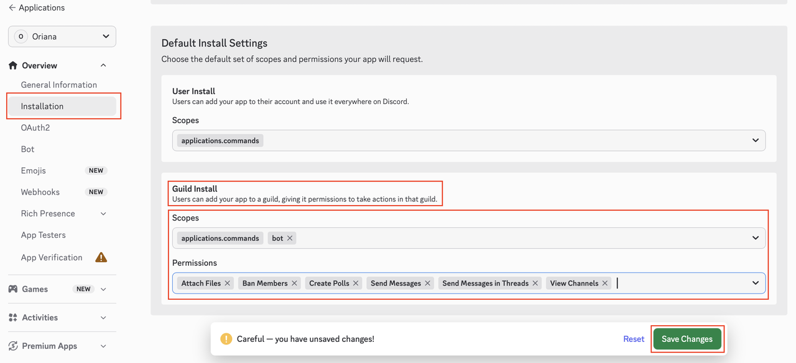

9. Install the bot in your private Discord server:

    - On **Installation**, scroll to **Install Link**, keep **Discord Provided Link**, and select the copy button.

        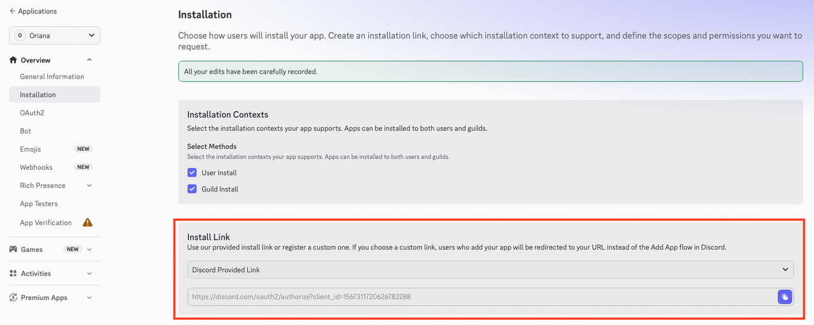

    - Open the copied link in your browser. If you shared the link through Discord, select the application card to open the authorization flow.

        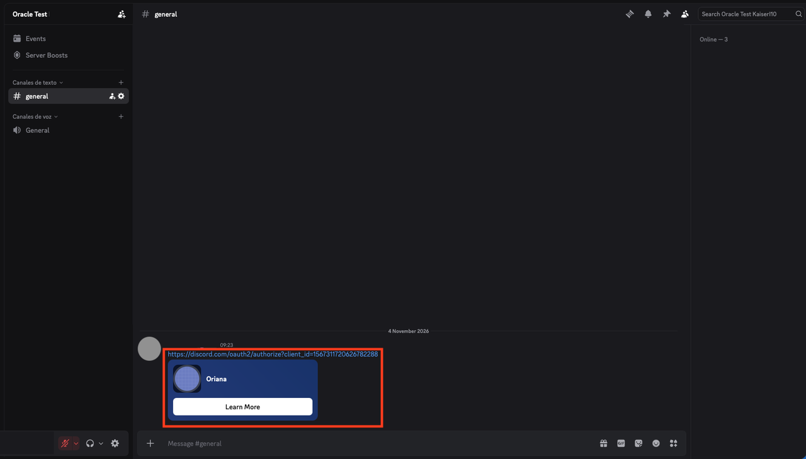

    - Select **Add to Server**.

        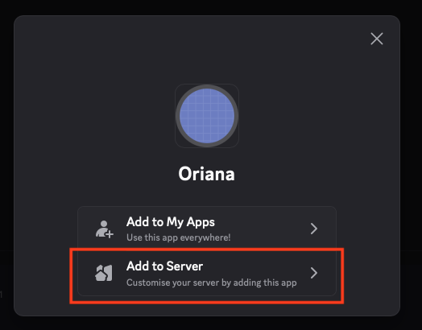

    - Under **Add to server**, select your private test server, then select **Continue**. You must have **Manage Server** permission in that server.

        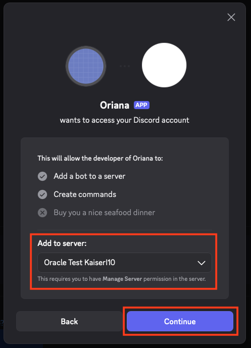

    - Review the authorization page. It must request only **View Channels**, **Send Messages**, **Read Message History**, and **Attach Files**. If it shows **Ban Members**, **Create Polls**, **Send Messages in Threads**, or another permission, close the dialog, return to Step 8, remove the extra permission, save the changes, and reopen the install link.

        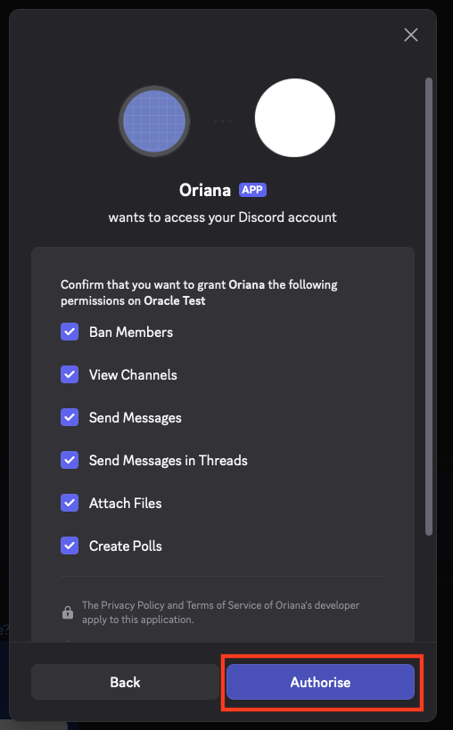

    - When the permissions match Step 8, select **Authorize**, complete the verification prompt, and confirm that the bot appears in the server member list.

10. Edit `.env` on Compute. Add the application ID, bot token, application public key, and port. Do not put credential values in workshop notes, chat, or the asset ZIP.

    ```text
    <copy>
    APP_ID=
    DISCORD_TOKEN=
    PUBLIC_KEY=
    PORT=3000
    </copy>
    ```

    The application ID is the Discord application identifier. The public key is in the app **General Information** page. The bot token is in the **Bot** page. These values serve different purposes.

11. Complete this step after Task 4 Step 3 starts the bot in the foreground:

    - Return to the Discord Developer Portal and open **General Information**.
    - In **Interactions Endpoint URL**, enter `https://<your-reserved-public-ip>/interactions`.
    - Replace `<your-reserved-public-ip>` with the reserved Compute IPv4 address from Lab 1. Do not include port `3000` in the public URL.
    - Keep the bot running and complete the endpoint checks in Task 4 Step 5. The public request must not return `502 Bad Gateway`.
    - Select **Save Changes**. Discord sends a signed verification request through Nginx to the bot.
    - Confirm that the portal accepts and saves the endpoint URL.

    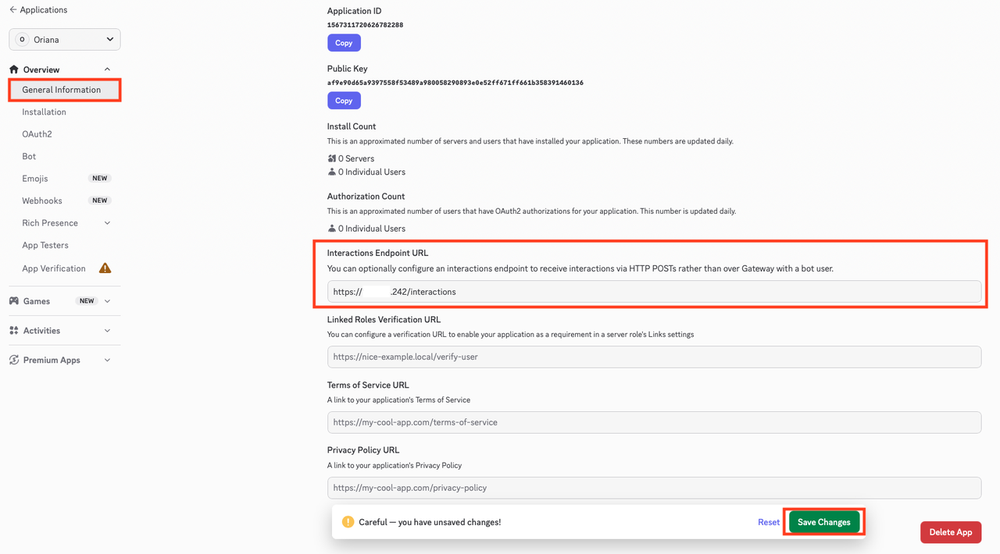

## Task 3: Configure OpenRouter

1. Add the OpenRouter API key and a model identifier available to your account. Keep the default agent data-collection preference set to `deny` unless you have reviewed and approved the provider policy.

    ```text
    <copy>
    OPENROUTER_API_KEY=
    OPENROUTER_MODEL=
    OPENROUTER_STUDY_MODEL=
    OPENROUTER_DATETIME_TIMEZONE=America/Mexico_City
    OPENROUTER_AGENT_DATA_COLLECTION=deny
    </copy>
    ```

    `OPENROUTER_STUDY_MODEL` is optional; the bot falls back to `OPENROUTER_MODEL`. The timezone is optional and uses an IANA timezone name. Check the current `.env.sample` for any new optional settings.

2. Save `.env`, then confirm its permissions.

    ```sh
    <copy>
    chmod 600 /home/opc/hackathon-bot/.env
    stat -c '%a %U %n' /home/opc/hackathon-bot/.env
    </copy>
    ```

    Expect mode `600` and owner `opc`. Do not print or screenshot the file contents.

## Task 4: Register Commands and Start the Bot

1. Register the current global slash commands from the application directory.

    ```sh
    <copy>
    cd /home/opc/hackathon-bot
    npm run register
    </copy>
    ```

2. Confirm that registration reports six commands: `/ask`, `/db`, `/research`, `/study`, `/oci`, and `/agent`.

3. Start the bot in the foreground.

    ```sh
    <copy>
    npm start
    </copy>
    ```

4. Keep this SSH session open. Confirm the logs show the HTTP listener on port `3000` and a successful Discord Gateway login.

5. Open a second SSH session and verify the bot locally and through Nginx. Replace `YOUR_RESERVED_PUBLIC_IP` with the reserved Compute IPv4 address.

    ```sh
    <copy>
    sudo ss -ltnp | grep ':3000'
    curl -i http://127.0.0.1:3000/interactions
    curl -i https://YOUR_RESERVED_PUBLIC_IP/interactions
    </copy>
    ```

    A browser-style `GET` request can return `401`, `404`, or `405` because Discord verification uses a signed `POST`. It must not return `502 Bad Gateway`. A `502` response means Nginx is available but cannot reach the bot on `127.0.0.1:3000`.

6. If the public request returns `502`, leave `npm start` running and check the listener, SELinux setting, Nginx configuration, and Nginx error log:

    ```sh
    <copy>
    sudo ss -ltnp | grep ':3000'
    getsebool httpd_can_network_connect
    sudo setsebool -P httpd_can_network_connect 1
    sudo nginx -t
    sudo systemctl reload nginx
    sudo tail -n 50 /var/log/nginx/error.log
    </copy>
    ```

    If nothing listens on port `3000`, return to the first SSH session and review the `npm start` error. Privately reopen `.env` and confirm that `APP_ID`, `DISCORD_TOKEN`, `PUBLIC_KEY`, and `PORT=3000` are set. The public key must come from **General Information**; it is not the bot token. Do not print, share, or screenshot `.env`.

7. Return to Task 2 Step 11. Keep `npm start` running while you save the interactions endpoint in the Discord Developer Portal. After Discord accepts it, run `/ask` in the test server with a short learning question. Mention the bot with a short question and confirm a reply.

8. Stop the foreground process with `Ctrl+C`. Lab 4 will run the bot under systemd.

## Data Handling Checkpoint

The bot sends `/ask`, `/research`, `/study`, `/oci`, and agent prompts to OpenRouter. It processes each attachment for the current request and does not store it permanently. Do not test with private information. Server replies appear to channel members.

## Acknowledgements

- Authors: Cyrce Salinas Rojas and Ilan Gómez Guerrero
- Last Updated: Ilan Gómez Guerrero, November 2026
