# Lab 2: Download the Bot and Configure Discord and OpenRouter

## Introduction

Download and configure the bot. Set up Discord and OpenRouter on Compute, register the slash commands, and start the app.

Estimated Time: 25 minutes.

### Objectives

In this lab, you will:

- Download and inspect the bot ZIP through the workshop object-scoped PAR.
- Configure Discord slash-command and interaction settings.
- Add OpenRouter settings without recording credential values in the workshop.
- Install locked dependencies, register seven commands, and start the bot.

### Prerequisites

- Finish Lab 1. You need system Node.js 24, SSH access, a reserved IP, and a valid IP certificate.
- The [hackathon-bot ZIP in OCI Object Storage](https://c4u02.objectstorage.us-ashburn-1.oci.customer-oci.com/p/9DEArLjsgbKXuJgQtSG95E8hMXRFtxgHR8jiHbqz4HgyVYXVnSo0SC_s-zq5CJA3/n/c4u02/b/hosted-files/o/hackathon-bot.zip).
- Discord Developer Portal access and a private test server.
- An OpenRouter API key and model name available to your account.

## Task 1: Download and Inspect the Bot Package

1. Open the [hackathon-bot ZIP link](https://c4u02.objectstorage.us-ashburn-1.oci.customer-oci.com/p/9DEArLjsgbKXuJgQtSG95E8hMXRFtxgHR8jiHbqz4HgyVYXVnSo0SC_s-zq5CJA3/n/c4u02/b/hosted-files/o/hackathon-bot.zip). Anyone with this link can download the file.

2. Download the package to the Compute host with the Object Storage PAR.

    ```sh
    <copy>
    curl --fail --location 'https://c4u02.objectstorage.us-ashburn-1.oci.customer-oci.com/p/9DEArLjsgbKXuJgQtSG95E8hMXRFtxgHR8jiHbqz4HgyVYXVnSo0SC_s-zq5CJA3/n/c4u02/b/hosted-files/o/hackathon-bot.zip' \
      --output /tmp/hackathon-bot.zip
    </copy>
    ```

3. Inspect the archive before extraction. Confirm its top-level folder is `hackathon-bot/`. Inside that folder, confirm it contains `.env.sample`, `LICENSE`, `package.json`, `package-lock.json`, `app.js`, `agents/`, and `db/`. Confirm it does not contain `.env`, wallets, keys, credentials, or `node_modules`.

    ```sh
    <copy>
    unzip -l /tmp/hackathon-bot.zip
    </copy>
    ```

    

4. Extract the package into `/home/opc`. Because the ZIP already contains the `hackathon-bot/` folder, this places the files directly in `/home/opc/hackathon-bot` and preserves the wallet directory from Lab 1. Install production dependencies and create a private environment file.

    ```sh
    <copy>
    unzip -o /tmp/hackathon-bot.zip \
      -d /home/opc
    cd /home/opc/hackathon-bot
    npm ci --omit=dev
    cp .env.sample .env
    chmod 600 .env
    </copy>
    ```

    Keep the original `.env.sample` unchanged. Keep `.env` on Compute. Do not add it to the asset ZIP.

## Task 2: Create and Install a Discord Application

1. Open the [Discord Developer Portal](https://discord.com/developers/home), sign in, and select **Create**.

    

2. Under **Start building**, select **Create blank app**.

    

3. Enter an application name, review and accept the Discord Developer Terms of Service and Developer Policy, then select **Create**.

    

4. On **General Information**, copy the **Application ID** and **Public Key** into your password manager or another secure temporary location. The screenshot contains example identifiers; use the values from your application.

    

5. Select **Bot** from the left menu. Set the bot username if needed. In the **Token** section, select **Reset Token** to generate a token you can copy. Resetting a token immediately invalidates the previous token.

    

6. Confirm the reset by selecting **Yes, do it!**.

    

7. Select **Copy** and immediately save the new bot token in your password manager. Discord shows the complete token only when it is created or reset. Do not paste it into workshop notes, chat, or screenshots.

    

8. Select **Installation** and configure **Guild Install** with exactly these values:

    - **Scopes:** `applications.commands`, `bot`
    - **Permissions:** **View Channels**, **Send Messages**, **Read Message History**, **Attach Files**

    Remove every other permission, including **Ban Members** and **Create Polls**, then select **Save Changes**.

    

9. Install the bot in your private Discord server:

    - On **Installation**, scroll to **Install Link**, keep **Discord Provided Link**, and select the copy button.

        

    - Open the copied link in your browser. If you shared the link through Discord, select the application card to open the authorization flow.

        

    - Select **Add to Server**.

        

    - Under **Add to server**, select your private test server, then select **Continue**. You must have **Manage Server** permission in that server.

        

    - Review the authorization page. It must request only **View Channels**, **Send Messages**, **Read Message History**, and **Attach Files**. If it shows **Ban Members**, **Create Polls**, **Send Messages in Threads**, or another permission, close the dialog, return to Step 8, remove the extra permission, save the changes, and reopen the install link.

        

    - When the permissions match Step 8, select **Authorize**, complete the verification prompt, and confirm that the bot appears in the server member list.

10. Edit `.env` on Compute. Add the application ID, bot token, application public key, and port. Do not put credential values in workshop notes, chat, or the asset ZIP.

    ```text
    <copy>
    APP_ID=
    DISCORD_TOKEN=
    PUBLIC_KEY=
    PORT=3000
    </copy>
    ```

    The application ID is the Discord application identifier. The public key is in the app **General Information** page. The bot token is in the **Bot** page. These values serve different purposes.

## Task 3: Configure OpenRouter

1. Open [OpenRouter](https://openrouter.ai/). Select **Sign up**. If you already have an account, select **Sign in** instead and continue with Step 6.

    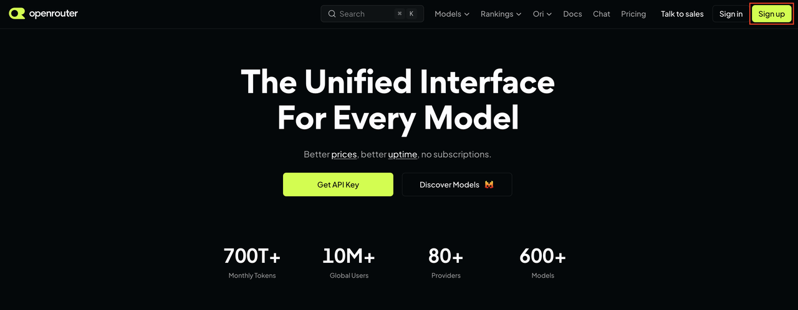

2. Create an account with an available identity provider or enter your email address and password. Review the linked terms and policies, accept them if appropriate, and select **Continue**.

    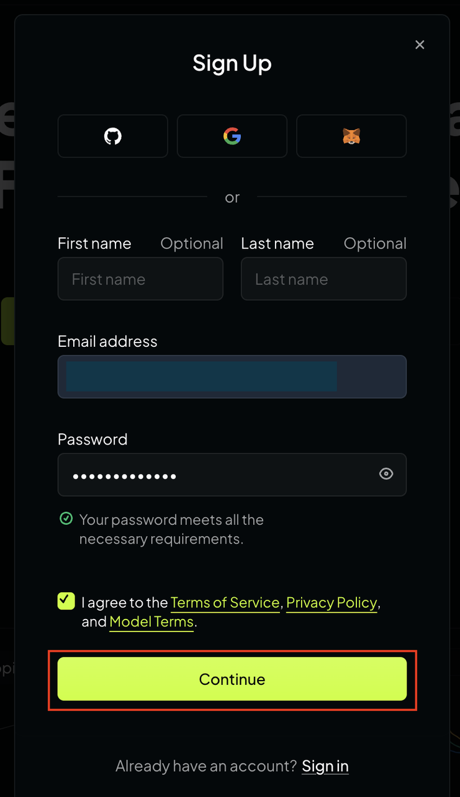

3. Select **Individual**, then select **Next**. Complete any additional profile prompts with the options appropriate for you until the payment page appears.

    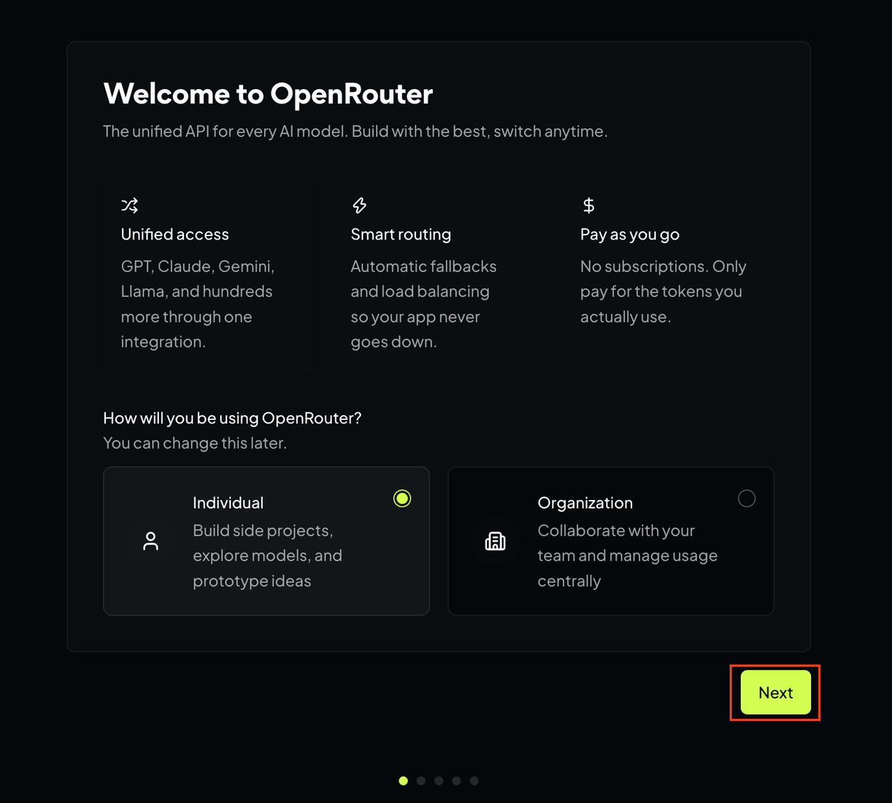

4. When OpenRouter offers payment setup, select **I'll do this later**. Adding a payment method is not required for the workshop setup. Complete any remaining onboarding prompts until OpenRouter confirms that the workspace is ready.

    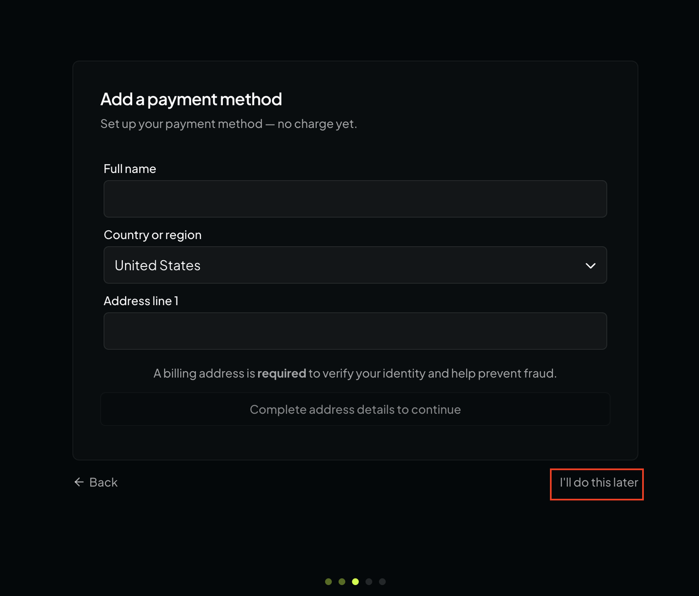

5. Select **Go to Dashboard**.

    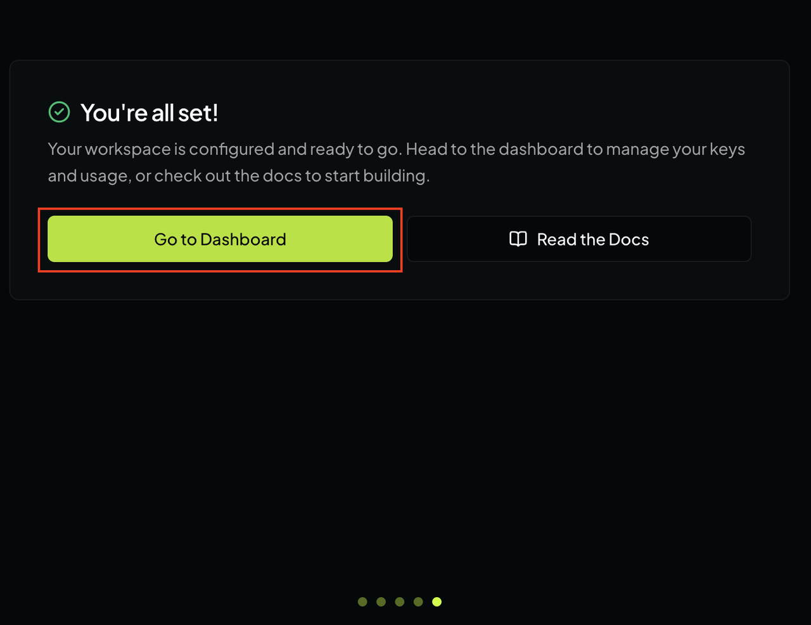

6. In the dashboard, select **API Keys**.

    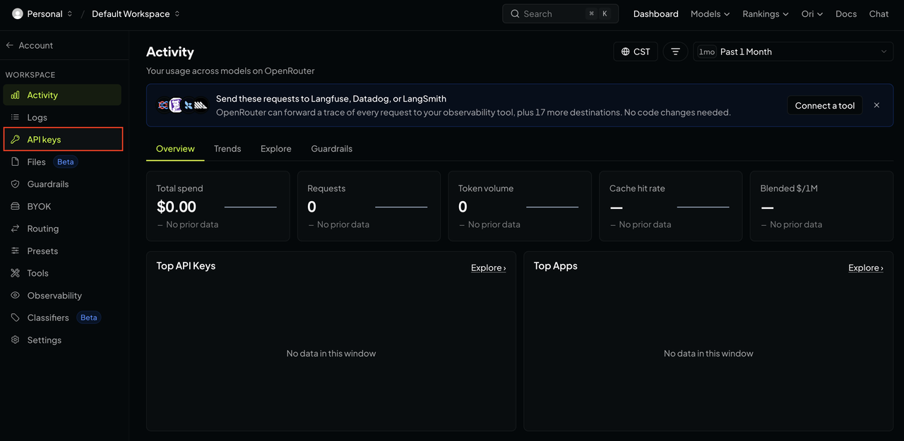

7. Select **New key**.

    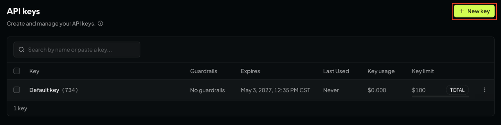

8. Enter `Oracle Agent Bot` as the key name. Choose an expiration and credit limit appropriate for this workshop, then select **Create**. Do not use an unlimited, non-expiring key unless your organization requires it.

    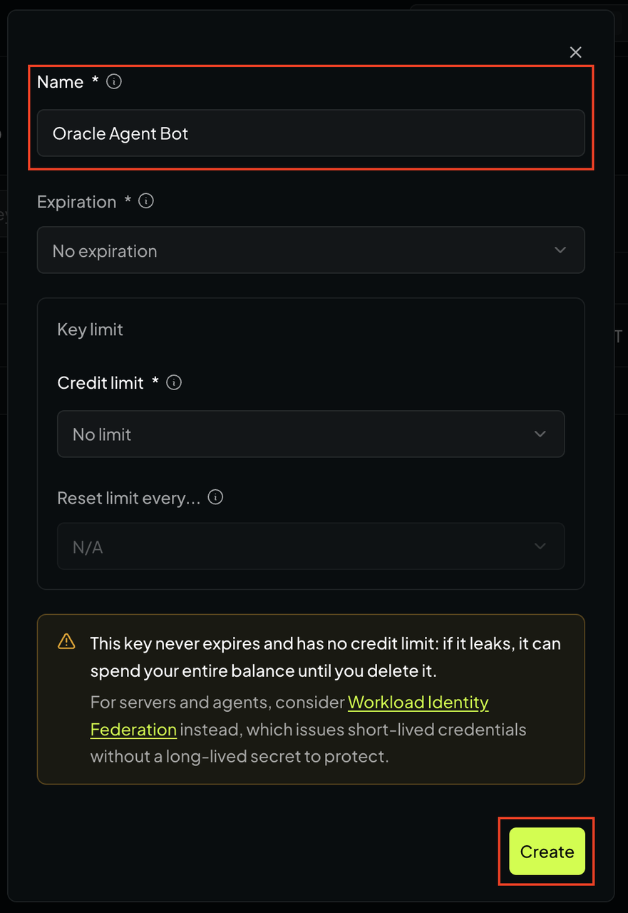

9. Select the copy icon. Store the key only in the protected `.env` file in the next step; OpenRouter does not display the complete key again.

    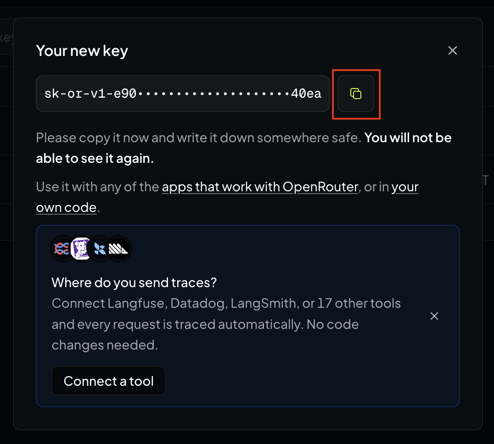

10. Use `openrouter/free` for this workshop. The [OpenRouter Free Models Router](https://openrouter.ai/openrouter/free) selects a currently available free model that supports the request. This avoids depending on one free model that may later be removed. Free requests are rate-limited and the selected model can change between requests. For a fixed model, choose one from the [current free-model collection](https://openrouter.ai/collections/free-models) and copy its identifier, including the `:free` suffix when shown.

    In the SSH session, open the bot environment file.

    ```sh
    <copy>
    nano /home/opc/hackathon-bot/.env
    </copy>
    ```

11. Add the OpenRouter settings. Replace `YOUR_OPENROUTER_API_KEY` with the key copied in Step 9. Keep the key on the same line as the variable name and do not add spaces around `=`.

    ```text
    <copy>
    OPENROUTER_API_KEY=YOUR_OPENROUTER_API_KEY
    OPENROUTER_MODEL=openrouter/free
    OPENROUTER_STUDY_MODEL=
    OPENROUTER_DATETIME_TIMEZONE=America/Mexico_City
    OPENROUTER_AGENT_DATA_COLLECTION=deny
    OPENROUTER_MEMORY_MODEL=
    </copy>
    ```

    | Variable | Required | Purpose |
    | --- | --- | --- |
    | `OPENROUTER_API_KEY` | Yes | Authenticates the bot with OpenRouter. Treat it as a secret and never place it in screenshots, workshop notes, or chat. |
    | `OPENROUTER_MODEL` | Yes | Sets the default model for the bot's AI requests. `openrouter/free` routes each request to a compatible free model available at that time. |
    | `OPENROUTER_STUDY_MODEL` | No | Overrides the model used by `/study`. Leave it empty to use `OPENROUTER_MODEL`. |
    | `OPENROUTER_DATETIME_TIMEZONE` | No | Sets the IANA timezone used by the bot's datetime tool. Replace the example with your timezone if needed. An invalid value falls back to `America/New_York`. |
    | `OPENROUTER_AGENT_DATA_COLLECTION` | No | Controls provider eligibility for `/agent`. Keep `deny` so agent requests use providers that do not collect data. Use `allow` only after reviewing the provider policy. Any other value is treated as `deny`. |
    | `OPENROUTER_MEMORY_MODEL` | No | Selects a separate model for optional user-memory decisions and validation. This workshop does not enable user memory, so leave it empty. |

    With `OPENROUTER_AGENT_DATA_COLLECTION=deny`, the free router has fewer eligible providers. A request can fail temporarily if no compatible free provider satisfies both the requested features and the data policy.

12. Save `.env`, then confirm its permissions.

    ```sh
    <copy>
    chmod 600 /home/opc/hackathon-bot/.env
    stat -c '%a %U %n' /home/opc/hackathon-bot/.env
    </copy>
    ```

    Expect mode `600` and owner `opc`. Do not print or screenshot the file contents.

## Task 4: Register Commands and Start the Bot

1. Register the current global slash commands from the application directory.

    ```sh
    <copy>
    cd /home/opc/hackathon-bot
    npm run register
    </copy>
    ```

2. Confirm that registration reports seven commands: `/ask`, `/db`, `/research`, `/study`, `/oci`, `/agent`, and `/memory`.

    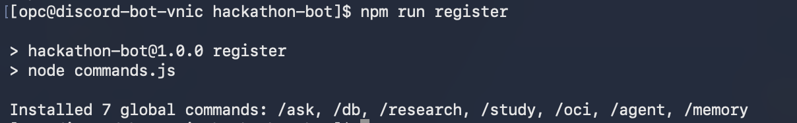

3. Start the bot in the foreground.

    ```sh
    <copy>
    npm start
    </copy>
    ```

4. Keep this SSH session open. Confirm that the terminal reports `Listening on port 3000`. This bot receives Discord interactions through HTTPS and does not require a Discord Gateway login. Leave `npm start` running while Discord verifies the endpoint.

5. Configure the Discord endpoint:

    - Return to the Discord Developer Portal and open **General Information**.
    - In **Interactions Endpoint URL**, enter `https://<your-reserved-public-ip>/interactions`.
    - Replace `<your-reserved-public-ip>` with the reserved Compute IPv4 address from Lab 1. Do not include port `3000` in the public URL.
    - Select **Save Changes**. Discord immediately sends a signed verification request through Nginx to the running bot.
    - Confirm that the portal accepts and saves the URL. This confirms that the public IP, HTTPS certificate, Nginx proxy, bot process, and Discord signature verification work together.

    

    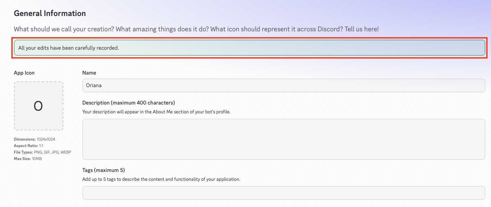

6. If Discord rejects the URL, keep `npm start` running and review its terminal output. Check these values before trying again:

    - The URL uses the reserved public IP assigned to this Compute instance.
    - OCI ingress allows TCP port `443`.
    - The HTTPS certificate covers the reserved public IP and has not expired.
    - Nginx is running with the configuration created in Lab 1.
    - `PUBLIC_KEY` exactly matches the application public key on **General Information**. It is not the bot token.

    Do not continue until Discord accepts and saves the URL.

7. Run `/ask` in the test server with a short learning question. Confirm that the bot replies.

8. Stop the foreground process with `Ctrl+C`. Lab 4 will run the bot under systemd.

## Data Handling Checkpoint

The bot sends `/ask`, `/research`, `/study`, `/oci`, and agent prompts to OpenRouter. It processes each attachment for the current request and does not store it permanently. Do not test with private information. Server replies appear to channel members.

## Acknowledgements

- Authors: Cyrce Salinas Rojas and Ilan Gómez Guerrero
- Last Updated: Ilan Gómez Guerrero, November 2026
