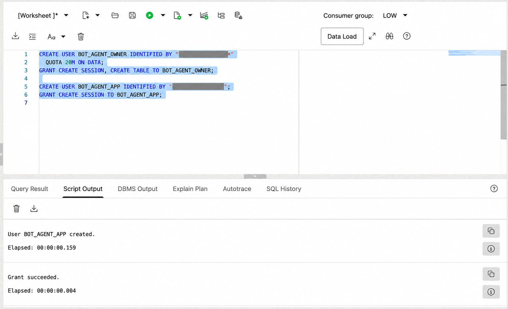
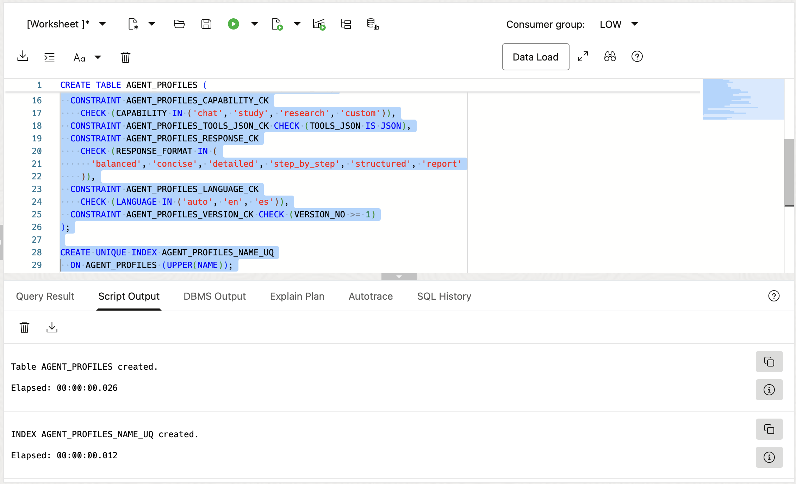
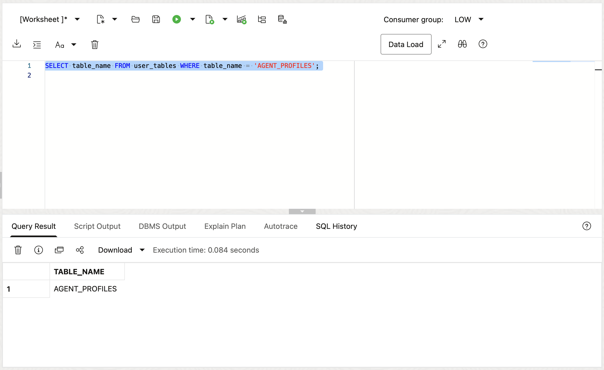
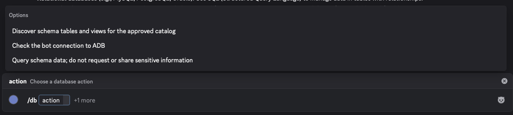

# Lab 3: Set Up Agent Profiles

## Introduction

Connect the bot to Autonomous Database and create `AGENT_PROFILES`. This lab uses one schema file: `agent-store-schema.sql`. Run it in OCI Database Actions SQL Worksheet as the schema owner. The recommended setup uses one database user. Separate owner and runtime accounts are optional. The `/db` test scans `AGENT_PROFILES` metadata. It does not query rows.

Estimated Time: 30 minutes.

### Objectives

In this lab, you will:

- Use one database user or optionally separate the schema owner and bot account.
- Run `agent-store-schema.sql` through OCI Database Actions SQL Worksheet.
- Grant the bot account access to the agent profile table.
- Configure the bot to use node-oracledb Thin mode and the Autonomous Database wallet.
- Verify the agent table with the `/db` schema scan.

### Prerequisites

- Finish Labs 1 and 2. Extract the bot package on Compute.
- Autonomous Database is available, and its wallet ZIP is on Compute.
- Turn on Database Actions for the Autonomous Database.
- Database credentials for one account, or temporary credentials for optional separate accounts.

## Task 1: Choose the Database Users

1. Choose one of these account layouts:

    - **One user—recommended for this workshop:** Use the provided non-`ADMIN` user to own `AGENT_PROFILES` and connect the bot. The optional `AGENT_STORE_*` settings will fall back to `ADB_USER` and `ADB_PASSWORD`.
    - **Separate users—optional:** Create one schema owner and one bot runtime account. `BOT_AGENT_OWNER` and `BOT_AGENT_APP` are example Oracle usernames, not `.env` variable names.

2. To create separate users, connect to Database Actions SQL Worksheet as `ADMIN`. Replace the password markers and run this block. `BOT_AGENT_OWNER` and `BOT_AGENT_APP` are example names; you can choose others.

    ```sql
    <copy>
    CREATE USER BOT_AGENT_OWNER IDENTIFIED BY "<TEMP_OWNER_PASSWORD>"
      QUOTA 20M ON DATA;
    GRANT CREATE SESSION, CREATE TABLE TO BOT_AGENT_OWNER;

    CREATE USER BOT_AGENT_APP IDENTIFIED BY "<TEMP_APP_PASSWORD>";
    GRANT CREATE SESSION TO BOT_AGENT_APP;
    </copy>
    ```

    Use temporary passwords that you do not use elsewhere; SQL Actions may retain statement history. A password must not contain its username or parts such as `BOT`, `AGENT`, `OWNER`, or `APP`. Skip this step if you will use one existing user.

    

3. Before Task 2, make sure the table owner can sign in to Database Actions. In **Administration > Database Users**, enable **Web Access** for that user. The bot account does not need Web Access. If you use the provided user, confirm Web Access is already enabled. See [Oracle Database Actions access instructions](https://docs.oracle.com/en/cloud/paas/autonomous-database/serverless/adbsb/connect-database-actions.html).

## Task 2: Create the Agent Profile Table

1. In Database Actions, connect as the provided ADB_* user or your custom table owner. Run the fresh-install `agent-store-schema.sql` below with **Run Script**. This user needs `CREATE TABLE` and a table quota. The script creates `AGENT_PROFILES`, which stores settings so `/agent` can reload profiles after restarts. Use it only when that table does not already exist.

    ```sql
    <copy>
    CREATE TABLE AGENT_PROFILES (
      AGENT_ID VARCHAR2(36 CHAR) NOT NULL,
      OWNER_USER_ID VARCHAR2(32 CHAR) NOT NULL,
      NAME VARCHAR2(32 CHAR) NOT NULL,
      GOAL VARCHAR2(1000 CHAR) NOT NULL,
      STYLE VARCHAR2(300 CHAR) NOT NULL,
      CAPABILITY VARCHAR2(16 CHAR) NOT NULL,
      PRESET VARCHAR2(32 CHAR) DEFAULT 'custom' NOT NULL,
      TOOLS_JSON VARCHAR2(500 CHAR) DEFAULT '[]' NOT NULL,
      RESPONSE_FORMAT VARCHAR2(32 CHAR) DEFAULT 'balanced' NOT NULL,
      LANGUAGE VARCHAR2(8 CHAR) DEFAULT 'auto' NOT NULL,
      VERSION_NO NUMBER(10) DEFAULT 1 NOT NULL,
      CREATED_AT TIMESTAMP WITH TIME ZONE DEFAULT SYSTIMESTAMP NOT NULL,
      UPDATED_AT TIMESTAMP WITH TIME ZONE DEFAULT SYSTIMESTAMP NOT NULL,
      CONSTRAINT AGENT_PROFILES_PK PRIMARY KEY (AGENT_ID),
      CONSTRAINT AGENT_PROFILES_CAPABILITY_CK
        CHECK (CAPABILITY IN ('chat', 'study', 'research', 'custom')),
      CONSTRAINT AGENT_PROFILES_TOOLS_JSON_CK CHECK (TOOLS_JSON IS JSON),
      CONSTRAINT AGENT_PROFILES_RESPONSE_CK
        CHECK (RESPONSE_FORMAT IN (
          'balanced', 'concise', 'detailed', 'step_by_step', 'structured', 'report'
        )),
      CONSTRAINT AGENT_PROFILES_LANGUAGE_CK
        CHECK (LANGUAGE IN ('auto', 'en', 'es')),
      CONSTRAINT AGENT_PROFILES_VERSION_CK CHECK (VERSION_NO >= 1)
    );
    
    CREATE UNIQUE INDEX AGENT_PROFILES_NAME_UQ
      ON AGENT_PROFILES (UPPER(NAME));
    </copy>
    ```

    

2. If you created a separate bot account, stay connected as the table owner and grant it access. Replace `BOT_AGENT_APP` if you chose a different name. Skip this step when one user owns and uses the table:

    ```sql
    <copy>
    GRANT SELECT, INSERT, UPDATE, DELETE ON AGENT_PROFILES TO BOT_AGENT_APP;
    </copy>
    ```

3. Confirm the table exists:

    ```sql
    <copy>
    SELECT table_name FROM user_tables WHERE table_name = 'AGENT_PROFILES';
    </copy>
    ```

    

## Task 3: Configure Bot Database Access

1. On Compute, identify a service name in the wallet file `tnsnames.ora`. Use the matching `*_low` service alias for the workshop.

    ```sh
    <copy>
    grep -E '^[A-Za-z0-9_-]+_low[[:space:]]*=' \
      /home/opc/hackathon-bot/wallet/tnsnames.ora
    </copy>
    ```

2. Edit `/home/opc/hackathon-bot/.env` and choose one configuration below. Enter the wallet password from Lab 1.

    **One user—recommended:** Set the required `ADB_*` values. Leave the optional agent-store and catalog values empty. The bot uses `ADB_USER` and `ADB_PASSWORD` for the agent store, and scans the schema owned by `ADB_USER`.

    ```text
    <copy>
    ADB_USER=<PROVIDED_DATABASE_USER>
    ADB_PASSWORD=<PROVIDED_DATABASE_USER_PASSWORD>
    ADB_CONNECT_STRING=<TNS_ALIAS_FROM_WALLET>
    ADB_WALLET_DIR=/home/opc/hackathon-bot/wallet
    ADB_WALLET_PASSWORD=<WALLET_PASSWORD_FROM_LAB_1>
    ADB_CATALOG_OWNER=
    AGENT_STORE_USER=
    AGENT_STORE_PASSWORD=
    AGENT_STORE_OWNER=
    </copy>
    ```

    **Separate users—optional:** Connect as `BOT_AGENT_APP` and point the catalog and agent store to the schema owned by `BOT_AGENT_OWNER`. The blank `AGENT_STORE_USER` and `AGENT_STORE_PASSWORD` values still fall back to `ADB_USER` and `ADB_PASSWORD`.

    ```text
    <copy>
    ADB_USER=BOT_AGENT_APP
    ADB_PASSWORD=<BOT_AGENT_APP_PASSWORD>
    ADB_CONNECT_STRING=<TNS_ALIAS_FROM_WALLET>
    ADB_WALLET_DIR=/home/opc/hackathon-bot/wallet
    ADB_WALLET_PASSWORD=<WALLET_PASSWORD_FROM_LAB_1>
    ADB_CATALOG_OWNER=BOT_AGENT_OWNER
    AGENT_STORE_USER=
    AGENT_STORE_PASSWORD=
    AGENT_STORE_OWNER=BOT_AGENT_OWNER
    </copy>
    ```

    | Optional variable | When empty |
    | --- | --- |
    | `AGENT_STORE_USER` | Uses `ADB_USER`. |
    | `AGENT_STORE_PASSWORD` | Uses `ADB_PASSWORD`. |
    | `AGENT_STORE_OWNER` | Uses `ADB_USER`. Set it when another user owns `AGENT_PROFILES`. |
    | `ADB_CATALOG_OWNER` | Uses `ADB_USER`. Set it when `/db` must scan another user's schema. |

3. Confirm that `.env` still contains your Discord and OpenRouter settings from Lab 2. Set mode `600` again and do not display the file contents.

    ```sh
    <copy>
    chmod 600 /home/opc/hackathon-bot/.env
    stat -c '%a %U %n' /home/opc/hackathon-bot/.env
    </copy>
    ```

4. Start the bot temporarily in the foreground with `npm start` from the bot directory. Check its output for errors and leave it running for the scan in Task 4. Lab 4 stops this process and enables the permanent systemd service. Node-oracledb uses Thin mode by default; the bot does not require Oracle Instant Client.

## Task 4: Verify the Agent Profile Schema

1. In the Discord test server, enter `/db`. For **action**, select **Discover schema tables and views for the approved catalog**. This is the `scan` action.

    

2. Submit the command. Confirm that the response includes `AGENT_PROFILES` from the selected table-owner schema.

3. Leave the foreground bot process running. Lab 4 stops it before creating the permanent systemd service.

## Acknowledgements

- Authors: Cyrce Salinas Rojas and Ilan Gómez Guerrero
- Last Updated: Ilan Gómez Guerrero, November 2026
