# Lab 4: Run the Bot as a Service and Verify Its Features

## Introduction

Test the bot under systemd. Check Discord, model, and agent features, then review the service logs.

Estimated Time: 30 minutes.

### Objectives

In this lab, you will:

- Run the application as the `opc` user and load its protected `.env` file through the application.
- Confirm the Nginx HTTPS proxy and Discord interaction handshake.
- Test the configured bot commands, bot mentions, file handling, and agent privacy behavior.
- Review service status, logs, and restart behavior.

### Prerequisites

- Completion of Labs 1 through 3.
- A PAR, Discord app, OpenRouter settings, database wallet, agent schema, and reserved IP certificate.
- The reserved Compute public IPv4 address and a valid, renewed Let’s Encrypt IP certificate.
- A private Discord server where you can test all bot features.

## Task 1: Check the Asset Link and Register Commands

1. Confirm that the Object Storage link in Lab 2 downloads the ZIP. Confirm the ZIP contains the approved source package and has no `.env`, wallet, credentials, private keys, or `node_modules`.

2. Set `opc` as the owner of `.env`, restrict the file to that user, and confirm that the application user can read it. Do not print the file contents.

    ```sh
    <copy>
    sudo chown opc:opc /home/opc/hackathon-bot/.env
    chmod 600 /home/opc/hackathon-bot/.env
    stat -c '%a %U %n' /home/opc/hackathon-bot/.env
    sudo -u opc test -r /home/opc/hackathon-bot/.env && echo '.env is readable by opc'
    </copy>
    ```

    The output must show mode `600`, owner `opc`, and `.env is readable by opc`.

3. Register the commands after any configuration changes.

    ```sh
    <copy>
    cd /home/opc/hackathon-bot
    npm run register
    </copy>
    ```

## Task 2: Create and Start the systemd Service

1. Stop the foreground process from Lab 3 with `Ctrl+C`.

2. Create the service file. This command writes the unit to `/etc/systemd/system/discord-example.service` and runs the bot as the unprivileged `opc` user. The application imports `dotenv/config`, so Node reads `.env` from the working directory. Do not add an `EnvironmentFile=` entry; direct systemd access to files under `/home/opc` can be rejected by the operating-system security policy.

    ```sh
    <copy>
    sudo tee /etc/systemd/system/discord-example.service >/dev/null <<'EOF'
    [Unit]
    Description=Discord learning bot
    After=network-online.target nginx.service
    Wants=network-online.target nginx.service

    [Service]
    Type=simple
    User=opc
    Group=opc
    WorkingDirectory=/home/opc/hackathon-bot
    ExecStart=/usr/bin/node /home/opc/hackathon-bot/app.js
    Restart=on-failure
    RestartSec=5
    NoNewPrivileges=true
    PrivateTmp=true

    [Install]
    WantedBy=multi-user.target
    EOF
    </copy>
    ```

    Lab 1 installs system-wide Node at `/usr/bin/node`. If `command -v node` reports another path, update `ExecStart` to that absolute path.

3. Reload systemd, enable the service, and restart it. The restart ensures that systemd uses the unit you just created and that Node reloads `.env`.

    ```sh
    <copy>
    sudo systemctl daemon-reload
    sudo systemctl enable discord-example.service
    sudo systemctl restart discord-example.service
    sudo systemctl is-active discord-example.service
    sudo systemctl is-enabled discord-example.service
    </copy>
    ```

4. Review only the log entries from the current start and confirm that the bot reports `Listening on port 3000`. This application uses Discord HTTP interactions and does not require a Discord Gateway login.

    ```sh
    <copy>
    sudo journalctl -u discord-example.service --since '5 minutes ago' --no-pager
    sudo ss -ltnp | grep ':3000'
    </copy>
    ```

    Confirm that the service is active and that Node is listening on port `3000` before continuing.

    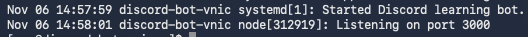

5. Confirm Nginx is active and can proxy to the bot on port 3000. From the Compute host, check the service and configuration if requests fail.

    ```sh
    <copy>
    sudo systemctl is-active nginx
    sudo nginx -t
    sudo journalctl -u nginx -n 40 --no-pager
    </copy>
    ```

    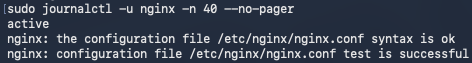

## Task 3: Verify the Discord Endpoint and Bot Features

1. In the Discord Developer Portal, confirm that **Interactions Endpoint URL** remains set to `https://<your-public-ip>/interactions`, using the reserved IP from Lab 1. Lab 2 saved and verified this URL while the bot was running in the foreground. The systemd service now handles the same endpoint.

2. In the private test server, enter `/` and confirm that the registered bot commands appear.

    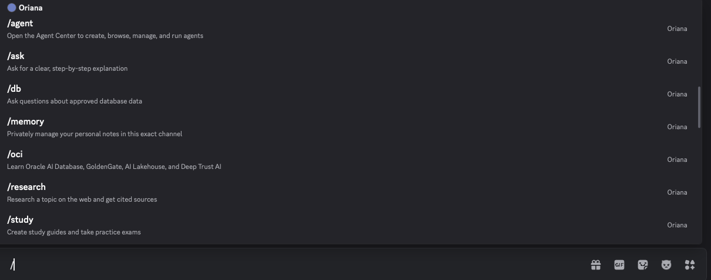

    Run `/ask` with a short learning question and confirm that the bot responds.

    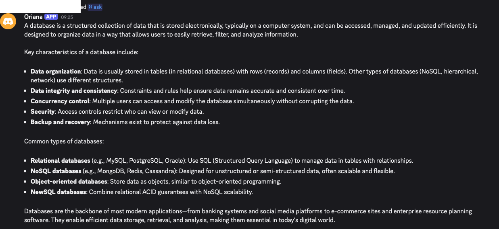

    Mention the bot in a message and confirm that it responds once.

    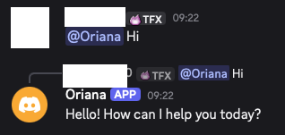

3. Run `/research` with a non-sensitive topic. Confirm the response contains source links.

    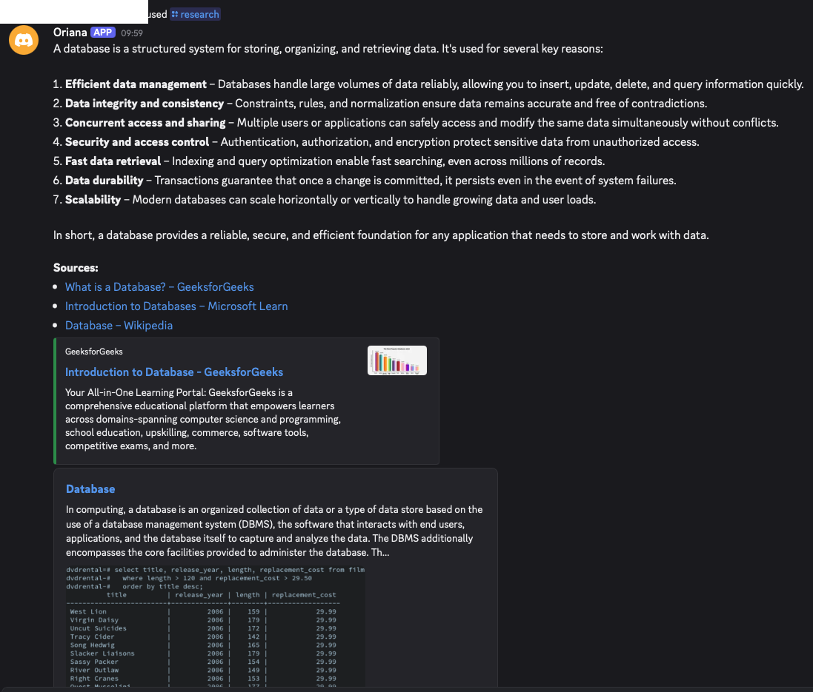

4. Run `/study`. Select **Guide: Create a study guide**, enter a non-sensitive topic, and submit the command.

    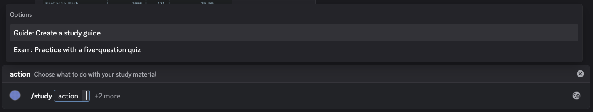

    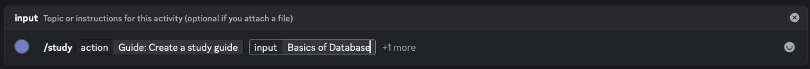

    Confirm that the bot returns the study guide as a Markdown attachment.

    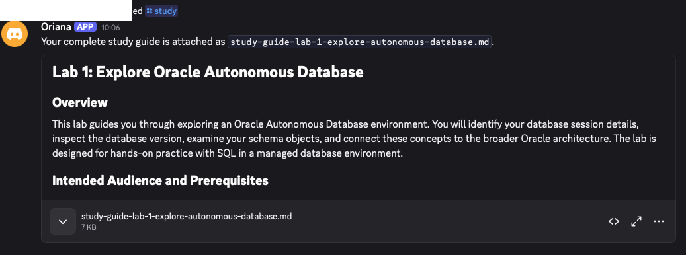

5. Run `/study` again with a non-sensitive PDF, TXT, Markdown, CSV, or JSON file. The file must not exceed 8 MB. Select **Exam: Practice with a five-question quiz**, submit the command, and answer the questions.

    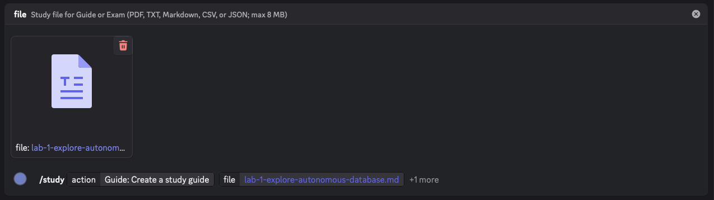

    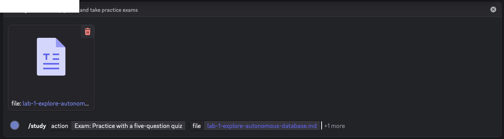

    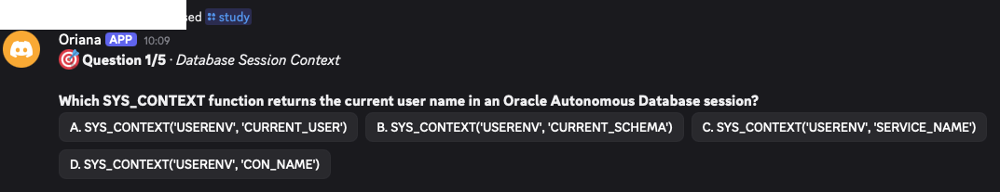

6. Run `/oci` with one of its supported topics: Oracle AI Database, GoldenGate, AI Lakehouse, or Deep Trust AI. Enter a technical question about the selected topic and submit the command.

    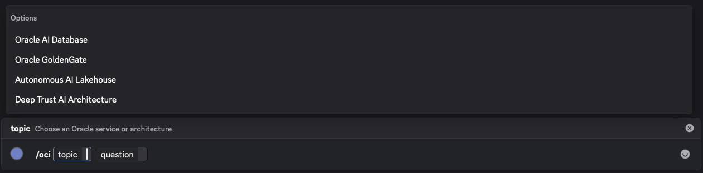

    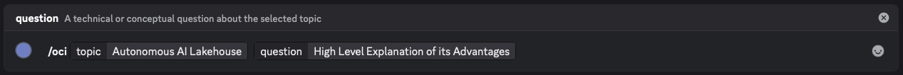

    Confirm that the response uses the selected topic. A long response can arrive as a Markdown attachment.

    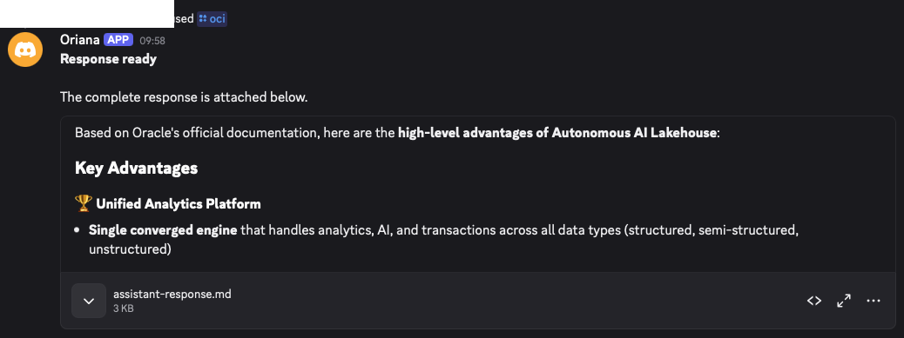

7. Lab 3 Task 4 verifies the `/db` schema scan. Skip `/db` status and lookup; this workshop tests only the scan.

8. Enter `/agent` and submit the command. Confirm that the private Agent Center displays **Run agent**, **Create agent**, and **Browse agents**.

    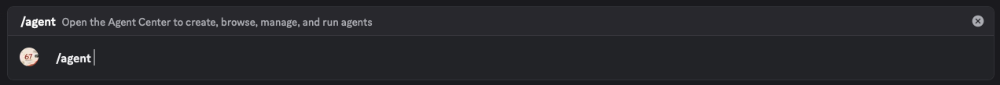

    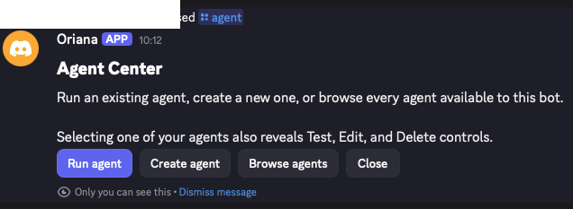

9. Select **Create agent**. Enter a non-sensitive name, goal, and response style. Select a preset and response language, submit the form, review the preview, and save the agent.

    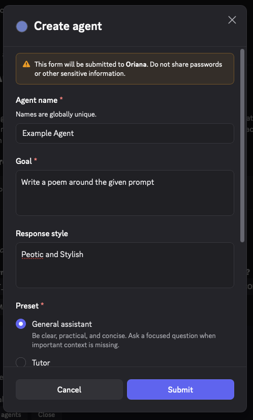

    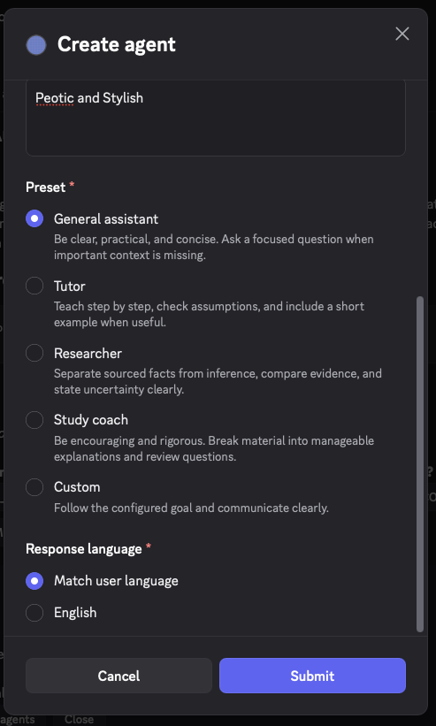

    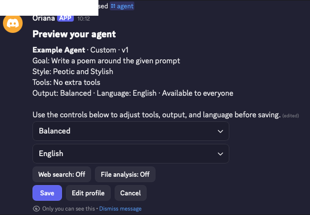

    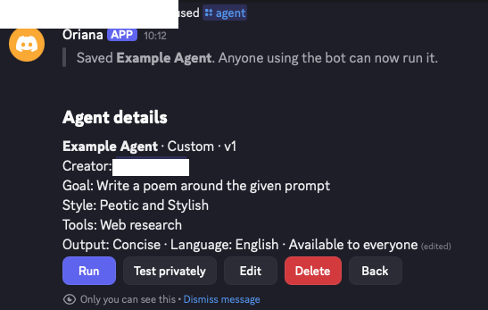

10. Select **Test privately** and enter a sample request. Confirm that the response says **Only you can see this**. Select **Edit**, change one profile field, and save the update.

    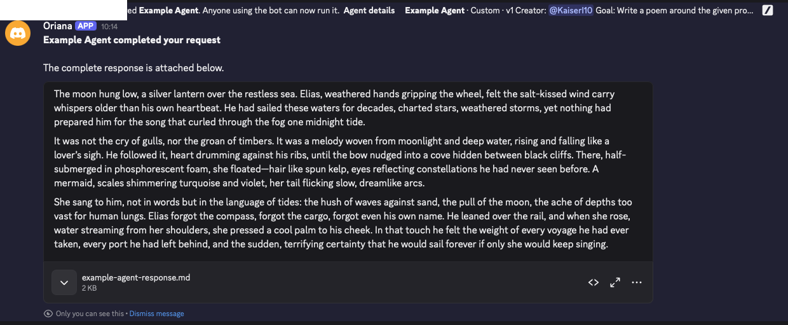

    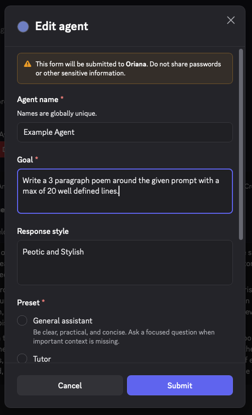

11. Return to **Run agent**, select the saved agent, and enter a non-sensitive request. Confirm that the normal response is visible in the server channel. Then browse the agent, review its details, and delete the workshop test agent.

    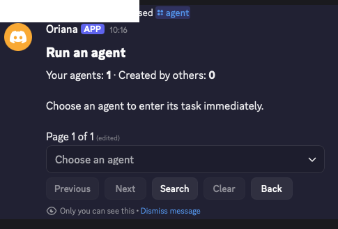

    

    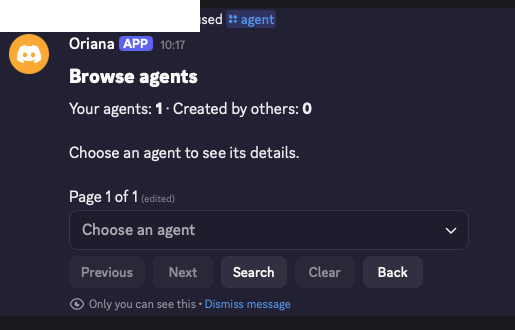

    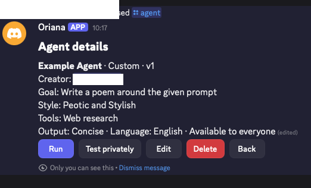

    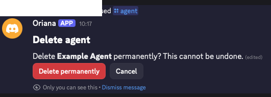

12. Ask for another long answer if neither previous test produced an attachment. Confirm that the bot sends a Markdown attachment when the response exceeds the Discord message limit.

13. Check data handling. Model prompts go to OpenRouter. Agent profiles remain in Autonomous Database. Channel members can see normal agent runs. Use no private learner, customer, or production data.

## Acknowledgements

- Authors: Cyrce Salinas Rojas and Ilan Gómez Guerrero
- Last Updated: Ilan Gómez Guerrero, November 2026
